# 程序设计基础 II（MIPS 汇编）复习题集

> 依据教材《程序设计基础 II 教程（MIPS 汇编语言）》（南京理工大学）与《MIPS课件》汇编语言课件 01–10 编写。
> 命题重心：**MIPS 架构与指令、寻址与地址计算、伪代码翻译、算法实现、栈与函数调用、递归与异常**。
> 模拟器（PCSpim/MARS）考试比重很低，第 04 讲仅作了解。

## 一、题量与题型统计

| 文件 | 对应来源 | 单选 | 多选 | 填空 | 判断 | 简答 | 计算/编码 | 代码转换 | 读程序 | 编程 | 作图 | 小计 |
|---|---|---|---|---|---|---|---|---|---|---|---|---|
| 01_概述.md | P1–P32 | 15 | 3 | 15 | 10 | 6 | 2 | 0 | 0 | 0 | 3 | 54 |
| 02_MIPS架构.md | P33–P73 | 22 | 4 | 18 | 10 | 8 | 8 | 4 | 2 | 0 | 5 | 81 |
| 03_寻址方式与指令集.md | P74–P123 | 28 | 5 | 20 | 11 | 11 | 8 | 21 | 3 | 2 | 4 | 113 |
| 04_模拟器.md | P124–P148（了解） | 3 | 1 | 3 | 2 | 1 | 0 | 0 | 1 | 0 | 1 | 12 |
| 05_伪代码.md | P149–P173 | 18 | 3 | 20 | 10 | 10 | 2 | 16 | 5 | 6 | 4 | 94 |
| 06_数制.md | P174–P194 | 16 | 3 | 16 | 8 | 6 | 14 | 3 | 4 | 4 | 3 | 77 |
| 07_算法一.md | P195–P224 | 12 | 2 | 12 | 6 | 8 | 2 | 6 | 5 | 11 | 3 | 67 |
| 08_算法二.md | P225–P251 | 10 | 2 | 10 | 6 | 6 | 0 | 4 | 5 | 8 | 3 | 54 |
| 09_函数调用与栈.md | P252–P279 | 16 | 3 | 18 | 8 | 10 | 4 | 5 | 6 | 8 | 4 | 82 |
| 10_可重入与递归.md | P280–P299 | 10 | 2 | 8 | 5 | 6 | 1 | 2 | 3 | 3 | 2 | 42 |
| 11_异常处理.md | P300–P311 | 13 | 3 | 10 | 6 | 6 | 1 | 3 | 3 | 2 | 3 | 50 |
| 12_教材补充与易错专项.md | 教材课后练习专项 | 6 | 3 | 6 | 5 | 2 | 4 | 4 | 4 | 4 | 2 | 40 |
| 13_教材独有内容补充.md | 教材独有内容及习题 | 5 | 3 | 6 | 4 | 7 | 3 | 6 | 3 | 12 | 2 | 51 |
| **合计** | | **174** | **37** | **162** | **91** | **87** | **49** | **74** | **44** | **60** | **39** | **817** |

共13章，按题型内的独立编号统计大题，小问不另计。第12、13章补充教材习题及易错点；教材和课件逐项核对的范围与限制见《教材与课件核对表》。原版含合订本保存在 `../_核对/原版备份/`。

题目按章内索引回查课件或教材；部分连续小题共用小节来源。页码索引覆盖课件P1–P311，但标题页、图片页及模拟器操作页可合并索引，**页码出现不等于每一句话都已独立出题**。教材专项采用页脚印刷页码，扫描PDF页序通常比印刷页码大1。

作答以MIPS为主，历史芯片和模拟器操作仅作了解。未取得历年试卷或正式考纲，本文不将练习优先级称为实际考频。答案在各章末尾“参考答案与解析”。

## 二、题型与作答模板

### 1. 汇编 → 机器码（四步法，重点练习）
1. 查指令属于 R / I / J 型；
2. 写出各字段值：`op`、`rs`、`rt`、`rd`、`shamt`、`funct`、`imm`；
3. 按位宽拼成32位二进制；addi/addiu、访存和分支的立即数按符号扩展，andi/ori/xori按零扩展，lui将立即数放入高16位；
4. 每 4 位一组转十六进制。

### 2. 机器码 → 汇编（反汇编五步法）
1. 先取高6位op；本课常见op=0指令再查funct，op=2/3为J型，其他通常为I型；CP0（op=16）及真实mul等扩展须按各自格式处理；
2. 按字段位宽切出 rs/rt/rd/shamt/imm；
3. 寄存器号 → 寄存器名（`$s0=16, $t0=8, $a0=4, $v0=2, $sp=29, $ra=31`）；
4. 根据具体指令确定立即数扩展；分支目标为 `P+4+sign_extend(imm)×4`，J型目标为 `(P+4)[31:28]‖(index26<<2)`，P始终表示当前指令地址；
5. 写出汇编并注明语义。

### 3. C 代码 → MIPS 汇编（三步法）
1. 写伪代码 + **交叉引用表**（`# 变量 → 寄存器`）；
2. 按控制结构套模板：if-else（条件取反跳 else）、while（条件不成立跳出）、for（初始化-条件-自增-回跳）、switch（跳转表 + `jr`）；
3. 检查寄存器约定：跨调用要保留的用 `$s0–$s7`，临时量用 `$t0–$t9`。

### 4. 带栈帧的函数

以下是教材式栈帧模板，局部区固定为8字节，保存s0、旧fp及ra。它展示建立/撤销的对称关系；完整函数还须按题设放置参数并遵守相应调用约定。

```asm
# 建立：保存返回地址、旧帧指针、s0，分配8字节局部区
addiu $sp,$sp,-4
sw $ra,0($sp)
addiu $sp,$sp,-4
sw $fp,0($sp)
addiu $sp,$sp,-4
sw $s0,0($sp)
addiu $fp,$sp,-8
move $sp,$fp
# 函数体：0/4(fp)为局部变量，8(fp)为旧s0，12(fp)为旧fp，16(fp)为ra
# 撤销
addiu $sp,$fp,8
lw $s0,0($sp)
addiu $sp,$sp,4
lw $fp,0($sp)
addiu $sp,$sp,4
lw $ra,0($sp)
addiu $sp,$sp,4
jr $ra
```

除延迟槽专项外，程序按课程默认无延迟模型执行，jal返回P+4；经典带延迟槽模型返回P+8。异常章采用教材的旧版PCSpim模型，rfe例程不标为可直接在MARS运行。KUc极性等材料差异见第11章说明。

### 5. 作图题作答要点
- 数据通路：组件齐全（PC、加法器、指令缓存、IR、寄存器堆、ALU、数据缓存、多路复用器）。
- 栈帧：一定要标 `$sp`、`$fp`、**地址增长方向**、各槽偏移。
- 流水线时空图：横轴时间、纵轴指令，每格标 IF/RD/ALU/MEM/WB。
- 大小尾端：把 `0x12345678` 逐字节写到 A、A+1、A+2、A+3。

## 三、重点练习清单（学习建议，非历年考频统计）

| 排名 | 考点 | 所在章节 |
|---|---|---|
| 1 | 汇编↔机器码互转（R/I/J 格式） | 02 §六、03 §七、05 §七 |
| 2 | 基址寻址有效地址与相对寻址 imm 计算 | 03 §六、03 §七 |
| 3 | 宏指令展开（la/li/move/mul/abs/b/beqz/bge） | 03 §七、05 §七 |
| 4 | 条件设置 + 分支组合（slt+beq 实现 blt） | 03 §七、05 |
| 5 | 伪代码 → 汇编（if/while/for/switch） | 05 §七、08 §六 |
| 6 | 栈帧建立与撤销、参数传递协议 | 09 §七、§九、§十 |
| 7 | 递归函数（Fac / Fibonacci）与栈变化 | 10 §七、§八、§十 |
| 8 | 可重入函数（缓冲区放栈上） | 10 §五、§九 |
| 9 | 数组算法（最大最小、插入、选择排序） | 08 §六、§八 |
| 10 | 进制 I/O 四函数（Hexout/Hexin/Decout/Decin） | 07 §九 |
| 11 | 补码、符号扩展、溢出与进位 | 06 §六、§九 |
| 12 | 位操作（清位/置位/取反/位计数） | 06、07 §九 |
| 13 | 字符串处理（长度、大小写、查找） | 08 §六 |
| 14 | 系统调用 syscall（1/4/5/8/10） | 05 §三、§七 |
| 15 | 寄存器使用约定（caller/callee saved） | 02 §三、09 §五 |
| 16 | 对齐规则与 PC+4 的原因 | 02 §三、§六 |
| 17 | 小尾端存储顺序 | 03 §七、§六 |
| 18 | 流水线五阶段与延迟槽 | 03 §十 |
| 19 | 异常：CP0 四寄存器、ExcCode、硬件动作 | 11 §三、§五、§十 |
| 20 | 汇编命令（.word/.ascii/.space/.align） | 05 §三 |

## 四、使用建议（三轮法）

1. **第一轮（按讲顺序，5–7 天）**：每讲先做选择/填空/判断（约 40 分钟），再攻代码转换与编程题；错题把 `【课件Pxx】` 页码抄在旁边，回到课件该页重读。
2. **第二轮（专项突破，3–4 天）**：按各章小节标题选做代码转换、程序设计与作图题，每章挑 60%，重点练机器码互转、栈帧、递归。
3. **第三轮（考前 2 天）**：重做所有错题；背《知识提纲》第 9 节“必背清单”13 条；把 20项重点内容各手写一遍。

## 五、文件清单

```
汇编复习/
├── 知识提纲.md                  # 知识点提纲（先看这个建立框架）
├── _题集编写规范.md              # 命题规范（了解题型设计逻辑）
├── 复习题集/
│   ├── 00_使用说明与目录.md      # 本文件
│   ├── 01_概述.md ~ 11_异常处理.md
│   ├── 12_教材补充与易错专项.md
│   ├── 13_教材独有内容补充.md
│   ├── 教材与课件核对表.md
│   ├── 核对记录.md
│   └── 汇编复习题集_合订本.md     # 全部题目+答案的单一文件（便于打印/搜索）
├── _mips_text.txt               # 课件全文文本（带页码标记）
└── _book_ocr_*.txt              # 教材 OCR 文本（带页码标记）
```

## 六、使用前先看易错点

- andi会将立即数零扩展，不能用0x7FFE代替完整的0xFFFF7FFE掩码。
- sra对负数向负无穷取整，不能无条件替代C的除法。
- 调用后仍要用的临时寄存器值应提前保存；递归的返回值可以按约定走寄存器或栈。
- jr在延迟槽前读取目标；地址修正必须先于jr。
- 递归结果写入调用者的返回槽，必须先核对当时sp已经指向哪一层。
- 题库经过结构、编码与程序重点核查；这不构成对所有句子和全部输入的形式化正确性证明。具体验证范围见《核对记录》。

<div style="page-break-after: always"></div>

# 第1讲 概述 复习题（对应课件 P1–P32）

> 作答约定：除题目明确说明存在延迟槽外，程序题按课程模拟器默认的“无分支延迟、无加载延迟”模型执行；此时 jal/jalr 保存调用指令地址加 4。经典带分支延迟槽的 MIPS 保存调用指令地址加 8。所有地址均按字节计；宏展开和周期数按题目指定的模型计算。


> 本章历史型号、年代、芯片参数及8086示例仅作课件背景了解，复习优先级低于MIPS指令与编程。RISC“单周期、定长”等表述是课件的简化比较；本课程的32位MIPS指令定长，不代表所有RISC实现的所有指令均为单周期。

## 本讲覆盖要点与题号索引

| 课件页 | 知识点 | 对应题号 |
|---|---|---|
| P1 | 课件01 标题“概述”；课程学习的 MIPS（RISC）架构定位 | 填1 |
| P2 | 汇编程序员视角的计算机硬件结构：CPU、主存储器、系统总线、I/O 接口、输入/输出设备、辅助存储器、CPU 外总线 | 单1、填2、简1 |
| P3 | 台式 PC 主板示例：CPU、存储器插槽、PCI/PCI-E 插槽、I/O 接口芯片 | 填3 |
| P4 | 笔记本内部示例（同样是 CPU＋内存＋主板＋硬盘＋接口） | 填3 |
| P5 | CPU 主要功能；控制器（取指、译码、发控制命令）、运算器 ALU、寄存器组 | 单2、简1 |
| P6 | 存储器：主存/辅存、RAM（可读可写、易失）/ROM（只读、非易失）、存储单元与容量单位 B/KB/MB/GB/TB | 单3、填4、判1 |
| P7 | 外设作用与种类、通过 I/O 总线接口连接、特殊外设＝辅助存储器（软驱/U盘/HD/SSD/CD-DVD） | 单4、填5 |
| P8 | 性能指标：字长、主频（MHz–GHz）、IPS/FLOPS、内存容量与速度、外存容量 | 单5、填6、简2 |
| P9 | 软件分类：系统软件（面向计算机、厂家提供）与应用软件（面向问题、公司或用户编写） | 多1、判2 |
| P10 | 程序设计语言分类图：机器语言/汇编语言（低级语言）＋高级语言 | 多1、填7 |
| P11 | 机器语言：操作码+操作数、指令系统、目标程序、唯一可直接识别、致命缺点；8086 例 B8 64 00 / 05 00 01 / A3 00 20 | 单6、填8、判3、计算1 |
| P12 | 汇编语言：助记符、汇编指令与机器指令一一对应、汇编源程序、汇编（翻译）程序 | 单7、填9、判4 |
| P13 | 当今汇编语言的价值、应用优势领域 | 填10、简4 |
| P14 | Hello! 程序对比：8086 汇编执行代码 25 字节 vs VC++ 6.0 208kB | 单8、判5 |
| P15 | 汇编语言三大缺陷；C=A+B 的 8086 三条指令实现 | 填11、简4 |
| P16 | C=A+B 的 MIPS 实现（la/lw/add/sw）与 9 条实际机器指令及地址 | 单9、计算2 |
| P17 | 第一款商用微处理器 4004：3mm×4mm、16 针脚、2300 晶体管、10 微米、740kHz、4 位运算、8 位指令集、12 位地址集、108kHz 时 6 万次/秒、<100 美元；ENIAC（1946、18000 真空管） | 单10、填12 |
| P18 | 第二代 8 位 CPU：8080（1974、第一款真正意义、6000 晶体管、29 万次/秒、16 位地址/8 位数据总线、7 个八位寄存器）、Z80、6800、6502（APPLE II）、NMOS、9000 晶体管、1～2μs | 单11、填13 |
| P19 | 整机示例：8080A、Sol-20、APPLE II、TRS-80 Model I | 填13 |
| P20 | 第三代 16 位：8086（1978、第一个 16 位、8MHz、16 位数据通道、1MB 寻址）、8087 数学协处理器、x86 指令集、1981 IBM PC 采用 8088 | 单12、判6 |
| P21 | 32 位时代：80386DX（1985.10、27.5 万晶体管、内外数据总线 32 位、地址总线 32 位、4GB）、80486、奔腾；CISC 名称由来 | 单13、判7 |
| P22 | CISC 设计理念与特点（直接支持高级编程结构、复杂编码、代码密度高、高性能高成本） | 多2、简5 |
| P23 | RISC 设计理念与特点（常用指令简单高效、定长、单周期、访存受限、寻址单一、电路少功耗低、性价比高） | 单14、多2、判8 |
| P24 | 常见 RISC 系列：ARM、PowerPC、MIPS（龙芯采用 MIPS 内核）、RISC-V（2023 出货百亿片） | 单15、填14 |
| P25 | MIPS 全称、1984 斯坦福 Hennessy、R2000(1986)/R3000(1988)/R4000(1991)、R2000 15MHz/11 万晶体管、R2010/R2020、R4000 首款 64 位、MIPS I/MIPS III | 多3、判9 |
| P26 | Hennessy 教授在检查 MIPS2000 电路图 | 填15 |
| P27 | MIPS2000 拆解后的显微照片 | 填15 |
| P28 | MIPS R4000 内部摄像 | 填15 |
| P29 | 1992 SGI 收购 MIPS、R8000/R10000/R12000、2000 完全剥离；1999 MIPS32（基于 MIPS II）/MIPS64（基于 MIPS V）、2014 Release 6、ASE | 多3、判10 |
| P30 | 学习汇编语言的目标和要求（两项） | 简6 |
| P31 | 学习要求；考核：期末 70%＋平时（作业、上机）30%，上机 0.5 学分 | 简6 |
| P32 | 教学计划课时分配（架构 1 次、寻址与指令集 2 次、伪代码 1、模拟器 1、数制 1、算法 2、函数调用与栈 1、可重入/递归/异常 1、复习答疑 1） | 简6 |
| P2、P5 | 硬件结构框图（CPU 三部分＋系统总线＋I/O 接口＋辅存） | 图1 |
| P10 | 程序设计语言分类层次图 | 图2 |
| P37–P39、P53 | MIPS 存储层次与速度/容量/成本关系 | 图3 |

---

## 一、单项选择题（共 15 题）

1. 【课件P2】【易】课件给出的计算机硬件结构图中，通过系统总线相互连接的三大部分是（　）。
   - A. 运算器、控制器、寄存器组
   - B. CPU、主存储器、I/O 接口
   - C. 输入设备、输出设备、辅助存储器
   - D. ALU、PC、指令寄存器

2. 【课件P5】CPU 中负责“取指令，经译码分析后发出取数、存数、运算等控制命令”的部件是（　）。
   - A. 运算器（ALU）
   - B. 控制器
   - C. 寄存器组
   - D. 主存储器

3. 【课件P6】关于存储器的叙述，正确的是（　）。
   - A. RAM 只读、非易失
   - B. ROM 可读可写、易失
   - C. RAM 可读可写、断电后内容丢失
   - D. ROM 断电后内容丢失

4. 【课件P7】课件把下列哪一类设备称为“特殊外设”？（　）
   - A. 键盘
   - B. 显示器
   - C. 辅助存储器
   - D. 打印机

5. 【课件P8】“CPU 能够同时处理的数据位数”对应的性能指标是（　）。
   - A. 主频
   - B. 字长
   - C. IPS
   - D. FLOPS

6. 【课件P11】【难】8086 机器语言程序 `B8 64 00 / 05 00 01 / A3 00 20` 中，指令 `A3 00 20` 完成的操作是（　）。
   - A. 把立即数 0064H 送入 AX
   - B. 把 AX 与 0100H 相加
   - C. 把 AX 的内容存入偏移地址 2000H 的存储单元
   - D. 把 2000H 送入 AX

7. 【课件P12】【易】表示指令操作码的符号称为（　）。
   - A. 助记符
   - B. 操作数
   - C. 目标程序
   - D. 汇编程序

8. 【课件P14】8086 汇编与 VC++ 6.0 实现“在显示器显示 Hello!”的对比说明（　）。
   - A. 8086 汇编的执行代码文件为 25 字节，VC++ 6.0 的为 208kB，汇编程序占用空间小得多
   - B. VC++ 6.0 的执行代码文件更小
   - C. 二者执行代码文件大小相同
   - D. 汇编语言不能完成字符串显示

9. 【课件P16】【难】MIPS 实现 C=A+B 时，机器码 `0x02329820` 对应的指令是（　）。
   - A. `add $19,$17,$18`
   - B. `lw $17,0($4)`
   - C. `sw $19,0($4)`
   - D. `lui $4,4097`

10. 【课件P17】关于第一款商用微处理器 4004 的叙述，正确的是（　）。
    - A. 尺寸 3mm×4mm、内有 2300 个晶体管、采用 10 微米制程、能执行 4 位运算
    - B. 是 32 位微处理器，内有 27.5 万个晶体管
    - C. 最高主频 8MHz，内存寻址能力 1MB
    - D. 采用 NMOS 工艺，集成度约 9000 只晶体管

11. 【课件P18】下列说法正确的是（　）。
    - A. 1974 年 Intel 推出 8080，是课件介绍的代表性8位微处理器
    - B. Z80 是摩托罗拉公司生产的
    - C. 6502 是 Intel 公司研制的
    - D. APPLE II 采用的 CPU 是 8086

12. 【课件P20】关于 8086 的叙述，**错误**的是（　）。
    - A. 1978 年 Intel 生产的 8086 是第一个 16 位微处理器
    - B. 主频为 8MHz，具有 16 位数据通道，内存寻址能力为 1MB
    - C. 8087 是数学协处理器，其指令与 8086 指令一起统称为 x86 指令集
    - D. 1981 年 IBM PC 采用 8086 作为 CPU

13. 【课件P21】1985 年 10 月 Intel 发布的 80386DX 的叙述，正确的是（　）。
    - A. 内部包含 27.5 万个晶体管，内部和外部数据总线都是 32 位，地址总线也是 32 位，可寻址 4GB 内存
    - B. 是 16 位微处理器，可寻址 1MB 内存
    - C. 地址总线为 16 位，只能寻址 64KB
    - D. 是第一款 64 位微处理器

14. 【课件P23】下列**不属于** RISC 设计特点的是（　）。
    - A. 指令具有相同的长度，便于 CPU 读取和解码
    - B. 常用指令简单，便于流水线设计
    - C. 对存储器操作有限制，寻址方式单一
    - D. 指令种类多、数量大，不同指令长度不一致、执行周期也有差别

15. 【课件P24】下列 RISC 系列与其应用领域的对应关系，**错误**的是（　）。
    - A. ARM：在低功耗和低成本嵌入式系统市场占主导地位
    - B. PowerPC：用于任天堂 Wii/Wii U、索尼 PlayStation 3、微软 Xbox 360 等
    - C. MIPS：中国龙芯系列采用了 MIPS 内核
    - D. RISC-V：是闭源的商业指令集架构，设计复杂

---

## 二、多项选择题（共 3 题）

1. 【课件P9、P10】关于计算机软件与程序设计语言，正确的有（　）。
   - A. 系统软件面向计算机、由厂家提供，如操作系统、诊断系统、数据库系统、网络服务程序、程序设计语言开发环境
   - B. 应用软件面向问题，由公司或用户编写
   - C. 机器语言和汇编语言都属于低级语言
   - D. Basic、C/C++、JAVA、Python 属于高级语言
   - E. 汇编语言属于高级语言，机器语言属于高级语言

2. 【课件P22、P23】关于 CISC 与 RISC 的比较，正确的有（　）。
   - A. CISC 直接支持高级编程结构的指令集，如过程调用、循环控制和复杂寻址模式，允许把数据结构和数组访问组合成单条指令
   - B. CISC 采用复杂的指令编码系统以增强代码密度，代码长度短、减少存储器访问，但指令种类多、长度不一致
   - C. 课件介绍的32位MIPS指令定长，常用指令简单、便于流水线设计，对存储器操作有限制、寻址方式单一
   - D. 相对于同时期 CISC 芯片，RISC 电路少、面积小、功耗低、价格低廉
   - E. RISC 指令种类比 CISC 更多、编码更复杂

3. 【课件P25、P29】关于 MIPS 的叙述，正确的有（　）。
   - A. MIPS 是 Microprocessor without interlocked pipelined stages（无内部互锁流水线微处理器）的缩写
   - B. 1984 年由斯坦福大学 Hennessy 教授领导的研究小组研制完成
   - C. 陆续发布 R2000(1986)、R3000(1988)、R4000(1991)，其中 R4000 是MIPS早期的64位处理器
   - D. 1992 年 SGI 收购 MIPS 公司，2000 年 MIPS 公司从 SGI 完全剥离，专注嵌入式系统架构
   - E. MIPS32 基于 MIPS V，MIPS64 基于 MIPS II

---

## 三、填空题（共 15 题）

1. 【课件P1】【易】本课程学习的处理器是 ______ 架构（属于 RISC）；课件第 01 讲的标题是“______”。

2. 【课件P2】对汇编语言程序员来说，计算机硬件由 ______、______、I/O 接口（外设）三大部分组成，它们之间通过 ______（CPU 外总线）连接；CPU 内部又分为运算器、______ 和寄存器组。

3. 【课件P3、P4】台式 PC 主板示例图中标出了 CPU、存储器插槽、______ 插槽和 I/O 接口芯片；笔记本内部示例说明笔记本电脑内部同样由 CPU、内存、主板、______ 等部件组成，外设通过接口与主机连接。

4. 【课件P6】按断电后信息是否保留，存储器分为 ______（可读可写、易失性）和 ______（只读、非易失性）；容量单位有 B、KB、MB、______、TB 等，其中 1 B = ______ 位。

5. 【课件P7】输入设备如键盘、鼠标、______、操纵杆、扫描仪等，输出设备如显示器、打印机、喇叭、音箱等，它们通过 ______ 和 CPU 连接；辅助存储器被称为 ______，包括软驱、U 盘、机械硬盘 HD、______ 和 CD/DVD 驱动器等。

6. 【课件P8】主频是 CPU 的时钟频率，即 CPU 内核电路的实际运行频率，单位从 ______ 到 ______；运算速度用每秒执行的指令数 ______ 和每秒钟执行的浮点运算次数 ______ 表示。

7. 【课件P10】程序设计语言中，低级语言包括 ______ 和 ______；高级语言如 Basic、C/C++、______、Python 等。

8. 【课件P11】机器指令由 ______ 和 ______ 组成；______ 及使用指令系统编写程序的规则称为机器语言；用机器语言描述的程序称为 ______；机器语言的致命缺点是 ______。

9. 【课件P12】表示指令操作码的符号称为 ______；把汇编语言源程序翻译成机器语言目标程序的翻译程序称为 ______；汇编语言的重要特点是汇编指令与机器指令 ______。

10. 【课件P13】因为汇编语言能直接控制硬件、程序代码质量高、占用内存空间少、执行速度快，所以在 ______、实时控制和处理、加密/解密、______、病毒分析、设备驱动程序等领域具有独特优势。

11. 【课件P15】汇编语言的三大缺陷是：与处理器密切相关（______差）；需要熟悉 ______、考虑许多细节；编写繁琐，调试、维护、交流和移植困难。例如 A+B 赋给 C：高级语言一条语句 `C=A+B;`，8086 汇编需 `MOV AX,A`、______、`MOV C,AX` 三条指令。

12. 【课件P17】第一款商用微处理器是 ______：尺寸 3mm×4mm，外层 16 只针脚，内有 ______ 个晶体管，采用 ______ 微米制程；最高主频 ______ kHz，能执行 ______ 位运算，支持 8 位指令集及 12 位地址集；其性能与 1946 年制造、拥有 ______ 个真空电子管的第一台现代数字电子计算机 ENIAC 相当。

13. 【课件P18、P19】1974 年 Intel 推出 ______，是课件介绍的代表性8位微处理器：集成 6000 只晶体管，每秒运算 29 万次，拥有 16 位地址总线和 8 位数据总线，包含 7 个八位寄存器。Zilog 公司生产了 8080 的增强型 ______，摩托罗拉公司生产了 ______；1975 年 MOS 科技研制了当时功效最强、价格低廉的 ______，被应用在个人计算机 ______ 中。第二代微处理器采用 ______ 工艺，集成度约 9000 只晶体管，平均指令执行时间 1μs～2μs。

14. 【课件P24】常见 RISC 微处理器系列有：______（在低功耗和低成本嵌入式系统市场占主导，用于 Android 系统、iPhone/iPad、GBA/DS 等）；IBM 的 ______ 系列（PowerPC）；______ 系列（中国龙芯采用其内核）；______（开源伯克利 RISC 开放指令集架构，指令集完全开源，2023 年出货量达到百亿片）。

15. 【课件P26、P27、P28】课件 P26～P28 的三幅图分别是 Hennessy 教授在检查 ______ 的电路图、______ 拆解后的显微照片和 ______ 的内部摄像。

---

## 四、判断题（共 10 题，正确写“对”，错误写“错”并改正）

1. 【课件P6】ROM 是可读可写、断电后信息丢失的存储器。（　）

2. 【课件P9】系统软件面向问题、由用户编写；应用软件面向计算机、由厂家提供。（　）

3. 【课件P11】【易】机器语言是计算机唯一能够直接识别的语言，用机器语言描述的程序称为目标程序。（　）

4. 【课件P12】因为汇编指令与机器指令一一对应，所以汇编语言源程序可以直接在机器上运行，不需要翻译。（　）

5. 【课件P14】同样显示“Hello!”，8086 汇编的执行代码文件为 25 字节，VC++ 6.0 的为 208kB，这说明汇编语言程序代码质量高、占用内存空间少。（　）

6. 【课件P20】8087 是 Intel 生产的数学协处理器，增加了对数、指数和三角函数等数学计算指令，这些指令与 8086 指令一起统称为 x86 指令集。（　）

7. 【课件P21】x86 指令集从 16 位扩展到 32 位、后来又扩展到 64 位，但始终是一个 CISC（复杂指令集）体系。（　）

8. 【课件P23】RISC 对存储器操作有限制、寻址方式单一，对不常用的功能常通过组合指令来完成。（　）

9. 【课件P25】R2000 和 R3000 支持 MIPS I 标准，R4000 支持 64 位的 MIPS III 标准。（　）

10. 【课件P29】MIPS32 基于 MIPS V，MIPS64 基于 MIPS II。（　）

---

## 五、简答题（共 6 题）

1. 【课件P2、P5】（6 分）说明汇编语言程序员视角的计算机硬件结构，并说明 CPU 三大部分各自的职能。

2. 【课件P8】（6 分）计算机系统的主要性能指标有哪些？分别说明含义（含单位）。

3. 【课件P10、P11、P12】（8 分）说明机器语言、汇编语言、高级语言三者的关系；机器语言的致命缺点是什么？汇编语言如何改进？

4. 【课件P13、P15】（8 分）当今汇编语言的价值体现在哪些方面？可用于哪些领域？汇编语言有哪三大缺陷？

5. 【课件P21、P22、P23】（8 分）CISC 与 RISC 的设计理念分别是什么？各写出三条主要特点。

6. 【课件P30、P31、P32】（6 分）本课程学习汇编语言的目标和要求是什么？考核方式如何？教学计划中哪些内容安排了 2 次课？

---

## 六、计算与编码题（共 2 题）

1. 【课件P11】【难】8086 机器语言程序实现 100+256，机器码如下（十六进制）：

   ```
   B8  64  00
   05  00  01
   A3  00  20
   ```

   （1）写出这三条机器指令各自对应的助记符（汇编指令）形式及功能；
   （2）程序执行后 AX 的值是多少？写成十六进制和十进制；
   （3）结果被存放到哪里？内存 2000H、2001H 两个字节单元中的内容分别是什么（按小尾端存储）？
   （4）用 C 语言写出等价代码；
   （5）结合本例说明机器语言“难以使用”的原因。

2. 【课件P16】【难】MIPS 实现 `C=A+B`（A、B、C 为字变量）的源程序与对应的实际机器指令如下：

   MIPS 源代码：

   ```asm
   la  $a0, A          # $a0 ← A 的地址
   lw  $s1, ($a0)      # $s1 ← A 的内容
   la  $a0, B
   lw  $s2, ($a0)      # $s2 ← B 的内容
   add $s3, $s1, $s2   # $s3 ← A + B
   la  $a0, C
   sw  $s3, ($a0)      # C ← $s3
   ```

   汇编后得到的实际机器指令（地址与机器码）：

   ```
   [0x00400024] 0x3c041001   lui $4, 4097 [A]
   [0x00400028] 0x8c910000   lw  $17, 0($4)
   [0x0040002c] 0x3c011001   lui $1, 4097 [B]
   [0x00400030] 0x34240004   ori $4, $1, 4 [B]
   [0x00400034] 0x8c920000   lw  $18, 0($4)
   [0x00400038] 0x02329820   add $19, $17, $18
   [0x0040003c] 0x3c011001   lui $1, 4097 [C]
   [0x00400040] 0x34240008   ori $4, $1, 8 [C]
   [0x00400044] 0xac930000   sw  $19, 0($4)
   ```

   （1）把 `0x3c041001`、`0x8c910000`、`0x34240004`、`0x02329820`、`0xac930000` 逐条按 R/I 格式拆分为字段（op、rs、rt、rd、shamt/funct 或 imm），并写出对应的 MIPS 汇编指令；
   （2）为什么 6 条汇编语句会变成 9 条机器指令？`la` 被展开成了哪两条实际指令？展开后 `lui`、`ori` 各出现几次？
   （3）`lui $4,4097` 中的立即数 4097 与数据段地址有什么关系？A、B、C 三个变量的地址分别是多少（用十六进制表示）？`ori $4,$1,4` 与 `ori $4,$1,8` 中的 4、8 又代表什么？
   （4）说明 `add $19,$17,$18` 中各寄存器编号对应的寄存器名，并指出 0x02329820 的 op 与 funct 值。

---

## 七、作图题（共 3 题）

1. 【课件P2】【6 分】画出面向汇编程序员的计算机硬件结构框图：CPU（运算器、控制器、寄存器组）、主存储器、系统总线（CPU 外总线）、I/O 接口、输入设备、输出设备、辅助存储器，并标出各自数据流向。（评分点：五大部件齐全、总线在中间连接、辅存归类为特殊外设）

2. 【课件P10】【5 分】画出程序设计语言分类层次图：机器语言/汇编语言属低级语言、高级语言举例，并标注“汇编指令与机器指令一一对应”“机器语言是计算机唯一能直接识别的语言”。

3. 【课件P37–P39、P53】【6 分】画出 MIPS 存储层次与访问速度/容量/成本的关系图（寄存器→Cache→主存→辅存），标出典型容量级别与“寄存器只有 18 个可用作变量（8~25）”的位置。（评分点：四层齐全、速度与容量轴方向正确、Cache 注明是内存副本且在 CPU 内）

---

# 参考答案与解析

## 一、单项选择题

1. **B**。【解析】P2 结构图：CPU（含运算器、控制器、寄存器组）、主存储器、I/O 接口（外设）三大部分通过系统总线连接；输入/输出设备与辅助存储器都挂在 I/O 接口一侧，不属于“三大部分”。A、D 是 CPU 内部组成。

2. **B**。【解析】P5：控制器负责取指令、译码分析后发出取数、存数、运算等控制命令；ALU 只完成算术与逻辑运算；寄存器组存放指令操作所需数据。

3. **C**。【解析】P6：RAM 可读可写、易失（断电丢失）；ROM 只读、非易失。A、B 恰好把两者性质对调，D 与 ROM 的非易失性质相反。

4. **C**。【解析】P7：辅助存储器（软驱、U 盘、HD、SSD、CD/DVD）被称为“特殊外设”；键盘、显示器、打印机都属于常规输入/输出外设。

5. **B**。【解析】P8：字长＝CPU 能够同时处理的数据位数（8～64bit）；主频单位 MHz～GHz；IPS 为每秒执行指令数；FLOPS 为每秒浮点运算次数。

6. **C**。【解析】P11：`B8 64 00` 为把立即数 0064H（=100）送入 AX；`05 00 01` 为 AX 与 0100H（=256）相加；`A3 00 20` 为把 AX 存入偏移地址 2000H 的存储单元。A、B 对应前两条，D 方向弄反。

7. **A**。【解析】P12：助记符是表示指令操作码的符号，一般用英语单词或缩写；操作数也用符号表示。

8. **A**。【解析】P14：8086 汇编的执行代码文件 25 字节，VC++ 6.0 的为 208kB，说明汇编程序代码质量高、占用内存空间少。

9. **A**。【解析】P16：`0x02329820` = op 0(000000)、rs 17(10001)、rt 18(10010)、rd 19(10011)、shamt 0、funct 32(100000)，即 `add $19,$17,$18`；B、C、D 分别对应 0x8c910000、0xac930000、0x3c041001（或 0x3c011001）。

10. **A**。【解析】P17：4004 尺寸 3mm×4mm、16 针脚、2300 只晶体管、10 微米制程、最高主频 740kHz、4 位运算。B 是 80386DX 的参数；C 是 8086 的参数；D 是第二代 8 位微处理器的参数。

11. **A**。【解析】P18：1974 年 Intel 8080 是课件介绍的代表性8位微处理器；Z80 由 Zilog 生产 8080 的增强型；6800 由摩托罗拉生产；6502 由 MOS 科技 1975 年研制并用于 APPLE II；APPLE II 用的是 6502，不是 8086。

12. **D**。【解析】P20：1981 年 IBM 获得 Intel 8086 家族授权，采用 **8088**（不是 8086）作为 IBM PC 的 CPU。A、B、C 均与课件一致。

13. **A**。【解析】P21：80386DX 含 27.5 万晶体管，内部和外部数据总线都是 32 位，地址总线也是 32 位，可寻址 4GB 内存。B 是 8086；C 数量级错误；D 本课MIPS发展示例中的R4000为64位处理器（P25）。

14. **D**。【解析】P23：A、B、C 都是 RISC 特点；D 是 P22 描述的 CISC 特点（复杂指令编码系统、指令种类多、长度不一致、执行周期有差别）。

15. **D**。【解析】P24：RISC-V 是**开源**的伯克利 RISC 开放指令集架构，指令集完全开源、设计简单、易于移植 Unix，具备模块化设计与完整工具链，主要用于 MCU，2023 年出货量达百亿片；A、B、C 与课件一致。

## 二、多项选择题

1. **ABCD**。【解析】A、B 见 P9（系统软件面向计算机、由厂家提供；应用软件面向问题、由公司或用户编写）；C、D 见 P10 语言分类图（低级语言＝机器语言＋汇编语言；高级语言＝Basic、C/C++、JAVA、Python 等）。**E 错**：汇编语言属于低级语言。

2. **ABCD**。【解析】A、B 见 P22（CISC 直接支持高级编程结构、复杂编码提高代码密度、代码短、高性能高成本）；C、D 见 P23（定长、单周期、访存受限、寻址单一、电路少、面积小、功耗低、价格低廉）。**E 错**：RISC 把精力放在常用指令上，不常用功能用组合指令完成，指令种类少而简单。

3. **ABCD**。【解析】A、B、C 见 P25（全称、1984 斯坦福 Hennessy、R2000/R3000/R4000 及 R4000 为MIPS早期的64位处理器）；D 见 P29（1992 SGI 收购，2000 年完全剥离）。**E 错**：P29 明确 MIPS32 基于 **MIPS II**，MIPS64 基于 **MIPS V**。

## 三、填空题

1. **MIPS（RISC）；概述**。【解析】P1 为本讲标题页。

2. **CPU；主存储器；系统总线；控制器**。【解析】P2 结构图与 P5 CPU 组成（运算器＋控制器＋寄存器组）。图中 I/O 接口一侧还接输入设备、输出设备、辅助存储器。

3. **PCI/PCI-E；硬盘（HD/SSD）**。【解析】P3 主板图标注 CPU、存储器插槽、PCI/PCI-E 插槽、I/O 接口芯片；P4 为笔记本内部照片，同样是 CPU＋内存＋主板＋硬盘＋接口的组成方式。

4. **RAM；ROM；GB；8**。【解析】P6：存储器由大量存储单元组成，容量单位 B、KB、MB、GB、TB；1 字节＝8 位。

5. **触摸屏；I/O 总线接口；特殊外设；固态硬盘 SSD**。【解析】P7：外设通过 I/O 总线接口与 CPU 连接；辅助存储器（软驱、U 盘、HD、SSD、CD/DVD 驱动器）称为特殊外设。

6. **MHz；GHz；IPS；FLOPS**。【解析】P8 性能指标：字长 8～64bit；主频 MHz～GHz；运算速度 IPS/FLOPS；内存容量 KB～TB、内存速度 MB/S～TB/S；外存容量。

7. **机器语言；汇编语言；JAVA**。【解析】P10 分类图：机器语言与汇编语言同属低级语言，高级语言包含 Basic、C/C++、JAVA、Python 等。

8. **操作码；操作数；指令系统；目标程序；难以使用**。【解析】P11 原文顺序：指令→机器指令；机器指令组成＝操作码＋操作数；指令系统及编写规则＝机器语言；机器语言是计算机唯一能直接识别的语言；目标程序＝用机器语言描述的程序；致命缺点＝难以使用。

9. **助记符；汇编程序；一一对应**。【解析】P12：汇编指令（符号指令）与机器指令一一对应，但更易理解掌握；翻译过程称为汇编，翻译程序称为汇编程序。

10. **操作系统；软件调试**。【解析】P13：应用优势领域为操作系统、实时控制和处理、加密/解密、软件调试、病毒分析、设备驱动程序。

11. **可移植性（兼容性）；计算机硬件系统；ADD AX,B**。【解析】P15：不同厂家、不同系列 CPU 的汇编语言区别很大→可移植性差；不同系列甚至同系列不同型号 CPU 所在硬件系统也不同→必须熟悉硬件；A+B→C 的 8086 实现正是 `MOV AX,A / ADD AX,B / MOV C,AX`。

12. **4004；2300；10；740；4；18000**。【解析】P17：4004 为第一款商用微处理器，3mm×4mm、16 针脚、2300 晶体管、10 微米制程、最高主频 740kHz、4 位运算、8 位指令集、12 位地址集；主频 108kHz 时每秒运算 6 万次，成本低于 100 美元；ENIAC 1946 年制造，18000 个真空电子管。

13. **8080；Z80；6800；6502；APPLE II；NMOS**。【解析】P18 原文；P19 给出 8080A、基于 8080 的 Sol-20、APPLE II、TRS-80 Model I 等整机照片，说明 8 位 CPU 推动个人计算机普及。

14. **ARM；Power Architecture（PowerPC）；MIPS；RISC-V**。【解析】P24：ARM 主导低功耗低成本嵌入式市场（Android 系统、iPhone/iPad、Windows Phone、GBA/DS）；PowerPC 用于 Wii/Wii U、PS3、Xbox 360、Macintosh、IBM 超级计算机；MIPS 用于 SGI 计算机、PlayStation/PS2/PSP、N64、网关，龙芯采用 MIPS 内核；RISC-V 2023 年出货量达百亿片。

15. **MIPS2000；MIPS2000；MIPS R4000**。【解析】P26 为 Hennessy 教授检查 MIPS2000 电路图；P27 为 MIPS2000 拆解后的显微照片；P28 为 MIPS R4000 内部摄像。

## 四、判断题

1. **错**。ROM 是**只读、非易失**存储器，断电后内容不丢失；可读可写、断电丢失的是 RAM（P6）。

2. **错**。应改为：**系统软件面向计算机、由厂家提供**（操作系统、诊断系统、数据库系统、网络服务程序、语言开发环境等）；**应用软件面向问题、由公司或用户编写**（P9）。

3. **对**。P11：机器语言是计算机唯一能够直接识别的语言；目标程序就是用机器语言描述的程序。

4. **错**。汇编指令虽与机器指令一一对应，但机器只能识别机器指令，汇编语言源程序必须由**汇编程序**翻译成机器语言目标程序后才能执行（P12）。

5. **对**。P14：25 字节 vs 208kB，体现汇编语言程序代码质量高、占用内存空间少、执行速度快。

6. **对**。P20：8087 增加对数、指数、三角函数等数学计算指令，这些指令与 8086 指令一起统称 x86 指令集，Intel 后续主要 CPU 仍兼容 x86 指令集。

7. **对**。P21：x86 从 16 位扩展到 32 位又扩展到 64 位，但由于兼容性约束必须完全兼容 x86 指令集，始终是 CISC 体系。

8. **对**。P23：RISC 把主要精力放在常用指令上，不常用功能通过组合指令完成；指令定长、单周期、访存受限、寻址方式单一。

9. **对**。P25：R2000/R3000 支持 MIPS I 标准，R4000 支持 64 位 MIPS III 标准，R4000 是MIPS早期的64位处理器（64 位寄存器组＋64 位 ALU）。

10. **错**。应改为：**MIPS32 基于 MIPS II**（并具有 MIPS III、IV、V 的一些附加功能），**MIPS64 基于 MIPS V**（P29）。

## 五、简答题

1. **（6 分）**
   - ①（2 分）硬件组成（P2）：CPU、主存储器、I/O 接口（外设）三大部分，通过**系统总线（CPU 外总线）**连接；I/O 接口外侧接输入设备、输出设备，**辅助存储器属于特殊外设**也通过接口连接。
   - ②（1 分）CPU 主要功能是**执行指令**（P5）。
   - ③（1 分）**控制器**：取指令，经译码分析后发出各种控制命令（取数、存数、运算等）。
   - ④（1 分）**运算器（ALU）**：完成各种算术运算和逻辑运算。
   - ⑤（1 分）**寄存器组（寄存器阵列）**：由寄存器组成，存放指令操作所需要的数据。

2. **（6 分）**（P8，每条 1 分，答出 5 条即可给满分）
   - ① **字长**：CPU 能够同时处理的数据位数（8～64bit）。
   - ② **主频**：CPU 的时钟频率，即 CPU 内核电路的实际运行频率（MHz～GHz）。
   - ③ **运算速度**：每秒执行的指令数 IPS、每秒钟执行的浮点运算次数 FLOPS。
   - ④ **内存容量和速度**：内存储器的总字节数（KB～TB）；CPU 每秒访问内存的数据量（MB/S～TB/S）。
   - ⑤ **外存容量**：外存储器（硬盘）容量。

3. **（8 分）**
   - ①（2 分）语言层次（P10）：程序设计语言分低级语言与高级语言；低级语言包括**机器语言**和**汇编语言**，高级语言如 Basic、C/C++、JAVA、Python。
   - ②（2 分）机器语言（P11）：机器指令由**操作码＋操作数**组成；指令系统及使用它编写程序的规则称为机器语言；它是计算机**唯一能直接识别**的语言，用机器语言描述的程序称为**目标程序**。
   - ③（2 分）致命缺点：**难以使用**（全是二进制代码，需直接分配存储空间，难写、难改、难维护，编程效率极低）。
   - ④（2 分）汇编语言的改进（P12）：用便于记忆、能描述指令功能的符号表示机器指令（**助记符**表示操作码，符号表示操作数），汇编指令与机器指令**一一对应**，相对机器语言易于理解、掌握；但需由**汇编程序**翻译成目标程序。

4. **（8 分）**
   - ①（2 分）价值（P13）：汇编语言仍具有不可替代的作用——**直接控制硬件，充分发挥硬件功能**；程序**代码质量高、占用内存空间少、执行速度快**。
   - ②（2 分）应用领域（P13）：操作系统、实时控制和处理、加密/解密、软件调试、病毒分析、设备驱动程序等。
   - ③（4 分）三大缺陷（P15，每条 1 分，举例 1 分）：
     - 与处理器密切相关：不同厂家、不同系列 CPU 的汇编语言区别很大（可移植性差）；
     - 需要熟悉计算机硬件系统、考虑许多细节：不同系列 CPU 的硬件系统不同，甚至同一系列同一型号 CPU 所在系统也不同；
     - 编写繁琐，调试、维护、交流和移植困难（兼容性问题，不易读、不易写）。
     - 例：`C=A+B;` 在 8086 汇编中需 `MOV AX,A / ADD AX,B / MOV C,AX` 三条指令。

5. **（8 分）**
   - ①（2 分）CISC 设计理念（P21）：通过设置一些功能复杂的指令，把原来由软件实现的常用功能改用硬件实现，以提高执行速度——Complex Instruction Set Computer。
   - ②（2 分）CISC 特点（P22，答三条即可）：直接支持高级编程结构（过程调用、循环控制、复杂寻址模式），允许把数据结构和数组访问组合成单条指令；复杂指令编码系统增强代码密度，导致指令种类多、数量大，不同指令长度不一致、执行周期有差别；代码长度短、减少存储器访问，节省存储成本、运行更快，汇编编程效率较高；是高性能、高成本的解决方案。
   - ③（2 分）RISC 设计理念（P23）：把主要精力放在经常使用的指令上，尽量使其简单高效，不常用功能通过**组合指令**完成——Reduced Instruction Set Computer。
   - ④（2 分）RISC 特点（P23，答三条即可）：指令长度相同，便于读取和解码；常用指令简单，便于流水线设计；对存储器操作有限制、寻址方式单一；电路少、面积小、功耗低、价格低廉；结构简单、指令规整、性能容易把握、易学易用，性价比高。

6. **（6 分）**
   - ①（2 分）学习目标（P30）：掌握汇编语言程序设计的基本方法，为接口技术、组成原理、单片机等后续课程奠定基础，深入理解计算机如何完成复杂操作和计算以及程序的执行过程；培养自我拓展汇编语言新知识的能力，掌握扎实的软件研制基本功。
   - ②（1 分）学习要求（P31）：预习＋听课＋复习＋作业；按时完成上机作业（**0.5 学分**）。
   - ③（2 分）考核方式（P31）：**期末考试 70%**，**平时成绩（作业、上机）30%**。
   - ④（1 分）教学计划（P32）：共 10 次课，其中 **寻址方式与指令集 2 次、算法 2 次**，其余（MIPS 架构、伪代码、模拟器、数制、函数调用与栈、可重入/递归及异常处理、复习答疑）各 1 次。

## 六、计算与编码题

### 1.（10 分）8086 机器码解读

**（1）逐条语义（3 分）**

| 机器码 | 助记符形式 | 功能 |
|---|---|---|
| `B8 64 00` | `MOV AX,0064H` | 把立即数 0064H（十进制 100）送入 AX |
| `05 00 01` | `ADD AX,0100H` | AX ← AX ＋ 0100H（十进制 256） |
| `A3 00 20` | `MOV [2000H],AX` | 把 AX 的内容存入偏移地址 2000H 的存储单元 |

**（2）AX 的值（2 分）**

`0064H + 0100H = 0164H` → AX = **0164H = 356**（100+256=356）。

**（3）结果存放位置（3 分）**

结果存入数据段偏移地址 **2000H** 起的字单元（两个字节）。8086 采用小尾端（低位字节存低地址），故：
- 2000H 单元（低地址）＝**64H**（低字节）
- 2001H 单元（高地址）＝**01H**（高字节）

即内存中依次为 `64 01`，按字读出才是 0164H。

**（4）等价的 C 语言（1 分）**

```c
int a = 100, b = 256, c;
c = a + b;      /* c 相当于 8086 中的 AX/内存 2000H */
```

**（5）机器语言“难以使用”的原因（1 分）**

程序全部由二进制（此处以十六进制书写）代码构成：看不出操作含义（B8、05、A3 需查表才知是 MOV/ADD/MOV），操作数地址与立即数混在字节序列中，需自己分配存储空间（此处指定 2000H），难写、难读、难改、难维护——这正是 P11 所说的“机器语言的致命缺点：难以使用”。

### 2.（12 分）MIPS 机器码解码与 la 展开

**（1）逐条字段拆分（6 分，题中 5 条 + 补充 0x8c920000，每条 1 分）**

| 机器码 | 二进制（按字段切分） | 字段值 | 汇编指令 |
|---|---|---|---|
| `0x3c041001` | `001111 00000 00100 0001000000000001` | op=15(lui)、rs=0、rt=4、imm=0x1001=4097 | `lui $4,4097` |
| `0x8c910000` | `100011 00100 10001 0000000000000000` | op=35(lw)、rs=4、rt=17、imm=0 | `lw $17,0($4)` |
| `0x34240004` | `001101 00001 00100 0000000000000100` | op=13(ori)、rs=1、rt=4、imm=4 | `ori $4,$1,4` |
| `0x8c920000` | `100011 00100 10010 0000000000000000` | op=35(lw)、rs=4、rt=18、imm=0 | `lw $18,0($4)` |
| `0x02329820` | `000000 10001 10010 10011 00000 100000` | op=0、rs=17、rt=18、rd=19、shamt=0、funct=32(0x20) | `add $19,$17,$18` |
| `0xac930000` | `101011 00100 10011 0000000000000000` | op=43(sw)、rs=4、rt=19、imm=0 | `sw $19,0($4)` |

（`0x3c011001` 同为 `lui $1,4097`，与上表第一行同型，只是 rt=1；`0x34240008` 为 `ori $4,$1,8`，imm=8。）

**（2）6 条语句 → 9 条机器指令（2 分）**

原因：`la`（load address，取地址）是**宏指令（伪指令）**，不是真正的机器指令，汇编器一般把它展开为两条实际指令——`lui`（取地址高 16 位）＋`ori`（拼上低 16 位）。程序中 `la` 出现 3 次（A、B、C 各一次），展开后共 5 条指令（A 的偏移为 0，其 `ori` 项不必出现），再加 `lw`、`lw`、`add`、`sw` 4 条，共 **9** 条实际机器指令（其中 `lui` 出现 3 次、`ori` 出现 2 次、`lw` 2 次、`add` 1 次、`sw` 1 次）。展开结果：

```
la $a0, A  →  lui $4,4097                 ; A 偏移为 0，低 16 位无需拼接，课件只列出这一条
la $a0, B  →  lui $1,4097 ; ori $4,$1,4    ; 拼上偏移 4
la $a0, C  →  lui $1,4097 ; ori $4,$1,8    ; 拼上偏移 8
```

**（3）4097 与地址的关系（2 分）**

- 数据段起始地址为 **0x10010000**，其高 16 位为 **0x1001 = 4097**，所以 `lui $4,4097` 使 `$4 = 0x10010000`。
- 三个变量地址：**A = 0x10010000**、**B = 0x10010004**、**C = 0x10010008**（字变量各占 4 字节，且字对齐）。
- `ori $4,$1,4` 中的 4 是 B 相对数据段起始的**偏移量（位移）**，`ori $4,$1,8` 中的 8 是 C 的偏移量；两者都只有 16 位，可用立即数拼接。

**（4）寄存器与字段（2 分）**

- `add $19,$17,$18`：$19 = **$s3**，$17 = **$s1**，$18 = **$s2**（即 `$s1 + $s2 → $s3`，对应 C=A+B）。
- `0x02329820`：op = **0（000000，R 型）**，funct = **0x20 = 32（100000，add）**，shamt = 0（非移位指令不用）。
- 补充（1 分）：字段重排校验 → `000000 10001 10010 10011 00000 100000` = 0000 0010 0011 0010 1001 1000 0010 0000 = **0x02329820** ✔（与课件给出的机器码一致）。

## 七、作图题

### 图1（6 分）面向汇编程序员的计算机硬件结构框图

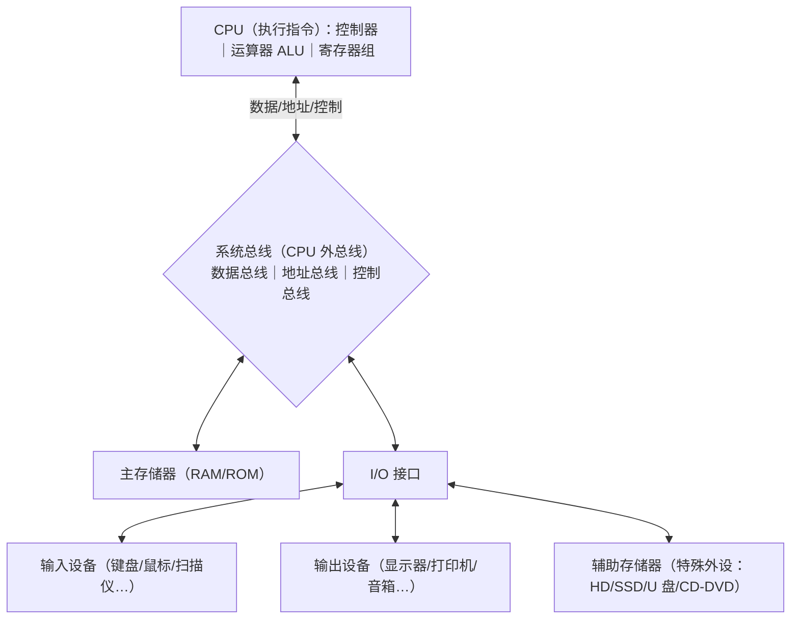

ASCII 备用图：

```
          ┌──────────────── CPU ────────────────┐
          │  控制器  │  运算器 ALU  │  寄存器组  │
          └──────────────────┬──────────────────┘
                  数据 / 地址 / 控制信号
   ═══════════════ 系统总线（CPU 外总线）═══════════════
            │                    │
     ┌──────┴──────┐      ┌──────┴──────┐
     │  主存储器   │      │  I/O 接口   │
     └─────────────┘      └──┬────┬────┬─┘
                        输入设备 输出设备 辅助存储器(特殊外设)
```

**评分点**：①（2 分）五大部件齐全：CPU（含运算器、控制器、寄存器组）、主存储器、系统总线、I/O 接口、外设；②（2 分）总线画在中间，CPU 与主存、I/O 接口都经总线相连，数据/地址/控制信号双向流动；③（2 分）输入/输出设备与**辅助存储器**都挂在 I/O 接口外侧，并注明辅存是**特殊外设**。

**常见错误**：把 CPU 三部分与“三大部分”混为一谈（三大部分是 CPU、主存储器、I/O 接口）；把辅助存储器直接连到系统总线上或归入主存；总线只画单向箭头；漏画寄存器组或输入/输出设备。

### 图2（5 分）程序设计语言分类层次图

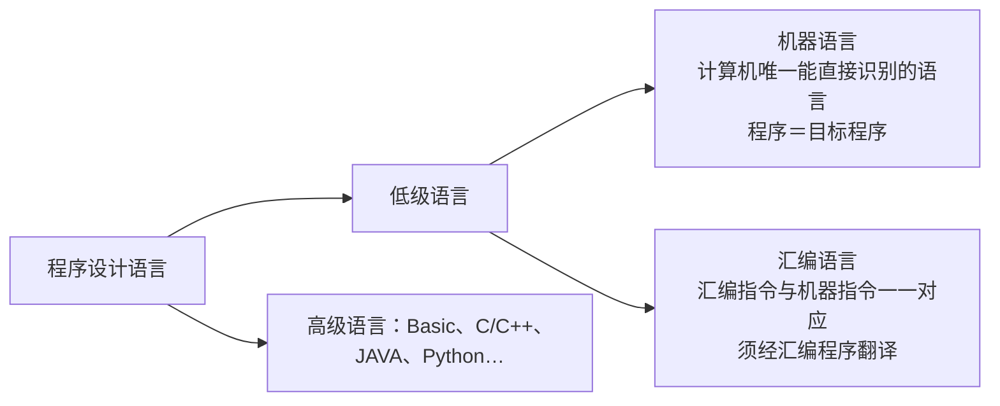

ASCII 备用图：

```
                 程序设计语言
                /              \
      低级语言（面向机器）        高级语言
        /            \          Basic / C/C++ /
  机器语言        汇编语言       JAVA / Python …
  唯一能直接识别   与机器指令一一对应
  （目标程序）     （需汇编程序翻译）
```

**评分点**：①（2 分）层次正确：机器语言、汇编语言同属**低级语言**并列，与高级语言并列；②（2 分）标注“汇编指令与机器指令**一一对应**”；③（1 分）标注机器语言是计算机**唯一能直接识别**的语言，并给出至少 3 个高级语言例子。

**常见错误**：把汇编语言画到高级语言一侧；把汇编语言与机器语言画成上下包含关系（并非子集，是一一对应）；写“汇编语言可直接运行”；高级语言举例只写 1 个或写 CISC/RISC。

### 图3（6 分）MIPS 存储层次与速度/容量/成本关系图

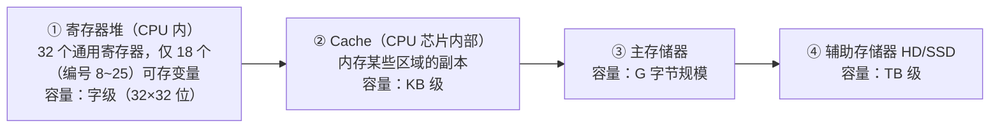

ASCII 备用图：

```
速度 快 ↑  成本/位 高 ↑                 容量 小 ↓
  ┌───────────────────────────────┐
  │ ① 寄存器  32 个通用寄存器        │  字级（18 个可作变量：8~25）
  ├───────────────────────────────┤
  │ ② Cache（CPU 内，主存副本）      │  KB 级
  ├───────────────────────────────┤
  │ ③ 主存储器                    │  G 字节级
  ├───────────────────────────────┤
  │ ④ 辅助存储器（HD/SSD）          │  TB 级
  └───────────────────────────────┘
速度 慢 ↓  成本/位 低 ↓                 容量 大 ↑
```

**评分点**：①（2 分）四层齐全且顺序正确：寄存器→Cache→主存→辅存；②（2 分）两条坐标轴方向正确：越往上速度越快、成本越高、容量越小；越往下相反；并写典型容量（字级/KB/G/TB）；③（2 分）Cache 注明“**内存某些区域的副本**”并明确指出“实现在 **CPU 芯片内部**”，寄存器处标注“32 个通用寄存器中仅 18 个（编号 8~25）可存放变量”。

**常见错误**：层次顺序颠倒（把 Cache 画在寄存器之上或主存之下）；把 Cache 画到主存一侧或说成“外存”；速度轴与容量轴同向；只写“寄存器数量有限”而不写 18 个（8~25）；漏写 Cache 是主存副本、在 CPU 内。

<div style="page-break-after: always"></div>

# 第二讲 MIPS 架构 复习题（对应课件 P33–P73）

> 作答约定：除题目明确说明存在延迟槽外，程序题按课程模拟器默认的“无分支延迟、无加载延迟”模型执行；此时 jal/jalr 保存调用指令地址加 4。经典带分支延迟槽的 MIPS 保存调用指令地址加 8。所有地址均按字节计；宏展开和周期数按题目指定的模型计算。


## 本讲覆盖要点与题号索引

| 课件页 | 知识点 | 对应题号 |
|---|---|---|
| P33 | 讲次封面（MIPS 架构），无独立考点 | — |
| P34 | 本讲主要内容：数据通路及组件、寄存器堆、ALU、PC、存储器、IR、CU | 多1 |
| P35 | 为什么要了解 MIPS 架构（寄存器/指令集/寻址模式/数据类型四方面） | 单1、简1 |
| P36 | 数据通路 datapath 定义；控制器任务＝控制数据在通路上正确流动 | 单2、填1、简2 |
| P37 | 简化 MIPS 数据通路图（PC、加法器、指令缓存、IR、寄存器堆、ALU、数据缓存、Rs/Rt/Rd/Imm） | 单3、填2、简2 |
| P38 | 基本数据通路组件清单（寄存器堆、ALU、PC、IR、存储器、CU、总线） | 单4、多1、填3、简3 |
| P39 | 总线 BUS：数据总线/地址总线/控制总线；32 位架构多数总线 32 位宽 | 单5、多2、填4、简4 |
| P40 | 多路复用器 MUX（数据选择器）原理与选择信号 | 单6、填5、简4 |
| P41 | 32 位寄存器取值范围；分类：通用/HI-LO/PC | 单7、填6、判3 |
| P42 | 32 个寄存器编号、名称、用途全表（必考） | 单8、单9、填7、简5 |
| P43 | ALU：算术、逻辑（AND/OR/NOR/XOR）、移位运算 | 单10、填8 |
| P44 | PC：定义、初值由操作系统指定、取指后 PC←PC+4 | 单11、判4、简6 |
| P45 | 存储器定义、存储单元唯一地址、一个单元 8 位（按字节编址） | 单12、填9、判5、简7 |
| P46 | 存储器的组织（地址—内容对照图，小尾端） | 填9、读2 |
| P47 | 寻址空间由地址总线宽度决定：2^32＝4G 个单元 | 单13、填10、计8、简7 |
| P48 | 数据类型与规模 size：字 32/半字 16/字节 8/双字 64 | 单14、填11 |
| P49 | size 与 C 类型对应（char/short/int/float/double） | 单15、填12 |
| P50 | 数据在内存中的存储；半字/字/双字占 2/4/8 个连续单元，最小地址为数据地址 | 单16、填13、判6 |
| P51 | 对齐规则：半字偶地址、字被 4 整除、双字被 8 整除 | 单17、判7、计8 |
| P52 | 指令 32 位定长、以字对齐存放、PC 增量 4 的原因 | 单18、填14、简6 |
| P53 | Cache 与存储层次；按教材约定18个寄存器（8~25）用于一般临时变量 | 单19、多3、判8 |
| P54 | IR 定义（32 位，保存最近取出的指令）；取指—分析—执行三步 | 单20、填15 |
| P55 | 三种指令格式总览（R/I/J） | 单21、填16、多4 |
| P56 | R 格式字段：op=0、rs/rt 源、rd 目的、shamt、funct | 单22、填17、判9、计1 |
| P57 | add 举例与语义 R[rd]=R[rs]+R[rt] | 计1 |
| P58 | sub 举例与语义 R[rd]=R[rs]−R[rt] | 计2 |
| P59 | R 格式移位举例（shamt 字段的实际使用） | 填17 |
| P60 | 指令执行五阶段 IF/RD/ALU/MEM/WB | 读1 |
| P61 | add 的 IF 阶段：PC→指令缓存、指令进 IR、PC←PC+4 | 读1、计1 |
| P62 | add 的 RD/ALU 阶段：读 $s1/$s2、ALU 求和 | 读1、计1 |
| P63 | add 的 MEM（无）/WB（写回 rd）阶段 | 读1、计1 |
| P64 | I 格式字段；imm 为 16 位补码立即数（源操作数） | 判10、计3、计4、计5 |
| P65 | addi 编码例：addi $s0,$s1,5 = 0x22300005（op/rs/rt/imm 分解） | 计3 |
| P66 | addi 的 IF 阶段（PC 0x00400004→0x00400008） | 计3 |
| P67 | addi 的 RD/ALU 阶段（符号扩展 0x0005、结果 6） | 计3 |
| P68 | addi 的 MEM（无）/WB 阶段（写回 $s0） | 计3 |
| P69 | J 格式：26 位 addr，仅用于无条件转移 jump 指令 | 填18、计6 |
| P70 | j 0x00400100 = 0x08100040（编码） | 计6 |
| P71 | j 指令执行过程：目标地址拼接送 PC | 计6、计8 |
| P72 | 控制单元 CU：有限状态自动机、按时钟脉冲先后发信号 | 判10、简8 |
| P73 | 下次课封面（寻址方式和指令集），无独立考点 | — |

---

## 一、单项选择题（共 22 题）

1. 【课件P35】使用 MIPS 机器指令编程时，必须了解 MIPS 架构，主要原因是（　）
   - A. MIPS 架构规定的寄存器、指令集、内存寻址模式和数据类型决定了程序怎么写
   - B. 不了解架构就无法安装 PCSpim 模拟器
   - C. 汇编程序运行速度比高级语言慢
   - D. MIPS 架构的时钟频率必须由程序员设定

2. 【课件P36】关于数据通路与控制器，下列说法正确的是（　）
   - A. 数据通路就是硬盘的数据连接线
   - B. 控制器的任务本质上是控制数据在数据通路上正确流动
   - C. 数据通路由操作系统用软件实现
   - D. 控制器负责存放程序的返回值

3. 【课件P37】在简化的 MIPS 数据通路图中，程序计数器 PC 与常量 4 一起送入加法器，其作用是（　）
   - A. 计算当前指令的操作数
   - B. 计算下一条指令的地址 PC+4
   - C. 计算数据的地址
   - D. 对 ALU 的运算结果做回写

4. 【课件P38】下列**不属于** MIPS 基本数据通路组件的是（　）
   - A. 寄存器堆（Register File）
   - B. 指令寄存器（IR）
   - C. 磁盘驱动器
   - D. 控制单元（Control Unit）

5. 【课件P39】在总线的分类中，用来传送内存单元地址和 I/O 地址的是（　）
   - A. 数据总线
   - B. 地址总线
   - C. 控制总线
   - D. 系统总线以外的外部总线

6. 【课件P40】具有两选一功能的多路复用器（MUX）必须具有（　）
   - A. 一个控制信号，用来决定两个输入中的哪一个被输出
   - B. 一个时钟信号，用来决定输出频率
   - C. 两个控制信号，分别控制两个输入
   - D. 不需要任何附加信号

7. 【课件P41】32 位寄存器中的内容 0x80000000 按带符号数解释，其十进制值是（　）
   - A. +2147483648
   - B. −2147483648
   - C. −2147483647
   - D. +2147483647

8. 【课件P42】编号为 31 的寄存器名及其用途是（　）
   - A. `$sp`，栈指针
   - B. `$fp`，栈帧指针
   - C. `$ra`，存放函数的返回地址
   - D. `$gp`，全局指针

9. 【课件P42】编号为 1 的寄存器 `$at` 的用途是（　）
   - A. 存放函数的返回值
   - B. 保留给汇编程序（汇编器）使用，实现宏指令
   - C. 存放传递给函数的实参
   - D. 保留给操作系统内核使用

10. 【课件P43】下列**不属于** ALU 承担的操作是（　）
    - A. 加法、减法运算
    - B. 与（AND）、或（OR）、或非（NOR）、异或（XOR）运算
    - C. 移位运算
    - D. 根据地址到主存中读出数据

11. 【课件P44】程序计数器 PC 中存放的是（　）
    - A. 刚刚执行完的指令的地址
    - B. 将要取出执行的指令所在内存单元的地址
    - C. 当前指令的机器码
    - D. 栈顶单元的地址

12. 【课件P45】32 位 MIPS 架构中，一个存储单元能记忆的二进制位数和采用的编址方案是（　）
    - A. 32 位，按字编址
    - B. 8 位，按字节编址
    - C. 16 位，按半字编址
    - D. 64 位，按双字编址

13. 【课件P47】32 位 MIPS 处理器地址总线宽度为 32 位，其存储器寻址空间是（　）
    - A. 2^16 个单元
    - B. 2^26 个单元
    - C. 2^32 个单元，即 4G 个内存单元
    - D. 2^64 个单元

14. 【课件P48】32 位 MIPS 架构中术语“字（word）”指的是（　）
    - A. 8 位二进制位
    - B. 16 位二进制位
    - C. 32 位二进制位
    - D. 64 位二进制位

15. 【课件P49】单精度浮点（短浮点）型 float 数据在 32 位 MIPS 中占用的规模是（　）
    - A. 字节
    - B. 半字
    - C. 字
    - D. 双字

16. 【课件P50】一个半字数据在内存中占用相邻的两个存储单元，其“数据的地址”是（　）
    - A. 两个单元中较大的地址
    - B. 两个单元中最小的地址
    - C. 两个地址的平均值
    - D. 由程序员任意指定其中一个

17. 【课件P51】下列地址中，可以作为双字（double word）数据地址的是（　）
    - A. 0x10010004
    - B. 0x10010006
    - C. 0x10010008
    - D. 0x1001000A

18. 【课件P52】“32 位 MIPS 指令以字对齐方式存放”的含义是（　）
    - A. 每条指令的地址必须能被 2 整除
    - B. 每条指令的地址必须能被 4 整除
    - C. 每条指令的地址必须能被 8 整除
    - D. 每条指令的长度可以不同，但首地址必须为 0

19. 【课件P53】MIPS 共设置 32 个寄存器，其中真正能用作存储变量的寄存器个数及编号范围是（　）
    - A. 32 个，0~31
    - B. 18 个，8~25
    - C. 16 个，16~31
    - D. 10 个，8~17

20. 【课件P54】指令寄存器 IR 中保存的是（　）
    - A. 最近一条取出的、即将执行的指令
    - B. 下一条将要取出的指令的地址
    - C. ALU 的运算结果
    - D. 当前函数的返回地址

21. 【课件P55】32 位 MIPS 架构提供的三种指令格式是（　）
    - A. A 格式、B 格式、C 格式
    - B. R 格式、I 格式、J 格式
    - C. 寄存器格式、堆栈格式、转移格式
    - D. 单字格式、双字格式、四字格式

22. 【课件P56】关于本课以 op=0 编码的 `add/sub` 等 R 格式指令，下列说法正确的是（　）
    - A. op 字段 6 位全为 0，具体执行什么操作由 funct 字段决定
    - B. op 字段非 0，funct 字段全为 0
    - C. shamt 字段在任何 R 格式指令中都表示操作数
    - D. rd 字段存放源操作数，rs 字段存放目的操作数

## 二、多项选择题（共 4 题）

1. 【课件P38】下列属于 MIPS 基本数据通路组件的有（　）
   - A. 寄存器堆（Register File）
   - B. 算术逻辑单元（ALU）与程序计数器（PC）
   - C. 指令寄存器（IR）与存储器
   - D. 控制单元（CU）与总线（BUS）

2. 【课件P39】关于总线（BUS），下列说法正确的有（　）
   - A. 总线是连接组件的公共信息传输通路，是一组电子导体
   - B. 总线可传送二进制值，包括指令、数据、内存单元地址和控制信号
   - C. 按传送内容可分为数据总线、地址总线和控制总线
   - D. 在 32 位 MIPS 架构中，大多数总线具备 32 位二进制位宽

3. 【课件P53】关于 MIPS 的存储层次，下列说法正确的有（　）
   - A. 寄存器存取速度快但成本高，因此数目、容量有限
   - B. 内存容量大（G 字节规模）但存取速度慢、成本较低
   - C. Cache 介于寄存器与内存之间，存放正在使用的程序和数据的副本，实现在 CPU 芯片内部
   - D. 通常把正在使用的变量分配到寄存器中，并组合使用寄存器与 Cache、内存，使程序能快速访问大量变量

4. 【课件P55】关于三种指令格式，下列说法正确的有（　）
   - A. `add` 的 R 格式含两个源寄存器字段和一个目的寄存器字段
   - B. `addi` 的 I 格式 imm 字段是 16 位补码立即数，参与符号扩展后的加法
   - C. J 格式的 addr 字段为 26 位，仅用于无条件转移（jump）指令
   - D. 三种格式长度都是 32 位

## 三、填空题（共 18 题）

1. 【课件P36】数据通路（datapath）定义（实现）了一个计算机内部______的路径；控制器的任务从本质上来说就是______。

2. 【课件P37】在简化 MIPS 数据通路图中，PC 的内容与常量______一起送入加法器，加法器的结果又送回______；指令从指令缓存取出后送入______。

3. 【课件P38】MIPS 基本数据通路上的组件包括：______、______、______、______、______、______、______（写出 7 个）。

4. 【课件P39】总线按所传送的信息可分为______总线、______总线和______总线；在 32 位 MIPS 架构中，大多数总线具备______位二进制位宽。

5. 【课件P40】多路复用器（MUX）实现从多个信息源中______发送到目的；两选一的多路复用器必须有______个控制信号。

6. 【课件P41】32 位寄存器中二进制数按带符号解释的十进制范围是______到______（十六进制 0x______~0x______）；按无符号解释的范围是 0~______。

7. 【课件P42】填写寄存器用途：`$zero`（编号______）存放常量______；`$v0-$v1`（编号______）存放______；`$a0-$a3`（编号______）存放______；`$t0-$t7`（编号______）是______保护的临时寄存器；`$s0-$s7`（编号______）是______保护的临时寄存器；`$k0-$k1` 保留给______；`$sp` 用作______。

8. 【课件P43】ALU 执行的运算包括三类：______运算（加、减、乘、除）、______运算（AND、OR、NOR、XOR）和______运算。

9. 【课件P45】存储器由若干存储单元组成，每个存储单元被赋予一个______的地址，地址从______开始依次递增；一个存储单元记忆______位二进制位，即一个______。

10. 【课件P47】处理器可寻址的内存单元数量由______的宽度决定；32 位 MIPS 的寻址空间为 2^______＝______个内存单元，地址范围 0x0~0x______。

11. 【课件P48】32 位 MIPS 中：字（word）＝______位，半字（half word）＝______位，字节（byte）＝______位，双字（double word）＝______位。

12. 【课件P49】数据类型与规模的对应关系：字符→______，短整型→______，整型→______，单精度浮点型→______，双精度浮点型→______。

13. 【课件P50】半字占用相邻的______个内存单元，字占用______个，双字占用______个；对于半字、字和双字，数据的地址取______。

14. 【课件P52】32 位 MIPS 采用长度为______位的定长指令，并以______对齐的方式在内存中存放指令，这就是一条指令取出放入 IR 后 PC 增量______的原因。

15. 【课件P54】指令寄存器 IR 是一个______位寄存器，保存______；一条指令执行的大致过程可分为______、______、______三步。

16. 【课件P55】MIPS 的三种指令格式是：R 格式（R 表示______）、I 格式（I 表示______）、J 格式（J 表示______）。

17. 【课件P56】R 格式的字段划分为 op______位、rs______位、rt______位、rd______位、shamt______位、funct______位；其中 本课 op=0 的 R 格式指令，其 op 字段为______，shamt 字段在立即数______指令中表示移位次数。

18. 【课件P69】J 格式中 addr 字段为______位，代表与目的地址相关的值；该格式仅用于______指令。

## 四、判断题（共 10 题，正确写“对”，错误写“错”并改正）

1. 【课件P35】使用汇编语言编程只需要背熟指令助记符，不必了解寄存器、寻址模式和数据类型。（　）

2. 【课件P39】在 32 位 MIPS 架构中，所有总线都是 32 位二进制位宽。（　）

3. 【课件P41】32 位寄存器中的 0x80000000 按带符号数解释是 −2147483648。（　）

4. 【课件P44】PC 中存放的是刚刚执行完的那条指令的地址。（　）

5. 【课件P45】一个存储单元可以记忆 32 位二进制位，即一个字。（　）

6. 【课件P50】一个字占用 4 个连续的内存单元，该字的地址取这 4 个单元中最大的地址。（　）

7. 【课件P51】地址 0x10010006 可以作为字（word）数据的地址。（　）

8. 【课件P53】MIPS 的 32 个寄存器都可以用来存放程序中的变量。（　）

9. 【课件P56】R 格式指令的 op 字段 6 位全为 0，funct 字段与 op 一起决定执行什么操作。（　）

10. 【课件P64/P72】addi的I格式imm字段是16位补码立即数；控制单元由硬件实现，是一个有限状态自动机，通过把不同控制信号放在不同时钟脉冲中发出，实现动作的先后次序。（　）

## 五、简答题（共 8 题）

1. 【课件P35】为什么要了解 MIPS 架构？请从四个方面说明。（6 分）

2. 【课件P36/P37】什么是数据通路？控制器的任务是什么？请按 P37 图说明一条指令在简化数据通路中经过的主要部件。（8 分）

3. 【课件P38】列出 MIPS 基本数据通路上的 7 个组件，并用一句话说明各自作用。（7 分）

4. 【课件P39/P40】总线分哪三类？各传送什么内容？多路复用器的作用是什么？为什么必须有控制信号？（6 分）

5. 【课件P42】说明 `$at`、`$k0-$k1`、`$gp`、`$sp`、`$fp`、`$ra` 的用途；并说明 `$t` 类与 `$s` 类寄存器在“调用-保存”协议上的差别。（8 分）

6. 【课件P44/P52】什么是 PC？其初始值由谁指定？为什么每取出一条指令后 PC 增量为 4？（6 分）

7. 【课件P45–P47】简述 MIPS 存储器的编址方式，并说明 32 位 MIPS 的寻址空间为什么是 4G 个单元。（7 分）

8. 【课件P72】控制单元（CU）的作用是什么？它如何保证控制信号按先后次序发出？（6 分）

## 六、计算与编码题（共 8 题）

1. 【课件P56/P57】写出 `add $s0, $s1, $s2` 的机器码，并写出各字段取值与二进制拼装过程。

2. 【课件P58】写出 `sub $t0, $t3, $t5` 的机器码，写出各字段取值，并说明该指令的语义。

3. 【课件P65–P68】写出 `addi $s0, $s1, 5` 的机器码与字段分解；再写出 `addi $t0, $t1, -3` 的机器码；并描述 `addi $s0,$s1,5` 在 PC=0x00400004、$s1=1 时五个阶段的变化。

4. 【课件P64】写出 `lw $t2, 32($t0)` 的机器码，说明 op、rs、rt、imm 各字段的值。

5. 【课件P64】写出 `sw $s1, -32($t1)` 的机器码，说明 imm 为负数时的处理方法。

6. 【课件P69–P71】写出 `j 0x00400100` 的机器码，并描述该指令执行时 PC 的变化过程。

7. 【课件P53】把下列机器码反汇编为 MIPS 汇编指令并写出字段值：0x8FB00004、0x2128FFFD、0x08100008。

8. 【课件P47/P51/P71】设某 J 格式 `j` 指令存放在地址 0x00400030，其 addr 字段为 0x00100020：(1) 求跳转的目标地址；(2) 判断 0x10010006 能否存放一个字、0x10010008 能否存放一个双字，并说明理由；(3) 写出 32 位 MIPS 寻址空间中最后一个内存单元的地址。

## 七、代码转换题（共 4 题）

### 7.1 C 语言 → MIPS 汇编

1. 【课件P41/P57】把下面的 C 程序段翻译成完整可运行的 MIPS 汇编程序（用寄存器存放变量），并输出 c 的值。

```c
int a = 12, b = 30, c;
c = a + b;
printf("%d", c);
```

2. 【课件P42/P64】把下面的 C 程序段翻译成完整可运行的 MIPS 汇编程序：变量 a、b、c 都放在 `.data` 段，用 `lw`/`sw` 访问，最后输出 c 的值。

```c
int a = 100, b = 40, c;
c = a - b + 5;
printf("%d", c);
```

### 7.2 MIPS 汇编 → 机器码

3. 【课件P56/P64/P69】写出下列程序的 4 条指令的机器码（十六进制），并写出字段分解。

```asm
addi $t0, $zero, 10
add  $t1, $t0, $t0
lw   $t2, 0($sp)
j    0x00400010
```

### 7.3 机器码 → MIPS 汇编（反汇编）

4. 【课件P57/P58/P64/P70】把下列 4 个 32 位机器码反汇编成 MIPS 汇编指令，并判断指令格式。

```
0x22300005
0x012A4020
0x8D0A0020
0x08100040
```

## 八、读程序写结果（共 2 题）

1. 【课件P60–P63】阅读下列程序段，写出执行后 `$t2`、`$t3`、`$t4`、`$t5` 的值以及屏幕输出。

```asm
.data
    msg: .asciiz "result="
.text
.globl main
main:
    li    $t0, 20          # $t0 = 20
    li    $t1, 5           # $t1 = 5
    add   $t2, $t0, $t1    # $t2 = $t0 + $t1
    sub   $t3, $t0, $t1    # $t3 = $t0 - $t1
    add   $t4, $t2, $t3    # $t4 = $t2 + $t3
    addi  $t5, $t4, -10    # $t5 = $t4 + (-10)
    li    $v0, 1           # 系统调用号 1：打印整数
    move  $a0, $t5
    syscall
    li    $v0, 10          # 退出
    syscall
```

2. 【课件P46/P41】阅读下列程序段（小尾端存储），写出 `$t1`、`$t2`、`$t3` 的值，变量 `v` 所在 4 个字节单元（地址由低到高）的内容，屏幕输出，以及变量 `w` 的最终值。

```asm
.data
v:  .word 0x11223344
w:  .word 0
.text
.globl main
main:
    la    $t0, v           # $t0 = v 的地址
    lw    $t1, 0($t0)      # $t1 = v 的值
    addi  $t2, $t1, 1      # $t2 = $t1 + 1
    sw    $t2, 4($t0)      # 把 $t2 存入 w
    lw    $t3, 4($t0)      # $t3 = w 的值
    li    $v0, 1
    move  $a0, $t1
    syscall
    li    $v0, 10
    syscall
```

---

## 九、作图题（共 5 题）

1. 【课件P37】【8分】画出简化的 MIPS 数据通路图：至少包含 PC、加法器（常量 4）、指令缓存、指令寄存器 IR、寄存器堆（标出 Rs/Rt/Rd）、ALU、数据缓存、Imm（立即数）；多路复用器 **MUX 用三角形符号表示**；并用 ①②③④⑤ 标出 IF/RD/ALU/MEM/WB 各阶段的数据流向。
2. 【课件P56/P64/P69】【8分】分别画出 R、I、J 三种指令格式的位域图，标出各字段位宽（6/5/5/5/5/6、6/5/5/16、6/26），并用 `add $s0,$s1,$s2`、`addi $s0,$s1,5`、`j 0x00400100` 三例在图上标出各字段的值。
3. 【课件P60】【6分】画出一条指令 IF→RD→ALU→MEM→WB 五阶段的流程图（横向为时间轴），并在图上分别标注 `add`、`lw`、`sw` 哪一阶段做实事、哪一阶段空转。
4. 【课件P45–P47】【6分】画出存储单元的“地址—内容”对应示意图（至少 4 个单元，如 0x00000000~0x00000003，内容 0x00/0xA1/0x6F/0x90），并在图上标出一个字（4 字节）的最小地址与对齐要求。
5. 【课件P53】【5分】画出寄存器—Cache—主存三级存储层次图，标出速度、容量、成本三个维度的发展方向，并注明 按教材约定将18个寄存器（编号8~25）作为一般临时变量寄存器。

---

# 参考答案与解析

## 一、单项选择题

1. **A**。【解析】P35 明确：MIPS 架构就是使用 MIPS 机器指令编程时必须理解（了解）的各类寄存器、指令集、内存寻址模式和数据类型等方面的定义和使用惯例，否则无法编制程序。B、C、D 均与本页无关。
2. **B**。【解析】P36：数据通路定义计算机内部数据流动的路径；计算机系统完成数据处理建立在数据通路之上，控制器（控制器）的任务本质就是控制数据在数据通路上正确流动。A 混淆了总线/外存；C 错，数据通路由硬件实现；D 是 `$v0/$v1` 的用途。
3. **B**。【解析】P37/P52：PC 内容与 4 相加得到下一条指令地址，送入 PC。
4. **C**。【解析】P38 组件为寄存器堆、ALU、PC、IR、存储器、控制单元（Control Logic）、总线，磁盘属于外存。
5. **B**。【解析】P39：地址总线传送内存地址、I/O 地址；数据总线传送数据与指令；控制总线传送控制信号。
6. **A**。【解析】P40：MUX 从多个信息源中选择一个送到目的，两选一 MUX 必须有 1 个控制信号决定输出哪一路。
7. **B**。【解析】P41：0x80000000 = −2^31 = −2147483648。注意无符号时为 2147483648。
8. **C**。【解析】P42：31 号是 `$ra`，存放函数返回地址。
9. **B**。【解析】P42：1 号 `$at`（assembler temp）保留给汇编程序，用于实现宏指令，程序员不应使用。
10. **D**。【解析】P43 只列算术、逻辑、移位三类运算；按地址访存由 lw/sw 完成，不是 ALU 的功能。
11. **B**。【解析】P44：PC 存放**将要取出执行**的指令所在内存单元的地址；“程序计数器”这个名称其实应叫“指令指针”。
12. **B**。【解析】P45：一个存储单元记忆 8 位，即一个字节，这种方案称为以字节为单位编址。
13. **C**。【解析】P47：寻址空间＝2^(地址总线宽度)＝2^32＝4G 个单元，地址 0x0~0xFFFFFFFF。
14. **C**。【解析】P48：32 位 MIPS 中字＝32 bits。
15. **C**。【解析】P49：float（单精度）用字；double（双精度）用双字。
16. **B**。【解析】P50：半字、字、双字都取最小的内存地址作为数据的地址。
17. **C**。【解析】P51：双字地址必须能被 8 整除，二进制末三位为 0。0x10010008 能被 8 整除（8 = 0b1000）；0x10010004 只能放字；0x10010006 连字都不满足。
18. **B**。【解析】P52：指令定长 32 位，按字对齐，地址必须能被 4 整除（二进制末两位为 0），故 PC 每次加 4。
19. **B**。【解析】P53：按教材“分配一般临时变量”的约定，32个通用寄存器中列出的变量寄存器为 18 个，编号 8~25（`$t0-$t9`、`$s0-$s7`）。
20. **A**。【解析】P54：IR 是 32 位寄存器，保存最近一条取出的指令，也就是马上将要执行的指令。
21. **B**。【解析】P55：R（register）、I（immediate）、J（jump）三种格式，长度均为 32 位。
22. **A**。【解析】P56：本题所指的 `add/sub` 等指令 op=0，由 funct 区分操作；`add/sub` 中 rs、rt 为源、rd 为目的。移位、乘除、jr 等指令的字段用途须逐条判断。

## 二、多项选择题

1. **ABCD**。A、B、C、D 全部正确：见 P38 组件清单（寄存器堆、ALU、PC、IR、存储器、CU、总线）。
2. **ABCD**。A（公共信息传输通路/电子导体）、B（传送指令、数据、地址、控制信号）、C（三种分类）、D（32 位架构多数总线 32 位宽）均出自 P39。
3. **ABCD**。均出自 P53：寄存器快而贵、数目有限；内存慢而大、便宜；Cache 是内存区域的副本，实现在 CPU 芯片内部；变量通常分配到寄存器，寄存器＋Cache＋内存组合使用。
4. **ABCD**。A 见 P56；B 见 P64（addi 的 16 位补码立即数，需符号扩展为 32 位；andi/ori/xori 则零扩展）；C 见 P69（26 位 addr，仅 jump）；D 见 P55（固定长度 32 位）。

## 三、填空题

1. **数据流动；控制数据在数据通路上正确流动**。
2. **4；PC；指令寄存器（IR）**。（P37 图中加法器输出回送 PC；指令缓存取出指令送 IR。）
3. **寄存器堆、算术逻辑单元（ALU）、程序计数器（PC）、指令寄存器（IR）、存储器、控制单元（CU）、总线**。（顺序可换）
4. **数据；地址；控制；32**。
5. **选择其中一个；1**。
6. **−2147483648；+2147483647；80000000；7FFFFFFF；4294967295**。
7. **0；0；2-3；函数的返回值；4-7；传递给函数的实参；8-15；无需（被调用函数无需）；16-23；必须（被调用函数必需）；操作系统内核使用；栈指针**。
8. **算术；逻辑；移位**。
9. **唯一；0；8；字节（Byte）**。
10. **地址总线；32；4G（2^32）；FFFFFFFF**。
11. **32；16；8；64**。
12. **字节；半字；字；字；双字**。
13. **2；4；8；最小（小）的地址**。
14. **32；字；4**。
15. **32；最近一条取出的指令（即将执行的指令）；取指令；分析指令；执行指令**。
16. **register（寄存器）；immediate（立即数）；jump（跳转）**。
17. **6；5；5；5；5；6；0（000000）；移位**。
18. **26；无条件转移（jump）**。

## 四、判断题

1. **错**。还必须了解（理解）寄存器、指令集、内存寻址模式和数据类型等定义与使用惯例，否则无法编制程序。
2. **错**。是“大多数”总线具备 32 位位宽，并非全部（如某些控制线只需 1 位）。
3. **对**。0x80000000 的最高位为 1，按 32 位补码解释为 −2^31 = −2147483648。
4. **错**。PC 中存放的是**将要取出执行**的指令的地址；取指后 PC←PC+4。
5. **错**。一个存储单元只能记忆 8 位（1 字节）；一个字需占 4 个连续单元。
6. **错**。半字、字、双字都取**最小**的内存地址作为数据的地址。
7. **错**。字的地址必须能被 4 整除，0x10010006 末两位为 10（2），不是 4 的倍数。
8. **错**。按教材约定，一般临时变量优先使用18个寄存器（编号8~25），其余有特定用途；这是软件约定，不是硬件禁止其他可写通用寄存器保存数据（`$zero`、`$at`、`$v`、`$a`、`$k`、`$gp`、`$sp`、`$fp`、`$ra`）。
9. **对**。R 格式 op=000000，由 funct（功能码/扩展操作码）区分 add(32)、sub(34) 等具体操作。
10. **对**。addi的imm为16位补码，符号扩展后参与运算；andi/ori/xori不采用这种扩展方式。CU 由硬件实现，是有限状态自动机，用不同时钟脉冲实现控制信号的先后次序。

## 五、简答题

1. **（6 分）要点**：①MIPS 架构即程序员使用 MIPS 机器指令编程时必须理解的**寄存器**（有哪些、各自用途与使用规范）；②**指令集**（有哪些指令、格式与语义）；③**内存寻址模式**（如何确定操作数地址与转移目标地址）；④**数据类型**（字/半字/字节/双字及与 C 类型的对应）。不掌握这些定义与使用惯例将无法编制程序。
2. **（8 分）要点**：①数据通路（datapath）定义（实现）了计算机内部数据流动的路径，是实现计算机硬件系统最基础的定义；②计算机完成数据处理建立在数据通路之上；③控制器的任务本质上是控制数据在数据通路上正确流动；④按 P37 图，一条指令的路径为：PC →（经加法器 +4 更新）→ 指令缓存取指 → 指令送 IR → 取 rs/rt/rd/Imm → 寄存器堆读操作数 → ALU 运算 → 数据缓存访问（如需）→ 结果写回寄存器堆。
3. **（7 分）要点（每点 1 分）**：寄存器堆——存放 32 个 32 位操作数/结果；ALU——执行算术、逻辑、移位运算；PC——存放下一条待取指令地址；IR——保存最近取出的指令；存储器（指令缓存/数据缓存）——存放指令与数据；控制单元——发出各部件所需控制信号；总线——组件间公共信息传输通路。
4. **（6 分）要点**：①数据总线传送数据与指令；②地址总线传送内存地址、I/O 地址；③控制总线传送控制信号；④MUX 实现从多个信息源中选一个送到目的，图中用三角形符号表示；⑤两选一 MUX 必须有控制信号决定输出哪一路输入，否则无法确定数据来源。
5. **（8 分）要点**：`$at`（1）保留给汇编程序实现宏指令，程序员不用；`$k0-$k1`（26-27）保留给操作系统内核，应用程序不得使用或修改；`$gp`（28）全局指针；`$sp`（29）栈指针；`$fp`（30）栈帧指针；`$ra`（31）存放函数返回地址。`$t0-$t9`（8-15、24-25）为**无需保护**的临时寄存器（Caller-saved：函数返回后不保证其原值不变）；`$s0-$s7`（16-23）为**必须保护**的临时寄存器（Callee-saved：被调用函数必须保护其原值）。
6. **（6 分）要点**：①PC 是一个寄存器，存放**将要取出执行**的指令所在内存单元的地址；②PC 的初始值由**操作系统**指定，即程序第一条指令所在单元的地址；③32 位 MIPS 指令长度为 32 位（4 字节），且以字对齐方式存放（地址能被 4 整除），因此一条指令取出放入 IR 后，下一条指令地址＝当前地址+4，PC 增量为 4。
7. **（7 分）要点**：①存储器由若干存储单元组成，每个单元有唯一地址，从 0 开始递增；②一个存储单元记忆 8 位（1 字节），称为按字节编址；③处理器地址总线宽度决定可寻址单元数量；④32 位地址总线 → 2^32 = 4G 个单元，地址 0x00000000~0xFFFFFFFF。
8. **（6 分）要点**：①CU 即控制器，发出数据通路中数据移动所需的**所有控制信号**（寄存器写使能、ALU 操作码、Cache 读写、寄存器堆读写、MUX 选择等）；②它由硬件实现，实际上是一个**有限状态自动机**；③它分析 IR 中的指令，按指令功能及各硬件组件应完成的动作与先后次序发出信号；④先后次序通过把不同信号放在**不同的时钟脉冲**中发出实现，时钟频率决定运行速度。

## 六、计算与编码题

1. **0x02328020**。字段分解：R 格式 op=0（000000）、rs=`$s1`=17（10001）、rt=`$s2`=18（10010）、rd=`$s0`=16（10000）、shamt=0（00000）、funct=add=32（100000）。
   拼装：`000000 10001 10010 10000 00000 100000` → 0000 0010 0011 0010 1000 0000 0010 0000 → **0x02328020**。语义：R[$s0] = R[$s1] + R[$s2]。
2. **0x016D4022**。op=0（000000）、rs=`$t3`=11（01011）、rt=`$t5`=13（01101）、rd=`$t0`=8（01000）、shamt=0（00000）、funct=sub=34（100010）。
   拼装：`000000 01011 01101 01000 00000 100010` → 0000 0001 0110 1101 0100 0000 0010 0010 → **0x016D4022**。语义：R[$t0] = R[$t3] − R[$t5]。
3. **(1) `addi $s0,$s1,5` = 0x22300005**：I 格式，op=addi=8（001000）、rs=`$s1`=17（10001）、rt=`$s0`=16（10000）、imm=5（0000 0000 0000 0101）。
   拼装：`001000 10001 10000 0000000000000101` → **0x22300005**。
   **(2) `addi $t0,$t1,-3` = 0x2128FFFD**：op=8（001000）、rs=`$t1`=9（01001）、rt=`$t0`=8（01000）、imm=−3 的 16 位补码＝0xFFFD（1111 1111 1111 1101）。
   拼装：`001000 01001 01000 1111111111111101` → **0x2128FFFD**。
   **(3) 五阶段（PC=0x00400004，$s1=1）**：
   - IF：PC=0x00400004，从指令缓存取出 0x22300005 放入 IR，PC←PC+4=0x00400008；
   - RD：译码得 rs=17、rt=16，读 $s1=0x00000001；取 16 位立即数 0x0005，高位用符号位扩展为 0x00000005；
   - ALU：1 + 5 = 0x00000006；
   - MEM：无（addi 不访问数据缓存）；
   - WB：结果 0x00000006 写回 $s0（R[16]）。
4. **0x8D0A0020**。I 格式，op=`lw`=35（100011）、rs=`$t0`=8（01000）、rt=`$t2`=10（01010）、imm=32（0000 0000 0010 0000）。
   拼装：`100011 01000 01010 0000000000100000` → **0x8D0A0020**。语义：R[$t2] = Mem[R[$t0]+32]。
5. **0xAD31FFE0**。op=`sw`=43（101011）、rs=`$t1`=9（01001）、rt=`$s1`=17（10001）、imm=−32。
   imm=−32 的 16 位补码：32 = 0x0020 = 0000 0000 0010 0000，取反加 1 → 1111 1111 1110 0000 = 0xFFE0。注意 rs 是**基址寄存器**（$t1），rt 是被存的数据寄存器（$s1）。
   拼装：`101011 01001 10001 1111111111100000` → **0xAD31FFE0**。语义：Mem[R[$t1]+(−32)] = R[$s1]。
6. **0x08100040**。J 格式：op=`j`=2（000010）、addr=目标地址右移 2 位后取低 26 位：0x00400100 >> 2 = 0x00100040 → 26 位二进制 `00 0001 0000 0000 0000 0100 0000`。
   拼装：`000010 00000100000000000001000000` → 0000 1000 0001 0000 0000 0000 0100 0000 → **0x08100040**。
   执行过程（P70/P71，设该指令在 0x00400008）：IF 阶段从 0x00400008 取出 0x08100040 送入 IR，PC←0x0040000C；随后取 addr<<2 = 0x00400100，与 (PC+4) 的高 4 位 0x0 拼接得 0x00400100，送入 PC，下一条取出的指令来自 0x00400100（地址 0x0040000C 处的内容被跳过）。
7. **(1) 0x8FB00004**：二进制 100011 11101 10000 0000000000000100 → op=35（lw）、rs=29（`$sp`）、rt=16（`$s0`）、imm=4 → **`lw $s0, 4($sp)`**（I 格式）。
   **(2) 0x2128FFFD**：二进制 001000 01001 01000 1111111111111101 → op=8（addi）、rs=9（`$t1`）、rt=8（`$t0`）、imm=0xFFFD=−3 → **`addi $t0, $t1, -3`**（I 格式）。
   **(3) 0x08100008**：二进制 000010 00000001000000000000001000 → op=2（j）、addr=0x00100008 → 目标地址 = 0x00100008<<2 = 0x00400020 → **`j 0x00400020`**（J 格式）。
8. **(1)** 目标地址 = (PC+4) 的高 4 位 ‖ (addr<<2) = 0x0 ‖ (0x00100020<<2 = 0x00400080) = **0x00400080**。
   **(2)** 0x10010006 **不能**存字：字的地址必须能被 4 整除，0x…06 末两位为 10₂＝2，不是 4 的倍数（它只是偶地址，能满足半字对齐，不能满足字对齐）；0x10010008 **能**存双字：双字地址必须能被 8 整除，8 = 0b1000，末三位为 0。
   **(3)** 最后一个单元地址 = 0xFFFFFFFF（共 2^32 = 4G 个单元，编号 0~4294967295）。

## 七、代码转换题

1. **参考代码（输出 42）**

```asm
        .data
msg:    .asciiz "c="
        .text
        .globl main
main:
        li    $t0, 12            # a = 12
        li    $t1, 30            # b = 30
        add   $t2, $t0, $t1      # c = a + b  → R[$t2] = R[$t0] + R[$t1]
        li    $v0, 4             # 打印字符串
        la    $a0, msg
        syscall
        li    $v0, 1             # 打印整数
        move  $a0, $t2
        syscall
        li    $v0, 10            # 正常退出
        syscall
```

2. **参考代码（变量在 .data，用 lw/sw，输出 65）**

```asm
        .data
a:      .word 100                # int a = 100
b:      .word 40                 # int b = 40
c:      .word 0                  # int c;
msg:    .asciiz "c="
        .text
        .globl main
main:
        la    $t0, a             # $t0 = &a
        lw    $t1, 0($t0)        # $t1 = a = 100
        lw    $t2, 4($t0)        # $t2 = b = 40
        sub   $t3, $t1, $t2      # $t3 = a - b = 60
        addi  $t3, $t3, 5        # $t3 = 60 + 5 = 65
        sw    $t3, 8($t0)        # c = $t3
        li    $v0, 4
        la    $a0, msg
        syscall
        li    $v0, 1
        lw    $a0, 8($t0)        # 从内存取回 c
        syscall
        li    $v0, 10
        syscall
```

3. **机器码**

| 指令 | op | rs | rt | rd/shamt/funct 或 imm | 机器码 |
|---|---|---|---|---|---|
| `addi $t0,$zero,10` | 8（001000） | 0（00000） | 8（01000） | imm=10（0000 0000 0000 1010） | **0x2008000A** |
| `add $t1,$t0,$t0` | 0（000000） | 8（01000） | 8（01000） | rd=9（01001）、shamt=0、funct=32（100000） | **0x01084820** |
| `lw $t2,0($sp)` | 35（100011） | 29（11101） | 10（01010） | imm=0（0000 0000 0000 0000） | **0x8FAA0000** |
| `j 0x00400010` | 2（000010） | — | — | addr=0x00400010>>2=0x00100004（000001000000000000000100） | **0x08100004** |

4. **反汇编结果**

| 机器码 | 二进制字段 | 汇编指令 | 格式 |
|---|---|---|---|
| 0x22300005 | 001000 10001 10000 0000000000000101 | `addi $s0, $s1, 5` | I |
| 0x012A4020 | 000000 01001 01010 01000 00000 100000 | `add $t0, $t1, $t2` | R |
| 0x8D0A0020 | 100011 01000 01010 0000000000100000 | `lw $t2, 32($t0)` | I |
| 0x08100040 | 000010 00000100000000000001000000 | `j 0x00400100` | J |

## 八、读程序写结果

1. **结果表**

| 寄存器 | 值 | 说明 |
|---|---|---|
| `$t2` | 25 | `add`：20+5 |
| `$t3` | 15 | `sub`：20−5 |
| `$t4` | 40 | 25+15 |
| `$t5` | 30 | 40+(−10) |

**屏幕输出**：`30`（以系统调用号 1 打印 `$t5`；随后 `$v0=10` 退出）。逐条解释：`li` 是宏指令（展开为 `ori`/`lui`+`ori`）；`add`/`sub` 为 R 格式；`addi` 的 imm 为 16 位补码，−10 合法（在 −32768~32767 之间）。
2. **结果表**

| 项目 | 结果 |
|---|---|
| `$t1` | 0x11223344（十进制 287454020） |
| `$t2` | 0x11223345（287454021） |
| `$t3` | 0x11223345 |
| `v` 的 4 个字节（地址由低到高） | 0x44、0x33、0x22、0x11（小尾端：低字节存低地址） |
| `w` 的最终值 | 0x11223345 |
| 屏幕输出 | `287454020` |

**逐条解释**：`la $t0, v` 取变量地址；`lw $t1,0($t0)` 按字读出 0x11223344（若按字节看，内存中依次是 44 33 22 11，这就是小尾端）；`addi $t2,$t1,1` 得 0x11223345；`sw $t2,4($t0)` 把结果写入 `w`（`v` 与 `w` 相邻，`.word` 各占 4 字节，且按字对齐）；`lw $t3,4($t0)` 再读回，验证写入成功；最后打印 `$t1`＝287454020 并退出。

## 九、作图题

**1.（8 分）**

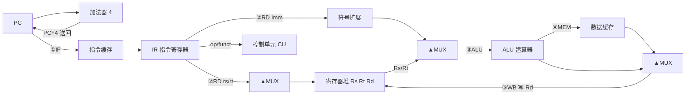

ASCII 备用图（按阶段）：

```
①IF   PC ─►[指令缓存]─►[IR] ；同时 PC ─►[加法器 +4] ─► PC（下一条指令地址）
②RD   IR(rs,rt) ─►[寄存器堆]读出 Rs、Rt ；IR 的 Imm(16 位) ─►[符号扩展] ─► 32 位
③ALU  ▲MUX 从 Rs/Rt/Imm 中选两路 ─►[ALU] ；目的寄存器编号 Rd 取自 IR
④MEM  ALU 结果作地址 ─►[数据缓存]（仅 lw/sw 有效）
⑤WB   ▲MUX 选 ALU 结果或数据缓存输出 ─► 写回 [寄存器堆] Rd
```

**评分点**：①8 类组件齐全、连接正确（4 分）；②MUX 三角形且≥2 个（1 分）；③五阶段流向标注完整（2 分）；④PC+4 回送、WB 写 Rd（1 分）。
**常见错误**：把 PC+4 加法器画成 ALU；MUX 画成方框；Imm 未符号扩展；IR 直接连 ALU；漏数据缓存；add 的 WB 错写为 Rs/rt（lw 的写回目标正是 rt）。

**2.（8 分）**

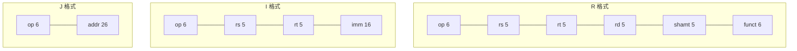

ASCII 备用图（均为 32 位）：

```
R:| op 6 | rs 5 | rt 5 | rd 5 | shamt 5 | funct 6 |
I:| op 6 | rs 5 | rt 5 |      imm 16           |
J:| op 6 |             addr 26                 |
```

| 例 | 格式 | 各字段值 | 机器码 |
|---|---|---|---|
| `add $s0,$s1,$s2` | R | op=0(000000)、rs=$s1=17(10001)、rt=$s2=18(10010)、rd=$s0=16(10000)、shamt=0(00000)、funct=32(100000) | **0x02328020** |
| `addi $s0,$s1,5` | I | op=8(001000)、rs=$s1=17(10001)、rt=$s0=16(10000)、imm=5(0000 0000 0000 0101) | **0x22300005** |
| `j 0x00400100` | J | op=2(000010)、addr=0x00400100>>2=0x00100040(00 0001 0000 0000 0000 0100 0000) | **0x08100040** |

**评分点**：①位宽 6/5/5/5/5/6、6/5/5/16、6/26 标对（3 分）；②三例字段值标对（3 分）；③机器码算对（2 分）。
**常见错误**：I 格式照抄 R 的 6 段位宽；把 `addi` 的目的寄存器写到 rd 位（I 格式目的寄存器在 **rt**）；J 的 addr 直接填 0x00400100 而未右移 2 位（也没有取低 26 位）；漏写 R 格式 op=000000。

**3.（6 分）**

```mermaid
gantt
    title 五阶段时间轴（非流水：一个时钟只推进一件事）
    dateFormat X
    axisFormat %s
    section add
    IF 取指 :a1, 0, 1
    RD 读寄存器 :a2, 1, 1
    ALU 运算 :a3, 2, 1
    MEM 空转 :a4, 3, 1
    WB 写回 rd :a5, 4, 1
    section lw
    IF :b1, 0, 1
    RD :b2, 1, 1
    ALU 算地址 :b3, 2, 1
    MEM 读数据 :b4, 3, 1
    WB :b5, 4, 1
    section sw
    IF :c1, 0, 1
    RD :c2, 1, 1
    ALU 算地址 :c3, 2, 1
    MEM 写数据 :c4, 3, 1
    WB 空转 :c5, 4, 1
```

ASCII 备用图：

```
时钟周期    1     2     3      4      5
add        IF    RD    ALU    ——     WB
lw         IF    RD    ALU    MEM    WB
sw         IF    RD    ALU    MEM    ——
```

**评分点**：①五阶段名称与先后顺序正确（2 分）；②`add` 的 MEM 标为空转（1.5 分）；③`lw` 五阶段均为实事（1.5 分）；④`sw` 的 WB 标为空转（1 分）。
**常见错误**：认为 add 也访存；认为 sw 写回寄存器；把 WB 写成“写内存”；阶段顺序颠倒。

**4.（6 分）**

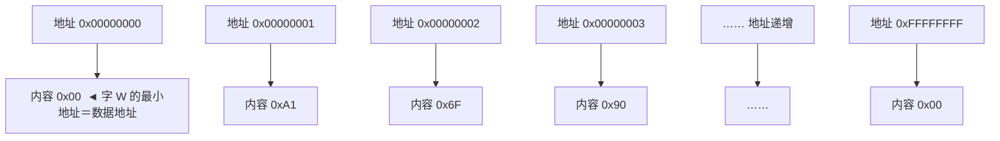

ASCII 备用图：

```
地址            内容(8 位/字节)
0x00000000  ┐   0x00   ┐
0x00000001  │   0xA1   │ 一个字 = 4 个连续单元
0x00000002  │   0x6F   │ 数据地址 = 最小的地址 = 0x00000000
0x00000003  ┘   0x90   ┘ （能被 4 整除，末两位为 0）
……              ……
0xFFFFFFFC      0x10
0xFFFFFFFF      0x00
```

小尾端下这 4 个字节组成的字是 **0x906FA100**（低字节 0x00 存低地址）。

**评分点**：①≥4 个单元地址—内容对应（2 分）；②字占 4 个连续单元、数据地址取最小地址（2 分）；③字地址 4 字节对齐（末两位为 0）（1 分）；④字节顺序符合小尾端（1 分）。
**常见错误**：数据地址写成最大地址；认为一个单元存 32 位；对齐只要求“被 2 整除”。

**5.（5 分）**


ASCII 备用图：

```
速度： 快 ──────────────────────────────► 慢
成本： 高 ──────────────────────────────► 低
容量： 小 ──────────────────────────────► 大

[寄存器 32个/18个可用]  ⇄  [Cache]  ⇄  [主存 内存]
   编号 8~25 可作变量         CPU 芯片内         G 字节规模
```

**评分点**：①三级顺序正确（寄存器—Cache—主存）（2 分）；②速度/容量/成本三个维度方向标对（2 分）；③注明 18 个可用变量寄存器、编号 8~25（1 分）。
**常见错误**：Cache 画到 CPU 外；速度/成本方向标反；写成 32 个寄存器都可作变量；漏 8~25 编号。

<div style="page-break-after: always"></div>

# 第三讲 寻址方式和指令集 复习题（对应课件 P74–P123）

> 作答约定：除题目明确说明存在延迟槽外，程序题按课程模拟器默认的“无分支延迟、无加载延迟”模型执行；此时 jal/jalr 保存调用指令地址加 4。经典带分支延迟槽的 MIPS 保存调用指令地址加 8。所有地址均按字节计；宏展开和周期数按题目指定的模型计算。


## 本讲覆盖要点与题号索引

| 课件页 | 知识点 | 对应题号 |
|---|---|---|
| P74 | 本讲两大内容：MIPS 寻址方式、整数类指令集 | 单1、填1 |
| P75 | 寻址方式定义：确定操作数地址与目标指令地址 | 单2、填2、判1 |
| P76 | 操作数寻址三种：寄存器/立即数/存储单元（基址） | 单3、单4、多1 |
| P77 | 存储器布局：保留区、代码段、数据段、栈向下增长 | 单5、单6、填3、判2、简1 |
| P78 | 基址寻址=基址+16 位补码位移；Load/Store 风格；lw/sw 格式 | 单7、单8、填4、简2 |
| P79 | `lw $t2,32($t0)` 字段值与机器码 0x8D0A0020 | 单9、计1 |
| P80 | 执行 lw 的第一阶段 IF：取指、PC+4 | 单10、填5 |
| P81 | RD/ALU 阶段：读寄存器堆、算有效地址 | 单11、填6 |
| P82 | MEM/WB 阶段：访问数据缓存、写回结果 | 简3 |
| P83 | `sw $s1,-32($t1)` 字段值与机器码 0xAD31FFE0 | 单12、计2 |
| P84 | 小尾端/大尾端，本书模拟器为小尾端 | 单13、填7、判3 |
| P85 | 目标地址寻址三种：相对/伪直接/寄存器间接 | 单14、多2 |
| P86 | 相对寻址：beq 行为与 imm=(y−x−4)>>2 | 单15、计3、判4 |
| P87 | 伪直接寻址：j / jal，PC=(P+4)[31:28]‖(Imm<<2) | 单16、计4、填8 |
| P88 | 寄存器间接寻址：jr / jalr | 单17、填9 |
| P89 | 整数指令集六类 | 单18、多3、简4 |
| P90 | 数据传送类：字/半字/字节、有符号/无符号、取数/存数 | 单19、填10 |
| P91 | lb/lh/lbu/lhu/lw/lui 与高位填充规则 | 单20、单21、判5、计5 |
| P92 | sb/sh/sw 与 mfhi/mflo/mthi/mtlo | 单22、填11、判6 |
| P93 | la/li 的 lui+ori 实现、move 的 addu 实现 | 单23、填12、简5 |
| P94 | add/addu 溢出差异、addi 为 16 位带符号 | 单24、判7、简6 |
| P95 | sub/subu；无减立即数指令，用 addi 负数 | 单25、填13 |
| P96 | 宏 neg=sub Rd,$0,Rs、abs 三条展开 | 填14、简7 |
| P97 | mult/multu/div/divu 与 HI/LO 存放规则 | 单26、填15、判8 |
| P98 | mul 宏两种展开（寄存器/立即数） | 填16、简7 |
| P99 | div/divu/rem/remu 宏：商与余数 | 填17、转7.1.4 |
| P100 | ax²+bx+c 例：取数到寄存器 | 转7.1.1 |
| P101 | ax²+bx+c 例：mul/add 计算 | 转7.1.1 |
| P102 | and/andi 清位：0xFFFF7FFE(0x7FFE) 例 | 单27、填18、计7 |
| P103 | andi 提取最低字节 ASCII：0x007F 例 | 转7.1.3 |
| P104 | or/ori 置位 0x8000+0x0080 例、nor | 多4、简8、计7 |
| P105 | xor/xori 取反 0x0020、寄存器清零 | 填19、判9 |
| P106 | 取反宏 not=nor Rd,Rs,$0 | 转7.1.3 |
| P107 | sll/sllv/srl/srlv/sra/srav 规则 | 多5、填20、简9 |
| P108 | 循环移位宏 rol/ror | 简9 |
| P109 | x*10+y 的移位实现 | 转7.1.2 |
| P110 | 条件设置类指令的作用 | 简10 |
| P111 | slt/sltu/slti/sltiu 与 seq/sgt/sge/sle/sne 宏 | 计8、转7.1.5 |
| P112 | beq/bne/bgez/bgtz/blez/bltz；beq 立即数经 $at | 单28、转7.1.7 |
| P113 | 宏 b/beqz/bge 展开 | 简10、转7.1.6 |
| P114 | bgeu/bgt/bgtu/ble/bleu/blt/bltu/bnez | 转7.1.6、编2 |
| P115 | 循环控制例：blez+addi+b | 读1 |
| P116 | 字符串长度统计例（lb/beqz/addiu/j） | 读2 |
| P117 | jal/jalr/jr 与参数传递 | 单17、简11 |
| P118 | string_len 调用例 | 读3 |
| P119 | string_len 函数体 | 读3、编1 |
| P120 | 五级流水线 IF/RD/ALU/MEM/WB 时空图 | 简11、判10 |
| P121 | 分支延迟槽定义（分支后那条指令必执行） | 判10、简11 |
| P122 | 填 nop、汇编器自动调整、SPIM 默认忽略 | 判10、简11 |
| P123 | 数据（加载）延迟；MIPS III 之后加锁 | 判11、简11 |

---

## 一、单项选择题（共 28 题）

1. 【课件P74】本讲（课件03）的主要内容是（　）。
   - A. 存储器层次与 Cache 设计
   - B. MIPS 架构定义的各种寻址方式和整数类指令集
   - C. 浮点指令与协处理器
   - D. 伪代码与算法开发

2. 【课件P75】寻址方式（addressing mode）要确定的两类地址是（　）。
   - A. 操作数所在位置的地址、目标指令所在位置的地址
   - B. 寄存器编号、栈指针
   - C. 物理地址、虚拟地址
   - D. 指令地址、数据地址的宽度

3. 【课件P76】`add $s0, $s1, $s2` 中，源操作数与目的操作数采用的寻址方式是（　）。
   - A. 立即数寻址
   - B. 基址寻址
   - C. 寄存器寻址
   - D. 相对寻址

4. 【课件P76】下列指令中，使用了立即数寻址的是（　）。
   - A. `add $t0,$t1,$t2`
   - B. `addi $s0,$s1,5`
   - C. `lw $t0,0($sp)`
   - D. `jr $ra`

5. 【课件P77】按本书 MIPS 存储器布局，用户程序（文本段 text segment）的起始地址是（　）。
   - A. 0x00000000
   - B. 0x00400000
   - C. 0x10000000
   - D. 0x10010000

6. 【课件P77】关于栈（stack）的增长方向，正确的是（　）。
   - A. 栈向高地址增长，入栈数据越多栈顶地址越大
   - B. 栈向低地址增长，入栈数据越多栈顶地址越小
   - C. 栈地址固定不变，只改变栈内偏移
   - D. 栈与堆都从 0x10000000 起向上增长

7. 【课件P78】基址寻址中，位移量（displacement）在指令中的形式是（　）。
   - A. 32 位无符号数
   - B. 16 位补码数（带符号数）
   - C. 26 位地址
   - D. 5 位立即数

8. 【课件P78】“Load/Store 风格”架构的含义是（　）。
   - A. 所有指令都可以直接访问主存
   - B. 只有取数/存数指令能访问主存，其它指令只操作寄存器
   - C. 取数和存数指令必须成对出现
   - D. 存储器与寄存器统一编址

9. 【课件P79】执行 `lw $t2,32($t0)`，若 `$t0=100`，则源操作数所在存储单元的起始地址是（　）。
   - A. 100　　　B. 132（0x00000084）　　　C. 68（0x00000044）　　　D. 32

10. 【课件P80】设该指令地址为 `0x00400000`，执行 `lw $t2,32($t0)` 的第一阶段（IF，取指）时，下列正确的是（　）。
    - A. PC 内容为 0x00400000，随后 PC←0x00400004
    - B. PC 内容为 0x00400004，随后 PC←0x00400004
    - C. PC 内容为 0x8D0A0020，随后 PC←0x00400000
    - D. PC 不变，只是把指令送入 ALU

11. 【课件P81】`lw $t2,32($t0)` 的机器码为 0x8D0A0020，已知 `$t0=100`，其中 rs 字段为 01000，则该字段选中的寄存器及 ALU 算出的有效地址分别是（　）。
    - A. $t2，0x00000020
    - B. $t0（8 号），0x00000084
    - C. $t0（8 号），0x00000064
    - D. $t2（10 号），0x00000084

12. 【课件P83】`sw $s1,-32($t1)`，若 `$t1=100`，则目的操作数所在存储单元地址与该指令机器码分别是（　）。
    - A. 0x00000044；0xAD31FFE0
    - B. 0x00000084；0xAD31FFE0
    - C. 0x00000044；0x8D31FFE0
    - D. 0x00000084；0x8D31FFE0

13. 【课件P84】本书模拟器建立在 Intel 系统上，处理字数据时采用（　）。
    - A. 大尾端：高位字节存低地址
    - B. 小尾端：低位字节存低地址
    - C. 两种方式随机选择
    - D. 由程序员在每条指令中指定

14. 【课件P85】MIPS 针对目标地址（转移地址）的寻址方式有（　）。
    - A. 寄存器寻址、立即数寻址、基址寻址
    - B. 相对寻址、伪直接寻址、寄存器间接寻址
    - C. 直接寻址、间接寻址、变址寻址
    - D. 顺序寻址、页式寻址、段式寻址

15. 【课件P86】某 `beq` 指令位于地址 0x00400020，标号 Label 在 0x00400038，则指令中 imm 字段的值为（　）。
    - A. 5　　　B. 6　　　C. 24　　　D. −5

16. 【课件P87】`j Label` 指令执行时的操作是（　）。
    - A. PC = PC + Imm<<2
    - B. PC = Imm
    - C. PC = (P+4)[31:28] ‖ (Imm<<2)
    - D. PC = R[rs]

17. 【课件P88】`jalr $rd, $rs` 指令执行时的操作是（　）。
    - A. R[$rd]=P+4；PC=R[$rs]（P为该指令地址，按无延迟模型）
    - B. R[$rs]=PC；PC=R[$rd]
    - C. R[$ra]=PC；PC=R[$rs]
    - D. PC=(P+4)[31:28]‖(Imm<<2)

18. 【课件P89】MIPS 整数指令集分为六类，下列不属于这六类的是（　）。
    - A. 数据传送类
    - B. 移位指令
    - C. 浮点运算类
    - D. 条件设置类

19. 【课件P90】数据传送类指令实现的功能是（　）。
    - A. 寄存器与寄存器之间的数据传送
    - B. 寄存器与内存之间的数据传送，可处理字/半字/字节及有符号/无符号数据
    - C. 只在内存内部搬移数据
    - D. 只完成地址计算

20. 【课件P91】若 `0($a0)` 指向的字节内容为 0x88，执行 `lb $t0,0($a0)` 后 `$t0` 的值是（　）。
    - A. 0x00000088　　B. 0xFFFFFF88　　C. 0x000000FF　　D. 0x0000FF88

21. 【课件P91】执行 `lui $t0,0x5A88` 后 `$t0` 的值是（　）。
    - A. 0x00005A88　　B. 0x5A880000　　C. 0x0000005A　　D. 0xFFFF5A88

22. 【课件P92】`sb $t0,0($a0)` 存入内存的是 `$t0` 中的（　）。
    - A. 最低有效字节（LSB）
    - B. 最低两个字节
    - C. 全部四个字节
    - D. 最高有效字节（MSB）

23. 【课件P93】宏指令 `la $t0, Label` 被汇编器翻译成（　）。
    - A. `lw $t0,0($gp)`
    - B. `lui $at,Label高16位` + `ori $t0,$at,Label低16位`
    - C. `li $t0,Label低16位`
    - D. `addiu $t0,$0,Label`

24. 【课件P94】`addi $s0,$s1,imm` 中 imm 的位数与解释方式是（　）。
    - A. 32 位无符号数
    - B. 16 位无符号数
    - C. 16 位带符号数（符号扩展为 32 位）
    - D. 26 位带符号数

25. 【课件P95】MIPS 没有“减立即数”指令，若要实现 `$t0 = $t1 − 5`，应使用（　）。
    - A. `subi $t0,$t1,5`
    - B. `addi $t0,$t1,-5`
    - C. `sub $t0,$t1,5`
    - D. `addiu $t0,$t1,5`

26. 【课件P97】执行 `div $a1,$s1` 后，（　）。
    - A. 商在 HI，余数在 LO
    - B. 商在 LO，余数在 HI
    - C. 商和余数都在 LO
    - D. 商在 $v0，余数在 $v1

27. 【课件P102】已知 `$a1` 高 16 位全为 0，将其 bit0 和 bit15 清零、其它位不变，正确指令是（　）。
    - A. `andi $a1,$a1,0x7FFE`
    - B. `ori $a1,$a1,0x7FFE`
    - C. `xori $a1,$a1,0x8001`
    - D. `andi $a1,$a1,0xFFFF`

28. 【课件P112】`beq $t0, 5, Label` 中的第二操作数是立即数，汇编器把它当作宏指令，先（　）。
    - A. 用 `ori $at,$zero,5` 装入 `$at`，再执行 `beq $t0,$at,Label`
    - B. 直接用 I 格式的 imm 字段存 5
    - C. 用 `lui $at,5` 装入 `$at`
    - D. 报错，beq 不允许立即数

---

## 二、多项选择题（共 5 题）

1. 【课件P76】MIPS 架构中针对操作数的寻址方式包括（　）。
   - A. 寄存器寻址
   - B. 立即数寻址
   - C. 存储单元寻址（基址寻址）
   - D. 相对寻址

2. 【课件P85】下列关于目标地址寻址的叙述，正确的有（　）。
   - A. 条件转移指令使用相对寻址，I 格式
   - B. `j`、`jal` 使用伪直接寻址，J 格式
   - C. `jr`、`jalr` 使用寄存器间接寻址，R 格式
   - D. 分支转移的实质是通过修改现行 PC 内的地址改变程序顺序执行的行为

3. 【课件P89】MIPS 整数指令集包含的类别有（　）。
   - A. 数据传送类、算术/逻辑运算类
   - B. 移位指令、条件设置类
   - C. 分支转移类、系统调用指令
   - D. 浮点运算类、协处理器指令

4. 【课件P102/P104】下列逻辑运算用途中，正确的有（　）。
   - A. 用 and/andi 将某些二进制位清零（复位）
   - B. 用 and/andi 分离（隔离）出一个字节、半字或字中的某些位
   - C. 用 or/ori 将某些二进制位置 1（置位）
   - D. 用 nor 可直接把两个操作数按位异或

5. 【课件P107/P108】关于移位指令，正确的有（　）。
   - A. 逻辑左移移出的空位补 0
   - B. 逻辑右移移出的空位补 0
   - C. 算术右移移出的空位补符号位
   - D. `sllv` 的移位次数取 Rsrc2 的全部 32 位

---

## 三、填空题（共 20 题）

1. 【课件P74】本讲内容包括 MIPS 架构定义的______和______。

2. 【课件P75】寻址方式就是确定地址的方式，它要确定______的地址和______的地址。

3. 【课件P77】地址空间 0x0 到 0x00400000 的部分保留给______使用；用户代码（文本段）从______开始；数据段从______开始；栈向______增长。

4. 【课件P78】基址寻址的有效地址＝______＋______，其中位移量在指令中以______位补码数存放。

5. 【课件P80】执行 `lw $t2,32($t0)` 的取指阶段，PC 中为______，该值送指令缓存取出指令 0x8D0A0020，同时 PC 更新为______。

6. 【课件P81】`lw $t2,32($t0)` 中 rs 字段 01000 选中基址寄存器______，ALU 将基址 0x00000064 与位移 0x00000020 相加得有效地址______。

7. 【课件P84】将字 0x12345678 存到起始地址 0x10000000 处，小尾端方式下 0x10000000 单元的内容是______，0x10000003 单元的内容是______。

8. 【课件P87】J 指令格式中，操作码占______位，Imm 占______位；`j Label` 执行后 PC＝______。

9. 【课件P88】`jr $rs` 执行后 PC＝______；`jalr $rd,$rs` 执行后 R[$rd]＝______，PC＝______。

10. 【课件P90】数据传送类指令实现______和______之间的数据传送，数据规模有______、______和______三种。

11. 【课件P92】`sh $t0,0($a0)` 将 `$t0` 中的______个字节（低 16 位）存到内存；把 HI 中数据复制到通用寄存器用指令______。

12. 【课件P93】`la` 与 `li` 的实现方法相同，都是先用______，再用______；`move $t0,$t1` 的实现是______。

13. 【课件P95】无减立即数指令，可用______指令实现，此时要求 imm 为______。

14. 【课件P96】宏 `neg $t0,$t1` 展开为______；宏 `abs $t0,$t1` 展开为三条指令：______、______、______。

15. 【课件P97】`mult` 得到的 64 位积分别存放在______和______中，其中高 32 位在______寄存器；`div` 的商存放在______，余数存放在______。

16. 【课件P98】宏 `mul $t4,$t0,$t1` 展开为______、______；若第二操作数是立即数，则先用______把立即数装入 `$at`。

17. 【课件P99】宏 `div $t0,$t1,$t2` 中 `$t0` 存放______，宏 `rem $t0,$t1,$t2` 中 `$t0` 存放______。

18. 【课件P102】`andi $a1,$a1,0x7FFE` 的功能是______（0x7FFE＝0111 1111 1111 1110）。

19. 【课件P105】`xori $a1,$a1,0x0020` 的功能是______；`xor $a1,$a1,$a1` 的功能是______。

20. 【课件P107】`sra` 移出的空位补______；`srlv $rd,$rt,$rs` 的移位次数取 `$rs` 的______位；高级语言中算术右移 1 位相当于有符号数______。

---

## 四、判断题（共 11 题，正确写“对”，错误写“错”并改正）

1. 【课件P75】寻址方式只用于确定操作数所在的地址。（　）

2. 【课件P77】栈是向上增长的，入栈数据越多栈顶地址越大。（　）

3. 【课件P84】本书模拟器采用大尾端方式存储字数据，即高位字节放在低地址。（　）

4. 【课件P86】`beq` 指令中的 imm 就是目标标号地址与当前指令地址之差。（　）

5. 【课件P91】`lb` 取出一个字节后，寄存器高 24 位用 0 填充。（　）

6. 【课件P92】`mfhi $t0` 的作用是把 `$t0` 的内容送到 HI 寄存器。（　）

7. 【课件P94】`addu` 在结果溢出时会产生溢出异常。（　）

8. 【课件P97】`mult` 得到的 64 位积，其高 32 位存放在 LO 中。（　）

9. 【课件P105】可用 `xori $a1,$a1,$a1` 把寄存器清零。（　）

10. 【课件P122】SPIM 模拟器默认开启分支延迟槽特性，因此分支指令后的那条指令不会被执行。（　）

11. 【课件P123】`lw` 取回的数据在紧接着的下一条指令中即可安全使用，MIPS 从未对加载延迟做处理。（　）

---

## 五、简答题（共 11 题）

1. 【课件P77】画出（叙述）MIPS 32 位存储器布局，说明保留区、文本段、数据段、栈段的位置与增长方向。（6 分）

2. 【课件P78】什么是基址寻址？什么是“Load/Store”风格架构？（6 分）

3. 【课件P80–P82】以 `lw $t2,32($t0)` 为例，说明五个阶段 IF、RD、ALU、MEM、WB 各完成什么操作。（8 分）

4. 【课件P89】写出 MIPS 整数指令集的六个类别，并各举一条指令。（6 分）

5. 【课件P93】说明 `la`、`li`、`move` 三条宏指令的展开实现，并说明为何 `la` 与 `li` 的实现方法相同。（6 分）

6. 【课件P94/P95】比较 `add` 与 `addu`、`sub` 与 `subu` 的区别；为什么 MIPS 不设 `subi` 指令？（6 分）

7. 【课件P96/P98】写出 `neg`、`abs`、`mul`（寄存器形式/立即数形式）的宏展开代码。（8 分）

8. 【课件P104】用 or 类指令把 `$a1` 的 bit7 和 bit31 置 1、其它位不变，写出三步代码并说明每步作用。（6 分）

9. 【课件P107/P108】说明 sll、srl、sra 三条移位指令对空位的填充规则及对应的数值意义；`rol`、`ror` 宏完成什么操作？（6 分）

10. 【课件P110–P114】条件设置指令的作用是什么？写出 `bge $t0,$t1,Label`、`beqz $t2,Label`、`b Label` 三条宏指令的展开。（8 分）

11. 【课件P120–P123】什么是分支延迟槽？什么是数据（加载）延迟？汇编程序员应如何对待延迟槽？SPIM 默认如何处理？（8 分）

---

## 六、计算与编码题（共 8 题）

1. 【课件P79】`lw $t2,32($t0)`（`$t0=100`）：（1）求有效地址；（2）写出 I 格式各字段的十进制值与二进制值；（3）写出机器码。

2. 【课件P83】`sw $s1,-32($t1)`（`$t1=100`）：求目的地址、各字段值（含 imm 的补码二进制）与机器码。

3. 【课件P86】`beq $s0,$s1,Loop` 位于地址 0x00400020，Loop 位于 0x00400038：（1）按 imm=(y−x−4)>>2 求 imm；（2）写字段与机器码；（3）若把 Loop 改到 0x00400008，imm 变为多少？

4. 【课件P87】`jal Sub` 位于 0x00400010，Sub 入口为 0x00400040：（1）求 26 位 Imm；（2）写出 J 格式字段与机器码；（3）执行后 `$ra` 的值是多少？

5. 【课件P91】内存 `0($a0)` 起的连续 4 个单元（小尾端）存放 0x12345688。求下列指令执行后目标寄存器的值：（1）`lb $t0,0($a0)`；（2）`lbu $t0,0($a0)`；（3）`lh $t0,0($a0)`；（4）`lhu $t0,2($a0)`；（5）`lw $t0,0($a0)`。

6. 【课件P93】用 `li $t0,0x12345678` 说明宏展开：（1）写出两条展开指令；（2）分别算出机器码；（3）说明 `$at` 的作用。

7. 【课件P102/P104】（1）已知 `$a1` 高 16 位为 0，用一条指令把 bit0、bit15 清零；（2）用三条指令把 `$a1` 的 bit7、bit31 置 1；（3）算出（2）中三条指令的机器码。

8. 【课件P111】`slt $t0,$s1,$t2`：（1）说明其功能；（2）写出机器码；（3）用 `slt` 实现“`$t3=1` 当且仅当 `$t1 ≥ $t2`（有符号）”，写出代码。

---

## 七、代码转换题（共 21 题）

### 7.1 C 语言 → MIPS 汇编（8 题，答案给完整可运行程序）

1. 【课件P100/P101】已知内存变量 X、A、B、C，计算 `y = a*x*x + b*x + c` 并输出 y。

2. 【课件P109】已知内存变量 x、y，用移位指令（不用乘法）计算 `z = x*10 + y` 并输出 z。

3. 【课件P103/P106】设 `a` 为内存字变量：`a = a & 0xFFFF7FFE;`（把 bit0、bit15 清零）`a = ~a;`（按位取反）。

4. 【课件P99】已知 `a`、`b`：`q = a / b; r = a % b;`（有符号），输出 q 与 r。

5. 【课件P111】`if (a < b) s = 1; else s = 0;`（a、b 为有符号内存变量）。

6. 【课件P114/P113】`sum = 0; i = 1; while (i <= n) { sum += i; i++; }`（n 为内存变量），输出 sum。

7. 【课件P112】`if (x == 5) y = 100; else y = 200;`（x、y 为内存变量）。

8. 【课件P102/P107】`y = (a & 0x00FF) | (b << 8);`（a、b、y 为内存变量）。

### 7.2 MIPS 汇编 → 机器码（6 题，必须给出字段分解）

1. `addi $s0,$s1,5`
2. `lw $t2,32($t0)`
3. `sw $s1,-32($t1)`
4. `beq $s0,$s1,Loop`（位于 0x00400020，Loop 在 0x00400038）
5. `jal Sub`（Sub 在 0x00400040）
6. `slt $t0,$s1,$t2`

### 7.3 机器码 → MIPS 汇编（反汇编，7 题）

1. 【课件P86】0x1109FFFD（该指令在 0x00400040）：写出指令并反算目标地址。
2. 【课件P94】0x2129FFFF：写出指令并给出 imm 的十进制值。
3. 【课件P93】连续两条：0x3C011001、0x34290004：写成一条更简洁的汇编语句。
4. 【课件P91】0x81090002。
5. 【课件P92】0xAD0A0004。
6. 【课件P87】0x0810000A（该指令在 0x00400000）。
7. 【综合】0x02644020 与 0x0000000C。

---

## 八、读程序写结果（共 3 题）

1. 【课件P115】写出执行后 `$s6`、`$t0` 的值及循环体执行次数。
   ```asm
           li   $s6, 5
           li   $t0, 0
   again:  blez $s6, Quit      # $s6<=0 则退出
           addi $s6, $s6, -1   # 循环控制变量减 1
           add  $t0, $t0, $s6  # 累加
           b    again
   Quit:
   ```

2. 【课件P116】写出输出结果及结束时 `$t1`、`$t2` 的值（`str` 在数据段）。
   ```asm
   .data
   str:    .asciiz "MIPS!"
   .text
           la   $t2, str
           xor  $t1, $t1, $t1
   nextCh: lb   $t0, ($t2)
           beqz $t0, strEnd
           addiu $t1, $t1, 1
           addiu $t2, $t2, 1
           j    nextCh
   strEnd: move $a0, $t1
           li   $v0, 1
           syscall
           li   $v0, 10
           syscall
   ```

3. 【课件P118/P119】写出屏幕输出、string_len刚返回时的 `$v0/$a0`，以及main执行 `move $t0,$v0` 后的 `$t0`。
   ```asm
   .data
   msg:    .asciiz "Hello\n"
   .text
   .globl main
   main:   la   $a0, msg
           jal  string_len
           move $t0, $v0
           move $a0, $t0
           li   $v0, 1
           syscall
           li   $v0, 10
           syscall
   string_len:
           li   $v0, 0
   Loop:   lb   $t0, ($a0)
           beq  $t0, 0xA, done
           beqz $t0, done
           addu $a0, $a0, 1
           addu $v0, $v0, 1
           b    Loop
   done:   jr   $ra
   ```

---

## 九、程序设计与综合题（共 2 题）

1. 【10 分】【课件P116–P119】编写完整程序：在数据段定义字符串 `"Hello MIPS"`，用 `jal` 调用子程序 `string_len` 统计长度（不得使用系统调用 8），主程序用 syscall 1 输出长度并换行。要求：`.data`/`.text`、参数用 `$a0` 传、结果用 `$v0` 返回、注释清楚。

2. 【12 分】【课件P113/P114】数组 `arr` 有 6 个有符号字（3,−1,7,4,9,2）：用循环求全部元素之和与最大值，分别存入 `sum`、`max` 并输出（同一行输出，中间用空格分隔）。要求：使用 `bge`/`bgt` 等宏指令、用 `sll` 计算字节偏移，并说明若硬件存在加载延迟时应如何修改。

---

## 十、作图题（共 4 题）

1. 【课件P77】（6 分）画出 MIPS 存储器（地址空间）布局图：要求标出保留区 0x00000000–0x003FFFFF、用户代码段从 0x00400000 开始、数据区从 0x10000000 开始（其中本课程示例的静态数据通常从 0x10010000 开始）、堆向上增长、栈向下增长，并用箭头标出堆与栈的增长方向。

2. 【课件P84】（6 分）画出小尾端（little-endian）与大尾端（big-endian）两种方式下 `0x12345678` 在地址 A、A+1、A+2、A+3 中的字节排列图，并指出 SPIM/MARS 采用哪一种。

3. 【课件P79/P86】（8 分）（1）画出基址寻址有效地址计算示意图：设 `$t0=100`，`lw $t2,32($t0)`，结果 132＝0x84，图中标出基址寄存器、16 位补码位移量、加法器与数据缓存。（2）画出相对寻址计算示意图：`beq` 位于地址 x，转移目标为 y，imm=(y−x−4)>>2，说明 PC 先加 4 再与 imm<<2 相加得到 y。

4. 【课件P120–P122】（8 分）画出五级流水线（IF/RD/ALU/MEM/WB）时空图：横轴为时间（周期 1~9），纵轴为指令 1~4（第 1 条为分支指令），每格标出所处阶段；在图上标出“分支延迟槽”的位置，说明什么条件下可填有效指令、什么条件下才应填 nop。

---

# 参考答案与解析

## 一、单项选择题

1. **B**。
2. **A**。P75：寻址即确定“操作数所在位置的地址”和“目标指令所在位置的地址”。
3. **C**。三个操作数都在寄存器中，均为寄存器寻址。
4. **B**。立即数紧跟在操作码后“立即”出现在指令中。
5. **B**。0x00400000 起为文本段；数据段 0x10000000 起。
6. **B**。栈向下增长，入栈越多栈顶地址越小；数据段（堆）向上增长。
7. **B**。I 格式中 16 位立即数字段按补码（符号扩展）解释，范围 −32768~32767。
8. **B**。
9. **B**。100+32=132=0x84。
10. **A**。IF：PC→指令缓存取指，同时 PC←PC+4。
11. **B**。rs=01000 即 8 号寄存器 `$t0`；0x64+0x20=0x84。rt=01010 才是 `$t2`（结果去向）。
12. **A**。100−32=68=0x44；`sw` op=43=101011，rt=`$s1`=17=10001，imm=−32=1111 1111 1110 0000。
13. **B**。
14. **B**。
15. **A**。imm=(0x00400038−0x00400020−4)>>2=(0x14)>>2=5。
16. **C**。
17. **A**。（`jal Label` 才是把返回地址存 `$ra`。）
18. **C**。六类：数据传送、算术/逻辑运算、移位、条件设置、分支转移、系统调用。
19. **B**。
20. **B**。lb 为符号扩展：0x88 最高位为 1，高位补 1 → 0xFFFFFF88。
21. **B**。
22. **A**。
23. **B**。
24. **C**。
25. **B**。加负数即减。
26. **B**。
27. **A**。题设高 16 位为 0，故可用 `andi 0x7FFE`。`andi` 的立即数零扩展为 `0x00007FFE`，会同时清掉高 16 位；若要求保留任意高 16 位，必须先构造 `0xFFFF7FFE` 再用寄存器形式 `and`，不能直接把 32 位掩码缩短为 16 位。
28. **A**。beq 第二操作数为立即数时成为宏指令，经 `$at` 中转。

## 二、多项选择题

1. **ABC**。D 相对寻址属于“目标地址寻址”，不是操作数寻址。
2. **ABCD**。
3. **ABC**。D 浮点与协处理器指令不属于整数指令集。
4. **ABC**。D 错：nor 是“或非”，异或要用 `xor/xori`。
5. **ABC**。D 错：`sllv/srlv/srav` 只用 Rsrc2 的低 5 位（0~31）作移位次数。

## 三、填空题

1. MIPS 架构定义的各种寻址方式；整数类指令集
2. 操作数所在位置；目标指令所在位置
3. 操作系统；0x00400000；0x10000000；低地址（向下）
4. 基地址（某通用寄存器内容）；位移量；16
5. 0x00400000；0x00400004
6. `$t0`；0x00000084
7. 0x78；0x12（0x10000000=0x78、01=0x56、02=0x34、03=0x12）
8. 6；26；(P+4)[31:28]‖(Imm<<2)
9. R[$rs]；P+4（无延迟模型的返回地址）；R[$rs]
10. 寄存器；内存（主存）；字；半字；字节
11. 2；`mfhi $rd`
12. `lui $at, 高 16 位`；`ori Rd,$at,低 16 位`；`addu $t0,$0,$t1`
13. `addi`；负数
14. `sub $t0,$0,$t1`；`addu $t0,$0,$t1`、`bgez $t1,1`（跳过下一条）、`sub $t0,$0,$t1`
15. HI；LO；HI；LO；HI
16. `mult $t0,$t1`；`mflo $t4`；`ori $at,$zero,imm`
17. 商；余数
18. 立即数零扩展为 `0x00007FFE`，把高 16 位及 bit15、bit0 清零，保留 bit14–bit1。
19. 把 bit5 取反，其余位不变；把 `$a1` 清零（赋初值 0）
20. 符号位（最高位）；低 5 位；除以 2 后向负无穷取整（负奇数与 C 的向零取整不同）。

## 四、判断题

1. **错**。寻址还要确定**目标指令（转移目标）所在位置的地址**。
2. **错**。栈**向下**增长，入栈越多栈顶地址**越小**。
3. **错**。本书模拟器建立在 Intel 系统上，采用**小尾端**（低位字节存低地址）。
4. **错**。imm=(y−x−4)>>2，即“差值先减 4（IF 已使 PC 加 4）再右移 2 位（指令按 4 字节对齐）”。
5. **错**。`lb` 用**符号位**填充高 24 位（0x88→0xFFFFFF88）；`lbu` 才补 0。
6. **错**。`mfhi $t0` 是 HI→`$t0`；`$t0`→HI 是 `mthi $t0`。
7. **错**。`addu` 不产生溢出异常；`add` 才可能产生。
8. **错**。高 32 位在 **HI**，低 32 位在 LO。
9. **错**。`xori` 的立即数不能是寄存器；清零应写 `xor $a1,$a1,$a1`。
10. **错**。SPIM **默认忽略**分支延迟槽（可在设置中打开），分支后一条指令正常按序执行与否由是否跳转决定。
11. **错**。加载数据最快只能在**再后一条**指令使用（加载延迟）；**MIPS III 之后的标准会锁住**该延迟，SPIM 默认忽略此特性。

## 五、简答题

1. 要点：①地址空间 0x0~0x00400000（0x0~0x003FFFFF）保留给操作系统（2 分）；②0x00400000~0x0FFFFFFF 为文本段（代码段）（1 分）；③0x10000000~0x7FFFFFFF 为数据段与堆栈段，数据段由代码控制、一般按地址递增使用（堆向上）（2 分）；④栈向下增长，入栈越多栈顶地址越小（1 分）。
2. 要点：①基址寻址＝基地址＋位移量；基地址存放在某个通用寄存器中，位移量在指令中以 16 位补码数存放，写作 `offset(rs)`（3 分）；②CPU 访问主存只能通过取数/存数（Load/Store）指令，其它指令不能直接访问存储单元（3 分）。
3. 要点：①IF：按 PC 从指令缓存取指令 0x8D0A0020，PC←PC+4（2 分）；②RD：按 rs=01000、rt=01010 读寄存器堆，取出基址 0x00000064，同时 imm 符号扩展为 0x20（2 分）；③ALU：基址+位移=0x00000084（2 分）；④MEM：以 0x84 为地址访问数据缓存，读出字（如 0x1234FFFF）（1 分）；⑤WB：把读出的数据写回 rt 指定的 `$t2`（1 分）。
4. 要点（每类 1 分）：数据传送类（`lw`）、算术/逻辑运算类（`add`/`and`）、移位指令（`sll`）、条件设置类（`slt`）、分支转移类（`beq`）、系统调用指令（`syscall`）。
5. 要点：①`la Rd,addr` → `lui $at,addr高16位` + `ori Rd,$at,addr低16位`（2 分）；②`li Rd,imm` 同样两条（2 分）；③地址与 32 位立即数都是 32 位规模数据，而 `lui` 只能装高 16 位、`ori` 只能装低 16 位，故实现方法相同（1 分）；④`move Rd,Rs` → `addu Rd,$0,Rs`（1 分）。
6. 要点：①`add/sub` 视操作数为有符号数，溢出时产生溢出（overflow）异常（2 分）；②`addu/subu` 不产生溢出异常（2 分）；③减法本质是“加负数”，`addi` 的 imm 是 16 位带符号数，写负立即数即可实现减立即数，故不必单设 `subi`（2 分）。
7. 要点：①`neg Rd,Rs` → `sub Rd,$0,Rs`（2 分）；②`abs Rd,Rs` → `addu Rd,$0,Rs`；`bgez Rs,1`；`sub Rd,$0,Rs`（3 分）；③`mul Rd,Rs1,Rs2`（寄存器）→ `mult Rs1,Rs2`＋`mflo Rd`（2 分）；④立即数 → `ori $at,$zero,imm`＋`mult Rs1,$at`＋`mflo Rd`（1 分）。
8. 要点：①`lui $t1,0x8000`：把 bit15 的 1 放到高 16 位，即得到 0x80000000，用于置 bit31（2 分）；②`ori $t1,$t1,0x0080`（课件简写为 `ori $t1,0x0080`）把 `$t1` 的低位中 bit7 置 1，得掩码 0x80000080（2 分）；③`or $a1,$a1,$t1`：按位或，使 bit31、bit7 变 1，其它位不变（2 分）。
9. 要点：①`sll` 逻辑左移、空位补 0，相当于无符号数乘 2^n（2 分）；②`srl` 逻辑右移、空位补 0，相当于无符号数除 2^n（2 分）；③`sra` 算术右移、空位补符号位，相当于有符号数除 2^n 后向负无穷取整，负奇数不能直接替代 C 的整除（1 分）；④`rol/ror` 为循环移位宏：移出的位不丢失、补到另一端（1 分）。
10. 要点：①条件设置（比较）指令比较两个操作数，第一个小于第二个时把目的寄存器置 1，否则置 0，为条件转移准备条件，用于实现分支/循环结构（3 分）；②`bge $t0,$t1,Label` → `slt $at,$t0,$t1`＋`beq $at,$0,Label`（2 分）；③`beqz $t2,Label` → `beq $t2,$0,Label`（1 分）；④`b Label` → `bgez $0,Label`（2 分）。
11. 要点：①五级流水 IF/RD/ALU/MEM/WB 重叠执行，跳转指令处于执行阶段时下一条指令已开始执行，分支指令之后的那条指令位置称分支延迟槽，该槽内指令总会被执行（3 分）；②应尽量填充有效指令以提高效率，无指令可填时必须填 `nop`（2 分）；③很多汇编器会自动调整代码隐藏该特性（1 分）；④SPIM 默认忽略分支延迟槽（可在设置中打开）（1 分）；⑤加载延迟：`lw` 结果最早只能在再后一条指令使用，MIPS III 之后标准会锁住该延迟（1 分）。

## 六、计算与编码题

1. （1）有效地址＝100+32＝132＝**0x00000084**。（2）op=35=100011、rs=8(`$t0`)=01000、rt=10(`$t2`)=01010、imm=32=0000 0000 0010 0000。（3）机器码＝100011 01000 01010 0000 0000 0010 0000＝**0x8D0A0020**。

2. 目的地址＝100−32＝68＝**0x00000044**；op=43=101011、rs=9(`$t1`)=01001、rt=17(`$s1`)=10001、imm=−32=1111 1111 1110 0000；机器码＝101011 01001 10001 1111 1111 1110 0000＝**0xAD31FFE0**。

3. （1）imm=(0x00400038−0x00400020−4)>>2=(0x14)>>2=**5**。（2）op=4=000100、rs=16=10000、rt=17=10001、imm=5=0000 0000 0000 0101 → 机器码＝**0x12110005**。（3）imm=(0x08−0x20−4)>>2=(−28)>>2=**−7**=0xFFF9，机器码变为 0x1211FFF9。

4. （1）Imm＝目标地址>>2 的低 26 位＝(0x00400040>>2)&0x3FFFFFF＝0x00100010。（2）op=3=000011、Imm=00 0000 0001 0000 0000 0000 0001 0000 → 机器码＝**0x0C100010**。（3）`$ra`＝jal 的下一条指令地址＝**0x00400014**（即 PC+4，PC 指 jal 本身地址）。

5. 内存：0x00 单元=0x88（最低字节），0x01=0x56，0x02=0x34，0x03=0x12。
   （1）`lb`：取 0x88 并符号扩展 → **0xFFFFFF88**；
   （2）`lbu`：0 扩展 → **0x00000088**；
   （3）`lh`：半字 0x5688，符号位为 0 → **0x00005688**；
   （4）`lhu 2($a0)`：半字 0x1234，0 扩展 → **0x00001234**；
   （5）`lw`：整字 → **0x12345688**。

6. （1）`lui $t0,0x1234` ；`ori $t0,$t0,0x5678`。（2）lui：op=15=001111、rs=0、rt=8=01000、imm=0x1234 → 001111 00000 01000 0001 0010 0011 0100＝**0x3C081234**；ori：op=13=001101、rs=8、rt=8、imm=0x5678 → 001101 01000 01000 0101 0110 0111 1000＝**0x35085678**。（3）`$at` 是汇编器专用的临时寄存器（1 号），宏指令用它暂存高 16 位，故 `la/li` 会破坏 `$at`，程序中不应长期占用 `$at`。

7. （1）`andi $a1,$a1,0x7FFE`（bit15、bit0 清零）。（2）`lui $t1,0x8000` → `ori $t1,$t1,0x0080` → `or $a1,$a1,$t1`。（3）①**0x3C098000**（op=15、rs=0、rt=9、imm=0x8000）；②**0x35290080**（op=13、rs=9、rt=9、imm=0x0080）；③or：op=0、rs=5(`$a1`)、rt=9(`$t1`)、rd=5、shamt=0、funct=0x25 → 000000 00101 01001 00101 00000 100101＝**0x00A92825**。

8. （1）若 R[$s1]<R[$t2]（有符号比较），`$t0`=1，否则 `$t0`=0。（2）op=0、rs=17=10001、rt=10=01010、rd=8=01000、shamt=00000、funct=0x2A=101010 → **0x022A402A**。（3）`$t1 ≥ $t2` 即 `($t1 < $t2) == 0`：`slt $t3,$t1,$t2`；`xori $t3,$t3,0x0001`（或 `beq` 分支实现）。

## 七、代码转换题

### 7.1 C → MIPS

1. 
```asm
.data
X: .word 3
A: .word 2
B: .word 5
C: .word 7
.text
.globl main
main:
    lw   $t0, X            # $t0 = x
    lw   $t1, A            # $t1 = a
    lw   $t2, B            # $t2 = b
    lw   $t3, C            # $t3 = c
    mul  $t4, $t0, $t0     # $t4 = x*x
    mul  $t4, $t4, $t1     # $t4 = a*x^2
    mul  $t5, $t2, $t0     # $t5 = b*x
    add  $t4, $t4, $t5     # $t4 = a*x^2+b*x
    add  $t4, $t4, $t3     # $t4 = a*x^2+b*x+c
    move $a0, $t4          # 输出结果（2*9+15+7=40）
    li   $v0, 1
    syscall
    li   $v0, 10
    syscall
```
输出 `40`。

2. 
```asm
.data
x: .word 7
y: .word 3
.text
.globl main
main:
    lw   $t1, x
    lw   $t2, y
    sll  $t1, $t1, 1       # $t1 = x*2
    move $t3, $t1          # 暂存 x*2
    sll  $t1, $t1, 2       # $t1 = x*8
    add  $t1, $t1, $t3     # $t1 = x*10
    add  $t1, $t1, $t2     # $t1 = x*10+y
    move $a0, $t1          # 7*10+3 = 73
    li   $v0, 1
    syscall
    li   $v0, 10
    syscall
```
输出 `73`。

3. 
```asm
.data
a: .word 0xFFFFFFFF
.text
.globl main
main:
    lw   $t0, a
    lui  $t1, 0xFFFF
    ori  $t1, $t1, 0x7FFE  # 构造完整掩码 0xFFFF7FFE
    and  $t0, $t0, $t1     # 保留高 16 位，仅清 bit15、bit0
    nor  $t0, $t0, $0      # 按位取反（not 的展开）
    sw   $t0, a
    move $a0, $t0          # 清位后为 0xFFFF7FFE，取反为 0x00008001
    li   $v0, 1
    syscall
    li   $v0, 10
    syscall
```
（`0xFFFFFFFF & 0xFFFF7FFE = 0xFFFF7FFE`，取反得 `0x00008001`，输出 `32769`。）

4. 
```asm
.data
a: .word 17
b: .word 5
sp: .asciiz " "
.text
.globl main
main:
    lw    $t0, a
    lw    $t1, b
    div   $t0, $t1
    mflo  $t2              # q = a/b
    mfhi  $t3              # r = a%b
    move  $a0, $t2
    li    $v0, 1
    syscall                # 打印商 3
    la    $a0, sp
    li    $v0, 4
    syscall                # 打印空格
    move  $a0, $t3
    li    $v0, 1
    syscall                # 打印余数 2
    li    $v0, 10
    syscall
```

5. 
```asm
.data
a: .word 4
b: .word 9
s: .word 0
.text
.globl main
main:
    lw   $t0, a
    lw   $t1, b
    slt  $t2, $t0, $t1     # $t2 = (a<b) ? 1 : 0
    sw   $t2, s
    move $a0, $t2
    li   $v0, 1
    syscall                # 输出 1
    li   $v0, 10
    syscall
```
若必须用 if…else 结构，可写：`slt $t2,$t0,$t1` / `beq $t2,$0,Else` / `li $t2,1` / `b End` / `Else: li $t2,0` / `End:`。

6. 
```asm
.data
n:   .word 10
sum: .word 0
.text
.globl main
main:
    lw   $t0, n            # 上界 n
    li   $t1, 1            # i = 1
    li   $t2, 0            # sum = 0
loop:
    bgt  $t1, $t0, done    # i > n 则结束（宏：slt $at,$t0,$t1; bne $at,$0,done）
    add  $t2, $t2, $t1     # sum += i
    addi $t1, $t1, 1       # i++
    b    loop
done:
    sw   $t2, sum
    move $a0, $t2
    li   $v0, 1
    syscall                # 1+...+10 = 55
    li   $v0, 10
    syscall
```

7. 
```asm
.data
x: .word 5
y: .word 0
.text
.globl main
main:
    lw   $t0, x
    li   $t1, 100
    beq  $t0, 5, Then      # 立即数形式：ori $at,$zero,5; beq $t0,$at,Then
    li   $t1, 200
Then:
    sw   $t1, y
    move $a0, $t1
    li   $v0, 1
    syscall                # x=5，输出 100
    li   $v0, 10
    syscall
```

8. 
```asm
.data
a: .word 0x1234
b: .word 0x0005
y: .word 0
.text
.globl main
main:
    lw   $t0, a
    lw   $t1, b
    andi $t0, $t0, 0x00FF  # 取出 a 的低字节
    sll  $t1, $t1, 8       # b 左移 8 位
    or   $t2, $t0, $t1     # 拼接
    sw   $t2, y
    move $a0, $t2
    li   $v0, 1
    syscall                # 0x34 | 0x500 = 0x534 = 1332
    li   $v0, 10
    syscall
```

### 7.2 MIPS → 机器码

1. `addi $s0,$s1,5`：op=8=001000、rs=`$s1`=17=10001、rt=`$s0`=16=10000、imm=5=0000 0000 0000 0101
   → 001000 10001 10000 0000 0000 0000 0101 → **0x22300005**

2. `lw $t2,32($t0)`：op=35=100011、rs=8=01000、rt=10=01010、imm=32=0000 0000 0010 0000
   → 100011 01000 01010 0000 0000 0010 0000 → **0x8D0A0020**

3. `sw $s1,-32($t1)`：op=43=101011、rs=9=01001、rt=17=10001、imm=−32=1111 1111 1110 0000
   → 101011 01001 10001 1111 1111 1110 0000 → **0xAD31FFE0**

4. imm=(0x00400038−0x00400020−4)>>2=5=0000 0000 0000 0101；op=4、rs=16=10000、rt=17=10001
   → 000100 10000 10001 0000 0000 0000 0101 → **0x12110005**

5. Imm=(0x00400040>>2)&0x3FFFFFF=0x00100010；op=3=000011
   → 000011 00000100000000000000010000 → **0x0C100010**

6. op=0、rs=17=10001、rt=10=01010、rd=8=01000、shamt=00000、funct=0x2A=101010
   → 000000 10001 01010 01000 00000 101010 → **0x022A402A**

### 7.3 机器码 → 汇编（反汇编）

1. 0x1109FFFD = 000100 01000 01001 1111 1111 1111 1101
   → op=4：`beq`；rs=01000=`$t0`；rt=01001=`$t1`；imm=0xFFFD=−3。
   目标地址 y = x+4+imm*4 = 0x00400040+4−12 = **0x00400038**。
   指令：`beq $t0,$t1,0x00400038`。

2. 0x2129FFFF = 001000 01001 01001 1111 1111 1111 1111
   → op=8：`addi`；rs=01001=9=`$t1`；rt=01001=9=`$t1`；imm=0xFFFF=−1。
   指令：`addi $t1,$t1,-1`。

3. 0x3C011001 = 001111 00000 00001 0001 0000 0000 0001 → op=15：`lui $at,0x1001`
   0x34290004 = 001101 00001 01001 0000 0000 0000 0100 → op=13：`ori $t1,$at,0x0004`
   合并写成：**`la $t1,0x10010004`**（即取数据段某标号的地址）。

4. 0x81090002 = 100000 01000 01001 0000 0000 0000 0010
   → op=32：`lb`；rs=01000=8=`$t0`；rt=01001=9=`$t1`；imm=2。
   指令：`lb $t1,2($t0)`。

5. 0xAD0A0004 = 101011 01000 01010 0000 0000 0000 0100
   → op=43：`sw`；rs=8=`$t0`；rt=10=`$t2`；imm=4。
   指令：`sw $t2,4($t0)`。

6. 0x0810000A = 000010 00000100000000000000001010
   → op=2：`j`；Imm=0x0010000A。目标＝(P+4)[31:28]‖(Imm<<2)＝0x00000000 | (0x0010000A<<2)=**0x00400028**。
   指令：`j 0x00400028`。

7. 0x02644020 = 000000 10011 00100 01000 00000 100000
   → op=0、funct=0x20：`add`；rs=10011=`$s3`；rt=00100=`$a0`；rd=01000=`$t0`。
   指令：`add $t0,$s3,$a0`。
   0x0000000C = 000000 00000 00000 00000 00000 001100 → op=0、funct=0x0C：**`syscall`**。

## 八、读程序写结果

1. 逐次执行：`$s6`=5 → 不退出 → `$s6`=4，`$t0`=4；→ `$s6`=3，`$t0`=7；→ `$s6`=2，`$t0`=9；→ `$s6`=1，`$t0`=10；→ `$s6`=0，`$t0`=10；再次 `blez $s6` 成立退出。
   **结果：`$s6`=0，`$t0`=10，循环体执行 5 次。**（`b again` 是宏，展开为 `bgez $0,again`。）

2. **输出 `5`**；`$t1`=5（字符数），`$t2`=str+5（指向结束符 `'\0'`），`$t0`=0。
   说明：`beqz`=`beq $t0,$0,strEnd`；若硬件有加载延迟，`lb` 与紧随的 `beqz`/`addiu` 之间应插 `nop`，SPIM 默认忽略。

3. **输出 `5`**。`string_len` 中 `$v0` 由 0 累加到 5；主程序 `move $t0,$v0` → `$t0`=5；函数返回时 `$a0` 已加到 msg+5（指向 `'\n'`），`jr $ra` 用调用时保存的返回地址回到 main。注意 `beq $t0,0xA,done` 使换行符也被当作结束，故不计入长度。

## 九、程序设计与综合题

**1. 评分点（10 分）**：数据段定义字符串 2 分；`la $a0,msg`＋`jal` 调用 2 分；子程序用 `$a0` 传参、`$v0` 返回长度 3 分；主程序 syscall 1 输出、4 输出换行、10 退出 2 分；`jr $ra` 返回 1 分。

```asm
.data
msg: .asciiz "Hello MIPS"
nl:  .asciiz "\n"
.text
.globl main
main:
    la    $a0, msg          # 入口参数：字符串首地址
    jal   string_len        # 调用求长度子程序
    move  $a0, $v0          # 出口参数：长度在 $v0
    li    $v0, 1
    syscall                 # 输出长度 10
    la    $a0, nl
    li    $v0, 4
    syscall                 # 输出换行
    li    $v0, 10
    syscall
string_len:
    li    $v0, 0            # 长度计数清零
Loop:
    lb    $t0, ($a0)        # 取一个字符
    beq   $t0, 0xA, done    # 遇换行结束
    beqz  $t0, done         # 遇 '\0' 结束
    addu  $a0, $a0, 1       # 指针后移一字节
    addu  $v0, $v0, 1       # 计数加 1
    b     Loop
done:
    jr    $ra               # 返回，长度在 $v0
```
输出 `10`。

**2. 评分点（12 分）**：数据段定义数组与 sum/max 2 分；循环用 `bge` 控制、`sll`+`addu` 求地址 3 分；求和 2 分；用 `bgt` 更新最大值 3 分；输出格式与 10 号退出 2 分。

```asm
.data
arr: .word 3, -1, 7, 4, 9, 2
n:   .word 6
sum: .word 0
max: .word 0
sp:  .asciiz " "
nl:  .asciiz "\n"
.text
.globl main
main:
    la   $t0, arr           # 数组首地址
    lw   $t1, n             # 元素个数
    li   $t2, 0             # i = 0
    li   $t3, 0             # sum = 0
    lw   $t4, 0($t0)        # max = arr[0]
loop:
    bge  $t2, $t1, done     # i>=n 结束（宏：slt $at,$t2,$t1; beq $at,$0,done）
    sll  $t5, $t2, 2        # 字节偏移 = i*4
    addu $t5, $t0, $t5      # 元素地址
    lw   $t6, 0($t5)
    nop                     # 若开启加载延迟，此句避免数据冒险（P123）
    addu $t3, $t3, $t6      # sum += arr[i]
    bgt  $t6, $t4, newmax   # 宏：slt $at,$t4,$t6; bne $at,$0,newmax
    b    next
newmax:
    move $t4, $t6           # 更新最大值
next:
    addiu $t2, $t2, 1
    b    loop
done:
    sw   $t3, sum           # sum = 24
    sw   $t4, max           # max = 9
    move $a0, $t3
    li   $v0, 1
    syscall                 # 输出 24
    la   $a0, sp
    li   $v0, 4
    syscall                 # 输出空格
    move $a0, $t4
    li   $v0, 1
    syscall                 # 输出 9
    la   $a0, nl
    li   $v0, 4
    syscall
    li   $v0, 10
    syscall
```
输出：`24 9`。若硬件存在加载延迟（P123），`lw $t6,0($t5)` 之后不能立即用 `$t6`，须插 `nop` 或把 `addiu $t2,$t2,1` 等无关指令移到中间；MIPS III 之后硬件会锁住该延迟，SPIM 默认忽略。

## 十、作图题

1. **MIPS 存储器（地址空间）布局图（6 分）**

   ```mermaid
   flowchart TB
     A["0x00000000 —— 保留区（操作系统使用，0x00000000–0x003FFFFF）"]
     B["0x00400000 —— 用户代码段 .text（程序第一条指令处）"]
     C["0x10000000 —— 数据区起始（含全局指针相关区域）"]
     D["0x10010000 —— 本课程示例静态数据 .data 起点"]
     E["堆 heap ↑ 向高地址增长（动态分配，MARS 堆起始 0x10040000）"]
     F["…… 空闲区 ……"]
     G["栈 stack ↓ 向低地址增长（$sp 指向当前栈顶）"]
     H["用户空间高端 —— 栈向低地址增长（sp初值由运行环境指定）"]
     A --> B --> C --> D --> E --> F --> G --> H
   ```
   说明：图中自上而下**地址递增**；堆与栈相向增长，中间的空闲区是二者共用的余地。

   ```
   高地址 用户空间高端 ┌───────────────┐
                    │  栈 stack     │  ↓ 向下（低地址）增长：入栈数据越多，栈顶地址越小
                    ├───────────────┤
                    │  空闲区       │
                    ├───────────────┤
                    │  堆 heap      │  ↑ 向上（高地址）增长
        0x10040000  ├───────────────┤
        0x10010000  │  数据段 .data │
                    ├───────────────┤
                    │  数据区低端  │
        0x00400000  ├───────────────┤
                    │  代码段 .text │  （用户程序从这里开始）
        0x003FFFFF  ├───────────────┤
                    │  保留区 (OS)  │
   低地址 0x00000000 └───────────────┘
   ```
   **评分点**：① 低端 0x00000000–0x003FFFFF 为操作系统保留区（1 分）；② 代码段起始 0x00400000（1.5 分）；③ 数据区0x10000000及示例静态数据起点0x10010000分清（1.5分）；④ 堆向上增长箭头（1 分）；⑤ 栈向下增长箭头（1 分）。

   **常见错误**：把堆、栈的增长方向画反；混淆数据区起点0x10000000与示例静态数据起点0x10010000；把栈底画在低地址端；漏画保留区；只写“栈向下”却不说明“入栈越多栈顶地址越小”。

2. **大/小尾端字节排列图（6 分）**

   ```mermaid
   flowchart TB
     W["一个字 0x12345678：MSB=0x12 | 0x34 | 0x56 | LSB=0x78"]
     W --> L["小尾端 little-endian：低地址放低字节"]
     W --> B["大尾端 big-endian：低地址放高字节"]
     L --> L1["A=0x78  A+1=0x56  A+2=0x34  A+3=0x12"]
     B --> B1["A=0x12  A+1=0x34  A+2=0x56  A+3=0x78"]
     L1 --> C["SPIM/MARS 运行于 Intel 环境 → 采用小尾端"]
     B1 --> C
   ```

   ```
            0x12      0x34      0x56      0x78        （MSB → LSB）

   小尾端（little-endian，低字节在低地址）
   地址      A         A+1       A+2       A+3
         ┌─────────┬─────────┬─────────┬─────────┐
         │  0x78   │  0x56   │  0x34   │  0x12   │
         └─────────┴─────────┴─────────┴─────────┘
          低地址 ───────────────────────→ 高地址

   大尾端（big-endian，高字节在低地址）
   地址      A         A+1       A+2       A+3
         ┌─────────┬─────────┬─────────┬─────────┐
         │  0x12   │  0x34   │  0x56   │  0x78   │
         └─────────┴─────────┴─────────┴─────────┘
          低地址 ───────────────────────→ 高地址
   ```
   **结论**：MIPS 架构**两种方式都支持**，由硬件设置决定；SPIM/MARS 在 Intel 环境下运行，采用**小尾端**（同一字 0x12345678 按 `sw` 存入后，`lb 0($a0)`=0x78、`lh 0($a0)`=0x5678、`lhu 2($a0)`=0x1234）。
   **评分点**：① 小尾端四字节顺序 0x78/0x56/0x34/0x12（2 分）；② 大尾端四字节顺序 0x12/0x34/0x56/0x78（2 分）；③ 指出 SPIM/MARS 为小尾端（1 分）；④ 说明架构两种都支持、由硬件设定（1 分）。

   **常见错误**：两种排列写反；把字节写成 4 位十六进制（如 0x0078）；把“最低有效字节”等同于“最低地址”；漏答 SPIM/MARS 的结论。

3. **基址寻址与相对寻址计算示意图（8 分）**

   （1）基址寻址：`lw $t2,32($t0)`，`$t0=100`
   ```mermaid
   flowchart LR
     R["寄存器堆<br/>R[$t0]=100=0x64（基址 rs=8）"] -->|基址| ADD["加法器<br/>有效地址计算"]
     I["指令中的 imm=32<br/>16 位补码，符号扩展"] -->|位移量| ADD
     ADD -->|"100+32 = 132 = 0x84"| M["数据缓存（读 4 字节）"]
     M -->|"数据 0x1234FFFF"| WB["写回 R[$t2]（rt=10）"]
   ```
   ```
   指令 100011 01000 01010 0000000000100000   （op=35, rs=8, rt=10, imm=32）
                │     │      └── imm=32 ──┐
                │     └── rt=$t2（目的）    │
                └── rs=$t0=100=0x64         ▼
                                      ┌──────────┐
   100 (0x64) ────────────────────────▶│ 加法器   │──▶ 132 (0x84) ──▶ 数据缓存 ──▶ $t2
                                      └──────────┘
   ```

   （2）相对寻址：`beq` 位于 x，目标 y，imm=(y−x−4)>>2
   ```mermaid
   flowchart LR
     PC["PC = x<br/>（beq 指令所在地址）"] --> A4["PC+4 加法器"]
     A4 -->|"x+4（顺序下一条地址）"| ADD["加法器"]
     IM["imm=(y−x−4)>>2<br/>16 位补码 → 符号扩展 → 左移 2 位<br/>imm<<2 = y−x−4"] --> ADD
     ADD -->|"PC = (x+4)+(y−x−4) = y"| T["目标指令地址 y"]
   ```
   ```
   x（beq）── +4 ──▶ x+4 ──(+)──▶ y
                      ▲
                      │ imm<<2
          imm=(y−x−4)>>2  （以“字”为单位的偏移，左移 2 位还原成字节偏移）
   ```
   **算例**：`beq` 在 0x00400020，目标在 0x00400038 → imm=(0x38−0x20−4)>>2 = 0x14>>2 = **5**；执行时 PC 已加 4 为 0x24，0x24 + 5<<2 = 0x24 + 0x14 = **0x38**，正好到目标。
   **评分点**：① 基址图：基址寄存器值 100（0x64）（1 分）；② 位移量 32（16 位补码/符号扩展）（1 分）；③ 加法器得出有效地址 132＝0x84 并接入数据缓存（1 分）；④ 相对图：标出 beq 地址 x 与“PC 先加 4”得 x+4（2 分）；⑤ imm=(y−x−4)>>2 与 imm<<2（左移 2 位）相加得 y（2 分）；⑥ 算例代入正确（1 分）。

   **常见错误**：相对寻址时把 imm<<2 直接加在 x 上（漏掉“PC 已加 4”）；忘记 imm 以字为单位、漏掉左移 2 位；把 imm 当作无符号数（向后转移时变小/负数漏考）；把基址寻址的有效地址算成 42 或把 imm 当成寄存器。

4. **五级流水线时空图与分支延迟槽（8分）**

下图采用明确的教学假设：分支在第3周期末得到结果，第3周期对顺序路径的取指被取消或停顿，目标从第4周期取指。延迟槽是地址x+4的那条指令；不能仅因某流水线图里多取了一条指令，就断言它也会提交。分支的MEM/WB标记为流水段位置，不表示它访存或写寄存器。

| 指令/周期 | 1 | 2 | 3 | 4 | 5 | 6 | 7 | 8 | 9 |
|---|---|---|---|---|---|---|---|---|---|
| I1 分支x | IF | RD | ALU | MEM | WB | | | | |
| I2 延迟槽x+4 | | IF | RD | ALU | MEM | WB | | | |
| I3 目标y | | | | IF | RD | ALU | MEM | WB | |
| I4 目标后续y+4 | | | | | IF | RD | ALU | MEM | WB |

```text
取指周期：1→I1；2→I2（延迟槽）；3→停顿/取消顺序取指；4→I3；5→I4
阶段顺序：每条沿 IF→RD→ALU→MEM→WB 右移
```

普通分支的延迟槽指令在跳转与不跳转时都执行。可以填入两种路径都允许执行、且不影响分支判断的有效指令；没有合适指令时才填nop。**延迟槽指令可以有副作用**，条件是副作用在两种路径下都符合程序要求。nop是`sll $zero,$zero,0`，机器码0。

评分点：五阶段及相对位置2分；标出x+4延迟槽2分；明确第3周期停顿/取消的模型假设2分；说明安全填充与nop2分。常见错误：把目标指令也当延迟槽；声称延迟槽只能放无副作用指令；图中I3从第4周期开始却按“每条均只右移1周期”评分。

<div style="page-break-after: always"></div>

# 第四讲 模拟器与系统 I/O（对应课件 P124–P148）

> 模拟器操作基本不考，本讲仅保留 12 道了解题。菜单、快捷键、窗口布局等原版题目保存在 `../_核对/原版备份/04_模拟器.md`，不计入本版主线题量。重点掌握 MIPS 指令、内存和系统调用接口。

## 本讲覆盖要点与题号索引

| 课件页 | 内容 | 对应题号 |
|---|---|---|
| P124–P130 | 模拟器概念、调试与控制台 | 单1、简1 |
| P131–P135 | 源码、宏展开、机器码、小尾端显示 | 单2、判1、读1、图1 |
| P136–P140 | 系统 I/O 服务与缓冲区 | 单3、多1、填1–3、判2 |
| P141–P145 | MARS 编辑、汇编、调试 | 简1（了解） |
| P146–P148 | 用户宏与模拟器局限 | 判1、图1、简1 |

## 一、单项选择题（共 3 题）

1. 【课件P125/P126】使用模拟器学习 MIPS 的主要价值是（　）。
   - A. 可以把所有运行时间当成真实 CPU 的周期数
   - B. 可以直接执行任意 x86 可执行文件
   - C. 没有 MIPS 硬件也能执行并观察 MIPS 程序的寄存器和内存变化
   - D. 可以省略所有寄存器保护

2. 【课件P132/P133】`syscall` 的机器码是（　）。
   - A. `0x0000000C`
   - B. `0x00000000`
   - C. `0x03E00008`
   - D. `0x0000000D`

3. 【课件P136/P138】输出以零结尾的字符串，正确的准备操作是（　）。
   - A. `$v0=5`，`$a0=字符串长度`
   - B. `$v0=4`，`$a0=字符串首地址`
   - C. `$v0=1`，`$a0=字符串首地址`
   - D. `$v0=8`，`$a0=字符串内容`

## 二、多项选择题（共 1 题）

1. 【课件P138/P139】关于课程使用的系统调用接口，正确的有（　）。
   - A. 服务号放在 `$v0`
   - B. 服务 5 读取整数，结果放在 `$v0`
   - C. 服务 8 的 `$a0` 是缓冲区地址，`$a1` 是包含结尾零所占位置的容量
   - D. 服务 4 自动把整数转换为十进制串

## 三、填空题（共 3 题）

1. 【课件P138】打印整数、打印字符串、读取整数、读取字符串、结束程序的服务号依次为______。

2. 【课件P139】`buf: .space 16`，调用服务 8 时 `$a0=______`、`$a1=______`，最多保存______个输入字符，另留一个字节保存______。若容量足够且输入含回车，换行符也会被保存。

3. 【课件P134/P135】小尾端内存中从低地址到高地址的四个字节为 `41 42 43 00`，按字显示的十六进制值为______，按零结尾字符串输出为______。

## 四、判断题（共 2 题）

1. 【课件P133/P146】宏展开在汇编阶段完成；一条源码伪指令可能对应多条真实机器指令。（　）

2. 【课件P138】`li $v0,5; syscall` 得到的输入整数总能一直保存在 `$v0`，即使之后执行了 `li $v0,4` 也不会丢失。（　）

## 五、简答题（共 1 题）

1. 【课件P126/P148】单步观察寄存器和内存能帮助发现哪些错误？为什么不能直接用模拟器的运行耗时证明一段代码在真实 MIPS 上更快？（4 分）

## 八、读程序写结果（共 1 题）

1. 【课件P136/P138】输入整数 37，关闭分支延迟和加载延迟。写出输出及退出时 `$t0`、`$v0` 的值。
   ```asm
   .text
   .globl main
   main:
       li $v0,5
       syscall
       move $t0,$v0
       move $a0,$t0
       li $v0,1
       syscall
       li $v0,10
       syscall
   ```

## 十、作图题（共 1 题）

1. 【课件P131/P133/P146】画出“汇编源码→宏展开→真实指令及编码→执行时寄存器/内存变化”的关系图，用 `li $t0,0x12345678` 举例。区分汇编阶段和执行阶段。（6 分）

# 参考答案与解析

## 一、单项选择题

1. **C**。模拟器提供执行与观察环境，运行耗时不能直接代表真机周期数。
2. **A**。op=0、funct=0x0C；B 是 `nop`，C 是 `jr $ra`，D 是 code 字段为 0 的 `break`。
3. **B**。服务 4 按字节输出到 `\0`。

## 二、多项选择题

1. **ABC**。D 错：打印整数用服务 1，服务 4 需要字符串地址。

## 三、填空题

1. **1、4、5、8、10**。
2. **buf 的首地址；16；15；0（字符串结束符）**。输入字符包含实际被保留的换行符；容量满时不能假定换行一定已读走。
3. **0x00434241；ABC**。字显示按位权拼接，字符串则按地址递增逐字节读取。

## 四、判断题

1. **对**。用户宏与汇编器提供的伪指令都在汇编期间处理，具体展开还可能随汇编器而异。
2. **错**。`li $v0,4` 会覆盖输入整数；跨系统调用仍需使用的值应提前转移或保存。

## 五、简答题

1. 观察寄存器可发现计算错误、错误覆盖及返回地址丢失；观察内存可发现地址/偏移、字节序、栈恢复错误（2 分）。模拟器没有完整再现真实 CPU 的流水线、缓存和访存延迟，主机负载也会影响耗时；性能题应按明确给出的机器模型与周期假设计算（2 分）。

## 八、读程序写结果

1. 输出 **37**；退出时 `$t0=37`、`$v0=10`。读取后 `$v0=37`，随后依次改成打印服务号 1 和退出服务号 10。

## 十、作图题

```text
汇编阶段：
li $t0,0x12345678
        ↓ 一种合法展开（本题固定采用）
lui $t0,0x1234    → 0x3C081234
ori $t0,$t0,0x5678 → 0x35085678
        ↓ 生成的机器指令
执行阶段：
$t0 = 0x12340000 → $t0 = 0x12345678
```

评分点：两阶段明确（2 分）；展开与编码正确（2 分）；写出两次寄存器值（2 分）。常见错误：认为 `li` 在运行时由硬件展开；把 32 位常数直接填入 16 位立即数字段。

<div style="page-break-after: always"></div>

# 第五讲 伪代码 复习题（对应课件 P149–P173）

> 作答约定：除题目明确说明存在延迟槽外，程序题按课程模拟器默认的“无分支延迟、无加载延迟”模型执行；此时 jal/jalr 保存调用指令地址加 4。经典带分支延迟槽的 MIPS 保存调用指令地址加 8。所有地址均按字节计；宏展开和周期数按题目指定的模型计算。


## 本讲覆盖要点与题号索引

| 课件页 | 知识点 | 对应题号 |
|---|---|---|
| P149 | 本讲范围：伪代码（教材第三章） | 全章 |
| P150 | 伪代码定义：非完整可编译、无严格语法、结构化 | 单1、单2、填1、判1、简1 |
| P151 | 变量处理；交叉引用表；变量优先分配寄存器 | 单3、单4、填2、填3、判2、简2 |
| P152 | 全局变量 `la`+`lw/sw` 两种写法；`.word`/`.ascii(z)` | 单5、单6、填4、填5、判3、简3、读1 |
| P153 | 求和程序：`$t0` 累加、`$v0` 递减计数（反序） | 单7、填6 |
| P154 | 求和伪代码（`blez` 提前结束、while） | 单8、填7、判4、读2、编1 |
| P155 | 交叉引用表注释、三个 `.asciiz`、`.globl main` | 单9、填8、读2 |
| P156 | 完整汇编：`blez`/`bnez`/`b main`/`li $v0,10` | 单10、填9、读2、编1 |
| P157 | 寄存器约定（`$s`/`$t`/`$a`/`$v`）、入栈保护 | 单11、单12、多1、填10、填11、判5、简4 |
| P158 | 宏指令概念；`abs` 展开（3 字、最坏 3 周期） | 单13、填12、填13、判6、计2、转7.2-2、读3 |
| P159 | 数据宏 `la/li/move`；计算宏 `mul/div/rem/neg/not/abs` | 单14、多2、填14、简5、转7.2-1、编6 |
| P160 | 分支宏 `b/beqz/bnez/bge/bgt/bgeu/…/bltu` | 单15、填15、判7、简6 |
| P161 | 表达式翻译：平方和开方；(πr²)/2（31415、`sra 1`） | 单16、填16、简7、转7.1-6、读4 |
| P162 | IF THEN ELSE：条件取反＋`b next`＋两标号 | 单17、填17、判8、转7.1-2、图1 |
| P163 | WHILE（含 break）：`bgeu done`、`bne break` | 填18、简9、转7.1-3、图2 |
| P164 | FOR：初始化＋`loop`＋计数修改＋`bgtz` 回跳 | 填19、转7.1-4、图3 |
| P165 | SWITCH 伪代码（`$s0=32` 左移 1~3 位） | 单18、多3、计1、图4 |
| P166 | 跳转表定义（`.align 2`+`.word`）与范围检查 | 多3、判9、转7.1-5、图4 |
| P167 | 取表四步：`sll 2`→`add`→`lw`→`jr $t2` | 单18、计1、转7.2-4、转7.3-3/4 |
| P168 | 汇编命令 `.align/.ascii(z)/.byte/.word/.space/.data/.text/.globl` | 多3、填20、简8 |
| P169 | `char`/`int` 全局变量；`.align 2` 原因 | 判10、转7.1-8 |
| P170 | `pof2[16]` 表定义（`.word`） | 转7.1-1、读5、编4 |
| P171 | 查表：`sll $t0,$v0,2`＋`add`＋`lw` | 转7.1-1、读5、编4 |
| P172 | 伪代码层用 `cin`/`cout` 表示输入输出 | 简10 |
| P173 | 系统 I/O 五种：1/4/5/8/10 与寄存器约定 | 填20、简10 |

---

## 一、单项选择题（共 18 题）

1. 【课件P150】关于伪代码，正确的是（ ）【易】
   - A. 可直接编译执行的高级语言程序
   - B. 用高级语言结构描述算法，无严格语法，但符合结构化编程模式
   - C. 汇编的简写，每条对应一条机器指令
   - D. 必须严格符合 C++ 语法才能翻译

2. 【课件P150】写汇编前先写伪代码，主要原因是（ ）
   - A. 伪代码可被汇编器直接汇编
   - B. 直接用汇编效率低、初学者困难，先用高级结构描述算法再改写
   - C. 伪代码运行速度快于汇编
   - D. 伪代码占用内存更少

3. 【课件P151】交叉引用表的存在形式与作用是（ ）
   - A. 汇编器生成的符号表，存于数据段
   - B. 以注释形式写在程序中，说明哪个寄存器存哪个变量
   - C. 操作系统运行时维护的映射表
   - D. 可执行文件头部的调试信息

4. 【课件P151】伪代码变量优先分配到寄存器，根本原因是（ ）
   - A. 寄存器编号比地址短，书写方便
   - B. 寄存器数量足够放任意多变量
   - C. 操作数必须在寄存器堆中，放寄存器可省去反复访存
   - D. 寄存器会自动记录变量类型

5. 【课件P152】`la $t0, A` 完成的操作是（ ）
   - A. 把 A 的值装入 `$t0`
   - B. 把符号 A 代表的地址装入 `$t0`
   - C. 把 `$t0` 存入变量 A
   - D. 分配一个字并命名为 A

6. 【课件P152】关于 `lw $t1, A` 与 `la $t0,A` 后 `lw $t1,($t0)` 的关系（ ）【难】
   - A. 完全不等价，前者非法
   - B. 都读出 A 的内容；前者是宏，由汇编器展开为“取 A 地址＋访存”
   - C. 前者把地址读入 `$t1`
   - D. 前者更快且不占 `$at`

7. 【课件P153】求和程序中 `$t0`、`$v0` 的分工与算法特点是（ ）
   - A. `$t0` 计数、`$v0` 累加，正序求和
   - B. `$t0` 累加、`$v0` 由 N 递减计数，反序求和
   - C. `$t0` 存 N、`$v0` 存和，用 for 实现
   - D. `$t0` 存和、`$v0` 存 1，用递归实现

8. 【课件P154】求和伪代码中若输入 N≤0，则（ ）
   - A. 循环体执行一次后输出 0
   - B. `blez` 使其直接到 end，打印告别信息后结束
   - C. 死循环
   - D. 输出 N 的绝对值

9. 【课件P155】三个串都用 `.asciiz` 而非 `.ascii`，原因是（ ）
   - A. `.asciiz` 更省内存
   - B. syscall 4 需以 0 结尾的串，`.asciiz` 自动加终止符
   - C. `.ascii` 只能定义单字符
   - D. `.asciiz` 会按字对齐

10. 【课件P156】`bnez $v0, loop` 与 `b main` 的作用分别是（ ）
    - A. `$v0≠0` 继续循环；求和结束后回 main 重新输入
    - B. `$v0=0` 继续循环；跳到程序结束
    - C. `$v0≠0` 跳出循环；到 end 打印告别信息
    - D. 两者都等于 0 时跳转

11. 【课件P157】要求跨函数调用后仍保持的变量应分配到（ ）【易】
    - A. `$t0`~`$t9`
    - B. `$s0`~`$s7`
    - C. `$a0`~`$a3`
    - D. `$v0`~`$v1`

12. 【课件P157】下列叙述**错误**的是（ ）
    - A. `$s0`~`$s7` 是被调用者保存寄存器
    - B. `$t0`~`$t9` 是调用者保存寄存器
    - C. 函数要用额外的 `$s` 寄存器须先入栈、退出前恢复
    - D. `$t0`~`$t9` 由被调用函数负责保存，调用者可依赖其值不变

13. 【课件P158】宏指令 `abs $s0, $t8` 汇编后（ ）
    - A. 变成一条取绝对值指令，1 字 1 周期
    - B. 被 `addu`、`bgez`、`sub` 替换，占 3 字，最坏 3 周期
    - C. 被 `sub`、`bgez` 替换，占 2 字
    - D. 运行时由硬件展开，不占代码空间

14. 【课件P159】下列**不是**宏指令的是（ ）
    - A. `move $s0, $t0`
    - B. `mul $t0, $t1, $t2`
    - C. `mflo $t0`
    - D. `li $t0, 100`

15. 【课件P160】`$a1`、`$a2` 中存的是地址，判断 `$a1>=$a2` 跳 done 应用（ ）【难】
    - A. `bge $a1,$a2,done`
    - B. `bgeu $a1,$a2,done`
    - C. `ble $a1,$a2,done`
    - D. `blt $a1,$a2,done`

16. 【课件P161】用 `sra $s0,$s0,1` 而不用 `div` 的原因是（ ）
    - A. `sra` 是宏指令，空间更小
    - B. 除以 2 的幂用算术右移更高效，且无需 `mflo` 取商
    - C. `sra` 会自动四舍五入
    - D. `div` 不能作用于 `$s0`

17. 【课件P162】IF 翻译中 `bgez $t8, else` 与 then 末尾 `b next` 的作用是（ ）
    - A. 前者条件成立进 then；后者实现循环
    - B. 前者用条件反面跳到 else；后者使 then 执行完跳过 else
    - C. 前者保存现场；后者恢复现场
    - D. 两者均可省略

18. 【课件P167】跳转表中 `sll $t0, $v0, 2` 的作用是（ ）【易】
    - A. case 值乘 2，因表项 2 字节
    - B. case 值乘 4，得表项相对表首址的字节偏移（每项一个 32 位地址）
    - C. 把 case 值左移 2 位当标号编号
    - D. 把 case 值转成 ASCII 码

## 二、多项选择题（共 3 题）

1. 【课件P157】关于寄存器使用约定，正确的有（ ）
   - A. 跨调用需保持的变量放 `$s0`~`$s7`（callee-saved）
   - B. 函数内部临时量用 `$t0`~`$t9`（caller-saved）
   - C. `$a0`~`$a3` 传参数，`$v0`~`$v1` 返结果
   - D. 用了 `$s` 却不保存恢复，会破坏调用者的数据
   - E. `$t0`~`$t9` 在 `jal` 之后一定保持不变

2. 【课件P158–P160】关于宏指令，正确的有（ ）
   - A. 宏指令在汇编阶段被真实 MIPS 指令替换
   - B. 宏的空间与时间开销等于展开后的空间与执行时间
   - C. `li`、`la`、`move`、`add`、`abs` 都是宏指令
   - D. `bgt` 用于有符号比较，`bgtu` 用于无符号比较
   - E. 宏由硬件直接实现，执行更快

3. 【课件P165–P168】关于跳转表与汇编命令，正确的有（ ）
   - A. `.align 2` 保证表首址是 4 的倍数，`lw` 才能按字访存
   - B. 每项用 `.word` 存 case 标号（地址），4 项共占 8 字节
   - C. 查表前必须做范围检查，否则越界会读到表外数据并 `jr` 到非法地址
   - D. `jr $t2` 是寄存器跳转，目标地址来自表中内容
   - E. 表项下标可直接用 case 值作字节偏移，无需移位

## 三、填空题（共 20 题）

1. 【课件P150】伪代码不是完整的、可编译的______，而是用______结构对算法的描述；它没有严格的______规范，但符合______编程的模式。

2. 【课件P151】交叉引用表以______形式写在程序中，`# v0: N` 表示______。

3. 【课件P151】MIPS 所有数据操作指令和控制指令都要求操作数在______中，因此变量优先分配到______。

4. 【课件P152】把符号 A 的地址装入寄存器用______指令；读写内存字用______和______指令。

5. 【课件P152】定义字变量用______；存字符串不加终止符用______，加终止符用______。

6. 【课件P153】求和程序中 `$t0` 用于______，`$v0` 用于______，算法以______（正序/反序）求和。

7. 【课件P154】`blez $v0, end` 的含义是“若 `$v0`______则跳转到 end”，对应伪代码 `If (v0<=0) stop`。

8. 【课件P155】`.globl main` 的作用是______，使模拟器/链接器能找到入口。

9. 【课件P156】程序结束用 `li $v0,______` + `syscall`；求和结果由服务号______输出。

10. 【课件P157】`$s0`~`$s7` 称为______（callee-saved）寄存器；`$t0`~`$t9` 称为______（caller-saved）寄存器。

11. 【课件P157】函数参数用______传递，返回值放______；函数内要用 `$s` 组寄存器须先______，退出前______。

12. 【课件P158】宏指令在______之后被真实指令替换，这个过程叫______。

13. 【课件P158】`abs` 展开为：`______ $s0,$t0,$t8`；`______ $t8,positive`；`______ $s0,$zero,$t8`；占______字，最坏______周期。

14. 【课件P159】`mul` 展开为______和______两条指令；`div`、`rem` 展开后分别用______、______取结果。

15. 【课件P160】`bgt` 用于______数比较，`bgtu` 用于______数比较；无条件跳转用______。

16. 【课件P161】(πr²)/2 中用______表示 π（放大约 10000 倍），除以 2 用______指令。

17. 【课件P162】then 分支末尾的 `b next` 不可省略，否则会______；`ori $s0,$t8,0` 的作用是把 `$t8`______给 `$s0`。

18. 【课件P163】while 翻译中条件不成立时写 `bgeu $a1,$a2,______`；break 由 `bne $t1,$t2,______` 实现。

19. 【课件P164】for 翻译三步：初始化、`loop:` 循环体、`addi $t0,$t0,-1` 后用 `______ $t0,loop` 回跳。

20. 【课件P168/P173】`.align n` 使下一个数据与______字节边界对齐；`.space n` 分配______字节。系统 I/O 服务号：打印 int______（参数 `$a0`）、打印串______（`$a0`=串首址）、读 int______（结果在 `$v0`）、读串______（`$a0`=缓冲、`$a1`=长度）、退出______。

## 四、判断题（共 10 题，正确写“对”，错误写“错”并改正）

1. 【课件P150】伪代码必须严格符合 C/C++ 语法，否则无法翻译成汇编。（　）

2. 【课件P151】交叉引用表以注释形式写在程序中，不参与汇编，只起说明作用。（　）

3. 【课件P152】对 A=1、B=0 执行 `la $t0,A; lw $t1,($t0); la $t0,B; sw $t1,($t0)` 后，A 的值被清零。（　）

4. 【课件P154】求和程序用 do-while 描述，因此 N≤0 时循环体也执行一次。（　）

5. 【课件P157】`$s0`~`$s7` 是调用者保存寄存器，函数内可直接使用而不必保存恢复。（　）

6. 【课件P158】`abs` 的空间与时间开销按 1 条指令计算，因为它只占 1 个字。（　）

7. 【课件P160】`blt $t0,$t1,L` 按无符号数比较，`$t0<$t1` 时跳 L。（　）

8. 【课件P163】while 例中 `mem[$a1]` 是字节，故用 `lb` 而非 `lw`；地址比较用无符号的 `bgeu`。（　）

9. 【课件P167】跳转表法若省略范围检查，越界输入会使 `lw` 读到表外数据、`jr` 跳到非法地址。（　）

10. 【课件P169】`char c1,c2,c3; char *str="hello"; int n=100;` 中，`.word` 定义 n 之前必须加 `.align 2`。（　）

## 五、简答题（共 10 题）

1. 【课件P150】什么是伪代码？有何特点？为什么要先写伪代码再写汇编？（6 分）

2. 【课件P151】什么是交叉引用表？伪代码变量为什么优先分配到寄存器？（6 分）

3. 【课件P152】访问全局变量有哪两种写法？各写出代码并比较优缺点。（6 分）

4. 【课件P157】`$s0-$s7`、`$t0-$t9`、`$a0-$a3`、`$v0-$v1` 各承担什么角色？函数要用额外的 `$s` 寄存器怎么办？（8 分）

5. 【课件P158/P159】什么是宏指令？宏展开对空间和时间有何影响？以 `li $t0,0x12345678` 或 `abs` 说明。（6 分）

6. 【课件P160】分支宏 `beqz/bnez/ble/blt` 没有对应真实指令，汇编器如何用 `slt`、`beq`、`bne` 实现？以 `blt $t0,$t1,L` 为例。（6 分）

7. 【课件P161】为什么 `mult` 后必须 `mflo`？为什么除以 2 用 `sra` 而不用 `div`？用 31415 定点表示 π 有什么代价？（6 分）

8. 【课件P168】说明 `.align n`、`.ascii`、`.asciiz`、`.byte`、`.word`、`.space`、`.data`、`.text`、`.globl` 的作用。（6 分）

9. 【课件P162/P163/P164】if、while、for 三种结构翻译成汇编的一般模式是什么？为什么分支条件常写成“条件的反面”？（8 分）

10. 【课件P172/P173】伪代码层如何表示输入输出？5 种常用系统 I/O（1/4/5/8/10）各需什么寄存器、结果在哪？（8 分）

## 六、计算与编码题（共 2 题）

1. 【课件P166/P167】某 switch 用跳转表实现，`jumptable` 首址 0x10010000：
   ```asm
   .data
   .align 2
   jumptable: .word top, case1, case2, case3
   ```
   设 case1、case2、case3 标号地址为 0x00400040、0x00400050、0x00400060。求：（1）表项字节偏移与 case 值 v 的关系式，为什么乘 4；（2）v=2 时 `sll` 结果、`$t1`、`lw` 后 `$t2` 的值；（3）表占多少字节、地址范围；（4）为什么表前必须有 `.align 2`（用地址数字说明）。

2. 【课件P158/P159】已知片段（按展开后的真实指令计空间，每条真实指令按 1 周期计）：
   ```asm
   li  $t0, 0x12345678
   la  $t1, A          # A 的地址为 0x10010000
   mul $t2, $t0, $t1
   abs $s0, $t2
   ```
   求：（1）各宏展开的真实指令序列；（2）共占多少字、多少字节；（3）最坏共执行多少周期；（4）`abs` 最好几周期，为什么课件说“较坏情况下 3 个周期”。

## 七、代码转换题（共 16 题）

### 7.1 C 语言 → MIPS 汇编（8 题，答案给完整可运行程序）

1. 【课件P170/P171】数组查表：`int pof2[16]={1,2,4,…,32768}; main(){int n; cin>>n; cout<<pof2[n];}`。用 `.word` 建表，`sll`+`add`+`lw` 查表。
2. 【课件P162】`if($t8<0){$s0=0-$t8;$t1=$t1+1;} else {$s0=$t8;$t2=$t2+1;}`，`$t8` 由内存变量读入。
3. 【课件P163】WHILE+break：比较字符串首尾字符，全部相同则 `$v0=1`（回文），一旦不等则 `$v0=0` 并 break。
4. 【课件P164】`$a0=0; for($t0=10;$t0>0;$t0=$t0-1) $a0=$a0+$t0;` 输出 `$a0`。
5. 【课件P165–P167】SWITCH：`$s0=32;` 读入 1~3，按 case 左移 1/2/3 位输出；越界回 top 重输。用跳转表实现。
6. 【课件P161】读入半径 r，计算 `$s0=(π*r*r)/2` 并输出（π 用 31415 定点）。
7. 【课件P161】读入两个整数，调用子程序 `sumsq` 求 `$a0*$a0+$a1*$a1`，结果经 `$v0` 返回后存 `$s0` 输出。
8. 【课件P169】按 `char c1,c2='A',c3='B'; char *str="hello"; int n=100;` 写数据段定义，并输出 `ABhello` 与 100。

### 7.2 MIPS 汇编 → 机器码（4 题，必须给出字段分解）

1. 【课件P159】`li $s0, 0x12345678`——写出展开后两条真实指令及机器码（op/rs/rt/imm 分解）。
2. 【课件P158/P159】`abs $s0, $t8`——3 条展开指令的机器码（`addu` 在 0x00400004，`positive` 在 0x00400010）。
3. 【课件P152/P159】`la $t0, A`（A=0x10010000），展开并编码。
4. 【课件P167】`sll $t0,$v0,2`、`lw $t2,0($t1)`、`jr $t2` 三条指令的机器码。

### 7.3 机器码 → MIPS 汇编（反汇编，4 题）

1. `0x152A0004`（位于 0x00400010）：写汇编语句并反算目标地址。
2. `0x00024080`：写汇编语句，指出 rt/rd/shamt。
3. `0x8D2A0000`：写汇编语句，说明它在哪个程序中出现。
4. `0x1840000B`（位于 0x00400010）：写汇编语句并反算目标地址。

## 八、读程序写结果（共 5 题）

1. 【课件P152】写出执行后 A、B 的值，并说明两种写法是否等价。
   ```asm
   .data
   A: .word 1
   B: .word 0
   .text
   la  $t0, A
   lw  $t1, ($t0)      # 写法一
   la  $t0, B
   sw  $t1, ($t0)
   lw  $t2, A          # 写法二
   sw  $t2, B
   ```

2. 【课件P154–P156】输入 N=4 运行 P156 求和程序，写出循环体执行次数、结束时 `$t0`/`$v0` 的值及屏幕输出。

3. 【课件P158】写出 `$t8=24,$t0=0`、`$t8=-5,$t0=0`、`$t8=-5,$t0=7` 三种情况下 `$s0` 的值，并说明原因。
   ```asm
   addu $s0, $t0, $t8
   bgez $t8, positive
   sub  $s0, $zero, $t8
   positive:
   ```

4. 【课件P161】设 `$t8=10`，写出 `$t1`、`$s0` 及 `sra` 之后的值。
   ```asm
   li   $t0, 31415
   mult $t8, $t8
   mflo $t1
   mult $t1, $t0
   mflo $s0
   sra  $s0, $s0, 1
   ```

5. 【课件P170/P171】输入 N=5，写出 `$t0`、`$s0`（相加后）、`$a0` 的值与输出；若输入 N=16 会怎样？
   ```asm
   .data
   pof2: .word 1,2,4,8,16,32,64,128,256,512,1024,2048,4096,8192,16384,32768
   .text
   li  $v0, 5
   syscall
   la  $s0, pof2
   sll $t0, $v0, 2
   add $s0, $s0, $t0
   lw  $a0, ($s0)
   li  $v0, 1
   syscall
   ```

## 九、程序设计与综合题（共 6 题）

1. 【课件P153–P156】【10 分】求 1+2+…+N：N 从键盘输入；N≤0 时打印告别信息并退出，否则打印和并重新询问。要求伪代码、交叉引用表、完整可运行代码。

2. 【课件P162/P164】【10 分】求 1~N 之间所有偶数之和并输出。要求伪代码、交叉引用表、完整代码（用 `rem` 判断奇偶）。

3. 【课件P165–P167】【10 分】用跳转表实现：反复读整数，输入 0 退出，输入 1~3 时令 `$s0=32<<case` 并输出，其它值重输。要求伪代码、交叉引用表、`.data` 跳转表、完整代码。

4. 【课件P170/P171】【10 分】查表求 2 的 N 次方：先检查 0≤N≤15，越界输出错误并退出，否则查 `pof2` 输出。要求伪代码、交叉引用表、完整代码。

5. 【课件P169/P173】【10 分】读入一行字符串（服务号 8），统计并输出大写字母个数。要求伪代码、交叉引用表、完整代码（数据段用 `.space`）。

6. 【课件P159/P163】【10 分】辗转相除法求两正整数最大公约数：`while(b!=0){t=a%b;a=b;b=t;}`，输出 a。要求伪代码、交叉引用表、完整代码（用 `rem`）。

## 十、作图题（共 4 题）

1. 【课件P162】【6 分】画 IF THEN ELSE 流程图，并在框旁标注 `bgez`、`b next`、`else:`、`next:`。

2. 【课件P163】【8 分】画含 break 的 WHILE 流程图，标注 `loop:`、`bgeu …done`、`bne …break`、`b loop`、`break:`、`done:`。

3. 【课件P164】【6 分】画 FOR 循环（`for($t0=10;$t0>0;$t0--) $a0+=$t0;`）流程图，标注初始化、条件、循环体、计数修改、`bgtz` 回跳。

4. 【课件P165–P167】【10 分】画 SWITCH 跳转表结构图：左侧 `.data` 中 4 个表项及内容，右侧“读入→范围检查→算偏移→取表项→`jr`”控制流，并标出 `sll/add/lw/jr` 各步作用与偏移公式。

---

# 参考答案与解析

## 一、单项选择题

1. **B**。无严格语法规范、符合结构化编程模式，不是完整可编译程序。
2. **B**。汇编开发效率低、易错；先描述算法可先优化再逐句翻译。
3. **B**。只是注释（`# v0: N`、`# t0: Sum`），不参与汇编。
4. **C**。运算/控制指令操作数必须在寄存器堆中，可免去反复 `lw/sw`。
5. **B**。`la` 装入符号的**地址**，不是内容。
6. **B**。`lw $t1,A` 展开为 `lui $at,…`+`ori $at,…`+`lw $t1,0($at)`；都读出 A 的值，但宏占用 `$at`。
7. **B**。`$t0` 累加、`$v0` 由 N 递减计数（反序：先加 N 再加 N-1…）。
8. **B**。`blez` 直接到 end 打印 bye，循环体一次也不执行。
9. **B**。syscall 4 打印到遇 0 为止，`.asciiz` 自动补 `\0`。
10. **A**。`bnez` 是循环回边；`b main` 使程序可反复计算。
11. **B**。`$s0`~`$s7` 为 callee-saved，跨 `jal` 保持。
12. **D**。`$t` 是**调用者**保存，被调用者可随意使用，需保值的是调用者。
13. **B**。3 条真实指令→3 字；最坏 `addu`+`bgez`(不跳)+`sub`=3 周期。
14. **C**。`mflo` 是真实指令；`move/mul/li` 都是宏。
15. **B**。地址是无符号量，须用无符号比较宏。
16. **B**。本题被除数是非负的平方项，算术右移与除以 2 的结果相同；一般负奇数右移会向负无穷取整，不能直接替代 C 的整除。
17. **B**。`bgez` 用条件反面（≥0→else）；`b next` 防止 then 顺流执行 else。
18. **B**。表项是 32 位地址（4 字节），偏移=case×4，`sll 2` 即乘 4。

## 二、多项选择题

1. **ABCD**。E 错：`$t0`~`$t9` 为调用者保存，`jal` 后不保证不变。
2. **ABD**。C 错：`add` 是真实指令；E 错：宏由汇编器展开，硬件不认识。
3. **ACD**。B 错：4×4=**16 字节**；E 错：每项 4 字节，须左移 2 位（×4）。

## 三、填空题

1. **高级语言程序**；**高级语言**；**语法**；**结构化**。
2. **注释**；**`$v0` 中存放变量 N**。
3. **寄存器堆**；**寄存器**。
4. **la**；**lw**；**sw**。
5. **.word**；**.ascii**；**.asciiz**。
6. **累加求和**；**循环计数（N 递减到 0）**；**反序**。
7. **小于或等于 0**。
8. **把 main 声明为全局符号**。
9. **10**；**1**。
10. **被调用者保存**；**调用者保存**。
11. **`$a0`~`$a3`**；**`$v0`/`$v1`**；**入栈保存**；**出栈恢复**。
12. **汇编**；**宏展开**。
13. **addu**；**bgez**；**sub**；**3**；**3**。
14. **mult**；**mflo**；**mflo**（商）；**mfhi**（余数）。
15. **有符号**；**无符号**；**b**。
16. **31415**；**sra（算术右移 1 位）**。
17. **顺序执行到 else（两段都执行）**；**传送（复制）**。
18. **done**；**break**。
19. **bgtz**。
20. **2^n**；**n**；**1**；**4**；**5**；**8**；**10**。

## 四、判断题

1. **错**。**没有严格语法规范**，只要求符合结构化编程模式。
2. **对**。注释不产生代码或数据。
3. **错**。A 仍为 1，**B 变为 1**（把 A 的值写入 B）；课件文字应为笔误。
4. **错**。是 `While(v0>0)` **当型循环**，N≤0 一次也不执行。
5. **错**。`$s` 是**被调用者保存**，要用须先入栈、退出前恢复。
6. **错**。按**展开后**计：`abs` 占 3 字、最坏 3 周期。
7. **错**。`blt` 是**有符号**比较；无符号小于用 `bltu`。
8. **对**。`mem[$a1]` 是字节→`lb`；地址比较用无符号 `bgeu`。
9. **对**。越界会读到表外数据、`jr` 到非法地址。
10. **对**。3 字节 char＋6 字节串＝9 字节，`.align 2` 补到 12，使 n 地址是 4 的倍数（否则非对齐）。

## 五、简答题

1. **①定义（2 分）**：用高级语言结构描述算法，非完整可编译程序。**②特点（2 分）**：无严格语法；符合结构化编程模式；用类似 C++ 的伪代码。**③原因（2 分）**：直接用汇编效率低易错；可先优化算法（空间＝字数，时间＝周期数）再改写。
2. **①定义（2 分）**：写在注释中的“变量—寄存器”对照表，如 `# v0: N`。**②原因（2 分）**：MIPS 运算/控制指令的操作数必须在寄存器堆，内存变量不能直接参与运算。**③好处（2 分）**：省去反复访存，程序更短更快，注释便于核对。
3. **写法一（2 分）**：
   ```asm
   la $t0, A
   lw $t1, ($t0)
   la $t0, B
   sw $t1, ($t0)
   ```
   **写法二（2 分）**：`lw $t1, A` / `sw $t1, B`。**比较（2 分）**：写法二简洁，但是宏，需用 `$at` 拼地址再访存；写法一显式保留地址寄存器，便于循环中多次访问同一变量（只改偏移），也不占 `$at`。
4. **①`$s0`~`$s7`（2 分）**：被调用者保存，跨调用需保持的变量。**②`$t0`~`$t9`（2 分）**：调用者保存，函数内临时量。**③`$a0`~`$a3`（1 分）**：传前 4 个参数；**`$v0`/`$v1`（1 分）**：返回结果（`$v0` 亦存 syscall 服务号）。**④保护（2 分）**：先把原值 `sw` 入栈（`$sp` 下移），用完退出前 `lw` 出栈恢复，使调用者看到的 `$s` 值不变。
5. **①概念（2 分）**：汇编器提供的简写，汇编后由一条或几条真实指令替换（宏展开）。**②开销（2 分）**：空间＝展开后字数，时间＝展开后执行时间；`abs` 占 3 字、最坏 3 周期。**③例（2 分）**：`li $t0,0x12345678`→`lui`+`ori`（2 字）；`li $t0,100`→`ori $t0,$zero,100`（1 字）；`la $t0,A`→`lui`+`ori`。
6. **思路（2 分）**：无“比较即跳转”的真实指令，须先用 `slt/sltu` 算出 0/1，再用 `beq/bne` 与 `$zero` 比较。**展开（4 分）**：
   ```asm
   slt $at, $t0, $t1
   bne $at, $zero, L
   ```
   `beqz Rs,L`→`beq Rs,$zero,L`；`bnez Rs,L`→`bne Rs,$zero,L`；`ble Rs,Rt,L`→`slt $at,Rt,Rs`+`beq $at,$zero,L`；无符号版把 `slt` 换 `sltu`。
7. **①（2 分）**：`mult` 只把 64 位积写入 HI/LO，不改通用寄存器，须用 `mflo` 把积的低 32 位移入通用寄存器。**②（2 分）**：除 2 的幂用右移，一条指令完成，`div` 还要 `mflo` 取商且延迟更大；本例平方项非负，`sra` 可用；若允许负被除数，须先校正向零取整，不能只靠复制符号位。**③（2 分）**：31415 为 π 放大 10000 倍的定点数，π 的近似值 3.1415 比真值偏小约 0.00295%，低 32 位截断可能溢出——精度与速度的折中。
8. **每条 0.5 分**：`.align n` 使下一个数据按 2^n 字节边界对齐；`.ascii` 存串不加终止符；`.asciiz` 存串并加 `\0`；`.byte` 连续存若干字节；`.word` 连续存若干 32 位字；`.space n` 分配 n 字节；`.data` 之后进数据段；`.text` 之后进文本段；`.globl` 声明全局符号供链接/加载使用。
9. **①if（2 分）**：条件取反→跳 else；then 段；`b next`；`else:`；`next:`。**②while（2 分）**：`loop:`；条件反面→跳出 done；循环体；`b loop`；`done:`。**③for（2 分）**：初始化；`loop:`；循环体；计数修改；`bgtz` 回跳。**④（2 分）**：MIPS 只有“条件成立则跳转”，把**退出条件**写成跳转目标，可使顺序路径恰为循环体（或 then 体），少一次无条件跳转。
10. **①伪代码层（2 分）**：用 `cin/cout` 表示输入输出，不关心机器细节。**②机制（2 分）**：用 `syscall` 产生软件异常请求服务；服务号放 `$v0`，参数放 `$a0/$a1`，返回值在 `$v0`。**③五种（4 分）**：1 print_int（`$a0`=整数）；4 print_string（`$a0`=串首址，以 0 结尾）；5 read_int（无参，结果在 `$v0`）；8 read_string（`$a0`=缓冲、`$a1`=长度）；10 exit（结束程序）。

## 六、计算与编码题

1. **（1）（3 分）**：每项存一个 32 位地址 ⇒ 每项 4 字节，`字节偏移=4×case值`，第 v 项地址=`表首址+4v`；`sll $t0,$v0,2` 即乘 4。
   **（2）（3 分）**：v=2 → `$t0=8`；`$t1=0x10010008`；`$t2=0x00400050`（case2 地址）；`jr` 跳 case2。
   **（3）（2 分）**：4×4=**16 字节（0x10）**，范围 `0x10010000~0x1001000F`。
   **（4）（2 分）**：`lw` 要求字地址是 4 的倍数。若表前有 3 个 `.byte`（如 P169），表首落在 0x…03，`表首+4v` 全部错位、字访问非法；`.align 2` 使下一个数据对齐到 2²=4 字节边界。
2. **（1）（4 分）**：
   ```asm
   lui $t0, 0x1234        # li 高半
   ori $t0, $t0, 0x5678   # li 低半
   lui $t1, 0x1001        # la A
   ori $t1, $t1, 0x0000   # 可省略
   mult $t0, $t1          # mul 1
   mflo $t2               # mul 2
   addu $s0, $zero, $t2   # abs 1（课件写 addu $s0,$t0,$t8，要求 $t0=0）
   bgez $t2, positive     # abs 2
   sub $s0, $zero, $t2    # abs 3
   positive:
   ```
   共 2+2+2+3=**9 条**。**（2）（2 分）** 9 字=**36 字节**。**（3）（2 分）** 最坏 **9 周期**。**（4）（2 分）** `abs` 最好 2 周期（`bgez` 成立跳过 `sub`），最坏 3 周期（负数时还要执行 `sub`），故课件说“较坏情况下 3 个周期”。

## 七、代码转换题

### 7.1 C → MIPS

1.
```asm
# v0:n  t0:4n  s0:表项址  a0:pof2[n]
.data
pof2: .word 1,2,4,8,16,32,64,128,256,512,1024,2048,4096,8192,16384,32768
prompt: .asciiz "Input N (0-15): "
.text
.globl main
main:
  li $v0, 4
  la $a0, prompt
  syscall
  li $v0, 5              # 读 n
  syscall
  la $s0, pof2           # s0 = &pof2
  sll $t0, $v0, 2        # t0 = 4n
  add $s0, $s0, $t0      # 表项地址
  lw $a0, 0($s0)         # a0 = pof2[n]
  li $v0, 1
  syscall
  li $v0, 10
  syscall
```

2.
```asm
# if($t8<0){$s0=-$t8;$t1++;} else {$s0=$t8;$t2++;}
.data
x: .word -7
.text
.globl main
main:
  lw $t8, x              # t8 = x
  li $t1, 0
  li $t2, 0
  bgez $t8, else         # 条件取反
  sub $s0, $zero, $t8    # then
  addi $t1, $t1, 1
  b next                 # 跳过 else
else:
  ori $s0, $t8, 0        # s0 = t8
  addi $t2, $t2, 1
next:
  move $a0, $s0
  li $v0, 1
  syscall                # 输出 7（t1=1,t2=0）
  li $v0, 10
  syscall
```

3.
```asm
# while(a1<a2){t1=mem[a1];t2=mem[a2];
#              if(t1!=t2){v0=0;break;} a1++;a2--;}
.data
s: .asciiz "abccba"
.text
.globl main
main:
  la $a1, s              # 左指针
  move $a2, $a1
findend:
  lb $t0, 0($a2)
  beqz $t0, gotend       # 找到 '\0'
  addi $a2, $a2, 1
  b findend
gotend:
  addi $a2, $a2, -1      # 指向末字符
  li $v0, 1
loop:
  bgeu $a1, $a2, done    # 指针相遇→结束
  lb $t1, 0($a1)
  lb $t2, 0($a2)
  bne $t1, $t2, brk      # 不等→break
  addi $a1, $a1, 1
  addi $a2, $a2, -1
  b loop
brk:
  li $v0, 0
done:
  move $a0, $v0
  li $v0, 1
  syscall                # 输出 1
  li $v0, 10
  syscall
```

4.
```asm
# $a0=0; for($t0=10;$t0>0;$t0--){$a0+=$t0;}
.text
.globl main
main:
  li $a0, 0
  li $t0, 10
loop:
  add $a0, $a0, $t0
  addi $t0, $t0, -1
  bgtz $t0, loop
  li $v0, 1
  syscall                # 输出 55
  li $v0, 10
  syscall
```

5.
```asm
# $s0=32; 读 1~3 → $s0<<=case；越界回 top
# v0:输入 s0:结果 t0:4*case t1:表项址 t2:表项内容
.data
  .align 2
jumptable: .word top, case1, case2, case3   # 第 0 项即 default
prompt: .asciiz "\n\n Input a value from 1 to 3: "
.text
.globl main
main:
top:
  li $s0, 32
  li $v0, 4
  la $a0, prompt
  syscall
  li $v0, 5
  syscall
  blez $v0, top              # <1 → 重输
  li $t3, 3
  bgt $v0, $t3, top          # >3 → 重输
  la $a1, jumptable
  sll $t0, $v0, 2            # 偏移=4*case
  add $t1, $a1, $t0
  lw $t2, 0($t1)             # 取标号地址
  jr $t2
case1:
  sll $s0, $s0, 1
  b output
case2:
  sll $s0, $s0, 2
  b output
case3:
  sll $s0, $s0, 3
output:
  li $v0, 1
  move $a0, $s0
  syscall                    # 64/128/256
  li $v0, 10
  syscall
```

6.
```asm
# $s0=(31415*r*r)/2   t8:r t0:π t1:r*r s0:结果
.data
prompt: .asciiz "Input r: "
.text
.globl main
main:
  li $v0, 4
  la $a0, prompt
  syscall
  li $v0, 5
  syscall
  move $t8, $v0          # r
  li $t0, 31415
  mult $t8, $t8          # r²
  mflo $t1
  mult $t1, $t0          # r²*π
  mflo $s0
  sra $s0, $s0, 1        # /2
  move $a0, $s0
  li $v0, 1
  syscall                # r=10 → 1570750
  li $v0, 10
  syscall
```

7.
```asm
# sumsq: $v0 = $a0*$a0 + $a1*$a1
.data
p: .asciiz "Input two integers: "
.text
.globl main
main:
  li $v0, 4
  la $a0, p
  syscall
  li $v0, 5
  syscall
  move $a0, $v0          # 参数1
  li $v0, 5
  syscall
  move $a1, $v0          # 参数2
  jal sumsq
  move $s0, $v0          # 返回值
  move $a0, $s0
  li $v0, 1
  syscall
  li $v0, 10
  syscall
sumsq:
  mult $a0, $a0
  mflo $t0
  mult $a1, $a1
  mflo $t1
  add $v0, $t0, $t1
  jr $ra
```

8.
```asm
.data
c1: .byte 0             # 全局变量默认 0
c2: .byte 65            # 'A'
c3: .byte 66            # 'B'
str: .asciiz "hello"    # 6 字节
  .align 2            # 3+6=9 → 补到 12
n: .word 100
.text
.globl main
main:
  li $v0, 4
  la $a0, c2          # 从 'A' 打印到 str 的 0 → "ABhello"
  syscall
  li $v0, 1
  lw $a0, n
  syscall             # 输出 100
  li $v0, 10
  syscall
```
输出 `ABhello100`。
### 7.2 MIPS → 机器码

1. `li $s0, 0x12345678` → `lui $s0,0x1234`（op=0x0F,rs=0,rt=16,imm=0x1234）：`001111 00000 10000 0001001000110100` = **0x3C101234**；`ori $s0,$s0,0x5678`（op=0x0D,rs=16,rt=16,imm=0x5678）：`001101 10000 10000 0101011001111000` = **0x36105678**。
2. `abs $s0,$t8`（`addu` 在 0x00400004，`positive` 在 0x00400010）：
   `addu $s0,$t0,$t8`（rs=8,rt=24,rd=16,fn=0x21）= **0x01188021**；
   `bgez $t8,positive`（op=1,rs=24,rt=1,imm=(0x10−0x08−4)>>2=1）= **0x07010001**；
   `sub $s0,$zero,$t8`（rs=0,rt=24,rd=16,fn=0x22）= **0x00188022**。
   （标准展开 `addu $s0,$zero,$t8` 则首条为 0x00188021）
3. `la $t0, A`（A=0x10010000）→ `lui $t0,0x1001`（op=0x0F,rt=8,imm=0x1001）= **0x3C081001**；`ori $t0,$t0,0`（op=0x0D,rs=8,rt=8,imm=0）= **0x35080000**。
4. `sll $t0,$v0,2`：`000000 00000 00010 01000 00010 000000` = **0x00024080**；`lw $t2,0($t1)`：`100011 01001 01010 0000000000000000` = **0x8D2A0000**；`jr $t2`：`000000 01010 00000 00000 00000 001000` = **0x01400008**。
### 7.3 机器码 → MIPS 汇编

1. `0x152A0004`=`000101 01001 01010 0000000000000100` → op=5(bne)，rs=9(`$t1`)，rt=10(`$t2`)，imm=4 → **`bne $t1,$t2,+4`**；目标=0x00400010+4+16=**0x00400024**（break 标号）。
2. `0x00024080` → funct=0(sll)，rt=2(`$v0`)，rd=8(`$t0`)，shamt=2 → **`sll $t0,$v0,2`**（case 值×4）。
3. `0x8D2A0000` → op=0x23(lw)，rs=9(`$t1`)，rt=10(`$t2`)，imm=0 → **`lw $t2,0($t1)`**；出现在 P167 跳转表“取表项”一步。
4. `0x1840000B`=`000110 00010 00000 0000000000001011` → op=6(blez)，rs=2(`$v0`)，rt=0，imm=11 → **`blez $v0,+11`**；目标=0x00400010+4+44=**0x00400040**（end）。

## 八、读程序写结果

1. **A=1、B=1**，两种写法等价；被改变的是 **B**（课件“A 变为 0”应为笔误）。

   | 单元 | 初值 | 执行后 |
   |---|---|---|
   | A | 1 | 1 |
   | B | 0 | 1 |

   逐条：`$t0`=A 地址；`$t1`=1；B=1；`$t2`=A 的值 1；B 再写一次 1。
2. 循环体执行 **4 次**；结束 **`$t0=10`**、**`$v0=0`**；输出：
   ```
   Please Input a value for N =  4
      The sum of the integers from 1 to N is 10
   ```
   `b main` 使程序继续询问下一个 N，直到输入 ≤0 才打印 bye 退出。
3. `$t8=24,$t0=0` → **`$s0=24`**（`bgez` 成立跳过 `sub`，2 周期）；`$t8=-5,$t0=0` → **`$s0=5`**（执行 `sub`，3 周期）；`$t8=-5,$t0=7` → 首条暂得 2，但负数路径的 `sub` 会覆盖它，故最终 **`$s0=5`**。错误出现在非负路径：如 `$t8=24,$t0=7`，得到 31；因此首条应使用 `$zero`，不能依赖 `$t0` 恰为 0。
4. `$t1=100`；`$s0=100×31415=3141500`；`sra` 后 **`$s0=1570750`**（π×10²/2 放大 10000 倍，真值 157.075）。`li $t0,31415` 只展开为一条 `ori $t0,$zero,31415`。
5. `$t0=20`；`$s0=0x10010014`；`$a0=32`；输出 **`32`**。输入 N=16 时偏移 64，`$s0=0x10010040` 越出 16 个字的表（0x10010000~0x1001003F），`lw` 读到表外数据，输出无意义值——程序**没有范围检查**。

## 九、程序设计与综合题

**1.（10 分）** 评分：伪代码 2、交叉引用表 1、数据段 2、循环与分支 3、反复运行 2。
```asm
# main: cout<<"Input N"; cin>>v0; if(v0<=0) goto end;
#       t0=0; while(v0>0){t0+=v0; v0--;} cout<<t0; goto main;
# end:  cout<<"Adios"; exit        v0:N  t0:Sum
.data
prompt: .asciiz "\n   Please Input a value for N =  "
result: .asciiz "   The sum of the integers from 1 to N is "
bye: .asciiz "\n  **** Adios Amigo - Have a good day ****"
.text
.globl main
main:
  li $v0, 4
  la $a0, prompt
  syscall
  li $v0, 5
  syscall                    # 读 N
  blez $v0, end
  li $t0, 0
loop:
  add $t0, $t0, $v0          # Sum += N
  addi $v0, $v0, -1          # N--
  bnez $v0, loop
  li $v0, 4
  la $a0, result
  syscall
  li $v0, 1
  move $a0, $t0
  syscall
  b main
end:
  li $v0, 4
  la $a0, bye
  syscall
  li $v0, 10
  syscall
```

**2.（10 分）** 评分：伪代码 2、交叉引用表 1、`rem` 判奇偶 3、循环边界 2、输出 2。
```asm
# cin>>N; if(N<=0) exit; sum=0; i=1;
# while(i<=N){ if(i%2==0) sum+=i; i++; } cout<<sum;
# t4:N t0:sum t1:i t2:i%2 t3:2
.data
prompt: .asciiz "\nN = "
.text
.globl main
main:
  li $v0, 4
  la $a0, prompt
  syscall
  li $v0, 5
  syscall
  blez $v0, end
  move $t4, $v0              # N
  li $t0, 0                  # sum
  li $t1, 1                  # i
  li $t3, 2
loop:
  bgt $t1, $t4, print
  rem $t2, $t1, $t3          # div+mfhi
  bnez $t2, next             # 奇数跳过
  add $t0, $t0, $t1
next:
  addi $t1, $t1, 1
  b loop
print:
  move $a0, $t0
  li $v0, 1
  syscall                    # N=10 → 30
  b main
end:
  li $v0, 10
  syscall
```

**3.（10 分）** 评分：跳转表定义 2、范围检查 2、`sll/add/lw/jr` 3、case 与输出 2、退出 1。
```asm
# top: cin>>v0; if(v0==0) exit; if(v0<1||v0>3) goto top;
#      s0=32<<v0; cout<<s0; goto top;
.data
  .align 2
jumptable: .word top, case1, case2, case3
prompt: .asciiz "\n\n Input a value from 1 to 3 (0 to quit): "
.text
.globl main
main:
top:
  li $s0, 32
  li $v0, 4
  la $a0, prompt
  syscall
  li $v0, 5
  syscall
  beqz $v0, quit             # 0 → 退出
  blez $v0, top              # 负数 → 重输
  li $t3, 3
  bgt $v0, $t3, top          # >3 → 重输
  la $a1, jumptable
  sll $t0, $v0, 2
  add $t1, $a1, $t0
  lw $t2, 0($t1)
  jr $t2
case1:
  sll $s0, $s0, 1
  b output
case2:
  sll $s0, $s0, 2
  b output
case3:
  sll $s0, $s0, 3
output:
  li $v0, 1
  move $a0, $s0
  syscall
  b top
quit:
  li $v0, 10
  syscall
```
输入 1/2/3 输出 64/128/256，输入 0 退出。

**4.（10 分）** 评分：表定义 2、范围检查 3、查表三步 3、错误提示 2。
```asm
# cin>>n; if(n<0||n>15){cout<<"error"; exit;} cout<<pof2[n];
.data
pof2: .word 1,2,4,8,16,32,64,128,256,512,1024,2048,4096,8192,16384,32768
prompt: .asciiz "Input N (0-15): "
err: .asciiz "N out of range!\n"
.text
.globl main
main:
  li $v0, 4
  la $a0, prompt
  syscall
  li $v0, 5
  syscall
  bltz $v0, bad              # n<0
  li $t3, 15
  bgt $v0, $t3, bad          # n>15
  la $s0, pof2
  sll $t0, $v0, 2
  add $s0, $s0, $t0
  lw $a0, 0($s0)
  li $v0, 1
  syscall
  b quit
bad:
  li $v0, 4
  la $a0, err
  syscall
quit:
  li $v0, 10
  syscall
```

**5.（10 分）** 评分：`.space`+`read_string` 2、取串首址 1、`lb` 循环与 `\0` 3、区间判断 2、输出 2。
```asm
# cin>>s; count=0; while((c=mem[s+i])!='\0'){if(c>='A'&&c<='Z')count++;i++;}
# t0:字符地址 t1:count t2:'A' t3:'Z' t4:当前字符
.data
prompt: .asciiz "Input a string: "
buf: .space 101
msg: .asciiz "\nUpper case letters: "
.text
.globl main
main:
  li $v0, 4
  la $a0, prompt
  syscall
  li $v0, 8                  # read_string
  la $a0, buf
  li $a1, 101                # 缓冲长度
  syscall
  la $t0, buf
  li $t1, 0                  # count
  li $t2, 65                 # 'A'
  li $t3, 90                 # 'Z'
loop:
  lb $t4, 0($t0)
  beqz $t4, done             # '\0' 结束
  blt $t4, $t2, next
  bgt $t4, $t3, next
  addi $t1, $t1, 1
next:
  addi $t0, $t0, 1
  b loop
done:
  li $v0, 4
  la $a0, msg
  syscall
  move $a0, $t1
  li $v0, 1
  syscall
  li $v0, 10
  syscall
```

**6.（10 分）** 评分：伪代码 2、交叉引用表 1、`rem`＋三次传送 4、结束条件 2、输入输出 1。
```asm
# cin>>a; cin>>b; while(b!=0){t=a%b; a=b; b=t;} cout<<a;
# t0:a t1:b t2:a%b
.data
p1: .asciiz "a = "
p2: .asciiz "b = "
.text
.globl main
main:
  li $v0, 4
  la $a0, p1
  syscall
  li $v0, 5
  syscall
  move $t0, $v0              # a
  li $v0, 4
  la $a0, p2
  syscall
  li $v0, 5
  syscall
  move $t1, $v0              # b
loop:
  beqz $t1, done             # b==0 结束
  rem $t2, $t0, $t1          # div+mfhi
  move $t0, $t1              # a=b
  move $t1, $t2              # b=t
  b loop
done:
  move $a0, $t0
  li $v0, 1
  syscall                    # 48,18 → 6
  li $v0, 10
  syscall
```

## 十、作图题

**1. IF THEN ELSE（6 分）**

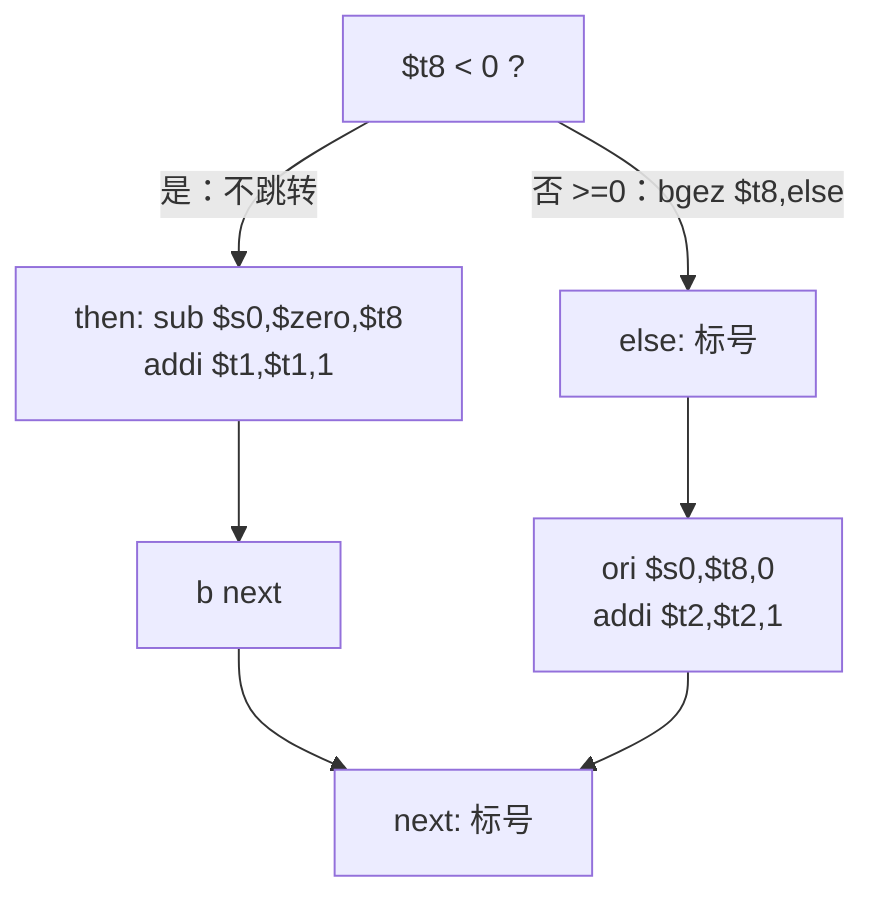
```
        [$t8 < 0 ?]
  否 |            | 是（顺序执行）
  else:          then:
  ori s0,t8,0    sub s0,zero,t8
  addi t2,t2,1   addi t1,t1,1
     | b next        |
     +--> next: <----+
```
**评分点**：①判断框＋两条条件出边（2 分）②then 末尾 `b next`（2 分）③`else:`/`next:` 位置（1 分）④框旁标注指令（1 分）。
**易错**：漏 `b next`（两段都执行）；`bgez` 跳转方向标反。

**2. 含 break 的 WHILE（8 分）**

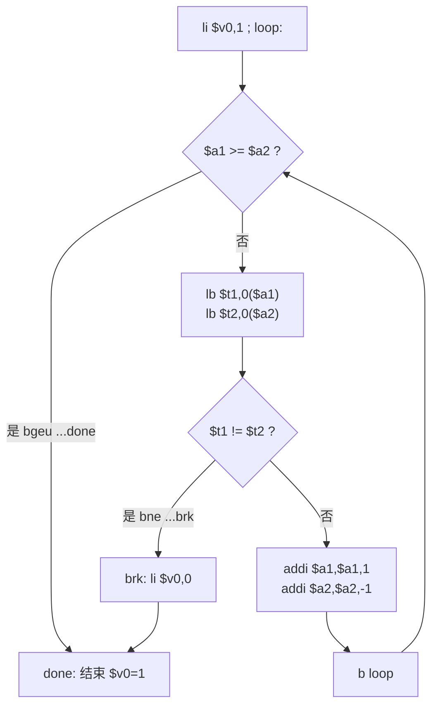
```
  li v0,1 -> loop:
              |
      [a1>=a2 ?]--是--> done:(v0=1) 结束
              |否              ^
      lb t1,0(a1); lb t2,0(a2) |
      [t1!=t2 ?]--是--> brk: li v0,0 --+
              |否                     |
      a1++; a2--; b loop -------------+
```
**评分点**：①`loop` 在条件前（1 分）②条件反面 `bgeu …done`（2 分）③`bne …brk` 跳过循环体剩余部分（2 分）④末尾 `b loop`（2 分）⑤`brk:` 在 `done:` 前（1 分）。
**易错**：`li $v0,0` 放在 `done:` 之后；地址比较误用 `bge`。

**3. FOR（6 分）**

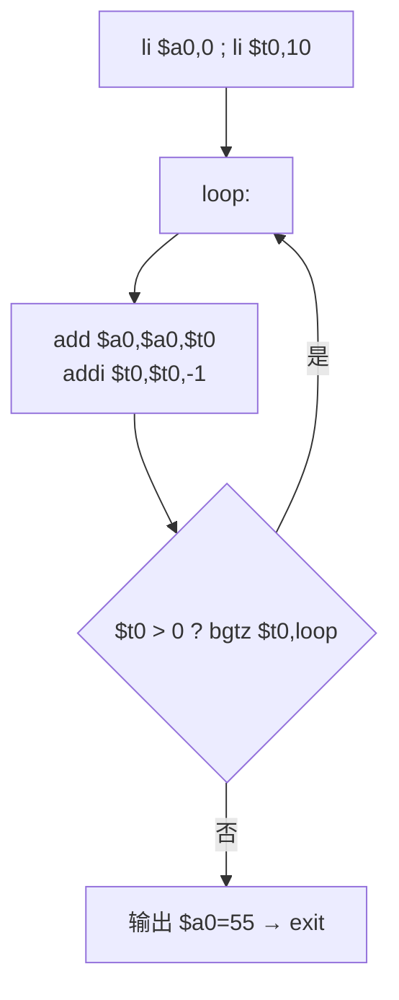
```
li a0,0 ; li t0,10      初始化(一次)
      v
+-> loop: a0=a0+t0 ; t0=t0-1
|     v
| [t0>0 ?]--是--+
|     |否
|  输出 a0=55 -> exit
```
**评分点**：①初始化在循环外（1 分）②循环体＋计数修改同路径（2 分）③条件在末尾、`bgtz` 回边指 `loop`（2 分）④退出后输出（1 分）。
**易错**：条件画在最前却仍用 `bgtz` 回跳；漏计数修改。

**4. SWITCH 跳转表结构图（10 分）**

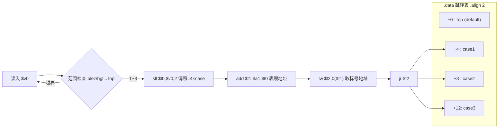
```
.data(0x10010000)              控制流
+-----------------+        读入 v0
| +0  top(default)|<--+       |
| +4  case1       |<-+ |  [范围检查]--越界--> 回 top
| +8  case2       |<-+ |       |通过
| +12 case3       |<-+ |       v
+-----------------+  | |  sll t0,v0,2  偏移=4×case
                     | |       v
                     | |  add t1,a1,t0 表项地址
                     | |       v
                     | |  lw t2,0(t1)  取标号地址
                     +-+- jr t2 --> case1/2/3
```
**评分点**：①表首址、4 项、每项 4 字节、第 0 项为 default(`top`)（3 分）②`基址+4×case` 与 `sll 2` 即乘 4（2 分）③分清 `lw`（取地址）与 `jr`（寄存器跳转）（2 分）④范围检查在查表前（2 分）⑤`.align 2` 原因（1 分）。
**易错**：表项画成代码而非“标号地址”；缺范围检查；用 `j case1` 代替 `lw`+`jr`。

<div style="page-break-after: always"></div>

# 第六讲 数制 复习题（对应课件 P174–P194）

> 作答约定：除题目明确说明存在延迟槽外，程序题按课程模拟器默认的“无分支延迟、无加载延迟”模型执行；此时 jal/jalr 保存调用指令地址加 4。经典带分支延迟槽的 MIPS 保存调用指令地址加 8。所有地址均按字节计；宏展开和周期数按题目指定的模型计算。


## 本讲覆盖要点与题号索引

| 页 | 知识点 | 题号 |
|---|---|---|
| P174 | 标题：数制 | 全章 |
| P175 | 32 位范围；有符号 −2³¹~2³¹−1；无符号 0~2³²−1 | 单1 单2 多1 填1 填2 判1 |
| P176 | 位值记数法（四种进制展开式） | 单3 单4 填3 计1 |
| P177 | 多项式展开；乘 2 加；除 2 取余；十六进制↔4 位二进制 | 单5–8 填4–6 判2 计2–5 |
| P178 | andi 1 判奇偶+beqz；sll 5 乘 32 | 单9 单10 填7 填8 判3 简4 计14 |
| P179 | 补码定义与速算法 | 单11 填9 判4 简3 计7 |
| P180 | 符号扩展 ±6；0x88→0xFFFFFF88 | 单12 填10 判5 计9 |
| P181 | 共用硬件；同构与断口 | 多2 填11 判6 简2 图2 |
| P182 | 溢出判定；add/sub/addi 异常 vs addu/subu | 单13 单14 填12 判7 简1 计10–13 读4 |
| P183 | 进位检测四行代码 | 单15 填13 计13 编4 |
| P184 | n 进制算法；1857→八进制 | 填14 简5 计6 图3 编1 |
| P185 | 8 进制输出 divu/mflo/mfhi/倒填/bnez | 填15 读1 读3 |
| P186 | hex_tab/result/hex_dig；$t1=7 | 单16 填15 读2 编2 |
| P187 | andi 0x0f、srl 4、lb、sb、bgez | 单16 转1–3 读2 图3 |
| P188 | 读十六进制总体思路 | 多3 简6 编3 |
| P189 | 寄存器分配 | 填16 简6 |
| P190 | 三阶段伪代码 | 多3 填16 简6 编3 |
| P191 | 缓冲区 20；mess1–3；syscall 8；jal | 多3 编3 |
| P192 | do_space；do_0x；out_e1 | 多3 判8 编3 |
| P193 | 区间判定；减 0x30/0x37/0x57 | 填16 编3 |
| P194 | do_length（bgt 8）；out_hex；out_r | 判8 填16 编3 |

---

## 一、单项选择题（共 16 题）

1. 【课件P175】MIPS 的 32 位寄存器中，**无符号**数的表示范围是（　）
   - A. −2,147,483,648 ~ +2,147,483,647
   - B. 0 ~ 65 535
   - C. 0 ~ 4,294,967,295
   - D. 0 ~ 2,147,483,647

2. 【课件P175】有符号数最小值 −2,147,483,648 在 32 位寄存器中的编码是（　）
   - A. 0x00000000
   - B. 0x7FFFFFFF
   - C. 0x80000000
   - D. 0xFFFFFFFF

3. 【课件P176】八进制值 4010 对应的十进制值是（　）
   - A. 4010
   - B. 2056
   - C. 1024
   - D. 528

4. 【课件P176】十六进制 808 按位值记数法展开为（　）
   - A. 8×16² + 0×16¹ + 8×16⁰
   - B. 8×10² + 0×10¹ + 8×10⁰
   - C. 8×8² + 0×8¹ + 8×8⁰
   - D. 8×2³ + 0×2² + 8×2⁰

5. 【课件P177】二进制 011010 用多项式扩展转换成十进制，结果是（　）
   - A. 26
   - B. 22
   - C. 30
   - D. 13

6. 【课件P177】用“乘 2 和加”方法把 00011010 转换成十进制，累计值的序列是（　）
   - A. 1 → 3 → 6 → 13 → 26
   - B. 1 → 2 → 4 → 8 → 16
   - C. 0 → 1 → 3 → 7 → 13
   - D. 1 → 3 → 7 → 15 → 26

7. 【课件P177】“十进制值 → 二进制值”的转换方法是（　）
   - A. 多项式展开
   - B. 乘 2 和加
   - C. 重复地将十进制值除 2，记录商和余数，每次除 2 后的余数是新的二进制位
   - D. 查十六进制—二进制对照表

8. 【课件P177】十六进制值 0xA2F0 对应的二进制值是（　）
   - A. 1010 0010 1111 0000
   - B. 1011 0010 1111 0000
   - C. 1010 0010 1110 0000
   - D. 0000 1111 0010 1010

9. 【课件P178】判断寄存器 $s0 奇偶性最有效的 MIPS 做法是（　）
   - A. 用 `div $s0,2` 后看 HI 中的余数
   - B. 用 `andi $t8,$s0,1` 提取最低位，再用 `beqz` 分支，共约 2 个时钟周期
   - C. 用 `srl $s0,$s0,1` 后比较
   - D. 用 `slt` 与 2 比较

10. 【课件P178】指令 `sll $v1,$t3,5` 的含义是（　）
    - A. $v1 = $t3 + 5
    - B. $v1 = $t3 × 5
    - C. $v1 = $t3 × 32
    - D. $v1 = $t3 / 32

11. 【课件P179】按课件所述“从右向左扫描”的简便算法求补码，对应描述是（　）
    - A. 所有位求反后加 1
    - B. 从右到左扫描，保持最低位的 0 们和第一个 1 不变，对剩下的位求反直到最左端
    - C. 从右到左扫描，保持最低位的 1 们和第一个 0 不变，其余求反
    - D. 最高位取反，其余位不变

12. 【课件P180】数值 −6 的 32 位二进制补码是（　）
    - A. 0x00000006
    - B. 0xFFFFFFFA
    - C. 0xFFFFFFF6
    - D. 0x000000FA

13. 【课件P182】按补码溢出判定规则，**不可能**发生溢出的情况是（　）
    - A. 两个正数相加
    - B. 两个负数相加
    - C. 一个正数与一个负数相加
    - D. 一个负数减去一个正数

14. 【课件P182】下列指令中，结果溢出时**不产生异常**的是（　）
    - A. `add`
    - B. `sub`
    - C. `addi`
    - D. `addu`

15. 【课件P183】已先执行 `li $t4,-1` 和 `subu $t4,$t4,$t1`，再执行 `sltu $t3,$t4,$t0` 得 $t3 = 1，说明（　）
    - A. $t1 + $t0 发生了有符号溢出
    - B. UINT_MAX − $t1 < $t0，即 $t1 + $t0 产生了进位
    - C. $t1 > $t0
    - D. $t0 的最高位为 1

16. 【课件P187】十六进制输出程序中 `li $t1,7` 且循环体含 `sb $t3,hex_dig($t1)`，第一次进入 `hexify` 时（　）
    - A. 把最高 4 位的字符写到 hex_dig[0]
    - B. 把最低 4 位（$t0 & 0x0f）对应的字符写到缓冲区的最后一个字符位置 hex_dig[7]
    - C. 把整个 8 位十六进制串一次写入
    - D. `bgez` 只循环 7 次，hex_dig[0] 不会被写入

## 二、多项选择题（共 3 题）

1. 【课件P175】关于 32 位范围与位值记数法，正确的有（　）
   - A. 任意值只要在长度上没有限制，均可以表示成十进制或二进制
   - B. 寄存器和内存中的数值是 32 位，存储值的范围是 0x00000000–0xFFFFFFFF
   - C. 无符号数最大值为 4,294,967,295
   - D. 有符号数范围为 −2,147,483,648 ~ +2,147,483,648

2. 【课件P181】关于补码加法与无符号加法的“同构与断口”，正确的有（　）
   - A. 二进制补码加减法逻辑与无符号数加减法逻辑完全相同
   - B. 二者可以用同样一套硬件实现加法
   - C. 无符号环在 0xFF→0x00（255 之后）处有断口，有符号环在 0x7F→0x80（127 之后）处有断口
   - D. 8 位无符号数 255+1 的结果 256 能完整保存在 8 位寄存器中

3. 【课件P188–P191】读十六进制值程序对输入格式的要求与错误处理，正确的有（　）
   - A. 字符串必须以 0x 开头（前面只允许有空格）
   - B. 每一位只允许 0x30–0x39、0x41–0x46、0x61–0x66 三个区间的字符
   - C. 0x 之后的十六进制数字最多 8 个，超过 8 个视为长度超限
   - D. 不以 0x 开头时输出 mess2（"invalid number"）

## 三、填空题（共 16 题）

1. 【课件P175】32 位存储范围是 0x________–0x________；有符号数范围________~________，无符号数范围________~________。

2. 【课件P175】32 位全 1 编码 0xFFFFFFFF 按有符号数解释等于______，按无符号数解释等于______。

3. 【课件P176】位值记数法：十进制 2056 = ______×10³ + ______×10² + ______×10¹ + ______×10⁰。

4. 【课件P177】用“乘 2 加”方法转换 00011010：从最左端的 1 开始，累计值依次为 1 → ______ → ______ → ______ → ______。

5. 【课件P177】除 2 取余把 35 转成二进制：35/2=17 余__，17/2=8 余__，8/2=4 余__，4/2=2 余__，2/2=1 余__，1/2=0 余__，故 35 = (______)₂。

6. 【课件P177】十六进制与二进制转换时，1 位十六进制数对应____位二进制数；二进制 1111011011100111 从右端每 4 位一组，得到十六进制 0x__________。

7. 【课件P178】$s0 为奇数则加 1 的两条关键代码：`________ $t8,$s0,1`（提取 LSB）和 `________ $t8,even`。

8. 【课件P178】`sll $v1,$t3,5` 表示 $v1 = $t3 × ______；若 $t3 = 26，则结果为______。

9. 【课件P179】−26 的 8 位补码：26 = 00011010 → 求反得________ → 加 1 得________，即 0x____。

10. 【课件P180】符号扩展：+6 的 32 位表示为 0x__________；−6 的 8 位表示为 ______，其 32 位表示为 0x__________（高位全部复制符号位）。

11. 【课件P181】补码加减法与无符号加减法逻辑完全相同，可共用同一硬件；两个递增环是______的，只是______不同。

12. 【课件P182】`add`/`sub`/`addi` 溢出时产生______；`addu`/`subu` 溢出时______异常。两个符号______的数相加不可能溢出。

13. 【课件P183】检测 $t1+$t0 是否进位的四行代码：

    ```asm
    ______ $t2,$t1,$t0
    addi $t4,$0,______ # $t4 = 0xFFFFFFFF = INT_MAX
    ______ $t4,$t4,$t1 # $t4 = UINT_MAX − $t1
    ______ $t3,$t4,$t0 # 进位记录在 $t3 中
    ```

14. 【课件P184】用算法把 1857 转换成八进制：1857/8 商______余______；232/8 商______余______；29/8 商______余______；3/8 商______余______；商为 0 结束，结果为 (________)₈。

15. 【课件P185–P187】`divu $a1,$t1` 后由 ______ 取商、______ 取余；`addi $t3,$t3,0x30` 的作用是________；十六进制输出用 `__________` 表映射 0–15，`srl $t0,$t0,4` 每次______，`bgez $t1,hexify` 使循环执行______次。

16. 【课件P193–P194】字符转数值：0–9 减 0x____，A–F 减 0x____，a–f 减 0x____；`bgt $t0,$t1,out_e3`（$t1=8）超长时输出 mess____。

## 四、判断题（共 8 题，正确写“对”，错误写“错”并改正）

1. 【课件P175】32 位无符号数能表示的最大值是 4,294,967,295。（　）

2. 【课件P177】重复除以 2 时，第一次相除的余数是二进制结果的最高位。（　）

3. 【课件P178】用除法指令判断奇偶性比用 `andi` + `beqz` 更高效。（　）

4. 【课件P179】求补码的简便方法：从右到左扫描原值，保持最低位的 0 们和第一个 1 不变，然后对剩下的位求反直到最左端。（　）

5. 【课件P180】把 −6 从 8 位扩展到 32 位时，高 24 位应补 0。（　）

6. 【课件P181】二进制补码加法与无符号数加法需要两套不同的加法器硬件。（　）

7. 【课件P182】两个符号不同的数相加也可能发生溢出。（　）

8. 【课件P194】长度检查 `bgt $t0,$t1,out_e3`（$t1=8）表示十六进制数字个数大于 8 才报错，恰好 8 个是合法的。（　）

## 五、简答题（共 6 题）

1. 【课件P182】加法运算中“溢出（overflow）”与“进位（carry）”的区别是什么？（6 分）

2. 【课件P181】为什么二进制补码加法与无符号数加法可以共用同一套硬件？请用 255→0 与 127→−128 两个“断口”说明加法在什么情况下得到错误结果。（6 分）

3. 【课件P179】求一个二进制值的相反数（补码）有哪两种方法？各举一个 8 位例子说明，并说明简便方法为什么成立。（6 分）

4. 【课件P178】为什么用 `andi` + `beqz` 判断奇偶比用除法好？若 $s0 为奇数则加 1，写出完整代码并说明 $t8 的作用。（5 分）

5. 【课件P184】写出把无符号数 x 转换成 n（2 ≤ n ≤ 16）进制字符串的算法步骤，并说明为什么要从缓冲区尾部向前存放字符、为什么最后要写入 0x00。（6 分）

6. 【课件P188–P194】写出“读取十六进制值”程序的三阶段伪代码（跳空格、校验 0x 前缀、逐字符校验并累加 + 长度检查），并说明 mess1/mess2/mess3 分别对应哪种错误。（8 分）

## 六、计算与编码题（共 14 题）

1. 【课件P176】把二进制 0000100000001000、十进制 2056、八进制 4010、十六进制 808 按位值记数法展开，说明是否为同一个值。

2. 【课件P177】用除 2 取余法把 35 和 32 转换成 8 位二进制数，写出每步商和余数。

3. 【课件P177】用“乘 2 加”方法把 00010101 和 00011001 转换成十进制，写出累计过程。

4. 【课件P177】把二进制 00010101、00011001、1111011011100111 转换成十六进制。

5. 【课件P177】把十六进制 0x15、0xA9、0x1F 转换成十进制（写出多项式展开式）。

6. 【课件P184】按“除 8 取余、商为 0 结束”把 1857 转换成八进制，写出演算与验算。

7. 【课件P179】把 −35 和 −63 转换成 8 位补码，写出“按位求反 → 加 1”过程，并用速算法验算。

8. 【课件P179】设使用二进制补码，求下列 8 位二进制数的十进制值：10000001、11111111、01010000、11100000、10000011。

9. 【课件P180】完成下表转换，并说明 0x88 如何符号扩展成 4 位十六进制。

   | 16 位二进制 | 十六进制 | 十进制（有符号） |
   |---|---|---|
   | 1111111100111100 | | |
   | | 0xFF88 | |
   | | 0xFF80 | −128 |
   | 1111111111111010 | | |
   | | 0x0011 | |
   | | | −25 |

10. 【课件P182】给定两个补码数 01101110 和 00011010，做二进制加法，判断是否溢出并说明依据。

11. 【课件P182】设 X = 10010100、Y = 00101100（补码），求其十进制值，做 X+Y、X−Y、Y−X 并判断溢出（写依据）。

12. 【课件P182】给定 11101000 与 00010011（补码），做 X−Y（减数取负后相加），判断溢出与进位。

13. 【课件P183】区分“进位”和“溢出”：
    (1) 举一个“有进位但无溢出”的 8 位例子并验算；
    (2) 举一个“有溢出但无进位”的 8 位例子并验算；
    (3) 补齐检测 $t1+$t0 进位的四行代码，并说明 `sltu` 为什么能判进位。

14. 【课件P178/P179】把 −9 的 8 位补码算术右移一位（`sra`），与“−9 除 2 向零取整”比较：是否相等、为什么？误用 `srl` 又如何？

## 七、代码转换题（共 3 题）

### 7.1 C 语言（十六进制查表输出）→ MIPS 汇编

1. 【课件P186–P187】把下面的 C 函数翻译成完整的 MIPS 程序（要求：以 `0x` 前缀输出 8 位十六进制，可在 PCSpim/MARS 运行）。

   ```c
   char hex_tab[] = "0123456789ABCDEF";
   char hex_dig[9];
   void hexout(unsigned int x) {
       int i;
       for (i = 7; i >= 0; i--) { hex_dig[i] = hex_tab[x & 0x0F]; x = x >> 4; }
       hex_dig[8] = 0;
       printf("Hexadecimal value: 0x%s", hex_dig);
   }
   ```

### 7.2 MIPS 汇编 → 机器码

2. 【课件P185–P187】写出下列指令的机器码（给出字段分解与二进制），并按给出的地址计算 `bgez` 的立即数：

   ```asm
   # 假设以下指令依次从 0x00400010 开始存放
   divu $a1,$t1
   srl $t0,$t0,4
   andi $t2,$t0,0x0f
   sb $t3,0($t1) # 本题固定为真实基址指令，不含标号宏展开
   addi $t1,$t1,-1
   bgez $t1,hexify # hexify 的地址为 0x00400010，本指令地址为 0x00400024
   ```

### 7.3 机器码 → MIPS 汇编（反汇编）

3. 【课件P183/P185】把下列机器码反汇编成 MIPS 指令，写出字段拆分过程：

   ```text
   (1) 0x00A9001B
   (2) 0x00084102
   (3) 0x310A000F
   (4) 0x200CFFFF
   (5) 0x0188582B
   (6) 0x00005810
   (7) 0xA12B0000
   ```

## 八、读程序写结果（共 4 题）

1. 【课件P185】阅读程序，写出屏幕输出、循环结束时 $a1 的值以及最后一次循环中 $t3 的值。

   ```asm
   .data
   buf: .space 12
   .text
   .globl main
   main:
       li $a1,12345678 # 测试数字
       li $t1,8 # 转换成 8 进制
       la $a0,buf
       add $a0,$a0,11
       sb $0,($a0) # 缓冲区末尾写结束符
   digital:
       divu $a1,$t1
       mflo $a1 # 商成为新的被除数
       mfhi $t3 # 余数
       addi $t3,$t3,0x30 # 转 ASCII
       addi $a0,$a0,-1
       sb $t3,($a0)
       bnez $a1,digital
       li $v0,4
       syscall
       li $v0,10
       syscall
   ```

2. 【课件P186–P187】阅读程序，写出屏幕输出（$t0 初值改为 0x0000ABCD 后由键盘输入的等价结果）。

   ```asm
   .data
   hex_tab: .ascii "0123456789ABCDEF"
   result: .ascii "Hexadecimal value: 0x"
   hex_dig: .asciiz "XXXXXXXX"
   .text
   .globl main
   main:
       li $t0,0x0000ABCD
       li $t1,7
   hexify:
       andi $t2,$t0,0x0f
       srl $t0,$t0,4
       lb $t3,hex_tab($t2)
       sb $t3,hex_dig($t1)
       sub $t1,$t1,1
       bgez $t1,hexify
       li $v0,4
       la $a0,result
       syscall
       li $v0,10
       syscall
   ```

3. 【课件P184–P185】阅读程序并回答：(a) 屏幕输出是什么？(b) 循环体执行几次？(c) 若把 `li $t1,10` 改成 `li $t1,16`，输出会变成什么、为什么错、应如何改？

   ```asm
   .data
   buf: .space 40
   .text
   .globl main
   main:
       la $a0,buf
       addi $a0,$a0,39
       sb $0,0($a0)
       li $a1,7054 # 待转换数
       li $t1,10 # 基数
   loop:
       divu $a1,$t1
       mflo $a1
       mfhi $t3
       addi $t3,$t3,0x30
       addi $a0,$a0,-1
       sb $t3,0($a0)
       bnez $a1,loop
       li $v0,4
       syscall
       li $v0,10
       syscall
   ```

4. 【课件P182】阅读程序，写出屏幕输出，并指出 $s0、$s1 各代表什么。

   ```asm
   .text
   .globl main
   main:
       li $t0,0x7FFFFFFF # a = 最大正数
       li $t1,1 # b = 1
       addu $t2,$t0,$t1 # r = a + b
       xor $t3,$t0,$t2
       xor $t4,$t1,$t2
       and $t3,$t3,$t4
       srl $s0,$t3,31 # 第一组是否溢出
       li $t0,0xFFFFFFF9 # a = −7
       li $t1,5 # b = 5
       addu $t2,$t0,$t1 # r = a + b
       xor $t3,$t0,$t2
       xor $t4,$t1,$t2
       and $t3,$t3,$t4
       srl $s1,$t3,31 # 第二组是否溢出
       li $v0,1
       move $a0,$s0
       syscall
       li $v0,1
       move $a0,$s1
       syscall
       li $v0,10
       syscall
   ```

## 九、程序设计与综合题（共 4 题）

1. 【10 分】【课件P184】编写子程序 `itoa`：把 $a0 的无符号数按 $a1 的基数（2≤n≤16）输出。要求 `divu/mflo/mfhi` 求商余、尾部向前存放、查 "0123456789ABCDEF" 表、`bnez` 控循环；主程序用 255 分别以 16、2 进制测试。

2. 【10 分】【课件P186】读入一个整数，以 `Hexadecimal value: 0x????????` 输出其 8 位十六进制（含 0x 前缀，总输出 8 位）。

3. 【12 分】【课件P188–P194】编写 `Hexin`：跳前导空格、校验 `0x`、逐字符判区间并累加（`sll 4`+加），长度>8 报错；三种错误分别输出 mess1/mess2/mess3；合法时用 syscall 1 按有符号 32 位解释输出十进制值（例如 0xFFFFFFFF 输出 -1）。

4. 【8 分】【课件P183】读入两个整数（视为 32 位无符号数）求和并检测进位，用 syscall 1 输出进位标志（0/1）；说明 `addi $t4,$0,-1`、`subu`、`sltu` 如何实现 `INT_MAX − t1 < t0`。

## 十、作图题（共 3 题）

1. 【8 分】【课件P175/P181】画出 32 位补码数轴（环），标出 0x00000000、0x7FFFFFFF、0x80000000、0xFFFFFFFF 及其十进制值，醒目标出 0x7FFFFFFF→0x80000000 的“断口”，并用箭头说明正、负溢出的方向。

2. 【8 分】【课件P181】画出无符号环与有符号环的“同构与断口”示意图（8 位）：标出两环起点、递增方向、断口位置，并给出一组二进制操作相同、却一进位一溢出的例子。

3. 【10 分】【课件P184】画出“十进制数→n 进制字符串”流程图，必须含“商是否为 0”的判断（循环出口）、指针前移、字符转换、结束符与输出。

---

# 参考答案与解析

## 一、单项选择题

1. **C**。P175：存储范围 0x00000000–0xFFFFFFFF，无符号 0–4,294,967,295；A 是有符号范围。
2. **C**。−2³¹ 的最高位为 1，编码 0x80000000；0x7FFFFFFF 是最大正数。
3. **B**。4010₈ = 4×512+0+1×8+0 = 2056。
4. **A**。808 = 8×16²+0×16¹+8×16⁰ = 8×256+8。
5. **A**。0×32+1×16+1×8+0×4+1×2+0×1 = 16+8+2 = 26。
6. **A**。1 → 1×2+1=3 → 3×2+0=6 → 6×2+1=13 → 13×2+0=26。
7. **C**。重复除 2 记商余，余数是新的二进制位（先得低位）。
8. **A**。A=1010、2=0010、F=1111、0=0000。
9. **B**。andi 提取 LSB + beqz 共 2 周期；除法需 38 周期。
10. **C**。左移 5 位 = ×2⁵ = ×32，26<<5 = 832。
11. **B**。A 是定义（求反加 1），C 把 0 与 1 说反。
12. **B**。6=00000110 → 求反 11111001 → +1 = 0xFA，符号扩展补 1 → 0xFFFFFFFA。
13. **C**。同号相加变号才溢出，异号相加不可能溢出。
14. **D**。addu/subu 不产生异常；add/sub/addi 溢出产生异常。
15. **B**。UINT_MAX−$t1 < $t0 即 $t1+$t0 超出 0xFFFFFFFF，产生进位。
16. **B**。先取低 4 位写入 hex_dig[7]，$t1 由 7 递减，共 8 次。

## 二、多项选择题

1. **ABC**。A 是 P175 首句；B 是范围原文；C 为 2³²−1。D 错：最大有符号数是 +2,147,483,647（不是 …648）。
2. **ABC**。D 错：8 位寄存器只能存 8 位，256 的低 8 位是 0，进位丢失，结果错误——这正是“断口”。
3. **ABC**。D 错：不以 0x 开头走 `out_e1`，输出的是 mess1（"not start with 0x"）；mess2 对应“无效数字”。

## 三、填空题

1. **0x00000000；0xFFFFFFFF；−2,147,483,648；+2,147,483,647；0；4,294,967,295**。
2. **−1；4,294,967,295**。（0xFFFFFFFF 的最高位为 1，按补码是 −1）
3. **2；0；5；6**。
4. **1 → 3 → 6 → 13 → 26**（1×2+1=3，3×2+0=6，6×2+1=13，13×2+0=26）。
5. **1；1；0；0；0；1；100011**。验算 32+2+1 = 35。
6. **4；0xF6E7**（1111 0110 1110 0111）。
7. **`andi`；`beqz`**。
8. **32；832**（26×32 = 832 = 0b1101000000）。
9. **11100101；11100110；E6**。速算法：00011010 从右到左，最低位 0 保留、第一个 1 保留，其余取反 → 11100110。
10. **00000006；11111010；FFFFFFFA**。
11. **同构；断口（发生错误的位置：无符号在 0xFF→0x00，有符号在 0x7F→0x80）**。
12. **异常（exception）；不产生；不同（相异）**。
13. **`addu`；−1；`subu`；`sltu`**。
14. **232；1；29；0；3；5；0；3；3501**。验算 3×512+5×64+0×8+1 = 1536+320+1 = 1857。
15. **`mflo`；`mfhi`；余数加 0x30 变成数字字符；`hex_tab`；右移 4 位（取出下一个十六进制位）；8**。
16. **30；37；57；3**。

## 四、判断题

1. **对**。2³²−1 = 4,294,967,295。
2. **错**。第一次除 2 的余数是**最低位**（最后写出的才是最高位），故余数序列要倒序读取。
3. **错**。`andi`+`beqz` 约 2 个周期，除法需 38 个周期，前者更高效。
4. **对**。即 P179 的简便计算法。
5. **错**。符号扩展时高位全部复制**符号位**，−6 的符号位是 1，高 24 位应补 1，得 0xFFFFFFFA。
6. **错**。二者逻辑相同，可用同一套硬件（P181）。
7. **错**。异号相加溢出**不可能**发生；只有同号相加且结果变号才溢出。
8. **对**。`bgt` 满足“大于”才跳，8>8 不成立，长度 8 合法，>8 才输出 mess3。

## 五、简答题

1. **要点**：
   ① 有符号溢出表示精确结果超出位宽对应的补码范围（8 位时为 −128~127）；MIPS 的 add/sub/addi 会对此产生异常，addu/subu/addiu 不会。
   ② 无符号加法进位表示精确结果超出 0~255（8 位）或 0~0xFFFFFFFF（32 位）；寄存器只保留模 2^8/2^32 的低位，若需完整结果必须记录进位（P183）。
   ③ 判定不同：溢出看**符号位**（同号相加变号即溢出）；进位看最高位是否有向外进位/借位。
   ④ 二者互不蕴含：有进位无溢出（−1+−1），有溢出无进位（58+124）。
2. **要点**：
   ① 无符号环 0→…→255→0，有符号环 −128→…→127→−128，两环**同构**：除断口外“+1”的二进制操作完全相同（0x80+1：128+1=129 与 −128+1=−127，都是 10000000+1=10000001）（P181）。
   ② 加法是 +1 的推广，故绝大多数元素上结果一致，可共用同一加法器。
   ③ 断口 255→0：产生**进位**，低 8 位为 0；断口 127→−128：产生**溢出**，结果变号。
3. **要点**：
   ① 方法一（定义）：全部位求反后再加 1。例：26 = 00011010 → 11100101 → +1 = 11100110（−26）。
   ② 方法二（简便）：从右到左扫描，保持最低位的 0 们和第一个 1 不变，对其余位求反。例：000**11010** 中最低的 0 和第一个 1 是“10”，保留，左边 00011 求反为 11100 → 11100110。
   ③ 原理：设原值最低的 1 在位置 k，则该数为 2^k 的倍数加 2^k，取反加 1 时低 k+1 位恰好不变，只有高位整体取反（等价于对 ≥k+1 的位求反）。
4. **要点**：
   ① `andi`+`beqz` 共约 2 个周期；除法 `div` 需 38 个周期且还要 `mfhi` 取余。
   ② 代码：
      ```asm
      andi $t8,$s0,1 # 提取最低有效位 LSB
      beqz $t8,even # LSB=0（偶数）则跳过
      addi $s0,$s0,1 # 奇数则加 1
      even:
      ```
   ③ $t8 = ($s0 & 1)，即奇偶标志（1 奇、0 偶）。
5. **要点**：
   ① 令 x 为待转换数、n 为基数：反复做 `x / n`，余数 d 由低到高依次得到，商作为新的 x；
   ② 当**商为 0** 时结束（`bnez` 判断商继续循环）；
   ③ 每个余数加 0x30（或查 "0123456789ABCDEF" 表）得到字符；
   ④ 因为第一个余数是**最低位**，所以必须把字符从缓冲区尾部向前放（指针每次减 1），最后 $a0 指向字符串首字符；
   ⑤ 末尾写入 0x00（`sb $0,($a0)`）作为字符串结束符，syscall 4 才能正确输出。
6. **要点**（三阶段伪代码）：
   ```text
   # 1 跳空格
   while (Mem(a0)==0x20) a0=a0+1;
   # 2 校验 0x 前缀
   if (Mem(a0)!=0x30 || Mem(a0+1)!=0x78) return "不以0x开头"(mess1);
   a0=a0+2;
   # 3 逐字符处理
   t0=0; t3=0;
   while (Mem(a0)!=0x0a) {
       if 0x30<=Mem(a0)<=0x39 or 0x41<=Mem(a0)<=0x46 or 0x61<=Mem(a0)<=0x66
       then { t4=getNumber(Mem(a0)); a0++; t0++; t3=(t3<<4)+t4; }
       else return "无效数字"(mess2);
   }
   if (t0>8) return "长度超过8"(mess3);
   ```
   ① mess1 = 不以 0x 开头；② mess2 = 出现非法字符（不在三个区间内）；③ mess3 = 十六进制数字个数超过 8 个。

## 六、计算与编码题

1. **解** 二进制 0000 1000 0000 1000 = 1×2¹¹+1×2³ = 2048+8 = **2056**；十进制 2056 = 2×10³+0×10²+5×10¹+6×10⁰ = **2056**；八进制 4010₈ = 4×8³+0×8²+1×8¹+0×8⁰ = 4×512+8 = **2056**；十六进制 808₁₆ = 8×16²+0×16¹+8×16⁰ = 2048+8 = **2056**。四者基数不同、值相同。

2. **解** 35/2=17 r1；17/2=8 r1；8/2=4 r0；4/2=2 r0；2/2=1 r0；1/2=0 r1。余数倒序：35 = (100011)₂（补零 00100011，验算 32+2+1=35）。32：32→16 r0→8 r0→4 r0→2 r0→1 r0→0 r1，故 32 = (100000)₂ = 0x20。

3. **解** 00010101（10101）：1 → 1×2+0=2 → 2×2+1=5 → 5×2+0=10 → 10×2+1=**21**。00011001（11001）：1 → 1×2+1=3 → 3×2+0=6 → 6×2+0=12 → 12×2+1=**25**。

4. **解** 00010101 → 0001 0101 → **0x15**；00011001 → 0001 1001 → **0x19**；1111011011100111 → 1111 0110 1110 0111 → **0xF6E7**。

5. **解** 0x15 = 1×16¹+5×16⁰ = 16+5 = **21**；0xA9 = 10×16¹+9×16⁰ = 160+9 = **169**；0x1F = 16+15 = **31**。

6. **解**
   ```
   1857/8 = 232 … 余 1   ← d0（最低位）
    232/8 =  29 … 余 0   ← d1
     29/8 =   3 … 余 5   ← d2
      3/8 =   0 … 余 3   ← d3（商为 0，结束）
   ```
   倒序读出 **1857 = (3501)₈**；验算 3×512+5×64+0×8+1 = 1536+320+1 = 1857 ✓

7. **解**（写出取反→加 1）
   - −35：35 = 0010 0011 → 求反 1101 1100 → 加 1 = **1101 1101**（0xDD）；验算 −128+64+16+8+4+1 = −35 ✓；速算法：最低的 1 保留、其余取反 → 11011101 ✓
   - −63：63 = 0011 1111 → 求反 1100 0000 → 加 1 = **1100 0001**（0xC1）；验算 −128+64+1 = −63 ✓；速算法 → 11000001 ✓

8. **解**（最高位为 1 则为负，负值 = −128 + 其余位之和）
   - 10000001 = −128 + 1 = **−127**
   - 11111111 = −128+64+32+16+8+4+2+1 = **−1**
   - 01010000 = 64+16 = **+80**
   - 11100000 = −128+64+32 = **−32**
   - 10000011 = −128 + 2 + 1 = **−125**

9. **解**

   | 16 位二进制 | 十六进制 | 十进制（有符号） |
   |---|---|---|
   | 1111111100111100 | 0xFF3C | −196 |
   | 1111111110001000 | 0xFF88 | −120 |
   | 1111111110000000 | 0xFF80 | −128 |
   | 1111111111111010 | 0xFFFA | −6 |
   | 0000000000010001 | 0x0011 | 17 |
   | 1111111111100111 | 0xFFE7 | −25 |

   计算示例：0xFF3C = 65340（无符号），有符号 = 65340 − 65536 = **−196**；或取反加 1：~0xFF3C = 0x00C3，+1 = 0xC4 = 196 → −196。
   −25 → 25 = 0x0019 → 求反 0xFFE6 → 加 1 = **0xFFE7**。
   **0x88 的符号扩展**：0x88 = 10001000，最高位（符号位）为 1，故扩展时高 24 位全补 1 → **0xFFFFFF88**（值仍为 −120）。

10. **解**
    ```
      0110 1110      (0x6E = +110)
    + 0001 1010      (0x1A = +26)
    ------------
      1000 1000      (0x88)
    ```
    逐位：bit1、bit2 各写 0 进 1；bit3 写 1 进 1；bit4–bit6 各写 0 进 1；bit7 写 1，**无向外进位**。
    **判断：溢出**。依据：两操作数符号位均为 0、结果符号位变 1（同号相加变号）→ 溢出；110+26 = 136 > 127 ✓。此例也是“有溢出无进位”。

11. **解**
    X = 10010100 = 0x94 = −128+16+4 = **−108**；Y = 00101100 = 0x2C = 32+8+4 = **+44**。
    - **X+Y**：0x94 + 0x2C = 0xC0 = 1100 0000 = −64。真值 −108+44 = −64 ✓。两数异号 → **溢出不可能发生**；结果 −64 在 −128~+127 内，**无溢出、无进位**。
    - **X−Y**：−Y = 取反+1：00101100 → 11010011 → +1 = 11010100（0xD4 = −44）。
      0x94 + 0xD4 = 1 0110 1000 → 保留低 8 位 **0x68 = +104**，产生进位（丢弃）。
      真值 −108 − 44 = −152 < −128 → **溢出**；依据：被减数（负）与减数（正）异号，等价于两个负数相加，结果符号位为 0（正），与操作数符号不同 → 溢出。
    - **Y−X**：−X = 10010100 → 01101011 → +1 = 01101100（0x6C = +108）。
      0x2C + 0x6C = 0x98 = 1001 1000 = −104，无进位。
      真值 44 − (−108) = 152 > 127 → **溢出**；依据：两个正数相加，结果符号位变成 1（负）→ 溢出。

12. **解**
    X = 11101000 = −24，Y = 00010011 = +19，X − Y = −24 − 19 = −43。
    减数取负：Y = 00010011 → 求反 11101100 → 加 1 = **11101101**（0xED = −19）。
    ```
      1110 1000
    + 1110 1101
    ------------
    1 1101 0101   → 结果 0xD5，进位 1（丢弃）
    ```
    0xD5 = −128+64+16+4+1 = **−43**，真值正确。
    判断：两个负数相加，结果符号位仍为 1（负），与操作数相同 → **无溢出**；虽然有最高位进位，但**进位不意味着溢出**。

13. **解**
    (1) **有进位无溢出**：11111111+11111111 = **1 11111110** → 0xFE。
        有符号 −1+(−1) = −2（结果仍为负）→ 无溢出；无符号 255+255 = 510 > 255，进位丢失，低 8 位 254 已错。
    (2) **有溢出无进位**：00111010+01111100 = **10110110**（0xB6）。
        有符号 58+124 = 182 > 127 且两正数相加得负（0→1）→ 溢出；无符号 182 ≤ 255，无进位。
    (3) 代码：
        ```asm
        addu $t2,$t1,$t0 # $t2 = $t1+$t0（只保留低 32 位）
        addi $t4,$0,-1 # $t4 = 0xFFFFFFFF = INT_MAX
        subu $t4,$t4,$t1 # $t4 = UINT_MAX − $t1
        sltu $t3,$t4,$t0 # 若 (UINT_MAX−$t1) < $t0 则 $t3=1，表示有进位
        ```
        理由：有进位 ⟺ $t1+$t0 > INT_MAX ⟺ UINT_MAX−$t1 < $t0。`sltu` 做**无符号**比较，用 `slt` 会把 0xFFFFFFFF 当 −1 而出错。

14. **解**
    −9 的 8 位补码：9 = 00001001 → 求反 11110110 → 加 1 = **11110111**（0xF7）。
    算术右移一位（`sra $t0,$t0,1`，符号位 1 补入高位）：11110111 → **11111011** = 0xFB = −128+64+32+16+8+2+1 = **−5**。
    整除：−9 / 2 向零取整 = **−4**（余 −1，MIPS 的 `div` 也向零取整）。
    二者**不相等**（−5 ≠ −4）：算术右移等价于“除以 2 后**向下取整**（floor）”，floor(−4.5) = −5；而整数除法是**向零截断** trunc(−4.5) = −4。因此对负数奇数用移位代替除法会差 1。
    若误用 `srl`（逻辑右移，高位补 0）：11110111 → 01111011 = +123，结果完全错误。

## 七、代码转换题

### 7.1 C → MIPS 汇编

1. **参考代码**

   ```asm
   .data
   hex_tab: .ascii "0123456789ABCDEF" # 16 进制转换表
   prefix: .asciiz "Hexadecimal value: 0x"
   hex_dig: .asciiz "XXXXXXXX" # 8 位结果缓冲区
   .text
   .globl main
   main:
       li $v0,5 # 读一个整数
       syscall
       move $t0,$v0 # x
       li $t1,7 # i = 7
   hexify:
       andi $t2,$t0,0x0f # x & 0x0F，取最低 4 位
       srl $t0,$t0,4 # x = x >> 4
       lb $t3,hex_tab($t2) # 查表转字符
       sb $t3,hex_dig($t1) # hex_dig[i] = 字符
       addi $t1,$t1,-1 # i--
       bgez $t1,hexify # i >= 0 继续（共 8 次）
       li $v0,4 # 输出 "Hexadecimal value: 0x"
       la $a0,prefix
       syscall
       li $v0,4 # 输出 8 位十六进制串
       la $a0,hex_dig
       syscall
       li $v0,10
       syscall
   ```

   评分点：① `andi 0x0f` 取低 4 位；② `srl 4` 右移；③ `lb` 查表 + `sb` 写入；④ `$t1` 由 7 递减到 0（`bgez`）；⑤ 先写低位到 `hex_dig[7]`，故输出顺序正确；⑥ 含 0x 前缀与 syscall 10 退出。
   常见错误：用 `+0x30` 代替查表（>9 的位错）、用 `sll` 代替 `srl`、循环写成 `bgtz` 只做 7 次。

### 7.2 汇编 → 机器码

2. **解**

   | 指令 | op | rs | rt | rd | shamt | funct/imm | 机器码 |
   |---|---|---|---|---|---|---|---|
   | `divu $a1,$t1` | 000000 | 00101($a1=5) | 01001($t1=9) | 00000 | 00000 | 011011(27) | **0x00A9001B** |
   | `srl $t0,$t0,4` | 000000 | 00000 | 01000($t0=8) | 01000 | 00100(4) | 000010(2) | **0x00084102** |
   | `andi $t2,$t0,0x0f` | 001100(0x0C) | 01000(8) | 01010(10) | — | — | 0x000F | **0x310A000F** |
   | `sb $t3,0($t1)` | 101000(0x28) | 01001(9) | 01011(11) | — | — | 0 | **0xA12B0000** |
   | `addi $t1,$t1,-1` | 001000(8) | 01001(9) | 01001(9) | — | — | 0xFFFF | **0x2129FFFF** |
   | `bgez $t1,hexify` | 000001(1) | 01001(9) | 00001(1) | — | — | 0xFFFA | **0x0521FFFA** |

   验算示例：`srl`：8<<16=0x00080000，8<<11=0x00004000，4<<6=0x100，funct=2 → 0x00084102。
   `bgez`：op=1，rs=9<<21=0x01200000，rt=1<<16=0x00010000 → 0x05210000；
   imm = (目标−本指令地址−4)/4 = (0x00400010−0x00400024−4)/4 = −24/4 = **−6 = 0xFFFA** → **0x0521FFFA**。
   验算：分支后 PC = 0x00400024+4+(−6×4) = 0x00400010 ✓

### 7.3 机器码 → MIPS 汇编

3. **解**

   | 机器码 | 二进制字段拆分 | 指令 |
   |---|---|---|
   | 0x00A9001B | op=000000, rs=00101(5), rt=01001(9), rd=00000, shamt=00000, funct=011011(27) | `divu $a1,$t1` |
   | 0x00084102 | op=000000, rs=00000, rt=01000(8), rd=01000(8), shamt=00100(4), funct=000010(2) | `srl $t0,$t0,4` |
   | 0x310A000F | op=001100(0x0C), rs=01000(8), rt=01010(10), imm=0x000F | `andi $t2,$t0,0x0f` |
   | 0x200CFFFF | op=001000(8), rs=00000, rt=01100(12), imm=0xFFFF | `addi $t4,$0,-1` |
   | 0x0188582B | op=000000, rs=01100(12), rt=01000(8), rd=01011(11), funct=101011(0x2B) | `sltu $t3,$t4,$t0` |
   | 0x00005810 | op=000000, rs=00000, rt=00000, rd=01011(11), shamt=00000, funct=010000(0x10) | `mfhi $t3` |
   | 0xA12B0000 | op=101000(0x28), rs=01001(9), rt=01011(11), imm=0x0000 | `sb $t3,0($t1)` |

   要点：funct 27=divu、2=srl、0x21=addu、0x23=subu、0x2B=sltu、0x10=mfhi、0x12=mflo；op 0x0C=andi、0x28=sb、0x20=lb。

## 八、读程序写结果

1. **结果**：屏幕输出 **57060516**；循环结束时 $a1 = 0；最后一次循环中 $t3 = 0x35（十进制 53，最高位数字字符 '5'）。
   **解释**：反复除 8 取余，余数序列 6,1,5,0,6,0,7,5（低位→高位），`+0x30` 后从缓冲区倒数第二字节起向前存放。验算 5×8⁷+7×8⁶+6×8⁴+5×8²+8+6 = 12345678 ✓

2. **结果**：屏幕输出 **`Hexadecimal value: 0x0000ABCD`**。
   **解释**：每轮取低 4 位 D、C、B、A、0、0、0、0，依次写入 hex_dig[7]…[0]，得到 "0000ABCD"；`result` 用 `.ascii`（无结束符）、`hex_dig` 用 `.asciiz`（自带结束符），两个 syscall 4 正好连成整行。

3. **结果**：(a) 输出 **7054**；(b) 循环体执行 **4** 次（7054→705→70→7→0）；(c) 改成 16 会错：余数为 14、8、11、1，`+0x30` 得 '>'、'8'、';'、'1'，输出 "1;8>"。原因：`+0x30` 只适用 0–9，10–15 必须查 hex_tab 表（P187）。

4. **结果**：屏幕输出 **10**；$s0 = 1 表示第一组（0x7FFFFFFF + 1）**发生溢出**，$s1 = 0 表示第二组（−7 + 5）**未溢出**。
   **解释**：溢出判定的位运算为 `((a ^ r) & (b ^ r))` 的符号位。
   第一组：r = 0x80000000，a^r = 0xFFFFFFFF，b^r = 0x80000001，与 = 0x80000001，符号位 1 → 溢出。
   第二组：r = 0xFFFFFFFE，a^r = 7，b^r = 4，与 = 4，符号位 0 → 不溢出（异号相加）。

## 九、程序设计与综合题

1. **参考代码**（通用 n 进制输出，2 ≤ n ≤ 16）

   ```asm
   .data
   buf: .space 40
   nl: .asciiz "\n"
   tab: .ascii "0123456789ABCDEF"
   .text
   .globl main
   main:
       li $a0,255 # 待输出值
       li $a1,16 # 基数
       jal itoa
       la $a0,nl
       li $v0,4 # 打印换行
       syscall
       li $a0,255
       li $a1,2 # 再以 2 进制输出
       jal itoa
       li $v0,10
       syscall

   # itoa: $a0 = 无符号值, $a1 = 基数(2..16)，直接打印
   itoa:
       la $t0,buf
       addi $t0,$t0,39
       sb $0,0($t0) # 结束符
       move $t9,$a0 # 当前被除数
       move $t8,$a1 # 基数
       la $t7,tab
   iloop:
       divu $t9,$t8
       mflo $t9 # 商 → 新的被除数
       mfhi $t1 # 余数
       add $t2,$t7,$t1
       lb $t2,0($t2) # 查表得字符
       addi $t0,$t0,-1
       sb $t2,0($t0) # 从尾部向前填
       bnez $t9,iloop # 商为 0 结束
       move $a0,$t0
       li $v0,4
       syscall
       jr $ra
   ```
   输出：`FF` 与 `11111111`。
   评分点：① divu + mflo/mfhi；② 查表代替 +0x30（支持 >10）；③ 尾部指针前移（倒序）；④ `bnez` 以“商为 0”为出口；⑤ 输入 0 时也能输出一个 "0"。

2. **参考代码**（十六进制 + 0x 前缀）

   ```asm
   .data
   hex_tab: .ascii "0123456789ABCDEF"
   result: .ascii "Hexadecimal value: 0x"
   hex_dig: .asciiz "XXXXXXXX"
   .text
   .globl main
   main:
       li $v0,5 # 读整数
       syscall
       move $t0,$v0
       li $t1,7
   hexify:
       andi $t2,$t0,0x0f
       srl $t0,$t0,4
       lb $t3,hex_tab($t2)
       sb $t3,hex_dig($t1)
       addi $t1,$t1,-1
       bgez $t1,hexify
       li $v0,4
       la $a0,result # 串中已含 "0x"
       syscall
       li $v0,10
       syscall
   ```
   说明：此处 `result` 用 `.ascii`，紧接 `.asciiz` 定义的 `hex_dig`，一次 syscall 4 可连续输出前缀与 8 位数字；若前缀改用 `.asciiz`，必须分别输出前缀和数字。

3. **参考代码**（读十六进制 + 校验）

   ```asm
   .data
   buf: .space 20
   mess1: .asciiz "\n not start with 0x "
   mess2: .asciiz "\n invalid number"
   mess3: .asciiz "\n length exceed 8 "
   .text
   .globl main
   main:
       la $a0,buf
       li $a1,20
       li $v0,8 # 读字符串
       syscall
       la $a0,buf # 重置缓冲区地址
       jal Hexin
       li $v0,10
       syscall

   Hexin:
       li $t1,0x20
   do_space: # 阶段1：跳前导空格
       lb $t2,($a0)
       addi $a0,$a0,1
       bne $t2,$t1,do_0x
       b do_space
   do_0x: # 阶段2：校验 0x
       bne $t2,0x30,out_e1
       lb $t2,($a0)
       addi $a0,$a0,1
       bne $t2,0x78,out_e1
       li $t0,0 # 数字个数
       li $t3,0 # 累计值
   do_valid: # 阶段3：逐字符校验并累加
       lb $t2,($a0)
       addi $a0,$a0,1
       beq $t2,0x0a,do_length
       beqz $t2,do_length
       blt $t2,0x30,out_e2
       ble $t2,0x39,do_dascii
       blt $t2,0x41,out_e2
       ble $t2,0x46,do_ucascii
       blt $t2,0x61,out_e2
       ble $t2,0x66,do_lcascii
       b out_e2
   do_dascii: sub $t4,$t2,0x30
       b do_incre
   do_ucascii: sub $t4,$t2,0x37
       b do_incre
   do_lcascii: sub $t4,$t2,0x57
   do_incre:
       addi $t0,$t0,1
       bgt $t0,8,out_e3       # 在移位累加前检验位数
       sll $t3,$t3,4 # 左移 4 位
       add $t3,$t3,$t4 # 插入新的 4 位
       b do_valid
   do_length:
       beqz $t0,out_e2        # 仅有 0x 不是一个数
       li $t1,8
       bgt $t0,$t1,out_e3
       b out_hex
   out_e1: li $v0,4
       la $a0,mess1
       syscall
       b out_r
   out_e2: li $v0,4
       la $a0,mess2
       syscall
       b out_r
   out_e3: li $v0,4
       la $a0,mess3
       syscall
       b out_r
   out_hex:
       li $v0,1 # 以十进制输出累计值
       move $a0,$t3
       syscall
   out_r:
       jr $ra
   ```
   测试：`0x1F`→31；`0xZZ`→invalid number；`0123`→not start with 0x；`0x123`→291；`0x123456789`→length exceed 8。
   评分点：① 先用 syscall 8 读串（含 0x0a 结束）；② 跳空格循环；③ 两次 `bne` 校验 0x30/0x78；④ 三个区间与三处减 0x30/0x37/0x57；⑤ `sll 4` + 加；⑥ `bgt` 判长度；⑦ 三条错误分支都回到 `jr $ra`。

4. **参考代码**（无符号加法进位检测）

   ```asm
   .text
   .globl main
   main:
       li $v0,5 # 读第 1 个数（按有符号读入，位模式即无符号值）
       syscall
       move $t1,$v0
       li $v0,5 # 读第 2 个数
       syscall
       move $t0,$v0
       addu $t2,$t1,$t0 # 低 32 位和
       addi $t4,$0,-1 # $t4 = 0xFFFFFFFF = INT_MAX
       subu $t4,$t4,$t1 # $t4 = UINT_MAX − $t1
       sltu $t3,$t4,$t0 # 有进位则 $t3 = 1
       li $v0,1 # 输出进位标志
       move $a0,$t3
       syscall
       li $v0,10
       syscall
   ```
   测试：输入 `-1`（即 0xFFFFFFFF）与 `1` → 输出 **1**；输入 `2` 与 `3` → 输出 **0**。
   说明：`sltu` 无符号比较避免把 0xFFFFFFFF 当 −1；若写成 `slt` 则 −1 < 1 成立，会误报进位。

## 十、作图题

1. **答案**

   ```mermaid
   graph LR
     A["0x00000000<br/>0"] --> B["0x00000001<br/>+1"] --> C["……"] --> D["0x7FFFFFFE<br/>+2147483646"]
     D --> E["0x7FFFFFFF<br/>+2147483647"]
     E -->|"断口：+1 变号（正溢出）"| F["0x80000000<br/>-2147483648"]
     F --> G["0x80000001<br/>-2147483647"] --> H["……"] --> I["0xFFFFFFFE<br/>-2"]
     I --> J["0xFFFFFFFF<br/>-1"]
     J -->|"再 +1 回绕到 0"| A
   ```
   ASCII 备用图：
   ```
   0x7FFFFFFF(+2147483647) │断口│ 0x80000000(-2147483648)
        ↑加1（正溢出：正+正得负）      ↓减1（负溢出：负+负得正）
   0x00000000(0) ←…→ 0xFFFFFFFF(-1)
   ```
   评分点：① 四个关键点编码与十进制值正确；② 断口在 0x7FFFFFFF 与 0x80000000 间；③ 标出正/负溢出方向；④ 注明“编码连续、值不连续”。
   常见错误：断口画在 0xFFFFFFFF→0（那是无符号进位）；最小值写成 −2147483647。

2. **答案**

   ```mermaid
   graph TD
     subgraph U["无符号环（8 位）0→255→0"]
       U0["0x00 = 0"] --> U1["0x01 = 1"] --> U2["…"] --> U3["0xFE = 254"] --> U4["0xFF = 255"]
       U4 -->|"断口：255+1 有进位，得 0x00"| U0
     end
     subgraph S["有符号环（8 位）-128→127→-128"]
       S0["0x80 = -128"] --> S1["0x81 = -127"] --> S2["…"] --> S3["0x7F = 127"]
       S3 -->|"断口：127+1 溢出，得 0x80 = -128"| S0
     end
   ```
   ASCII 备用图：
   ```
   无符号：0→1→…→127→128→…→255 ─┐进位┐→ 0
   有符号：-128→…→-1→0→…→127 ─┐溢出┐→ -128
   同构例：128+1=129 与 -128+1=-127，二进制都是 10000000+1=10000001
   ```
   评分点：① 两环起点不同（0x00/0x80）；② 递增方向一致；③ 断口正确；④ 举出同一运算却一进位一溢出的例子。
   常见错误：认为两环断口相同；把“进位”写成“溢出”。

3. **答案**

   ```mermaid
   graph TD
     A(["开始"]) --> B["输入 x, n (2 ≤ n ≤ 16)"]
     B --> C["a0 ← 缓冲区末尾；sb $0,(a0)"]
     C --> D["divu x, n"]
     D --> E["x ← mflo（商）；d ← mfhi（余数）"]
     E --> F["d ← d+0x30（或查 hex_tab）"]
     F --> G["a0 ← a0−1；sb d,(a0)"]
     G --> H{"商 x = 0 ?"}
     H -->|"否（bnez 成立）"| D
     H -->|"是"| I["syscall 4 输出 a0 起的字符串"]
     I --> J(["结束"])
   ```
   ASCII 备用图：
   ```
   [开始]→[读 x、n]→[a0=buf 末; sb $0]
        ┌──────────────←──────────┐
        ↓                          │
   [divu x,n]→[商→x, 余数→d]→[d+0x30]→[a0-1; sb d]
        ↓                          │
   <商=0?>──否──────────────────────┘
        └─是→[syscall 4 输出]→[结束]
   ```
   评分点：① 起止框；② 除 n 取商余；③ 字符转换；④ 指针前移存字符；⑤ 菱形“商是否为 0”作出口；⑥ 输出并结束。
   常见错误：用“余数是否为 0”作出口；忘记写结束符；mflo/mfhi 取反。

<div style="page-break-after: always"></div>

# 第七讲 算法设计（一） 复习题（对应课件 P195–P224）

> 作答约定：除题目明确说明存在延迟槽外，程序题按课程模拟器默认的“无分支延迟、无加载延迟”模型执行；此时 jal/jalr 保存调用指令地址加 4。经典带分支延迟槽的 MIPS 保存调用指令地址加 8。所有地址均按字节计；宏展开和周期数按题目指定的模型计算。


## 本讲覆盖要点与题号索引

| 课件页 | 知识点 | 对应题号 |
|---|---|---|
| P195 | 课件标题：算法 1（本讲范围） | 全章 |
| P196 | 四步法；性能指标（字数=空间、周期数=时间）；熟练后可直接用汇编思维 | 单1、填1、判1、简1、计2 |
| P197 | 逻辑指令四用途（AND 清位 0xffffffc0／OR 置位 0x0000003f／XOR 取反／XOR 判同号 bgez／XOR 交换三步） | 单2–4、多1、填2、填3、判2、简2 |
| P198 | srl/sra 区别；负奇数整除三步 sub/sra/sub | 单5、单6、多2、填4、填5、判3、简3、读5 |
| P199 | 文档化四要素：函数描述／寄存器使用表／伪代码／按行注释 | 单7、填6、判4、简4 |
| P200 | 四个标准 I/O 函数接口 | 单8、填7、简5 |
| P201–P202 | 主程序头模板；sum 主程序（la/li 传参、jal、取 $v0/$v1、syscall） | 简6、读4、编程5 |
| P203–P204 | 函数头模板；sum 寄存器使用表与伪代码 | 填8、简6、编程5、图3 |
| P205 | sum 代码（blez 退出、bltz 双分支、b loop、jr $ra） | 读4、编程5、图3、计2 |
| P206–P208 | Hexout 算法思想、寄存器表、伪代码（0x30/0x37、t1=a1+10 倒填、Mem(a1+11)=0） | 单9、填9、简7、编程1、图1 |
| P209–P210 | Hexout 主程序与代码（andi/srl/bge/bgtz、补 " 0x"） | 转4、转5、读1、编程1 |
| P211–P213 | Decout 算法思想（do-while）、寄存器表、伪代码（12 空格、abs、div 取余、0x2d） | 单10、判5、填10、简7、编程2 |
| P214–P216 | Decout 主程序与代码（空格循环、mflo/mfhi、+0x30 倒填） | 读2、编程2、计1 |
| P217–P218 | Decin 动机（syscall 5 不报错）；三阶段算法 | 单11、简8、判6、编程4、图2 |
| P219 | err_tab 跳转表与主程序（sub+sll+add+lw） | 编程4、图2 |
| P220–P222 | read10 三段：' '/'-'、0x30–0x39 与溢出检测、四出口 2/3/4/1 | 单11、填11、转5、编程4 |
| P223–P224 | 素数上机：半字表 7000、CreatePrimes、NextPrime、偶数排除、C 参考代码 | 单12、填12、编程11 |

---

## 一、单项选择题（共 12 题）

1. 【课件P196】代码编写步骤依次是（ ）【易】
   - A. 写汇编 → 写伪代码 → 测周期数
   - B. 伪代码 → 互相查看并讨论优化 → 翻译成汇编 → 计算性能指标
   - C. 算性能指标 → 写汇编 → 写伪代码
   - D. 画流程图 → 写汇编 → 上机

2. 【课件P197】`and $t1,$t0,$t8`（$t8=0xffffffc0）的作用是（ ）
   - A. 高 26 位置 1
   - B. 最低 6 位清零，其余不变
   - C. 最低 6 位置 1
   - D. 全部取反

3. 【课件P197】判断 `$s0`、`$s1` 同号，课件用（ ）
   - A. `sub` 后 `bgez`
   - B. `xor $t0,$s0,$s1` 后 `bgez $t0`
   - C. `and` 后 `beqz`
   - D. `slt` 后 `beqz`

4. 【课件P197】依次执行 `xor $t0,$s0,$s1`、`move $s0,$s1`、`xor $s1,$s0,$t0` 后（ ）
   - A. 两寄存器变 0
   - B. 两寄存器值互换
   - C. `$s0` 不变、`$s1` 为 0
   - D. 都等于原异或值

5. 【课件P198】关于 `srl`/`sra` 正确的是（ ）【易】
   - A. 都补 0，仅速度不同
   - B. `srl` 补 0；`sra` 复制符号位
   - C. `srl` 补符号位、`sra` 补 0
   - D. 对负数结果相同

6. 【课件P198】设 `$a0` 是不等于 INT_MIN 的负数，用课件“取负→移位→取负”三步实现与 C 一致的除以 2，对应的是（ ）【难】
   - A. 一条 `sra $a0,$a0,1`
   - B. `sub`→`sra`→`sub`
   - C. `srl` 后取反
   - D. `sra`→`sub`→`sra`

7. 【课件P199】“只说明函数是什么、参数如何传、结果如何回，不描述如何实现”的是（ ）
   - A. 函数描述
   - B. 寄存器使用表
   - C. 算法伪代码
   - D. 按行注释

8. 【课件P200】Hexin 的接口是（ ）
   - A. 值在 `$v0`、指针在 `$v1`
   - B. 值放 `Mem($sp+8)`，指针在 `Mem($sp+4)`，返回时指向最后一个十六进制数字字节
   - C. 只打印无返回
   - D. 值在 `$a0`、长度在 `$a1`

9. 【课件P206/P208】Hexout 中 `t1=a1+10` 的原因是（ ）
   - A. 8 位数字占 buf+3…buf+10，而算法由低位向高位迭代，故从 buf+10 倒填
   - B. 缓冲区只有 10 字节
   - C. 8 次迭代后计数归零
   - D. 十六进制 ASCII 从 0x30 起

10. 【课件P211/P213】Decout 的 `buf: .space 13` 用法是（ ）
    - A. 13 字节全存数字
    - B. 前 12 字节填 0x20、buf+12 放 0；数字从 buf+11 倒填，负数再补 0x2d
    - C. 前 12 字节填 0，最后放 '\n'
    - D. 前 3 字节放 " 0x"

11. 【课件P217/P222】按 read10，输入合法十进制数与空串时 `$v1` 分别是（ ）【易】
    - A. 0 与 1
    - B. 1 与 2
    - C. 2 与 3
    - D. 1 与 4

12. 【课件P223】关于素数实验正确的是（ ）
    - A. 素数表用 `.word` 存 65536 项
    - B. 半字存 3～2^16−1 的素数、容量 7000、个数由 `$v0` 传出
    - C. NextPrime 用全部奇数试除，偶数也逐个判断
    - D. CreatePrimes 从 2 起逐个加 1 枚举

---

## 二、多项选择题（共 2 题）

1. 【课件P197】关于“位模板”，正确的有（ ）
   - A. `and`+0xffffffc0 清低 6 位
   - B. `or`+0x0000003f 置低 6 位
   - C. `xor`+模板把模板中为 1 的位取反
   - D. `nor` 可清某几位
   - E. `andi` 立即数 16 位零扩展，不能一次清高 16 位中的位

2. 【课件P198】关于移位，正确的有（ ）
   - A. `andi 0x0f`＋`srl 4` 可逐段提取位段
   - B. `sra` 最高位复制符号位
   - C. 负奇数直接 `sra 1` 与 C 整除差 1
   - D. `sll 3` 等价乘 8
   - E. 移位次数只能来自 shamt

---

## 三、填空题（共 12 题）

1. 【课件P196】性能指标中，代码的______衡量空间，执行代码的______衡量时间。

2. 【课件P197】模板 `$t8=______` 清除最低 6 位；`$t9=______` 置最低 6 位。

3. 【课件P197】XOR 交换三步：`xor $t0,$s0,$s1`、`move $s0,$s1`、______。

4. 【课件P198】`sra` 是______右移，最高位保留以保证______不变；`srl` 是______右移，空位补______。

5. 【课件P198】负奇数整除三步：`sub $a0,$0,$a0`、______、______。

6. 【课件P199】文档化四要素：______、______、______、______。

7. 【课件P200】Decin 的值放______、状态放______；Hexin 的值放 `Mem(______)`、指针放 `Mem(______)`。

8. 【课件P204】sum 寄存器表：`a0` 是______，`a1` 是______，`t0` 是______。

9. 【课件P207/P208】Hexout 中 `a2` 初值______、`t1` 初值______；末尾写 `Mem(a1+11)=______`、`+2=0x______`、`+1=0x______`、`+0=0x______`。

10. 【课件P212/P213】Decout 中 `a1` 是______、`a0` 是______；前 12 字节初始化______、`Mem(a0+12)=______`；余数加______成 ASCII，负数补 0x______。

11. 【课件P218/P221】Decin 每读一位先让累加器______；乘 10 溢出用 `mult` 后取______判断，加溢出用 `0x7fffffff` 减当前值再与______比较；状态 1/2/3/4 表示______。

12. 【课件P223/P224】`prime` 表以______存储、最多______项；NextPrime 用表中素数做______判定，2 以外的______直接判合数。

---

## 四、判断题（共 6 题，正确写“对”，错误写“错”并改正）

1. 【课件P196】熟练后可以不必先写伪代码，直接用汇编思维编写。（　）
2. 【课件P197】`or $t1,$t0,$t9`（$t9=0x0000003f）把 `$t0` 低 6 位清零。（　）
3. 【课件P198】对负数，`srl 1` 与 `sra 1` 结果相同。（　）
4. 【课件P199】函数描述要详细写出实现步骤与循环结构。（　）
5. 【课件P211】Decout 核心是 do-while：先取余存一位，再判断商是否为 0。（　）
6. 【课件P218】Decin 检测到溢出会触发溢出异常并终止程序。（　）

---

## 五、简答题（共 8 题）

1. 【课件P196】写出代码编写四步法，说明性能指标的两个量。（6 分）
2. 【课件P197】逻辑指令有哪四种用途？写出指令序列与模板值，并解释 XOR 判同号为何只看符号位。（8 分）
3. 【课件P198】比较 `srl` 与 `sra`；说明负数除以 2 为何不能只用一条 `sra`，写出三步并以 −7 为例。（8 分）
4. 【课件P199】最小化文档标准四要素各解决什么问题？（8 分）
5. 【课件P200】描述 Hexout/Decout/Decin/Hexin 四函数接口（参数、返回、状态）。（8 分）
6. 【课件P201–P205】程序头/函数头含哪些内容？说明寄存器表与伪代码的作用，以及 `blez`/`bltz` 的用意。（8 分）
7. 【课件P206–P216】Hexout 与 Decout 的迭代方向有何共同点？解释 Hexout 的 0x30/0x37 与四种补头字节、Decout 的空格初始化与 `abs`/0x2d。（10 分）
8. 【课件P217–P222】Decin 三阶段是什么？如何在不产生异常的前提下检测乘 10 与加溢出？4 个状态码含义？（10 分）

---

## 六、计算与编码题（共 2 题）

1. 【课件P210/P215】实算下列三条的机器码并写字段；说明用 `andi` 做“清零低 4 位”为何不可行。
   ```asm
   andi $t0, $a0, 0x0f
   srl  $a0, $a0, 4
   sb   $t0, 0($t1)
   ```

2. 【课件P196/P205/P210】性能指标：① sum（P205）的字数、每迭代条数、N=4 总执行字数、CPI=1/3 的周期数；② Hexout（P210）的字数、每迭代条数、8 次迭代总条数与周期；③ 说明“字数=空间、周期=时间”下的优化取舍。

---

## 七、代码转换题（共 6 题）

### 7.1 C 语言 → MIPS 汇编（3 题，含 if + while）

1. 【课件P204】`$a0`=首址、`$a1`=N，结果 `$v0/$v1`：
   ```c
   v0=0; v1=0;
   while (a1>0) { a1--; t0=*a0; a0+=4;
                  if (t0>0) v0+=t0; else v1+=t0; }
   ```
2. 【课件P204/P221】`$a0`=p、`$a1`=n，结果 `$v0`=cnt、`$v1`=max：
   ```c
   cnt=0; max=-0x80000000;
   while (n>0) { x=*p; p+=4; n--;
                 if (x>max) max=x;
                 if (x>=100) cnt++; }
   ```
3. 【课件P198/P221】`$a0`=串首址，结果 `$v0`=字符码之和：
   ```c
   i=0; s=0;
   while ((c=p[i])!=0) { if (c>='a' && c<='z') c-=0x20; s+=c; i++; }
   ```

### 7.2 MIPS 汇编 → 机器码（2 题，实算）

4. 【课件P210】写 4 条指令机器码（起始 0x00400000）：
   ```asm
   andi $t0,$a0,0x0f
   srl  $a0,$a0,4
   sb   $t0,($t1)
   addi $t1,$t1,-1
   ```
5. 【课件P210】按地址布局写 `bge $t0,10,char`（宏展开两条）与 `bgtz $a2,loop`，给出 imm 计算：
   ```asm
   0x00400000 loop: andi $t0,$a0,0x0f
   0x00400004       srl  $a0,$a0,4
   0x00400008       slti $at,$t0,10
   0x0040000C       beq  $at,$0,char
   0x00400010       addi $t0,$t0,0x30
   0x00400014       b    put
   0x00400018 char: addi $t0,$t0,0x37
   0x0040001C put:  sb   $t0,($t1)
   0x00400020       addi $t1,$t1,-1
   0x00400024       addi $a2,$a2,-1
   0x00400028       bgtz $a2,loop
   ```

### 7.3 机器码 → MIPS 汇编（1 题）

6. 【综合】反汇编下列代码段（起始 0x00400000），指出宏展开形式与分支目标：
   ```
   0x00400000 2409000B   0x00400010 00005812
   0x00400004 240A0020   0x00400014 2129FFFF
   0x00400008 012A5820   0x00400018 1D20FFFC
   0x0040000C 012A001A   0x0040001C 03E00008
   ```

---

## 八、读程序写结果（共 5 题）

1. 【课件P206–P210】Hexout 代码见编程 1 答案，`$a0=0x1234ABCD`。写出 `buf` 各字节、`$a2`/`$t1` 终值、屏幕输出。
2. 【课件P211–P216】Decout 代码见编程 2 答案，`$a1=-12345678`。写出 `buf` 各字节、`$t0`/`$a2` 终值、屏幕输出。
3. 【综合】`$a0=0x0000F00F`，写出 `$v0`、循环次数、`$a0` 终值。
   ```asm
   number_1: move $v0,$0
   loop: bgez $a0,skip
         addi $v0,$v0,1
   skip: sll $a0,$a0,1
         bnez $a0,loop
         jr $ra
   ```
4. 【课件P202–P205】`array: .word 7,-3,12,-20,0`、`$a1=5`，执行 sum 主程序（打印 msg1、正数和、msg2、负数和）。写出 `$v0`/`$v1`/`$a1`、两行输出，并说明 0 被算入哪个和。
   ```asm
   sum:  li $v0,0
         li $v1,0
   loop: blez $a1,retzz
         addi $a1,$a1,-1
         lw $t0,0($a0)
         addi $a0,$a0,4
         bltz $t0,negg
         add $v0,$v0,$t0
         b loop
   negg: add $v1,$v1,$t0
         b loop
   retzz: jr $ra
   ```
5. 【课件P198】写出 `$t0/$t1/$a0/$a1` 终值，指出哪种与 C 的 `x/2`（向零取整）一致。
   ```asm
         li $a0,-7
         sra $t0,$a0,1
         li $a1,-9
         sra $t1,$a1,1
         li $a0,-7
         sub $a0,$0,$a0
         sra $a0,$a0,1
         sub $a0,$0,$a0
         li $a1,-9
         sub $a1,$0,$a1
         sra $a1,$a1,1
         sub $a1,$0,$a1
   ```

---

## 九、程序设计与综合题（共 11 题）

> 每题要求：① 伪代码 ② 交叉引用表（变量↔寄存器）③ 可运行代码。若题目另要求性能分析，必须写明宏展开和周期模型；未经固定模型的近似字数不作为标准答案。

1. 【课件P206–P210】【10 分】实现 `Hexout`，用例 `$a0=0x0000BEEF`，输出 ` 0x0000BEEF`，`buf: .space 12`。
2. 【课件P211–P216】【10 分】实现 `Decout`（13 字节缓冲区、12 空格、负数补 '-'），用例 `$a1=1234567890`。
3. 【课件P200】【10 分】实现 `Hexin`：读 `0x…` 串并返回值，对“不以 0x 开头／非法字符／超过 8 位”输出三种提示。
4. 【课件P217–P222】【12 分】实现 `Decin`：三阶段读十进制，`$v0`=值、`$v1`=状态（1/2/3/4），用 `err_tab` 输出错误。
5. 【课件P201–P205】【10 分】按课件模板写带头注释的完整 sum 程序（`array: .word -4,5,8,-1`）。
6. 【综合】【8 分】写 `number_1`：仅用 `bgez`+`sll` 统计 `$a0` 中 1 的个数，用例 `0x8000F00F`。
7. 【综合】【8 分】写 `trans`：把 `$a0` 指向的以 0 结尾字符串的小写字母就地转大写。
8. 【课件P197】【8 分】对 `$a0=0x0000ABCD` 依次 ① bit0–5 置 1 ② bit4–7 清 0 ③ bit8–11 取反；给出模板、说明②为何不能用 `andi`、写出最终值。
9. 【课件P198】【8 分】不用乘法用移位实现 `$v0=x*10+y`（x 在 `$a0`、y 在 `$a1`），用例 1234 与 5，并与 `mul` 比较。
10. 【综合】【10 分】按 `$t`/`$s` 约定写完整例子：主程序用 `$s0` 存 0x1234，`sumsq` 求 1²+…+N² 且内部用 `$s0`，须保存恢复 `$s0` 与 `$ra`；说明为何不能依赖调用后的 `$t0`。
11. 【课件P223–P224】【12 分】实现素数实验：`CreatePrimes` 生成 3～65535 的素数到半字数组 `prime`（7000 项）并由 `$v0` 返回个数；`NextPrime($a0:N)` 用素数表试除返回第一个 ≥N 的素数（输入范围 2≤N≤65535，允许结果为 65537）；主程序输入 N（N≤1 退出）。


---

## 十、作图题（共 3 题）

1. 【课件P206–P210】【6 分】画 Hexout 流程图：初始化（`t1=a1+10`）、`a2>0` 判定、`andi 0x0f`＋`srl 4`、**0x30/0x37 双分支**、`sb`/`t1--`/`a2--`、回边、出口 4 次 `sb` 与 `jr $ra`。
2. 【课件P217–P222】【8 分】按本章编程4的完整32位版本画 Decin 流程图：跳空格与负号、数字判定、multu 高半积及幅值上限检查、尾部空格、至少一个数字、四状态出口。
3. 【课件P202–P205】【8 分】画 sum 流程图：`v0=v1=0`、`a1<=0` 退出、`a1--`/`lw`/`a0+=4`、`bltz` **双分支**、汇合回边、`jr $ra`。

---

# 参考答案与解析

## 一、单项选择题

1. **B**。2. **B**（C 是 `or 0x3f`，D 是 `nor`）。3. **B**（异或结果最高位＝两符号位异或；`sub` 受溢出影响不可靠）。
4. **B**：`t0=S0⊕S1`，`s0=S1`，`s1=S1⊕S0⊕S1=S0`。5. **B**。6. **B**（`sra` 得 −4，C 的 −7/2=−3）。
7. **A**（实现由伪代码与注释描述）。8. **B**。9. **A**（8 位数字占 buf+3…buf+10，低位先算出，故从 buf+10 倒填）。
10. **B**（1 空格＋1 符号＋10 数字＋1 结束符＝13）。11. **B**（out4 有效 1、out1 空串 2、out2 非法 3、out3 溢出 4）。P200 文字写“错误 1／有效 0”，与 P222 代码（1 有效）不一致，按代码作答。
12. **B**（候选从 5 起 +2，2 以外偶数直接排除）。

## 二、多项选择题

1. **ABCE**。D 错：`nor` 所有位都参与运算，不能作掩码清位。
2. **ABCD**。E 错：还有 `sllv/srlv/srav`，次数取 Rs 低 5 位。

## 三、填空题

1. **字数；时钟周期数**。 2. **0xffffffc0；0x0000003f**。 3. **`xor $s1,$s0,$t0`**。
4. **算术；数值符号；逻辑；0**。 5. **`sra $a0,$a0,1`；`sub $a0,$0,$a0`**。
6. **函数描述；寄存器使用表；伪代码；按行注释**。 7. **`$v0`；`$v1`；`$sp+8`；`$sp+4`**。
8. **数组元素指针；循环计数器；取出的当前值**。 9. **8；a1+10；0x00；0x78；0x30；0x20**。
10. **待打印值；缓冲区地址；0x20；0x00；0x30；0x2d**。
11. **乘 10（`mult $v0,10`）；`mfhi` 高 32 位；待加数；1 有效/2 空串/3 非法字符/4 溢出**。
12. **半字；7000；整除法（试除）；偶数**。

## 四、判断题

1. **对**。2. **错**。`or`+0x3f 是置位，清位应用 `and`+0xffffffc0。3. **错**。`srl` 补 0 会把负数当正数，结果不同。
4. **错**。函数描述只说明“是什么、参数如何传、结果如何回”。5. **对**。6. **错**。它用 `mult`+`mfhi`、`0x7fffffff-v0` 提前判定并返回状态 4，无异常。

## 五、简答题

1. （6 分）① 伪代码写方案；② 互相查看并讨论优化使时空更高效；③ 翻译成汇编；④ 算性能指标——**字数**＝空间、**时钟周期数**＝时间；⑤ 熟练后可直接用汇编思维。
2. （8 分）① 清位 `li $t8,0xffffffc0`＋`and`；② 置位 `li $t9,0x0000003f`＋`or`；③ 取反 `li $t9,0x0000003f`＋`xor`；④ 判同号 `xor $t0,$s0,$s1`＋`bgez`（各 1.5 分）。异或结果最高位＝两符号位异或，为 0 即同号（1.5 分）。补：`xor/move/xor` 无临时单元交换（0.5 分）。
3. （8 分）`srl` 补 0、`sra` 复制符号位（3 分）；C 整除向零取整而 `sra 1` 对负数是向下取整（2 分）；在排除 INT_MIN 的题设下，`sub`/`sra`/`sub` 使 −7 得 −3（`sra` 得 −4）（3 分）。INT_MIN 不能用可能溢出的 sub 取正；一般解法可先加负数偏置再 sra，见第12讲。
4. （8 分）函数描述（是什么、参数怎么传、结果怎么回，便于调用）／寄存器表（变量↔寄存器对应，伪代码与汇编同名）／伪代码（说明如何实现，便于讨论维护）／按行注释（标出每块逻辑）；目的：省分析旧代码时间、加速修改（各 2 分）。
5. （8 分）Hexout 打印十六进制、无返回／Decout 打印十进制、无返回／Decin 值→`$v0`、状态→`$v1`（1 有效/2 空串/3 非法/4 溢出）／Hexin 值→`Mem($sp+8)`、指针在 `Mem($sp+4)`，返回时指向最后一个十六进制数字字节（各 2 分）。
6. （8 分）头注释（4 分）：程序/函数名、程序员、日期、课程、修改时间、功能描述、参数如何传、返回值如何回、寄存器表、伪代码、调用示例。寄存器表（1 分）变量↔寄存器一一对应；伪代码（1 分）先厘清循环与分支边界；`blez`（1 分）计数控制循环，N=0 时循环体不执行；`bltz`（1 分）元素级双分支，0 不满足故归入正数和。
7. （10 分）都由低位向高位迭代，故从缓冲区尾部倒填（2 分）。0x30/0x37：0–9 加 0x30；10–15 加 0x30 得 0x3a–0x3f，改加 0x37 得 'A'–'F'（3 分）。补头 `+11=0`、`+2=0x78`、`+1=0x30`、`+0=0x20`（2 分）。Decout 先填 12 个 0x20，未写位置即空格→右对齐（1.5 分）；`abs` 后才能 `div 10` 取数字，最后按符号补 0x2d（1.5 分）。
8. （10 分）三阶段：跳空格并处理负号／逐位 `v0=v0*10+d` 并检错、负数 `neg`／确认剩余为空格（4 分）。溢出：课件以高半积和剩余可加空间检错；完整32位实现还须检查低半积与正负幅值上限，使用无符号比较和 addu/subu，详见编程4（4 分）。状态 1/2/3/4＝有效/空串/非法字符/溢出（2 分）。

## 六、计算与编码题

1. `andi $t0,$a0,0x0f`：I 型 op=0x0C、rs=4、rt=8、imm=0x000F → `001100 00100 01000 0000000000001111` = **0x3088000F**
   `srl $a0,$a0,4`：R 型 op=0、rs=0、rt=4、rd=4、shamt=4、funct=0x02 → `000000 00000 00100 00100 00100 000010` = **0x00042102**
   `sb $t0,($t1)`：I 型 op=0x28、rs=9、rt=8、imm=0 → `101000 01001 01000 0000000000000000` = **0xA1280000**
   “清零低 4 位”需掩码 0xFFFFFFF0，但 `andi` 立即数 16 位且**零扩展**，`andi $t0,$t0,0xFFF0` 会把高 16 位清零；须 `li $t8,0xFFFFFFF0`（lui+ori）再 `and`。
2. ① sum：2（两条 `li`）＋1（`blez`）＋6（`addi,lw,addi,bltz,add,b`）＋2（负数支）＋1（`jr`）= **12 word = 48 字节**，每迭代 7 条；N=4 执行 2+4×7+2 = **32 条**；CPI=1⇒≈32 周期，CPI=3⇒≈96。
   ② Hexout（按编程1的显式 slti/beq 版本，固定 la=2条，其余 li/move/b=1条）：初始化4条，循环体静态11条，收尾8条，共 **23 word=92字节**；一次数字迭代10条、字母迭代9条。设8位中有L个A–F，则执行总条数为 **4+10(8−L)+9L+8=92−L**，不含main；0x0000BEEF有4个字母，故执行88条。CPI=1时88周期，CPI=3时264周期。
   ③ 周期数估算：`Σ(执行条数×CPI)`，各类指令的CPI必须由题设给出，不能把本题固定CPI与其他硬件模型混用。循环展开、查表减时间但增字数；优化是在字数（空间）与周期数（时间）间折中。

## 七、代码转换题

### 7.1 C → MIPS

1. ```asm
          li   $v0,0
          li   $v1,0
   loop:  blez $a1,retzz      # while(a1>0)
          addi $a1,$a1,-1
          lw   $t0,0($a0)
          addi $a0,$a0,4
          bltz $t0,negg       # if (t0>0)?
          add  $v0,$v0,$t0
          b    loop
   negg:  add  $v1,$v1,$t0
          b    loop
   retzz: jr   $ra
   ```
   12 word；每迭代 7 条，N=4 共 32 条。
2. ```asm
          li   $v0,0
          li   $t2,0x80000000
          move $v1,$t2        # max=INT_MIN
   w:     blez $a1,wend
          addi $a1,$a1,-1
          lw   $t0,0($a0)
          addi $a0,$a0,4
          ble  $t0,$v1,ck     # if (x>max)
          move $v1,$t0
   ck:    li   $t3,100
          blt  $t0,$t3,w      # if (x>=100)
          addi $v0,$v0,1
          b    w
   wend:  jr   $ra
   ```
   `ble/blt` 为宏（各 2 word），约 15 word；每迭代约 10 条。
3. ```asm
          li $v0,0
          li $t0,0            # i=0
   w:     add $t1,$a0,$t0
          lb  $t2,0($t1)
          beqz $t2,wend
          li  $t3,0x61
          blt $t2,$t3,nx
          li  $t3,0x7a
          bgt $t2,$t3,nx
          addi $t2,$t2,-0x20  # 转大写
   nx:    add $v0,$v0,$t2
          addi $t0,$t0,1
          b   w
   wend:  jr $ra
   ```
   约 15 word；每字符 9–11 条。

### 7.2 MIPS → 机器码

4. | 指令 | 字段 | 机器码 |
   |---|---|---|
   | `andi $t0,$a0,0x0f` | op=0x0C, rs=4, rt=8, imm=0x000F | **0x3088000F** |
   | `srl $a0,$a0,4` | op=0, rs=0, rt=4, rd=4, sh=4, funct=0x02 | **0x00042102** |
   | `sb $t0,($t1)` | op=0x28, rs=9, rt=8, imm=0 | **0xA1280000** |
   | `addi $t1,$t1,-1` | op=0x08, rs=9, rt=9, imm=0xFFFF | **0x2129FFFF** |
5. `bge $t0,10,char` 宏展开为 `slti $at,$t0,10`＋`beq $at,$0,char`：
   - `slti $at,$t0,10`：op=0x0A、rs=8、rt=1、imm=10 → **0x2901000A**
   - `beq $at,$0,char`：op=0x04、rs=1、rt=0，`imm=(0x18−0x0C−4)/4=2` → `000100 00001 00000 0000000000000010` = **0x10200002**；验算 `0x00400010+2×4=0x00400018` ✔
   - `bgtz $a2,loop`：op=0x07、rs=6、rt=0，`imm=(0−0x28−4)/4=−11=0xFFFFFFF5` → `000111 00110 00000 1111111111110101` = **0x1CC0FFF5**；验算 `0x0040002C−44=0x00400000` ✔
   附：`addi $t0,$t0,0x30`=**0x21080030**、`addi $t0,$t0,0x37`=**0x21080037**、`b put`（`bgez $0,put`，imm=1）=**0x04010001**、`addi $a2,$a2,-1`=**0x20C6FFFF**。

### 7.3 机器码 → 汇编

6. | 地址 | 机器码 | 反汇编 | 说明 |
   |---|---|---|---|
   | 0x00400000 | 2409000B | `addiu $t1,$0,11` | `li $t1,11` 宏展开 |
   | 0x00400004 | 240A0020 | `addiu $t2,$0,0x20` | `li $t2,0x20` 宏展开 |
   | 0x00400008 | 012A5820 | `add $t3,$t1,$t2` | funct=0x20, rd=11 |
   | 0x0040000C | 012A001A | `div $t1,$t2` | funct=0x1A |
   | 0x00400010 | 00005812 | `mflo $t3` | funct=0x12, rd=11 |
   | 0x00400014 | 2129FFFF | `addi $t1,$t1,-1` | imm=0xFFFF=−1 |
   | 0x00400018 | 1D20FFFC | `bgtz $t1,0x0040000C` | imm=−4：`0x0040001C−16=0x0040000C` |
   | 0x0040001C | 03E00008 | `jr $ra` | funct=0x08, rs=31 |

## 八、读程序写结果

1. 取出的 4 位依次 D,C,B,A,4,3,2,1，从 buf+10 向前填：
   | +0 | +1 | +2 | +3 | +4 | +5 | +6 | +7 | +8 | +9 | +10 | +11 |
   |---|---|---|---|---|---|---|---|---|---|---|---|
   | ' '(20) | '0'(30) | 'x'(78) | '1'(31) | '2'(32) | '3'(33) | '4'(34) | 'A'(41) | 'B'(42) | 'C'(43) | 'D'(44) | 00 |
   终值：`$a2=0`、`$t1=buf+2`、`$a0=0`；输出 ` 0x1234ABCD|`（1 空格＋10 字符）。
2. `abs(-12345678)=12345678`（8 位）倒填到 buf+11…buf+4，`$t0` 终值 8，`$a2=buf+3`，负号写 buf+3：
   | +0 | +1 | +2 | +3 | +4 | +5 | +6 | +7 | +8 | +9 | +10 | +11 | +12 |
   |---|---|---|---|---|---|---|---|---|---|---|---|---|
   | ' ' | ' ' | ' ' | '-'(2d) | '1' | '2' | '3' | '4' | '5' | '6' | '7' | '8' | 00 |
   输出 `   -12345678|`（**3 个空格**＋9 字符，共 12 字符）。
3. `0x0000F00F` 中 1 的个数 = 4+4 = **8**；最高位 1 在 bit15，需 16 次左移移空 ⇒ 循环 **16 次**；`$v0=8`、`$a0=0`。
4. `$v0=7+12+0=19`、`$v1=−3−20=−23`、`$a1=0`。0 不满足 `bltz`，落入 `add $v0,$v0,$t0`，累加到**正数和**（加 0 不改结果，但易错）。输出：
   ```
   The sum of the positive values = 19
   The sum of the negative values = -23
   ```
5. 直接 `sra`：`$t0=−4`、`$t1=−5`；三步法：`$a0=−3`、`$a1=−4`。与 C `x/2`（−7/2=−3、−9/2=−4）一致的**只有三步法**（`div` 的商也一致，单条 `sra` 差 1）。

## 九、程序设计与综合题

### 编程 1 Hexout（$a0=0x0000BEEF）
**伪代码**：`a1=buf; a2=8; t1=a1+10`；`while(a2>0){ t0=a0 and 0x0f; a0=a0>>4; t0=(t0>=10)? t0+0x37 : t0+0x30; Mem(t1)=t0; t1--; a2-- }`；`Mem(a1+11)=0; +2=0x78; +1=0x30; +0=0x20`。
**交叉引用表**：`$a0` 待打印值／`$a1` buf 基址／`$a2` 计数 8／`$t1` 倒填指针（a1+10 起）／`$t0` 4 位值→ASCII。
```asm
.data
buf: .space 12
.globl main
.text
main:  li $a0,0x0000BEEF
       jal Hexout
       li $v0,4
       la $a0,buf
       syscall
       li $v0,10
       syscall
Hexout: la  $a1,buf
       li  $a2,8
       addi $t1,$a1,10        # 从 buf+10 倒填
loop:  andi $t0,$a0,0x0f      # 取低 4 位
       srl $a0,$a0,4          # 右移 4 位
       slti $t9,$t0,10
       beq $t9,$zero,char
       addi $t0,$t0,0x30      # '0'..'9'
       b   put
char:  addi $t0,$t0,0x37      # 'A'..'F'
put:   sb  $t0,($t1)
       addi $t1,$t1,-1
       addi $a2,$a2,-1
       bgtz $a2,loop
out:   sb  $0,11($a1)         # 结束符
       li  $t0,0x78
       sb  $t0,2($a1)
       li  $t0,0x30
       sb  $t0,1($a1)
       li  $t0,0x20
       sb  $t0,($a1)
       jr  $ra
```
输出 ` 0x0000BEEF`。**空间** 23 word = 92 字节。**时间** 每迭代 10 条（数字）/9 条（字母），本例 4+4 ⇒ 4+4×10+4×9+8 = **88 条**；CPI=1 ⇒ ≈88 周期，CPI=3 ⇒ ≈264。

### 编程 2 Decout（$a1=1234567890）
**伪代码**：`for(i<12) Mem(a0+i)=0x20; Mem(a0+12)=0; t1=abs(a1); t0=1; do{ t3=t1 mod 10; t1=t1/10; Mem(a0+12-t0)=t3+0x30; if(t1==0) break; t0++ }while(1); if(a1<0) Mem(a0+12-t0-1)=0x2d`。
**交叉引用表**：`$a1` 待打印值／`$a0` buf／`$t0` 空格下标(11→0)、位数(1 起)／`$t1` 0x20→被除数、商／`$t2` 10 与临时地址／`$t3` 余数→ASCII／`$a2` 写入地址／`$t4` 0x2d。
```asm
.data
buf: .space 13
.globl main
.text
main:  li $a1,1234567890
       la $a0,buf
       jal Decout
       li $v0,4
       syscall
       li $v0,10
       syscall
Decout: li $t0,11
       li $t1,0x20
sp_ini: add $t2,$a0,$t0        # 12 个空格
       sb  $t1,($t2)
       addi $t0,$t0,-1
       bgez $t0,sp_ini
       sb  $0,12($a0)
       li  $t0,1
       move $t1,$a1
       bgez $a1,mag_ready
       subu $t1,$zero,$a1     # INT_MIN 的无符号幅值也可表示
mag_ready:
       li  $t2,10
dig_do: divu $t1,$t2            # 除 10
       mflo $t1                # 商 → 新数值
       mfhi $t3                # 余数
       addi $t3,$t3,0x30
       addi $a2,$a0,12
       sub $a2,$a2,$t0         # buf+12-t0
       sb  $t3,($a2)
       beqz $t1,sign
       addi $t0,$t0,1
       j   dig_do
sign:  bgez $a1,outr
       li  $t4,0x2d
       addi $a2,$a2,-1
       sb  $t4,($a2)           # 补 '-'
outr:  jr  $ra
```
输出 `  1234567890`（2 空格＋10 位）。该参考实现为支持INT_MIN而修改了课件的abs/div路径，字数和周期不能沿用旧版本；应先固定宏展开及输入，再分别统计空格循环、数字循环、符号处理，除法周期按题设给定。

### 编程 3 Hexin（三种错误信息）
**伪代码**：跳空格；首字符≠'0' 或次字符≠'x' → err1；`t0=0,t3=0`；循环 `c=*p++`，遇 0/换行→chklen；按 `'0'-'9'`→−0x30、`'A'-'F'`→−0x37、`'a'-'f'`→−0x57，其它→err2；`t0++`，>8→err3；`t3=(t3<<4)+d`；chklen 判长度与空串；成功 `v0=t3,v1=1`；err1/2/3 打印信息并 `v0=0,v1=2/3/4`。
**交叉引用表**：`$a0` 串指针／`$t0` 位数／`$t2` 当前字符／`$t3` 结果（→`$v0`）／`$t4` 数字值／`$t1,$t5` 常量／`$v1` 状态。
```asm
.data
mess1: .asciiz "\n not start with 0x "
mess2: .asciiz "\n invalid number"
mess3: .asciiz "\n length exceed 8 "
buf:   .space 20
.globl main
.text
main:  la $a0,buf
       li $a1,20
       li $v0,8
       syscall
       la $a0,buf
       jal Hexin
       move $t0,$v0
       li $v0,1
       move $a0,$t0
       syscall
       li $v0,10
       syscall
Hexin: li $t1,0x20
skp:   lb $t2,($a0)
       addi $a0,$a0,1
       beq $t2,$t1,skp         # 跳空格
       li $t5,0x30
       bne $t2,$t5,err1        # 须以 '0' 开头
       lb $t2,($a0)
       addi $a0,$a0,1
       li $t5,0x78
       bne $t2,$t5,err1        # 须为 'x'
       li $t0,0
       li $t3,0
dig:   lb $t2,($a0)
       addi $a0,$a0,1
       li $t5,0x0a
       beq $t2,$t5,chklen
       beqz $t2,chklen
       li $t5,0x30
       blt $t2,$t5,err2
       li $t5,0x39
       ble $t2,$t5,dlow        # '0'..'9'
       li $t5,0x41
       blt $t2,$t5,err2
       li $t5,0x46
       ble $t2,$t5,dupp        # 'A'..'F'
       li $t5,0x61
       blt $t2,$t5,err2
       li $t5,0x66
       bgt $t2,$t5,err2
       addi $t4,$t2,-0x57      # 'a'..'f'
       b   acc
dupp:  addi $t4,$t2,-0x37
       b   acc
dlow:  addi $t4,$t2,-0x30
acc:   addi $t0,$t0,1
       li $t5,8
       bgt $t0,$t5,err3        # 超过 8 位
       sll $t3,$t3,4
       add $t3,$t3,$t4
       b   dig
chklen: li $t5,8
       bgt $t0,$t5,err3
       beqz $t0,err2
       move $v0,$t3
       li $v1,1
       j  rtn
err1:  la $a0,mess1
       li $v1,2
       b  eprt
err2:  la $a0,mess2
       li $v1,3
       b  eprt
err3:  la $a0,mess3
       li $v1,4
eprt:  li $v0,4
       syscall
       li $v0,0
rtn:   jr $ra
```
用例：`0x1A2B`→6699（1）；`1234`→` not start with 0x `（2）；`0x1G`→` invalid number`（3）；`0x123456789`→` length exceed 8 `（4）。**空间** ≈70 word≈280 字节。**时间** 每位 8–12 条，8 位 ≈90 条 ⇒ ≈90 周期。

### 编程 4 Decin（read10，四状态 + err_tab）
**伪代码**：`syscall 8` 读串；阶段一跳空格并置 `t1=1`（'-'）；阶段二 `' '`→阶段三、0/换行→out4、非 `'0'-'9'`→out2、`mult` 后 `mfhi>0` 或 `(0x7fffffff-v0)<d`→out3、否则 `v0=v0*10+d`；阶段三跳空格，遇 0/换行→out4，其它→out2；out1:2、out2:3、out3:4、out4:1 且 `t1=1` 时 `neg`。
**交叉引用表**：`$a0` 串指针／`$v0` 值／`$v1` 状态／`$t1` 符号 0/1／`$t0` 字符／`$t3`=10／`$t4`=' '／`$t5`='\n'／`$t6`='-'→'0'／`$t7`='9'／`$t8`=0x7fffffff／`$t9`=mfhi 临时。
```asm
.data
err_tab: .word err2,err3,err4
err2: .asciiz "empty string\n"
err3: .asciiz "illegal character\n"
err4: .asciiz "overflow\n"
buffer: .space 80
.text
.globl main
main:
       jal Decin
       bne $v1,1,error
       move $a0,$v0
       li $v0,1
       syscall
       b exit
error:
       addiu $t0,$v1,-2
       sll $t0,$t0,2
       la $t1,err_tab
       addu $t1,$t1,$t0
       lw $a0,0($t1)
       li $v0,4
       syscall
exit: li $v0,10
       syscall
# a0=游标 t0=字符 t1=负号 t2=数字数 t3=10 t8=幅值上限
# v0=无符号幅值，成功时转换成补码；v1=状态
Decin:
       la $a0,buffer
       li $a1,80
       li $v0,8
       syscall
       la $a0,buffer
       li $t1,0
       li $t2,0
skip_space:
       lbu $t0,0($a0)
       addiu $a0,$a0,1
       beq $t0,32,skip_space
       beqz $t0,out1
       beq $t0,10,out1
       bne $t0,45,start_digits
       li $t1,1
       lbu $t0,0($a0)
       addiu $a0,$a0,1
start_digits:
       li $v0,0
       li $t3,10
       li $t8,0x7fffffff
       beqz $t1,loop2
       li $t8,0x80000000
loop2:
       beq $t0,32,trailing
       beqz $t0,out4
       beq $t0,10,out4
       blt $t0,48,out2
       bgt $t0,57,out2
       addiu $t0,$t0,-48
       multu $v0,$t3
       mfhi $t9
       bnez $t9,out3
       mflo $v0
       bgtu $v0,$t8,out3
       subu $t9,$t8,$v0
       bgtu $t0,$t9,out3
       addu $v0,$v0,$t0
       addiu $t2,$t2,1
       lbu $t0,0($a0)
       addiu $a0,$a0,1
       b loop2
trailing:
       lbu $t0,0($a0)
       addiu $a0,$a0,1
       beq $t0,32,trailing
       beqz $t0,out4
       beq $t0,10,out4
       b out2
out1: li $v1,2
       li $v0,0
       jr $ra
out2: li $v1,3
       li $v0,0
       jr $ra
out3: li $v1,4
       li $v0,0
       jr $ra
out4: beqz $t2,out2
       li $v1,1
       beqz $t1,rtn
       subu $v0,$zero,$v0
rtn:  jr $ra
```

算法：先跳前导空格、处理可选负号；逐个检查十进制数字并累计无符号幅值；最后只允许空格及换行/零结尾。`t2` 统计数字个数，故仅有负号或负号后只有空格不能当作 0。幅值上限正数为 0x7FFFFFFF、负数为 0x80000000；用 multu 检查高半积，再以无符号比较检测乘积与加法上限，最后用 subu 取负，支持 -2147483648。

测试：`0`、`-2147483648`、`2147483647` 成功；空行返回状态 2；`-`、`- `、`12 3` 返回状态 3；`2147483648`、`-2147483649`、`9999999999` 返回状态 4。状态 1/2/3/4 依次为成功/空串/非法字符/溢出。只含 0x20 的前导或尾随空格被接受，不接受加号或制表符。本题约定整行输入（含换行）不超过 79 个字符，避免缓冲区截断掩盖尾部非法字符。

评分点：三阶段（3 分）、至少一个数字（2 分）、两种幅值上限和无符号溢出检测（4 分）、状态及错误表输出（3 分）。

### 编程 5 正负数求和 sum（带头注释）
```asm
########################## 主程序头 ############################
# 程序#1：sum 正负数求和   程序员：<姓名>
# 到期日期：20XX年XX月XX日   课程：程序设计基础II
# 最后修改时间：XX月XX日 XX时XX分
################################################################
# 程序功能：计算长度 4 的整型数组的正数和与负数和并打印
#   $a0：数组首地址 array      $a1：数组长度 N
# Main 寄存器使用：$a0/$a1 传参   $v0/$v1 取返回值
# 伪代码：a0=array; a1=4; jal sum; 打印 v0、v1
################################################################
############################# 函数头 ###########################
# 函数名：sum(&X, N)        最后修改时间：XX月XX日 XX时XX分
################################################################
# 功能描述：计算长度为 N 的整数数组 X 中正数之和与负数之和
#   "X" 通过 $a0 传递（数组首地址）；"N" 通过 $a1 传递
#   返回 2 个值：(1) 正数之和 $v0  (2) 负数之和 $v1
# 调用示例：la $a0,array / li $a1,4 / jal sum / move $a0,$v0
# 寄存器使用：a0=元素指针  a1=循环计数器  t0=取出的值
# 伪代码：v0=0; v1=0; while(a1>0){ a1--; t0=Mem(a0); a0+=4;
#         if (t0>0) v0+=t0; else v1+=t0; } return
################################################################
.data
array: .word  -4,5,8,-1
msg1:  .asciiz "\n The sum of the positive values = "
msg2:  .asciiz "\n The sum of the negative values = "
.globl main
.text
main:  li $v0,4
       la $a0,msg1
       syscall
       la $a0,array           # 参数 1
       li $a1,4               # 参数 2
       jal sum
       move $a0,$v0
       li $v0,1
       syscall
       li $v0,4
       la $a0,msg2
       syscall
       move $a0,$v1
       li $v0,1
       syscall
       li $v0,10
       syscall
sum:   li $v0,0
       li $v1,0
loop:  blez $a1,retzz         # a1<=0 结束
       addi $a1,$a1,-1
       lw  $t0,0($a0)
       addi $a0,$a0,4
       bltz $t0,negg          # 负数走另一支
       add $v0,$v0,$t0
       b   loop
negg:  add $v1,$v1,$t0
       b   loop
retzz: jr $ra
```
输出 ` The sum of the positive values = 13`、` The sum of the negative values = -5`。**空间** sum 12 word = 48 字节。**时间** N=4 执行 32 条 ⇒ ≈32 周期。

### 编程 6 number_1（bgez + sll）
**伪代码**：`v0=0; while(a0!=0){ if(a0<0) v0++; a0=a0<<1 } return v0`。**交叉引用表**：`$a0` 被统计值（左移移空）／`$v0` 计数。
```asm
.globl main
.text
main:  li $a0,0x8000F00F
       jal number_1
       move $t0,$v0
       li $v0,1
       move $a0,$t0
       syscall
       li $v0,10
       syscall
number_1: move $v0,$0
loop:  bgez $a0,skip          # 最高位 0 → 不计数
       addi $v0,$v0,1
skip:  sll $a0,$a0,1          # 下一位推到最高位
       bnez $a0,loop
       jr $ra
```
`0x8000F00F` 中 1 的个数 = 1+4+4 = **9**；循环 32 次。**空间** 6 word = 24 字节。**时间** 32×3+1 ≈ 97 条 ⇒ ≈97 周期（改用 `x&(x-1)` 只需 9 次迭代）。

### 编程 7 trans（小写转大写）
**伪代码**：`while(*p){ if('a'<=*p<='z') *p-=0x20; p++ }`。**交叉引用表**：`$a0` 串指针／`$t0` 当前字符／`$t1` 0x61、0x7a。
```asm
.data
s: .asciiz "MIPS Array, 2024 ok!"
.globl main
.text
main:  la $a0,s
       jal trans
       li $v0,4
       la $a0,s
       syscall
       li $v0,10
       syscall
trans: lb $t0,($a0)
       beqz $t0,done
       li $t1,0x61
       blt $t0,$t1,next
       li $t1,0x7a
       bgt $t0,$t1,next
       addi $t0,$t0,-0x20      # 转大写
       sb $t0,($a0)
next:  addi $a0,$a0,1
       b   trans
done:  jr $ra
```
输出 `MIPS ARRAY, 2024 OK!`。**空间** 13 word ≈52 字节。**时间** 每字符 6–9 条，19 字符 ≈150 条 ⇒ ≈150 周期。

### 编程 8 位模板置位/清位/取反（$a0=0x0000ABCD）
| 步骤 | 模板 | 指令 | 结果 |
|---|---|---|---|
| ① 置 bit0–5 | 0x0000003F | `ori $a0,$a0,0x003f` | 0x0000ABFF |
| ② 清 bit4–7 | 0xFFFFFF0F | `li $t8,0xffffff0f`＋`and` | 0x0000AB0F |
| ③ 翻转 bit8–11 | 0x00000F00 | `li $t9,0x00000f00`＋`xor` | **0x0000A40F** |

② 不能用 `andi`：立即数 16 位且零扩展，`andi $a0,$a0,0xFF0F` 会把高 16 位清零（得 0x00000B0F）。
```asm
.globl main
.text
main:  li  $a0,0x0000ABCD
       ori $a0,$a0,0x003f      # ① 置位
       li  $t8,0xffffff0f      # ② 清位
       and $a0,$a0,$t8
       li  $t9,0x00000f00      # ③ 翻转
       xor $a0,$a0,$t9
       move $a0,$a0
       li  $v0,1               # 打印 42007
       syscall
       li  $v0,10
       syscall
```
**交叉引用表**：`$a0` 数据／`$t8` 清位模板／`$t9` 翻转模板。最终 0x0000A40F（42007）。**空间** 核心 6 条（含包装 11 word = 44 字节）。**时间** 6 条 ⇒ ≈6 周期。

### 编程 9 移位实现 x*10+y
**伪代码**：`v0=(x<<3)+(x<<1)+y`（10x=8x+2x）。**交叉引用表**：`$a0`=x／`$a1`=y／`$t0`=8x／`$t1`=2x／`$v0` 结果。
```asm
.globl main
.text
main:  li  $a0,1234
       li  $a1,5
       sll $t0,$a0,3         # x*8
       sll $t1,$a0,1         # x*2
       add $t0,$t0,$t1       # x*10
       add $v0,$t0,$a1       # +y
       move $a0,$v0
       li  $v0,1
       syscall               # 12345
       li  $v0,10
       syscall
```
结果 **12345**。**空间** 核心 4 word = 16 字节（`mul` 需 `ori`+`mult`+`mflo` 3 word）。**时间** 4 条 ALU ⇒ ≈4 周期；`mult` 多周期，故移位法更快。

### 编程 10 $t/$s 约定（sumsq）
**约定**：`$t0–$t9` 被调函数可随意用（调用后不可依赖）；`$s0–$s7` 必须由被调函数保存恢复；函数内再 `jal` 还须保存 `$ra`。
**伪代码**：`push s0,ra; s0=0; while(N>0){ s0+=N*N; N-- } v0=s0; pop s0,ra`。**交叉引用表**：`$a0`=N／`$s0` 累加器（须入栈）／`$ra` 返回地址／`$t0,$t1` 循环变量与乘积。
```asm
.data
space: .asciiz " "
.globl main
.text
main:  li  $s0,0x1234         # 主程序使用 $s0
       li  $a0,4              # N=4 → 30
       jal sumsq
       move $t2,$v0
       li  $v0,1
       move $a0,$s0           # 打印 4660，证明 $s0 未被破坏
       syscall
       la  $a0,space
       li  $v0,4
       syscall
       li  $v0,1
       move $a0,$t2           # 打印 30
       syscall
       li  $v0,10
       syscall
sumsq: addi $sp,$sp,-8
       sw  $s0,0($sp)         # 保护 $s0
       sw  $ra,4($sp)         # 保护 $ra
       li  $s0,0
       move $t0,$a0
lp:    blez $t0,fend
       mult $t0,$t0
       mflo $t1
       add $s0,$s0,$t1
       addi $t0,$t0,-1
       b   lp
fend:  move $v0,$s0
       lw  $s0,0($sp)         # 恢复 $s0
       lw  $ra,4($sp)
       addi $sp,$sp,8
       jr  $ra
```
输出 `4660 30`。不能依赖 `$t0`：函数内已被改为 0。**空间** 16 word = 64 字节。**时间** N=4 约 27 条 ⇒ ≈27 周期。忘写 `sw/lw $s0` 会破坏主程序的 0x1234，是主要扣分点。

### 编程 11 素数表 CreatePrimes + NextPrime
**伪代码**：`CreatePrimes`：`prime[0]=3; j=1; for(i=5;i<65536;i+=2){ for(k=3;k*k<=i;k+=2) if(i%k==0) break; if(k*k>i){prime[j]=i;j++} } return j`；`NextPrime(N)`：N<=3 返回 3；N 偶则 +1；循环用表中 p 试除（`p*p<=N`），若 `p*p>N` 返回 N，否则 N+=2。
**交叉引用表**：`$t0` 表基址／`$t2` 候选 i 或 N／`$v0` 个数 j／`$t3` 下标／`$t4` 试除 k／`$t5` k*k 与表项 p／`$t6` 乘积或余数／`$t7` 偏移或余数／`$a0,$a1` N 与个数。
```asm
.data
newline: .asciiz "\n"
        .align 1
prime:  .space 14000          # 7000 个半字
prompt: .asciiz "N = "
msg1:   .asciiz " primes created, last 10:\n"
spc:    .asciiz " "
.globl main
.text
main:  jal  CreatePrimes
       move $s0,$v0           # 个数
       li   $v0,1
       move $a0,$s0
       syscall
       li   $v0,4
       la   $a0,msg1
       syscall
       la   $t0,prime         # 输出最后 10 个素数
       addi $t1,$s0,-10
pl:    bge  $t1,$s0,prd
       sll  $t2,$t1,1
       addu $t2,$t0,$t2
       lhu  $a0,0($t2)
       li   $v0,1
       syscall
       li   $v0,4
       la   $a0,spc
       syscall
       addi $t1,$t1,1
       b    pl
prd:   la   $a0,newline
       li   $v0,4
       syscall
       la   $a0,prompt
       li   $v0,4
       syscall
       li   $v0,5             # 输入 N
       syscall
       move $a0,$v0
       li   $t0,1
       ble  $a0,$t0,mexit     # N<=1 退出
       move $a1,$s0           # 传入个数
       jal  NextPrime
       move $a0,$v0
       li   $v0,1
       syscall
mexit: li   $v0,10
       syscall
CreatePrimes:
       la   $t0,prime
       li   $t1,3
       sh   $t1,0($t0)        # prime[0]=3
       li   $v0,1             # j=1
       li   $t2,3             # i=3
outer: addi $t2,$t2,2         # i+=2（从 5 起）
       li   $t3,0x10000
       bge  $t2,$t3,cdone
       li   $t4,3             # k=3
try:   mult $t4,$t4
       mflo $t5               # k*k
       bgt  $t5,$t2,isprime
       div  $t2,$t4
       mfhi $t6
       beqz $t6,outer         # 能整除 → 合数
       addi $t4,$t4,2
       b    try
isprime:
       sll  $t7,$v0,1         # j*2
       addu $t7,$t0,$t7
       sh   $t2,0($t7)
       addi $v0,$v0,1
       b    outer
cdone: jr   $ra
NextPrime:                    # a0=N, a1=个数 → v0=X
       li   $t1,2
       ble  $a0,$t1,r2
       li   $t1,4
       blt  $a0,$t1,r3        # N<4 → 3
       move $t2,$a0
       andi $t1,$t2,1
       bnez $t1,chk
       addi $t2,$t2,1         # 偶数 → 下一奇数
chk:   la   $t0,prime
       li   $t3,0
nxt:   beq  $t3,$a1,big
       sll  $t4,$t3,1
       addu $t4,$t0,$t4
       lhu  $t5,0($t4)        # p=prime[i]
       multu $t5,$t5
       mflo $t6
       bgtu $t6,$t2,found     # p*p>N → 素数
       div  $t2,$t5
       mfhi $t7
       beqz $t7,notp
       addi $t3,$t3,1
       b    nxt
notp:  addi $t2,$t2,2
       b    chk
found: move $v0,$t2
       jr   $ra
big:   li   $v0,-1            # 表不足（N<65536 不会发生）
       jr   $ra
r2:    li   $v0,2
       jr   $ra
r3:    li   $v0,3
       jr   $ra
```
运行：输出 `6541 primes created, last 10:` 与 `65413 65419 65423 65437 65447 65449 65479 65497 65519 65521`；输入 100 得 101。数据素数表占14000字节；代码字数须按当前宏展开计数。**时间** 候选 ≈32766 个奇数，各试除到 √i，执行条数 10⁶ 量级；`div` 多周期，故 P223 要求用素数表试除以减少试除次数——典型的**用空间换时间**。

## 十、作图题

### 图 1 Hexout 流程图（6 分）
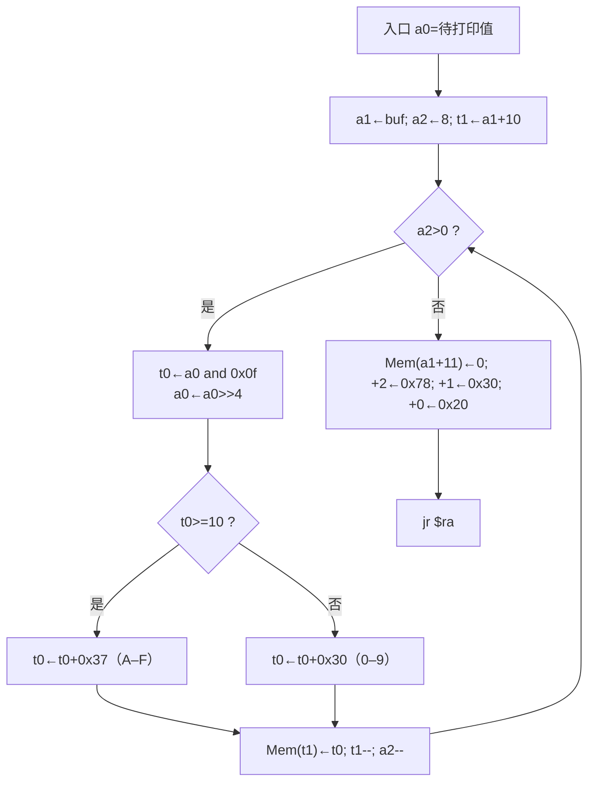
```
[Hexout(a0=待打印值)] → a1←buf; a2←8; t1←a1+10
   ↓←──────────────────────────┐
[a2>0 ?] --否→ [Mem(a1+11)=0; +2=0x78; +1=0x30; +0=0x20] → jr $ra
   ↓是
[t0←a0 and 0x0f; a0←a0>>4]
   ↓
[t0>=10 ?] --否→ [t0←t0+0x30] ─┐
   ↓是                          │
[t0←t0+0x37] ──────────────────┤
                                ↓
   [Mem(t1)←t0; t1←t1-1; a2←a2-1] ─┘（回到 a2>0）
```
**评分点**：① 三个初始化（含 `t1=a1+10`）1 分 ② `a2>0` 与回边 1 分 ③ `andi 0x0f`＋`srl 4` 1 分 ④ 0x30/0x37 双分支 1.5 分 ⑤ `sb`/`t1--`/`a2--` 1 分 ⑥ 出口 4 字节与返回 0.5 分。
**常见错误**：`t1` 初值写成 a1+11／a1+8；漏分支汇合；条件写成 `a2>=0`；漏 NUL。

### 图 2 Decin 三阶段流程图（8 分）

```text
读整行 → 跳前导空格 → 空行? 是：状态2返回
                       否 ↓
                 可选负号、设置幅值上限
                       ↓
             当前字符为数字? ─是→ multu 累计值×10
                       │          ↓
                       │    HI非零或低积>上限? 是→状态4
                       │          否 ↓
                       │    数字>上限-低积? 是→状态4
                       │          否 ↓
                       │    加数字、位数++、读下一字节 → 数字判断
                       否
                       ↓
        空格? 是→扫描尾部空格 → 结束符? 否→状态3
          否 ↓                         是 ↓
        结束符? 否→状态3       位数为0? 是→状态3
          是 ────────────────────────┘ 否 ↓
                      有负号则subu取负 → 状态1返回
```

评分点：三阶段及回边（2 分）；非法字符/空串/无数字分支（2 分）；正负幅值上限、乘加检错（3 分）；四个状态出口（1 分）。常见错误：将 `-` 当作 0；用带溢出陷阱的 sub/neg 处理 INT_MIN；先执行会溢出的 add 再检查。

### 图 3 sum 函数流程图（8 分）
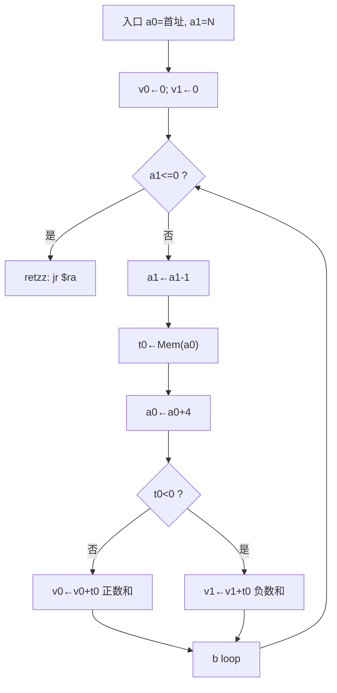
```
[sum(a0=首址, a1=N)] → v0←0; v1←0
   ↓←────────────────────────────┐
[a1<=0 ?] --是→ [jr $ra]（返回 v0, v1）
   ↓否
[a1←a1-1] → [t0←Mem(a0) lw] → [a0←a0+4]
   ↓
[t0<0 ?] --否→ [v0←v0+t0（正数和）] ─┐
   ↓是                                │
[v1←v1+t0（负数和）] ────────────────┤
                                      ↓
                        b loop ──（回 a1<=0）
```
**评分点**：① 初始化 1 分 ② `a1<=0` 退出分支与 `jr $ra` 1.5 分 ③ `a1--`/`lw`/`a0+=4` 顺序 2 分 ④ `bltz` 双分支且 0 走正数支 2 分 ⑤ 汇合后回边指向循环判定 1 分 ⑥ 标出返回值 0.5 分。
**常见错误**：回边画到 `a1--`；两支各自返回；条件写成 `a1<0`；把 0 算入负数和。

<div style="page-break-after: always"></div>

# 第08讲 算法（二）复习题（对应课件 P225–P251）

> 作答约定：除题目明确说明存在延迟槽外，程序题按课程模拟器默认的“无分支延迟、无加载延迟”模型执行；此时 jal/jalr 保存调用指令地址加 4。经典带分支延迟槽的 MIPS 保存调用指令地址加 8。所有地址均按字节计；宏展开和周期数按题目指定的模型计算。


## 本讲覆盖要点与题号索引

| 课件页 | 知识点 | 对应题号 |
|---|---|---|
| P225 | 章节标题：算法（二） | 本讲范围，不单独命题 |
| P226 | 求最大/最小值的思路：计数控制循环、循环体含两个分支 | 单1、填1、简1 |
| P227 | 伪代码与交叉引用表（a→$a0、N→$a1、max→$v0、min→$v1、i→$t0） | 单3、填2、简1 |
| P228 | max/min 完整程序；`bge/ble` 宏展开；`blt $t0,$a1,loop` 作循环条件 | 单2、判1、判2、读5、编1 |
| P229 | 递增数组插入算法：从最后一个元素起比较、K 后移、数组前一单元放哨兵 | 单4、填3、简2 |
| P230 | 插入程序：`addi $a0,$a0,36` 定位末元、`sw $t1,4($a0)`、`insert: sw $t0,4($a0)` | 填4、判3、读2、图2、编2 |
| P231 | 统计 $a0 中 1 的个数：`beqz`+`bgez` 判 MSB、`sll` 左移、`jr $ra` 返回 | 单5、判4、读3、编3 |
| P232 | 小写转大写：ASCII 0x61–0x7a 判定、减 0x20、$a0 串地址/$a1 最大长度、null 结束 | 单6、填5、简3 |
| P233 | trans 函数完整代码；系统调用 8 号输入、4 号输出、`jal`/`jr $ra` | 读4、代1、编4 |
| P234 | 简单选择排序算法：n 个元素共 n−1 趟，第 i 趟在 r[i..n] 中选最小放 r[i] | 单7、填6、简4 |
| P235–P242 | 一趟排序全过程：$a0 指向本轮基准单元（蓝）、$a1 依次扫描其后单元（红）、交换 | 多1、图1、读1 |
| P243–P245 | 第二趟至最后一趟结果与最终有序序列、每趟比较次数递减 | 单7、填7、读1 |
| P246 | 排序程序：`ble` 不交换 / 两条 `sw` 交换 / `addi $a0,4` 进入下一趟 | 单8、代3、判5、编5、编6 |
| P247 | 反汇编实验目的、方法与实验报告要求（总体流程图、函数流程图、测试） | 简5、判6 |
| P248 | 程序要求：输入格式、指令计数提示、`[地址] 机器码 汇编指令`、首地址 00400000、不可转换显示 ??? | 单9、填8、填9 |
| P249 | 评分标准：格式检查 2 分、反汇编 9 分、分支绝对地址 2 分、标号 2 分、三个必写函数 | 多2、填10、简6 |
| P250 | 输出示例：L001/L002 标号 + `标号[绝对地址]`；分支 imm 反算目标地址 | 单10、代2、代4、读1、编7、编8 |
| P251 | 独立完成、禁止 AI 代码/抄袭的学术诚信要求 | 判6 |

> 本讲共 54 题：单选 10、多选 2、填空 10、判断 6、简答 6、代码转换 4、读程序 5、编程 8、作图 3。

---

## 一、单项选择题（共 10 题）

1. 【课件P226】关于“求无序数组最大、最小值”的算法，下列说法正确的是（　）。
   - A. 数组必须事先排序才能求最大最小值
   - B. 元素个数已知，可用计数控制循环，循环体中包含两个二分支结构
   - C. 只需一个分支结构即可同时求出最大和最小
   - D. 必须使用递归才能同时求出最大和最小值

2. 【课件P228】程序中 `bge $v0,$t1,minck` 的宏指令展开是（　）。
   - A. `slt $at,$v0,$t1` 后接 `beq $at,$zero,minck`
   - B. `slt $at,$t1,$v0` 后接 `beq $at,$zero,minck`
   - C. `slt $at,$v0,$t1` 后接 `bne $at,$zero,minck`
   - D. `sub $at,$v0,$t1` 后接 `beq $at,$zero,minck`

3. 【课件P227】例8-1 的交叉引用表中，数组元素个数 N 被分配给（　）。
   - A. $a0　B. $a1　C. $v0　D. $t0

4. 【课件P229】例8-2 中已知数组元素及待插入数均非负，在数组前一个单元放置数值 −1 的目的是（　）。
   - A. 标记数组结束，便于输出
   - B. 作为哨兵：题设数组元素和待插入数均非负，故 −1 小于它们，可使扫描停止
   - C. 作为数组的第 0 个元素参与排序
   - D. 存放数组长度

5. 【课件P231】统计 $a0 中 1 的个数的函数中，`bgez $a0,next` 的作用是（　）。
   - A. 若 $a0 的最高位为 0（非负）则跳过计数，不执行 `addi $v0,$v0,1`
   - B. 若 $a0 为 0 则返回
   - C. 若 $a0 为负数则返回
   - D. 判断 $a0 的奇偶性

6. 【课件P232】把小写字母转成大写字母，正确的判断与变换是（　）。
   - A. 0x41≤c≤0x5A，加 0x20
   - B. 0x61≤c≤0x7a，减 0x20
   - C. 0x61≤c≤0x7a，加 0x20
   - D. 0x30≤c≤0x39，减 0x30

7. 【课件P234/P245】对 n=7 的数组做简单选择排序，共需进行（　）趟，第一趟需比较（　）次。
   - A. 7；7　B. 6；6　C. 7；6　D. 6；5

8. 【课件P246】排序程序中 `ble $t2,$t3,next`（$t2 为本轮基准单元内容，$t3 为后续单元内容）的含义及排序结果是（　）。
   - A. 前面的大则不交换，结果为降序
   - B. 前面的小（≤）则跳过交换，结果为升序
   - C. 前面的小则交换，结果为降序
   - D. 无论大小都交换，结果为升序

9. 【课件P248】反汇编程序对无法识别的机器码应输出（　），第一条指令的地址是（　）。
   - A. `nop`；00000000
   - B. `???`；00400000
   - C. 空白；00400000
   - D. `???`；10000000

10. 【课件P250】指令 `1420fff6` 位于地址 00400038，其反汇编结果（含目标地址）是（　）。
    - A. `bne $at,$zero,L002[0040000c]`
    - B. `bne $at,$zero,L002[00400010]`
    - C. `bne $at,$zero,L002[00400014]`
    - D. `beq $at,$zero,L002[00400018]`

## 二、多项选择题（共 2 题）

1. 【课件P235–P242】关于排序过程中 $a0、$a1 两个指针与交换操作，正确的有（　）。
   - A. $a0 指向本趟的基准单元（课件中用蓝色标注），一趟之内保持不变
   - B. $a1 从 $a0+4 开始逐个指向 $a0 之后的单元（课件中用红色标注），每比较一次加 4
   - C. 交换两个单元的内容需要两条 `sw`：`sw $t2,($a1)` 与 `sw $t3,($a0)`
   - D. 每趟结束后 $a0 加 4（`addi $a0,$a0,4`）进入下一趟，共进行 n−1 趟
   - E. 内层循环的比较次数随趟数增加而增加

2. 【课件P249】关于反汇编实验的评分标准与实现要求，正确的有（　）。
   - A. 机器指令的逐条读取和存储共 5 分，其中格式检查 2 分；某条格式错误则读到该条为止
   - B. 按 `[地址] 机器码 汇编指令` 格式输出得 2 分；反汇编本身共 9 分
   - C. 分支指令目标地址显示为绝对地址得 2 分，再加自定义标号（从 L001 起）并显示为 `标号[绝对地址]` 再得 2 分
   - D. “读取机器指令”“反汇编一条指令”“由寄存器号得到寄存器名”必须写成独立函数
   - E. 只要程序能跑出结果，代码再冗长重复也不扣分

## 三、填空题（共 10 题）

1. 【课件P226】因数组元素个数已知，求最大最小值采用______控制循环；循环体中包含______个分支结构，分别用于更新最大值和最小值。

2. 【课件P227】补全例8-1 的交叉引用表：`a`→______，`N`→______，`max`→______，`min`→______，`i`→______。

3. 【课件P229】递增序数组的插入算法从______（哪个元素）开始，把待插入数 N 与 K 逐一比较；若 N<K 则 K______一个单元空出位置，直到______时把 N 放入当前位置。

4. 【课件P230】`la $a0,array` 之后执行 `addi $a0,$a0,36`，使 $a0 指向数组的第______个元素（下标为______，字节偏移为______）；后移一个单元用指令______，插入用指令______。

5. 【课件P232】小写字母 a~z 的 ASCII 码范围是______到______，转换为大写需______0x20；转换函数的入口参数为：字符串地址在______中，最大长度在______中；遇到______认为字符串结束。

6. 【课件P234】简单选择排序对 n 个元素共进行______趟；第 i 趟在______范围内挑出最小者放在______；排序过程中通过把较小的数值______到前面实现。

7. 【课件P245】对 `13,27,38,97,76,65,49` 执行课件 P246 的排序程序，第 1 趟结束后序列为______，第 4 趟结束后序列为______，最终序列为______。

8. 【课件P248】输入格式为多个______位十六进制数字序列，以______隔开，以______结束，指令不超过______条；读取完成后显示“______ instructions loaded”（###为十进制数）。

9. 【课件P248】输出每条指令一行的格式为______；数值按______进制显示，地址按______进制显示且不显示 0x，寄存器按______显示。

10. 【课件P249】评分标准要求必须写成独立函数的三个过程是：______、______、______。

## 四、判断题（共 6 题，正确写“对”，错误写“错”并改正）

1. 【课件P228】求最大最小值的循环体中只有一个分支结构，因此每轮只需比较一次。（　）

2. 【课件P228】`blt $t0,$a1,loop` 展开为 `slt $at,$t0,$a1` 后接 `bne $at,$zero,loop`。（　）

3. 【课件P229】插入算法依靠数组前一个单元中的 −1 作哨兵，在数组元素和 N 都非负的前提下，即使 N 比数组中所有元素都小也能正确停止并插入。（　）

4. 【课件P231】`bgez $a0,next` 判断的是 $a0 的最高位：最高位为 0 时跳转跳过计数，最高位为 1 时计数 1 次。（　）

5. 【课件P246】排序程序中内层循环变量 $t1 逐次减 1，比较次数逐趟减少，程序结束时数组为升序。（　）

6. 【课件P247/P251】实验报告与代码可以与同学合作完成，只要各自写自己的报告即可。（　）

## 五、简答题（共 6 题）

1. 【课件P226/P227】写出例8-1（求最大最小值）的交叉引用表，并说明为什么该算法适合用计数控制循环。（6 分）

2. 【课件P229/P230】简述递增序数组的插入算法步骤，并说明哨兵的值、位置及作用。（6 分）

3. 【课件P232】说明小写转大写函数 trans 的入口参数、结束条件、转换条件与转换方法。（6 分）

4. 【课件P234】写出简单选择排序的基本思想（含趟数、第 i 趟做什么），并指出它与冒泡排序的主要区别。（6 分）

5. 写出反汇编实验的总体设计思路（从输入到输出的完整流程）。（8 分）

6. 【课件P249】列出反汇编实验的评分项与分值，并说明处理分支指令目标地址的两个步骤。（8 分）

## 六、代码转换题（共 4 题）

### 6.1 C 语言 → MIPS 汇编

1. 【课件P226–P228】把下面的 C 程序改写为完整的 MIPS 汇编程序（要求：`la` 取数组首址、计数循环、循环体内两个分支；程序末尾用 `li $v0,10` + `syscall` 结束）。

```c
int a[10] = {100,-10,0,23,35,-67,90,10,65,-87};
int max = a[0], min = a[0];
for (i = 0; i < 10; i++) {
    if (max < a[i]) max = a[i];
    if (min > a[i]) min = a[i];
}
```

### 6.2 伪指令/宏指令展开 + 编码

2. 【课件P246】排序程序中的 `ble $t2,$t3,next` 位于地址 00400034，标号 `next` 的地址为 00400044。
   （1）写出该宏指令展开后的两条真实指令；
   （2）分别写出这两条指令的机器码（给出字段分解）。

### 6.3 MIPS 汇编 → 机器码

3. 【课件P246】按下列指令所在地址写出机器码（十六进制，给字段分解）：
   （1）地址 0040000C：`addi $a1,$a0,4`
   （2）地址 0040003C：`addi $a0,$a0,4`
   （3）地址 00400034：`slt $at,$zero,$t1`

### 6.4 机器码 → MIPS 汇编（反汇编）

4. 【课件P248–P250】已知下列机器码，写出反汇编结果；不能识别的写成 `???`。
   （1）`012A4020`（位于 00400000）
   （2）`20850004`（位于 0040000C）
   （3）`1420FFF6`（位于 00400038）
   （4）`FFFFFFFF`（位于 00400050）

## 七、读程序写结果（共 5 题）

1. 【课件P235–P246】阅读下列排序程序，写出第 1 趟、第 4 趟结束后以及程序结束时数组的内容（每趟写出“$a0 指向的值 + 比较过程”）。
   ```asm
   .data
   array: .word 13,27,38,97,76,65,49
   .globl main
   .text
   main:  la   $a0, array
          li   $t0, 6
   lp0:   addi $a1, $a0, 4
          move $t1, $t0
   lp1:   lw   $t2, ($a0)
          lw   $t3, ($a1)
          ble  $t2, $t3, next
          sw   $t2, ($a1)
          sw   $t3, ($a0)
   next:  addi $a1, $a1, 4
          addi $t1, $t1,-1
          bgt  $t1, $0, lp1
          addi $a0, $a0, 4
          addi $t0, $t0,-1
          bgt  $t0, $0, lp0
          li   $v0, 10
          syscall
   ```

2. 【课件P230】阅读插入程序，写出执行完毕后的数组内容以及 N=31 所在的下标。
   ```asm
   .data
          .word -1
   array: .word 4,8,24,28,35,62,67,78,90,96
          .space 32
   N:     .word 31
   .globl main
   .text
   main:  la   $a0, array
          addi $a0, $a0, 36
          la   $a1, N
          lw   $t0, ($a1)
   again: lw   $t1, ($a0)
          ble  $t1, $t0, insert
          sw   $t1, 4($a0)
          addi $a0, $a0, -4
          b    again
   insert:sw   $t0, 4($a0)
          li   $v0, 10
          syscall
   ```

3. 【课件P231】执行下列函数，写出 $a0 分别为 `0x00F0F000` 和 `0x80000001` 时 $v0 的值，并说明循环体最多执行多少次。
   ```asm
   number_1: li   $v0, 0
   again:    beqz $a0, ret
             bgez $a0, next
             addi $v0, $v0, 1
   next:     sll  $a0, $a0, 1
             b    again
   ret:      jr   $ra
   ```

4. 【课件P233】程序被调用后从键盘输入 `aB3z!` 后回车，写出屏幕输出以及内存中字符串前 6 个字节的值，并说明 $t3 的作用。
   ```asm
   main:   la   $a0, string
           li   $a1, 100
           li   $v0, 8
           syscall
           jal  trans
           li   $v0, 4
           syscall
           li   $v0, 10
           syscall
   trans:  move $a2, $a0
           li   $t0, 0x61
           li   $t1, 0x7a
           li   $t3, 0
   again:  lb   $t2, ($a2)
           beqz $t2, ret
           blt  $t2, $t0, next
           bgt  $t2, $t1, next
           addi $t2, $t2,-0x20
           sb   $t2, ($a2)
   next:   addi $a2, $a2, 1
           addi $t3, $t3, 1
           blt  $t3, $a1, again
   ret:    jr   $ra
   ```

5. 【课件P228】执行下列程序，写出 $v0、$v1、$t0、$a0（程序结束时）的值。
   ```asm
   .data
   array: .word 100,-10,0,23,35,-67,90,10,65,-87
   .globl main
   .text
   main:  la   $a0, array
          lw   $v0, ($a0)
          move $v1, $v0
          li   $t0, 0
          li   $a1, 10
   loop:  lw   $t1, ($a0)
          bge  $v0, $t1, minck
          move $v0, $t1
   minck: ble  $v1, $t1, next
          move $v1, $t1
   next:  addi $a0, $a0, 4
          addi $t0, $t0, 1
          blt  $t0, $a1, loop
          li   $v0, 10
          syscall
   ```

## 八、程序设计与综合题（共 8 题）

1. 【10 分】【课件P226–P228】编写完整程序：在数据段定义 `array: .word 100,-10,0,23,35,-67,90,10,65,-87`，用计数控制循环求出最大值与最小值，分别存入 $v0、$v1，并用 1 号系统调用按“最大值 十进制数、换行、最小值”的格式输出。要求程序末尾 `li $v0,10` + `syscall`。

2. 【10 分】【课件P229–P230】编写完整程序：递增序数组 `4,8,24,28,35,62,67,78,90,96`，在其前一个单元放置哨兵 −1 并预留增长空间，把变量 N（=31）插入到正确位置，使数组仍递增。要求用 `addi $a0,$a0,36` 从末元素开始比较，并注释说明 `sw $t1,4($a0)` 与 `insert: sw $t0,4($a0)` 的作用。

3. 【10 分】【课件P231】编写函数 `number_1`：统计 $a0 中 1 的个数并由 $v0 返回（用 `bgez` + `sll` 实现，不得使用 `andi`/循环右移）。再写 main 用 `0x00F0F000` 调用该函数，并用 1 号系统调用输出结果。

4. 【10 分】【课件P232–P233】编写完整程序：用 8 号系统调用读入一行字符串（缓冲区 100 字节），调用函数 `trans` 把小写字母全部转成大写（参数：$a0 串地址、$a1 最大长度；遇 null 结束），再用 4 号系统调用输出。要求 trans 用 `jal` 调用、`jr $ra` 返回。

5. 【12 分】【课件P245–P246】编写简单选择排序程序（课件 P246 的“基准单元交换”版本）：数组 `13,27,38,97,76,65,49`，外层 n−1 趟、内层用 $a1 扫描，`ble` 成立则不交换，否则用两条 `sw` 交换；排序后按十进制逐个输出（数与数之间一个空格）。

6. 【10 分】【课件P234/P246】用冒泡排序（相邻两元素比较，逆序则交换，共 n−1 趟）对 `49,38,65,97,76,13,27` 排序，写出完整可运行程序，并给出每一趟结束后的数组（写在答案中）。

7. 【12 分】【课件P248–P250】编写函数 `dis_r`：输入 $a0 = 一条 R 型机器指令，输出形如 `add $t0,$t1,$t2` 的汇编指令。要求：①用移位+与运算取出 rs/rt/rd/funct；②用“寄存器号→寄存器名”的独立函数 `prt_reg` 打印寄存器名；③支持 add/sub/and/or/slt，其它 funct 输出 `???`。

8. 【12 分】【课件P248–P250】编写函数 `dis_b`：输入 $a0 = 一条分支指令机器码、$a1 = 该指令地址，输出形如 `bne $at,$zero,L002[00400014]` 的结果。要求：①由 imm 反算目标地址（符号扩展后左移 2 位，再加 PC+4）；②在标号表中查找目标地址，找到则先输出标号，随后输出 `[目标地址]`（16 进制、不显示 0x）；③支持 beq/bne。

## 九、作图题（共 3 题）

1. 【8 分】【课件P235–P242】画出对 `13,27,38,97,76,65,49` 排序时**第 4 趟**的指针与序列变化图。要求：画出初始序列，用蓝色标出 $a0 所指单元（97）、用红色标出 $a1 的三次位置（76→65→49），画出每次交换后的序列，并标注每步 `addi $a1,$a1,4`、`addi $t1,$t1,-1` 的变化。

2. 【8 分】【课件P229–P230】画出把 N=31 插入 `4,8,24,28,35,62,67,78,90,96` 的过程图。要求：标出哨兵 −1 的位置、$a0 的移动路径、每次后移（`sw $t1,4($a0)`）的数据流向，最后标出 `insert: sw $t0,4($a0)` 的落点与最终数组。

3. 【10 分】【课件P247–P250】画出反汇编程序的总体流程图。要求包含：输入提示→逐条读取并做格式检查（8 位十六进制）→子串转数值并存储、计数→按 `[地址] 机器码 汇编指令` 输出→判断是否分支指令（是则 imm 反算绝对地址，并在标号表中查/建 L001 起的标号，输出 `标号[绝对地址]`）→直到输入结束。

---

# 参考答案与解析

## 一、单项选择题

1. **B**。数组无需排序，逐个元素比较即可；因元素个数已知（N=10），用计数控制循环（`i<N` 时继续），循环体内两个二分支分别更新 max、min。
2. **A**。`bge $v0,$t1,label` 语义为“$v0≥$t1 则跳转”，等价 `slt $at,$v0,$t1`（$v0<$t1 时 $at=1）+ `beq $at,$zero,label`（$at=0 即不小于时跳转）。B 的寄存器顺序反了；C 把条件取反。
3. **B**。交叉引用表：`a`→$a0、`N`→$a1、`max`→$v0、`min`→$v1、`i`→$t0。
4. **B**。哨兵 −1 放在 `array` 前一个单元（`.data` 中 `.word -1`），必小于任何待插入数，使 `ble $t1,$t0,insert` 一定能成立，循环必然结束，避免越过数组首址继续比较。
5. **A**。`bgez` 测符号位（MSB）；MSB=0（非负）则跳过 `addi $v0,$v0,1`，MSB=1 才计 1，然后 `sll` 左移把下一位送到 MSB。
6. **B**。小写 0x61–0x7a，大写比小写小 0x20，故 `addi $t2,$t2,-0x20`；A 是大写判断。
7. **B**。n 个元素共 n−1=6 趟；第 1 趟把基准单元与其余 n−1=6 个元素比较 6 次。
8. **B**。`ble` 成立（前面≤后面）直接 `next` 不交换；只有前面大于后面才交换，故小的往前移，结果为升序。
9. **B**。首条指令地址 00400000，每条 +4；无法识别的 opcode/funct 输出 `???`。
10. **C**。opcode=5→bne；rs=1→$at；rt=0→$zero；imm=0xFFF6=−10，目标=00400038+4+(−10×4)=0040003C−40=00400014。

## 二、多项选择题

1. **A、B、C、D**。E 错：第 i 趟只比较 n−i 次，比较次数随趟数**减少**（`move $t1,$t0` 后 `addi $t1,$t1,-1` 递减）。
2. **A、B、C、D**。E 错：P249 明确“过于冗长、重复的代码酌情扣 1–2 分”，且三个关键过程必须独立成函数，否则相应扣分。

## 三、填空题

1. **计数**；**2**（一个更新 max，一个更新 min）。
2. **$a0**；**$a1**；**$v0**；**$v1**；**$t0**。
3. **最后一个元素**（a[n−1]）；**后移**；**N≥K**（即 `K<=N`）。
4. **10**（第 10 个）；**9**；**36**；`sw $t1,4($a0)`；`sw $t0,4($a0)`。
5. **0x61**；**0x7a**；**减**；**$a0**；**$a1**；**null（0）**。
6. **n−1**；**r[i] 到 r[n]**；**r[i]**；**交换**。
7. 第 1 趟：**13 27 38 97 76 65 49**（基准 13 已最小，无交换）；第 4 趟：**13 27 38 49 97 76 65**；最终：**13 27 38 49 65 76 97**。
8. **8**；**空格**；**回车**；**100**；**`### instructions loaded`**（如 `19 instructions loaded`）。
9. **`[地址] 机器码 汇编指令`**；**十**；**十六**；**MIPS 寄存器名**（如 `$a0`）。
10. **读取机器指令的过程**、**反汇编一条指令的过程**、**从寄存器号获得寄存器名的过程**。

## 四、判断题

1. **错**。循环体含**两个**分支：`bge $v0,$t1,minck` 更新 max、`ble $v1,$t1,next` 更新 min，每轮最多两次比较。
2. **对**。`slt $at,$t0,$a1` 得 $t0<$a1，再用 `bne $at,$zero,loop` 实现“小于则继续循环”。
3. **对**。哨兵 −1 保证 `ble` 必成立；若 N 比所有元素小，走到 $a0=array−4 时插入 `4($a0)`，正好写入 array[0]。
4. **对**。`bgez` 按 MSB 分派：MSB=0 跳过计数，MSB=1 计 1 后左移；`beqz` 负责结束。
5. **对**。内层 `$t1` 每趟初值等于 $t0 并递减到 0，比较次数 6,5,4,3,2,1；`ble` 保证小在前，结果为升序。
6. **错**。P251：代码必须独立手工完成，禁止 AI 生成代码、抄袭、合作写代码或找人代做，查实即取消期末考试资格。

## 五、简答题

1. 【6 分】交叉引用表：a→$a0（数组指针，每次 `addi $a0,$a0,4`），N→$a1（元素个数/循环上界），max→$v0，min→$v1，i→$t0（计数器）。适合计数循环的原因：元素个数 N 事先已知，循环次数确定，用 `addi $t0,$t0,1` 计数、`blt $t0,$a1,loop` 判断即可，无需判结束标志。

2. 【6 分】步骤（得分点）：① $t0=N，`addi $a0,$a0,36` 指向末元素；② K=`lw $t1,($a0)`，`ble $t1,$t0,insert`；③ 若 K>N，`sw $t1,4($a0)` 把 K 后移一单元，`addi $a0,$a0,-4` 前移，`b again`；④ K≤N 或碰到哨兵时 `insert: sw $t0,4($a0)`。哨兵：值 **−1**，位于 `array` **前一个单元**；作用：必小于任何元素，保证循环终止且 N 最小时也能写入 array[0]。

3. 【6 分】入口参数：$a0 = 串首址，$a1 = 缓冲区最大长度。结束条件：`beqz $t2,ret`（遇 null）或计数器 $t3 达到 $a1。转换条件：`blt $t2,0x61,next` 与 `bgt $t2,0x7a,next` 均不成立（0x61≤c≤0x7a）。方法：`addi $t2,$t2,-0x20` 后 `sb $t2,($a2)`；用 $a2 作游标以保留原 $a0。

4. 【6 分】思想：第 1 趟在 r[1..n] 选最小放 r[1]，第 2 趟在 r[2..n] 选最小放 r[2]，……第 i 趟在 r[i..n] 选最小放 r[i]，共 n−1 趟。与冒泡区别：选择排序每趟把基准单元与后续单元比较交换，已就位元素不再参与；冒泡只在相邻两元素间比较交换，大数逐步“冒”到末尾。

5. 【8 分】流程（得分点）：① 输出提示，循环读入空格分隔的 8 位十六进制串；② 子串转数值（逐字符判 0–9/A–F，`val=val*16+digit`）并做格式检查，非法则停止读入；③ 数值存入数组、统计条数，输出 `### instructions loaded`；④ 从 00400000 起逐条反汇编，按 `[地址] 机器码 汇编指令` 输出，不可识别输出 `???`；⑤ 分支指令由 imm 反算绝对地址并生成/查找 L001 起的标号，输出 `标号[绝对地址]`；⑥ 地址每条 +4，直到处理完所有指令。

6. 【8 分】评分项：读取与存储 5 分（含格式检查 2 分）；按格式输出 2 分；反汇编 9 分；分支目标显示为绝对地址 2 分；加标号并显示 `标号[绝对地址]` 2 分。三个必写函数：读机器指令、反汇编一条指令、寄存器号→寄存器名。分支目标两步：① imm 符号扩展后左移 2 位，加 `PC+4` 得绝对地址；② 在标号表中查该地址，无则按地址从小到大依次分配 L001、L002…，输出时先标号再 `[地址]`。

## 六、代码转换题

### 6.1 C → MIPS

1. 参考代码（循环结束、设置退出服务号之前 `$v0=100`、`$v1=−87`；退出时 `$v0=10`）：

```asm
.data
array: .word 100,-10,0,23,35,-67,90,10,65,-87
.globl main
.text
main:  la   $a0, array        # a = array
       lw   $v0, ($a0)        # max = a[0]
       move $v1, $v0          # min = max
       li   $t0, 0            # i = 0
       li   $a1, 10           # N = 10
loop:  lw   $t1, ($a0)        # t1 = *a
       bge  $v0, $t1, minck   # if (max >= *a) goto minck
       move $v0, $t1          # max = *a
minck: ble  $v1, $t1, next    # if (min <= *a) goto next
       move $v1, $t1          # min = *a
next:  addi $a0, $a0, 4       # a++
       addi $t0, $t0, 1       # i++
       blt  $t0, $a1, loop    # if (i < N) goto loop
       li   $v0, 10
       syscall
```

### 6.2 宏指令展开 + 编码

2. （1）展开为：
```asm
       slt  $at, $t3, $t2     # $t3<$t2 ? 1 : 0（即 $t2>$t3）
       beq  $at, $zero, next  # 不大于则跳转
```
（2）`slt`（地址 00400034）：R 型，op=0，rs=$t3=11，rt=$t2=10，rd=$at=1，shamt=0，funct=0x2A
```
000000 01011 01010 00001 00000 101010
= 0000 0001 0110 1010 0000 1000 0010 1010
= 0x016A082A
```
`beq`（地址 00400038，目标 00400044）：imm=(00400044−00400038−4)/4=8/4=2
```
000100 00001 00000 0000 0000 0000 0010
= 0001 0000 0010 0000 0000 0000 0000 0010
= 0x10200002
```

### 6.3 汇编 → 机器码

3. （1）`addi $a1,$a0,4`：op=8(001000)，rs=4(00100)，rt=5(00101)，imm=4
```
001000 00100 00101 0000 0000 0000 0100 = 0x20850004
```
（2）`addi $a0,$a0,4`：op=8，rs=4，rt=4，imm=4
```
001000 00100 00100 0000 0000 0000 0100 = 0x20840004
```
（3）`slt $at,$zero,$t1`：R 型，rs=0，rt=9(01001)，rd=1(00001)，funct=0x2A
```
000000 00000 01001 00001 00000 101010 = 0x0009082A
```

### 6.4 反汇编

4. （1）`012A4020`：op=0、rs=9($t1)、rt=10($t2)、rd=8($t0)、funct=0x20 → **`add $t0,$t1,$t2`**
（2）`20850004`：op=8 → addi，rs=4($a0)、rt=5($a1)、imm=4 → **`addi $a1,$a0,4`**
（3）`1420FFF6`（地址 00400038）：op=5 → bne，rs=1($at)、rt=0($zero)，imm=0xFFF6=−10，目标=00400038+4−40=00400014 → **`bne $at,$zero,00400014`**（若已建标号则为 `bne $at,$zero,L002[00400014]`）
（4）`FFFFFFFF`：op=0x3F=63，不在指令集内 → **`???`**

## 七、读程序写结果

1. 【排序程序】$t0 从 6 递减到 1，共 6 趟；$a0 指基准单元，$a1 从其下一单元扫描。

   | 趟 | $a0 指向 | 比较与交换 | 本趟结束后的数组 |
   |---|---|---|---|
   | 1 | 13 | 13≤27,38,97,76,65,49，均不交换 | 13 27 38 97 76 65 49 |
   | 2 | 27 | 27≤38,97,76,65,49 | 13 27 38 97 76 65 49 |
   | 3 | 38 | 38≤97,76,65,49 | 13 27 38 97 76 65 49 |
   | 4 | 97 | 97>76 换→[76,97]；76>65 换→[65,76]；65>49 换→[49,65] | **13 27 38 49 97 76 65** |
   | 5 | 97 | 97>76 换，76>65 再换 | 13 27 38 49 65 97 76 |
   | 6 | 97 | 97>76 换 | **13 27 38 49 65 76 97** |

   答：第 1/4 趟及最终的序列即上表加粗项。

2. 【插入程序】$a0 从 a[9]（偏移 36）开始，N=31。

   | 步骤 | $a0 偏移 | K=mem[$a0] | 动作 |
   |---|---|---|---|
   | 1 | 36 | 96 | 96>31 → `sw` 到偏移 40，$a0←32 |
   | 2 | 32 | 90 | 后移到 36，$a0←28 |
   | 3 | 28 | 78 | 后移到 32，$a0←24 |
   | 4 | 24 | 67 | 后移到 28，$a0←20 |
   | 5 | 20 | 62 | 后移到 24，$a0←16 |
   | 6 | 16 | 35 | 后移到 20，$a0←12 |
   | 7 | 12 | 28 | 28≤31 → insert，写入偏移 16 |

   答：末尾数组为 **4, 8, 24, 28, 31, 35, 62, 67, 78, 90, 96**，N=31 位于下标 **4**（偏移 16），共 11 个元素。

3. 【位计数】
   - $a0=`0x00F0F000` = 0000 0000 1111 0000 1111 0000 0000 0000，共 **8** 个 1 → $v0=**8**。
   - $a0=`0x80000001`：MSB 与最低位为 1，共 **2** 个 1 → $v0=**2**（注意 $a0 是负数时不能靠 `beqz` 之外的符号判断提前结束）。
   - 每轮必 `sll` 一次，最多 **32** 轮后 $a0 变为 0 退出。

4. 【大小写转换】输入 `aB3z!` + 回车，内存前 6 字节：`0x41 0x42 0x33 0x5A 0x21 0x0A`；屏幕输出 **`AB3Z!`** 并换行。$t3 是已处理字符计数器，初值 0，每处理一个字符（包括不需要转换的 `3`、`!`、换行）加 1，用 `blt $t3,$a1,again` 限制不超过缓冲区长度 $a1=100；本例遇 null 提前返回，$t3=6。

5. 【max/min 程序】循环结束时：$v1=**−87**（最小值），$t0=**10**，$a0=**array+40**（指向数组末尾之后）；$v0 在 `li $v0,10` 后被覆盖为 **10**（最大值 100 存于 $v0 直到程序末尾被覆盖）。

## 八、程序设计与综合题

1. 【评分点：交叉引用/计数循环 3 分、两个分支 3 分、结果正确 2 分、输出与结束 2 分】

```asm
.data
array: .word 100,-10,0,23,35,-67,90,10,65,-87
smax:  .asciiz "max="
smin:  .asciiz "\nmin="
nl:    .asciiz "\n"
.globl main
.text
main:  la   $a0, array        # a = array
       lw   $v0, ($a0)        # max = a[0]
       move $v1, $v0          # min = max
       li   $t0, 0            # i = 0
       li   $a1, 10           # N = 10
loop:  lw   $t1, ($a0)        # t1 = *a
       bge  $v0, $t1, minck   # max >= *a ? 跳过
       move $v0, $t1          # 更新 max
minck: ble  $v1, $t1, next    # min <= *a ? 跳过
       move $v1, $t1          # 更新 min
next:  addi $a0, $a0, 4       # a++
       addi $t0, $t0, 1       # i++
       blt  $t0, $a1, loop    # i < N 继续
       move $s0, $v0          # 保存 max（v0 将用于系统调用）
       move $s1, $v1          # 保存 min
       la   $a0, smax
       li   $v0, 4
       syscall
       move $a0, $s0
       li   $v0, 1
       syscall
       la   $a0, smin
       li   $v0, 4
       syscall
       move $a0, $s1
       li   $v0, 1
       syscall
       la   $a0, nl
       li   $v0, 4
       syscall
       li   $v0, 10
       syscall
```
输出：`max=100`、`min=-87`。

2. 【评分点：哨兵与增长空间 3 分、从末元开始比较 3 分、后移/插入指令 2 分、结果正确 2 分】

```asm
.data
       .word -1                 # 哨兵，位于 array 前一个单元
array: .word 4,8,24,28,35,62,67,78,90,96
       .space 32                # 预留 8 个单元的增长空间
N:     .word 31
spc:   .asciiz " "
nl:    .asciiz "\n"
.globl main
.text
main:  la   $a0, array
       addi $a0, $a0, 36        # 指向最后一个元素 a[9]（1 个元素 4 字节）
       la   $a1, N
       lw   $t0, ($a1)          # t0 = N = 31
again: lw   $t1, ($a0)          # t1 = K
       ble  $t1, $t0, insert    # K <= N 则找到位置
       sw   $t1, 4($a0)         # K 后移一个单元
       addi $a0, $a0, -4        # 指向前一单元
       b    again
insert:sw   $t0, 4($a0)         # N 写入空出的位置
       la   $t2, array          # 输出 11 个元素
       li   $t3, 11
ploop: lw   $a0, ($t2)
       li   $v0, 1
       syscall
       la   $a0, spc
       li   $v0, 4
       syscall
       addi $t2, $t2, 4
       addi $t3, $t3, -1
       bgtz $t3, ploop
       la   $a0, nl
       li   $v0, 4
       syscall
       li   $v0, 10
       syscall
```
输出：`4 8 24 28 31 35 62 67 78 90 96`（N=31 落在下标 4）。

3. 【评分点：函数用 `beqz`/`bgez`/`sll` 3 分、返回 $v0 与 `jr $ra` 2 分、循环正确 3 分、调用与输出 2 分】

```asm
.data
val:  .word 0x00F0F000
msg:  .asciiz "number of 1 = "
nl:   .asciiz "\n"
.globl main
.text
main:  lw   $a0, val
       jal  number_1           # v0 = 1 的个数
       move $s0, $v0
       la   $a0, msg
       li   $v0, 4
       syscall
       move $a0, $s0
       li   $v0, 1
       syscall
       la   $a0, nl
       li   $v0, 4
       syscall
       li   $v0, 10
       syscall

# number_1: 统计 $a0 中 1 的个数，结果在 $v0 中返回
number_1:
       li   $v0, 0             # 计数器清零
again: beqz $a0, ret           # 全 0 则返回
       bgez $a0, next          # MSB=0 不计数
       addi $v0, $v0, 1        # MSB=1，计数
next:  sll  $a0, $a0, 1        # 左移，把下一位送到 MSB
       b    again
ret:   jr   $ra
```
输出：`number of 1 = 8`。

4. 【评分点：8/4 号系统调用 2 分、参数传递 2 分、范围判定与 -0x20 3 分、null 结束 1 分、`jal/jr $ra` 2 分】

```asm
.data
string: .space 100
.globl main
.text
main:  la   $a0, string        # a0 = 缓冲区地址
       li   $a1, 100           # a1 = 最大长度
       li   $v0, 8             # 读字符串
       syscall
       jal  trans              # 调用转换函数（a0/a1 仍有效）
       li   $v0, 4             # 输出字符串
       syscall
       li   $v0, 10
       syscall

# trans: a0 = 串地址，a1 = 最大长度
#        把 0x61~0x7a 的字符减 0x20 变为大写
trans: move $a2, $a0           # a2 作游标，保留 a0
       li   $t0, 0x61          # 'a'
       li   $t1, 0x7a          # 'z'
       li   $t3, 0             # 计数器
again: lb   $t2, ($a2)         # 取字符
       beqz $t2, ret           # 遇 null 结束
       blt  $t2, $t0, next     # < 'a' 跳过
       bgt  $t2, $t1, next     # > 'z' 跳过
       addi $t2, $t2, -0x20    # 小写→大写
       sb   $t2, ($a2)         # 写回
next:  addi $a2, $a2, 1        # 指向下一字符
       addi $t3, $t3, 1
       blt  $t3, $a1, again    # 未超长继续
ret:   jr   $ra
```
输入 `aB3z!` 输出 `AB3Z!`。

5. 【评分点：外层 n−1 趟 3 分、内层指针+计数 3 分、`ble`/两条 `sw` 3 分、输出 2 分、结果 1 分】

```asm
.data
array: .word 13,27,38,97,76,65,49
spc:   .asciiz " "
nl:    .asciiz "\n"
.globl main
.text
main:  la   $a0, array        # a0 = 基准单元指针
       li   $t0, 6            # 外循环变量 = n-1 = 6
lp0:   addi $a1, $a0, 4       # a1 = 本趟第一个被比较单元
       move $t1, $t0          # 内循环变量 = 本趟比较次数
lp1:   lw   $t2, ($a0)        # 基准单元
       lw   $t3, ($a1)        # 后续单元
       ble  $t2, $t3, next    # 前面小则不交换
       sw   $t2, ($a1)        # 否则交换两单元
       sw   $t3, ($a0)
next:  addi $a1, $a1, 4       # a1 指向下一单元
       addi $t1, $t1, -1
       bgt  $t1, $0, lp1      # 内层未完继续
       addi $a0, $a0, 4       # 进入下一趟
       addi $t0, $t0, -1
       bgt  $t0, $0, lp0      # 外层未完继续
# 输出 7 个元素
       la   $t4, array
       li   $t5, 7
ploop: lw   $a0, ($t4)
       li   $v0, 1
       syscall
       la   $a0, spc
       li   $v0, 4
       syscall
       addi $t4, $t4, 4
       addi $t5, $t5, -1
       bgtz $t5, ploop
       la   $a0, nl
       li   $v0, 4
       syscall
       li   $v0, 10
       syscall
```
输出：`13 27 38 49 65 76 97`。

6. 【评分点：外层趟数 2 分、内层相邻比较 3 分、交换 2 分、界限 `n-1-i` 2 分、输出 1 分】

```asm
.data
array: .word 49,38,65,97,76,13,27
spc:   .asciiz " "
nl:    .asciiz "\n"
.globl main
.text
main:  la   $s0, array
       li   $s1, 7             # n
       li   $s2, 0             # i = 0（趟号）
outer: addi $t0, $s1, -1
       sub  $t0, $t0, $s2      # 本趟比较次数 = n-1-i
       blez $t0, end           # 无需比较则排序完成
       li   $s3, 0             # j = 0
       move $s4, $s0           # p = &a[0]
inner: beq  $s3, $t0, nextpass
       lw   $t1, 0($s4)        # a[j]
       lw   $t2, 4($s4)        # a[j+1]
       ble  $t1, $t2, noswap   # 顺序正确不交换
       sw   $t2, 0($s4)        # 交换相邻两元
       sw   $t1, 4($s4)
noswap:addi $s4, $s4, 4
       addi $s3, $s3, 1
       b    inner
nextpass:
       addi $s2, $s2, 1
       b    outer
# 输出
end:   move $t4, $s0
       li   $t5, 7
ploop: lw   $a0, ($t4)
       li   $v0, 1
       syscall
       la   $a0, spc
       li   $v0, 4
       syscall
       addi $t4, $t4, 4
       addi $t5, $t5, -1
       bgtz $t5, ploop
       la   $a0, nl
       li   $v0, 4
       syscall
       li   $v0, 10
       syscall
```
逐趟变化表：

| 趟 | 本趟比较次数 | 本趟结束后的数组 |
|---|---|---|
| 初始 | — | 49 38 65 97 76 13 27 |
| 1 | 6 | 38 49 65 76 13 27 97 |
| 2 | 5 | 38 49 65 13 27 76 97 |
| 3 | 4 | 38 49 13 27 65 76 97 |
| 4 | 3 | 38 13 27 49 65 76 97 |
| 5 | 2 | 13 27 38 49 65 76 97 |
| 6 | 1 | 13 27 38 49 65 76 97（无交换，已有序） |

7. 【评分点：字段抽取 3 分、funct 判分与 ??? 3 分、`prt_reg` 独立函数 3 分、输出格式与保存 $ra 3 分】

```asm
.data
# 寄存器名表：每项固定 8 字节（以 \0 填充兼作串尾），偏移 = 寄存器号 * 8
regtab: .ascii "$zero\0\0\0$at\0\0\0\0\0$v0\0\0\0\0\0$v1\0\0\0\0\0"
        .ascii "$a0\0\0\0\0\0$a1\0\0\0\0\0$a2\0\0\0\0\0$a3\0\0\0\0\0"
        .ascii "$t0\0\0\0\0\0$t1\0\0\0\0\0$t2\0\0\0\0\0$t3\0\0\0\0\0"
        .ascii "$t4\0\0\0\0\0$t5\0\0\0\0\0$t6\0\0\0\0\0$t7\0\0\0\0\0"
        .ascii "$s0\0\0\0\0\0$s1\0\0\0\0\0$s2\0\0\0\0\0$s3\0\0\0\0\0"
        .ascii "$s4\0\0\0\0\0$s5\0\0\0\0\0$s6\0\0\0\0\0$s7\0\0\0\0\0"
        .ascii "$t8\0\0\0\0\0$t9\0\0\0\0\0$k0\0\0\0\0\0$k1\0\0\0\0\0"
        .ascii "$gp\0\0\0\0\0$sp\0\0\0\0\0$fp\0\0\0\0\0$ra\0\0\0\0\0"
f_add: .asciiz "add "
f_sub: .asciiz "sub "
f_and: .asciiz "and "
f_or:  .asciiz "or "
f_slt: .asciiz "slt "
f_unk: .asciiz "??? "
comma: .asciiz ","
code:  .word 0x012A4020      # 测试用 R 型指令
.globl main
.text
main:  lw   $a0, code
       jal  dis_r
       li   $v0, 10
       syscall

# prt_reg: $a0 = 寄存器号，输出寄存器名（如 $t0）
prt_reg:
       la   $t7, regtab
       sll  $t6, $a0, 3      # 号 * 8
       add  $a0, $t7, $t6
       li   $v0, 4
       syscall
       jr   $ra

# dis_r: $a0 = R 型机器码，输出 "add $t0,$t1,$t2"
dis_r: addi $sp, $sp, -16
       sw   $ra, 12($sp)
       sw   $s0, 8($sp)
       sw   $s1, 4($sp)
       sw   $s2, 0($sp)
       srl  $t5, $a0, 26
       bnez $t5, unknown_r
       srl  $s0, $a0, 11     # rd  = [15:11]
       andi $s0, $s0, 0x1F
       srl  $s1, $a0, 21     # rs  = [25:21]
       andi $s1, $s1, 0x1F
       srl  $s2, $a0, 16     # rt  = [20:16]
       andi $s2, $s2, 0x1F
       andi $t4, $a0, 0x3F   # funct = [5:0]
       la   $a0, f_unk
       li   $t5, 0x20
       bne  $t4, $t5, t_sub
       la   $a0, f_add
       b    prn
t_sub: li   $t5, 0x22
       bne  $t4, $t5, t_and
       la   $a0, f_sub
       b    prn
t_and: li   $t5, 0x24
       bne  $t4, $t5, t_or
       la   $a0, f_and
       b    prn
t_or:  li   $t5, 0x25
       bne  $t4, $t5, t_slt
       la   $a0, f_or
       b    prn
t_slt: li   $t5, 0x2A
       bne  $t4, $t5, unknown_r
       la   $a0, f_slt
prn:   li   $v0, 4
       syscall
       move $a0, $s0         # 打印 rd
       jal  prt_reg
       la   $a0, comma
       li   $v0, 4
       syscall
       move $a0, $s1         # 打印 rs
       jal  prt_reg
       la   $a0, comma
       li   $v0, 4
       syscall
       move $a0, $s2         # 打印 rt
       jal  prt_reg
       b    restore_r
unknown_r:
       la   $a0, f_unk
       li   $v0,4
       syscall
restore_r:
       lw   $ra, 12($sp)
       lw   $s0, 8($sp)
       lw   $s1, 4($sp)
       lw   $s2, 0($sp)
       addi $sp, $sp, 16
       jr   $ra
```
`0x012A4020`：rd=8($t0)、rs=9($t1)、rt=10($t2)、funct=0x20 → 输出 **`add $t0,$t1,$t2`**。

8. 【评分点：imm 符号扩展与左移 3 分、PC+4 加法 2 分、绝对地址输出 2 分、标号表查找 3 分、beq/bne 区分与保存寄存器 2 分】
下面给出独立程序，包含寄存器表、`prt_reg` 和十六进制输出过程；只用课件中的系统调用 4/10。

```asm
.data
regtab: .ascii "$zero\0\0\0$at\0\0\0\0\0$v0\0\0\0\0\0$v1\0\0\0\0\0"
        .ascii "$a0\0\0\0\0\0$a1\0\0\0\0\0$a2\0\0\0\0\0$a3\0\0\0\0\0"
        .ascii "$t0\0\0\0\0\0$t1\0\0\0\0\0$t2\0\0\0\0\0$t3\0\0\0\0\0"
        .ascii "$t4\0\0\0\0\0$t5\0\0\0\0\0$t6\0\0\0\0\0$t7\0\0\0\0\0"
        .ascii "$s0\0\0\0\0\0$s1\0\0\0\0\0$s2\0\0\0\0\0$s3\0\0\0\0\0"
        .ascii "$s4\0\0\0\0\0$s5\0\0\0\0\0$s6\0\0\0\0\0$s7\0\0\0\0\0"
        .ascii "$t8\0\0\0\0\0$t9\0\0\0\0\0$k0\0\0\0\0\0$k1\0\0\0\0\0"
        .ascii "$gp\0\0\0\0\0$sp\0\0\0\0\0$fp\0\0\0\0\0$ra\0\0\0\0\0"
hexchars: .ascii "0123456789ABCDEF"
hexbuf: .space 9
laddr: .word 0x0040000c, 0x00400014, 0   # 标号表（0 结束）
lname: .word L001, L002
L001:  .asciiz "L001"
L002:  .asciiz "L002"
n_beq: .asciiz "beq "
n_bne: .asciiz "bne "
f_unk: .asciiz "??? "
comma: .asciiz ","
lb:    .asciiz "["
rb:    .asciiz "]"
code:  .word 0x1420FFF6      # 测试：bne $at,$zero,L002[00400014]
addr:  .word 0x00400038
.globl main
.text
main:  lw   $a0, code
       lw   $a1, addr
       jal  dis_b
       li   $v0, 10
       syscall

# dis_b: $a0 = 分支指令机器码，$a1 = 本指令地址
dis_b: addi $sp, $sp, -24
       sw   $ra, 20($sp)
       sw   $s0, 16($sp)
       sw   $s1, 12($sp)
       sw   $s2, 8($sp)
       sw   $s3, 4($sp)
       move $s0, $a1         # 本指令地址
       srl  $s1, $a0, 21     # rs
       andi $s1, $s1, 0x1F
       srl  $s2, $a0, 16     # rt
       andi $s2, $s2, 0x1F
       sll  $s3, $a0, 16     # 取 imm 低 16 位
       sra  $s3, $s3, 16     # 符号扩展
       sll  $s3, $s3, 2      # imm * 4
       addi $t0, $s0, 4      # PC + 4
       add  $s3, $t0, $s3    # 目标地址
       srl  $t1, $a0, 26     # opcode
       la   $a0, f_unk
       li   $t2, 4
       beq  $t1, $t2, i_beq
       li   $t2, 5
       beq  $t1, $t2, i_bne
       la   $a0, f_unk
       li   $v0,4
       syscall
       b    restore_b
 i_beq:la   $a0, n_beq
       b    prn
 i_bne:la   $a0, n_bne
prn:   li   $v0, 4
       syscall
       move $a0, $s1
       jal  prt_reg
       la   $a0, comma
       li   $v0, 4
       syscall
       move $a0, $s2
       jal  prt_reg
       la   $a0, comma
       li   $v0, 4
       syscall
       la   $t3, laddr        # 查标号表
       la   $t4, lname
find:  lw   $t5, ($t3)
       beqz $t5, nolab
       beq  $t5, $s3, hit
       addi $t3, $t3, 4
       addi $t4, $t4, 4
       b    find
hit:   lw   $a0, ($t4)       # 输出标号
       li   $v0, 4
       syscall
nolab: la   $a0, lb
       li   $v0, 4
       syscall
       move $a0, $s3
       jal  print_hex8          # 用查表和 syscall 4 输出8位十六进制
       la   $a0, rb
       li   $v0, 4
       syscall
restore_b:
       lw   $ra, 20($sp)
       lw   $s0, 16($sp)
       lw   $s1, 12($sp)
       lw   $s2, 8($sp)
       lw   $s3, 4($sp)
       addi $sp, $sp, 24
       jr   $ra

prt_reg:
       la   $t7, regtab
       sll  $t6, $a0, 3      # 号 * 8
       add  $a0, $t7, $t6
       li   $v0, 4
       syscall
       jr   $ra

print_hex8:
       la $t0,hexbuf
       addiu $t0,$t0,8
       sb $zero,0($t0)
       li $t1,8
       la $t3,hexchars
hex_loop:
       andi $t2,$a0,15
       addu $t2,$t3,$t2
       lbu $t2,0($t2)
       addiu $t0,$t0,-1
       sb $t2,0($t0)
       srl $a0,$a0,4
       addiu $t1,$t1,-1
       bgtz $t1,hex_loop
       move $a0,$t0
       li $v0,4
       syscall
       jr $ra

```
验证：opcode=5→bne；rs=1→$at；rt=0→$zero；imm=0xFFF6=−10，目标=00400038+4−40=**00400014**，命中 L002 → 输出 `bne $at,$zero,L002[00400014]`。

## 九、作图题

1. **评分点**：初始序列并标 $a0→97（2 分）、$a1 三次位置（2 分）、三次交换后序列（3 分）、`addi $a1,4`/`addi $t1,-1` 更新（1 分）。

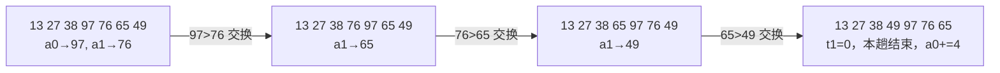
```
[a0]→97
13 27 38 97 76 65 49   a1↑76  交换 → 13 27 38 76 97 65 49
                       a1↑65  交换 → 13 27 38 65 97 76 49
                       a1↑49  交换 → 13 27 38 49 97 76 65
t1: 3→2→1→0   a0+=4 → 指向 97（第 5 趟基准）
```
常见错误：$a1 未从 `$a0+4` 开始（与自身比较）、交换只写一条 `sw`（两单元变成同值）。

2. **评分点**：哨兵位置与值（2 分）、$a0 从偏移 36 起向左移动路径（3 分）、后移箭头与次数 6 次（2 分）、`insert` 落点与最终数组（1 分）。

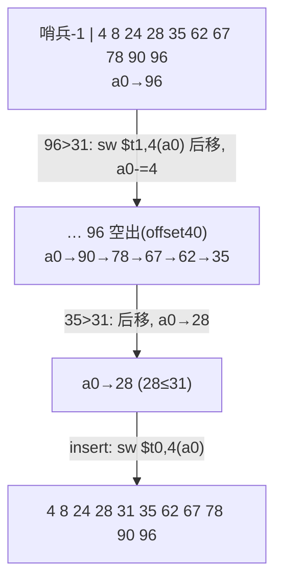
```
[-1] [4 8 24 28 35 62 67 78 90 96] → __
哨兵          a0↑________________↑ 逐个右移
最终 [4 8 24 28 31 35 62 67 78 90 96]   N=31 在下标 4
```
常见错误：用偏移 40（越界）而非 36 定位末元；写成 `sw $t1,($a0)` 覆盖自身；忘记哨兵导致 N 最小时越过 array 首址。

3. **评分点**：输入与格式检查分支（2 分）、子串转数值与计数（2 分）、反汇编/寄存器名两个子过程（2 分）、输出格式（2 分）、分支目标反算与标号处理（2 分）。

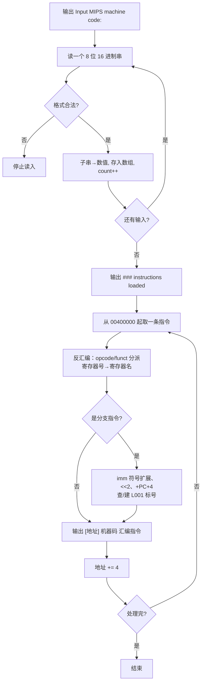
不可转换指令输出 `???`。
```
提示→读串→格式查(否→停)→转数值&计数→已完?→显示 loaded
→取指→反汇编→分支?─是→imm 反算目标+查建标号─┐
              └─否────────────────→输出一行←┘
→地址+4→未完继续，否则结束
```
常见错误：标号未按地址从小到大编 L001、L002…；把 imm 当无符号数（负数偏移反算错）。

<div style="page-break-after: always"></div>

# 第九讲 函数调用与栈 复习题（对应课件 P252–P279）

> 作答约定：除题目明确说明存在延迟槽外，程序题按课程模拟器默认的“无分支延迟、无加载延迟”模型执行；此时 jal/jalr 保存调用指令地址加 4。经典带分支延迟槽的 MIPS 保存调用指令地址加 8。所有地址均按字节计；宏展开和周期数按题目指定的模型计算。


> 本讲为考试重点：**栈帧建立/撤销 5 步、参数传递协议、寄存器保存分工、$fp 的引入**。所有栈帧代码答案均给出 5 步建立 + 5 步撤销并注明偏移含义。

## 本讲覆盖要点与题号索引

| 课件页 | 知识点 | 对应题号 |
|---|---|---|
| P252 | 课件 09 标题：函数调用与栈 | 全章 |
| P253 | 主要内容六项：过程调用／栈段／参数传递协议／嵌套调用／局部变量／栈帧指针 | 单1、填1 |
| P254 | 过程调用目的（代码重用）与要解决的四个问题 | 单2、多1、填2、简1 |
| P255 | `jal`/`jr $ra`；参数传递介质；栈 LIFO | 单3、单4、多1、填3、判1 |
| P256 | SPIM 中的栈段及其作用 | 填4、简8 |
| P257 | `$sp`(29)/`$fp`(30)；栈向下增长；push/pop | 单5、单6、填5、填6、判3、图1 |
| P258 | 入栈/出栈代码；出栈示例笔误（两个 `lw` 都写 `$a0`） | 单7、单8、填7、填8、判2、简9、计3 |
| P259 | 简单协议（≤4 参数／≤2 返回值）；复杂协议（预留 4 字、第 5 个起入栈） | 单9、单10、填9、填10、简4、判6、计1、转2 |
| P260 | 叶子函数／非叶子函数 | 单11、填11、简2、判4 |
| P261 | `$ra` 必须入栈；通用寄存器也需保护；谁负责保护 | 单12、填11、简3、简7 |
| P262 | 保护清单：被调用者 `$sp/$fp/$a0-$a3/$s0-$s7`；调用者 `$ra/$v0-$v1/$t0-$t9` | 单13、多2、填12、判5、简3、简10 |
| P263–P264 | JACK 调 JILL：`-24` 布局（0/4/8 参数、12/16 返回值、20 返回地址） | 单14、填13、计2、读6、图4 |
| P265–P266 | 临时寄存器保护；`-32` 布局新增 24/28 保存 `$t6/$t7` | 单15、多3、填13、读1 |
| P267–P268 | vowel 主程序：`-12`、`sw $ra,8($sp)`、`lw $v0,4($sp)` | 填14、读4 |
| P269–P270 | vcount：`-24`、保存 `$s0/$s1/$ra`、`16($sp)` 传参、`20($sp)` 取返回 | 填15、读4、读6、编程2 |
| P271–P272 | vowelp：返回 0/1，`sw $v0,20($sp)`、`jr $ra` | 读4、读6 |
| P273 | 局部变量/临时数组在栈上分配与释放（`-16`／`+16`） | 填16、简8、编程3、编程5 |
| P274 | 分配局部变量会改变 `$sp`，参数偏移不再固定 | 单16、简5、判7 |
| P275 | `$fp`=30 存放栈帧地址；栈帧＝活动记录及其内容 | 填17、简5、图2 |
| P276 | 栈帧结构图：局部变量、参数、返回地址、动态链接、`$sp/$fp` | 图2、图3、读2、判8 |
| P277–P279 | main/mysub 完整栈帧：`$fp=$sp-N`、局部 `0/4($fp)`、保存 `$s1` | 读2、编程6、编程7、转1、判8 |

---

## 一、单项选择题（共 16 题）

1. 【课件P253】本讲的主要内容**不包括**（ ）
   - A. 过程（函数、子程序）调用
   - B. 参数传递协议
   - C. 栈帧指针
   - D. 指令流水线的分支延迟槽

2. 【课件P254】过程调用要解决的问题**不包括**（ ）
   - A. 实现调用：控制转移到被调用者
   - B. 调用返回：控制转移回调用者
   - C. 参数传递与寄存器使用的规划管理
   - D. 提高 CPU 主频

3. 【课件P255】执行 `jal proc` 时，硬件完成的操作是（ ）
   - A. 只把 PC 改为 proc 的地址
   - B. 把 `PC+4`（下一条指令地址）存入 `$ra`，并把 PC 改为 proc 的地址
   - C. 把 proc 的地址存入 `$ra`，PC 不变
   - D. `$sp←$sp-4`，把 proc 地址入栈

4. 【课件P255】`jr $ra` 的作用是（ ）
   - A. 跳转到 `$ra` 中的地址，即返回到调用者的下一条指令
   - B. 把当前 PC 存入 `$ra`
   - C. 把 `$ra` 清零
   - D. 栈顶指针加 4

5. 【课件P257】关于 `$sp` 与 `$fp` 的说法**正确**的是（ ）
   - A. `$sp` 是 30 号寄存器，`$fp` 是 29 号
   - B. `$sp` 记录栈顶单元地址，`$fp` 指示当前活动记录（栈帧）的位置
   - C. `$sp` 永远指向栈底且不变
   - D. `$fp` 只能由硬件自动修改，程序不能使用

6. 【课件P257】“栈向下增长”意味着（ ）
   - A. 入栈时 `$sp` 减小，出栈时 `$sp` 增大
   - B. 入栈时 `$sp` 增大，出栈时 `$sp` 减小
   - C. 入栈、出栈时 `$sp` 都不变
   - D. 栈底地址比栈顶地址低

7. 【课件P258】把 `$a0` 与 `$ra` 依次入栈，正确的代码序列是（ ）
   - A. `sub $sp,$sp,8` / `sw $a0,0($sp)` / `sw $ra,4($sp)`
   - B. `add $sp,$sp,8` / `sw $a0,0($sp)` / `sw $ra,4($sp)`
   - C. `sw $a0,0($sp)` / `sw $ra,4($sp)` / `sub $sp,$sp,8`
   - D. `sub $sp,$sp,4` / `sw $a0,0($sp)` / `sw $ra,8($sp)`

8. 【课件P258】课件出栈示例为 `lw $a0,0($sp)`、`lw $a0,4($sp)`、`addu $sp,$sp,8`。其中错误及正确写法是（ ）
   - A. 无需修改，两条 `lw` 都取到 `$a0` 是对的
   - B. 第二条应为 `lw $ra,4($sp)`，否则 `$ra` 没有恢复
   - C. 第三条应为 `sub $sp,$sp,8`
   - D. 第一条应为 `lw $ra,0($sp)`

9. 【课件P259】简单参数传递协议规定（ ）
   - A. 参数用 `$t0~$t3`，返回值用 `$v0~$v1`
   - B. 参数用 `$a0~$a3`，返回值用 `$v0~$v1`
   - C. 参数全部用栈，返回值全部用栈
   - D. 参数用 `$s0~$s3`，返回值用 `$a0~$a1`

10. 【课件P259】按复杂协议传递 5 个参数，第 5 个参数应放在（ ）
    - A. `0($sp)`　B. `4($sp)`　C. `12($sp)`　D. `16($sp)`（前 4 个仍预留 4 个字）

11. 【课件P260】叶子函数是指（ ）
    - A. 没有任何参数的函数
    - B. 没有调用其它函数的函数
    - C. 没有返回值的函数
    - D. 只被调用一次的函数

12. 【课件P261】非叶子函数必须把 `$ra` 入栈保护，原因是（ ）
    - A. `$ra` 是只读寄存器
    - B. 它执行 `jal` 时硬件会用新的返回地址覆盖 `$ra`
    - C. `$ra` 会被 `syscall` 清零
    - D. `$ra` 属于被调用者保存寄存器

13. 【课件P262】下列寄存器中属于**被调用者**负责保护（入栈）的是（ ）
    - A. `$t0~$t9`　B. `$v0~$v1`　C. `$s0~$s7`　D. `$ra`

14. 【课件P263】JACK 调用 JILL（3 入参、2 出参）时分配 24 字节，返回地址 `$ra` 存放在（ ）
    - A. `12($sp)`　B. `16($sp)`　C. `20($sp)`　D. `24($sp)`

15. 【课件P265】关于临时寄存器 `$t6/$t7` 的保护，正确的是（ ）
    - A. 由被调用者 JILL 负责保存
    - B. 由调用者 JACK 在 `jal` 前入栈、返回后恢复
    - C. 任何函数都不需要保存 `$t` 寄存器
    - D. 叶子函数必须保存全部 `$t` 寄存器

16. 【课件P274】引入栈帧指针 `$fp` 的根本原因是（ ）
    - A. `$sp` 是只读的
    - B. 为局部变量分配空间会改变 `$sp`，使参数相对 `$sp` 的偏移不再固定
    - C. `$fp` 比 `$sp` 访问速度快
    - D. 硬件要求每个函数必须有两个指针

## 二、多项选择题（共 3 题）

1. 【课件P254/P255】关于过程调用机制，正确的有（ ）
   - A. `jal` 把返回地址存入 `$ra` 并跳转到被调用者
   - B. `jr $ra` 实现从被调用者返回
   - C. 栈是后进先出（LIFO）结构
   - D. 参数只能通过寄存器传递，不能通过栈传递
   - E. 栈向下增长，入栈时 `$sp` 减小

2. 【课件P262】下列属于**被调用者**负责保护（入栈）的寄存器有（ ）
   - A. `$sp`　B. `$fp`　C. `$a0~$a3`　D. `$s0~$s7`　E. `$t0~$t9`

3. 【课件P263–P266】JACK 调用 JILL 并保存 `$t6/$t7` 时，正确的有（ ）
   - A. 第 1、2、3 个参数分别存 `0/4/8($sp)`
   - B. 两个返回值存 `12/16($sp)`
   - C. 返回地址存 `20($sp)`
   - D. `$t6/$t7` 存 `24/28($sp)`
   - E. 只需分配 24 字节就能同时保存 `$t6/$t7`

## 三、填空题（共 18 题）

1. 【课件P253】本讲主要内容包括：过程调用、______、参数传递协议、嵌套函数调用、______、栈帧指针。
2. 【课件P254】函数调用要解决的四个问题：实现调用、______、参数传递、______。
3. 【课件P255】调用用指令______，返回用指令______；栈是______（LIFO/FIFO）结构。
4. 【课件P256】栈段用于存放向函数传递的______、函数的______、函数的返回值以及函数的______。
5. 【课件P257】`$sp` 是______号寄存器，称为______指针；`$fp` 是______号寄存器，称为______指针。
6. 【课件P257】栈向______增长：入栈时 `$sp` 减 4，出栈时 `$sp` ______。
7. 【课件P258】入栈：`______ $sp,$sp,8`；`sw $a0,______($sp)`；`sw $ra,______($sp)`。
8. 【课件P258】出栈：`lw $a0,0($sp)`；`lw ______,4($sp)`；`______ $sp,$sp,8`。
9. 【课件P259】简单协议：参数不超过 4 个时用______寄存器；返回值不超过 2 个时用______寄存器。
10. 【课件P259】复杂协议：前 4 个参数仍用寄存器，但栈中要为它们预留______字节；从第______个参数起入栈；返回值从第______个起入栈。
11. 【课件P260】不调用其它函数的函数称为______；调用了其它函数的函数称为______。
12. 【课件P262】被调用者保护：`$sp`、`$fp`、`$a0~$a3`、______；调用者保护：`$ra`、`$v0~$v1`、______。
13. 【课件P263/P266】JACK 分配 32 字节时：参数 A/B/C 在______、返回值 D/E 在 12/16、`$ra` 在______、`$t6/$t7` 在______。
14. 【课件P268】vowel 主程序分配 12 字节：`sw $a0,______($sp)` 保存字符串地址，`sw $ra,______($sp)` 保存返回地址，返回后用 `lw $v0,______($sp)` 取 vcount 的结果。
15. 【课件P270/P272】vcount 分配______字节，依次保存 `$a0/$s0/$s1/$ra` 于 0/4/8/12($sp)，用 `sw $a0,______($sp)` 向 vowelp 传参，用 `lw $v0,______($sp)` 取返回值；vowelp 用 `sw $v0,20($sp)` 写出结果。
16. 【课件P273】为 16 字节临时数组分配空间：`addiu $sp,$sp,______`；使指针指向它：`move $a0,______`；释放：`addiu $sp,$sp,______`。
17. 【课件P275】栈帧又称______；它保存该函数的______、临时寄存器的内容、局部变量，还包含栈帧之间的______。
18. 【课件P278/P279】建立：`sub $sp,$sp,4` + `sw $ra,($sp)`；`sub $sp,$sp,4` + `sw ______,($sp)`；压 `$s1`；`sub $fp,$sp,______`；`move $sp,$fp`。撤销：`add $sp,$fp,______`；`lw $s1,($sp)`；`lw $fp,($sp)`；`lw ______,($sp)`；`jr $ra`。

## 四、判断题（共 8 题，正确写“对”，错误写“错”并改正）

1. 【课件P255】栈是按先进先出（FIFO）方式工作的队列。（　）
2. 【课件P258】出栈示例中两条 `lw` 的目的寄存器都写成 `$a0`，这样写是正确的，`$ra` 会自动恢复。（　）
3. 【课件P257】栈向下增长，因此入栈操作为 `sub $sp,$sp,4` 后再 `sw`。（　）
4. 【课件P260】叶子函数也必须把 `$ra` 入栈保护。（　）
5. 【课件P262】`$t0~$t9` 属于调用者保存寄存器，跨函数调用仍需使用的值由调用者自己入栈。（　）
6. 【课件P259】按复杂协议传递 5 个参数时，第 5 个参数应放在 `0($sp)`。（　）
7. 【课件P274】只要始终用相对 `$sp` 的固定偏移，即使函数为局部变量分配了空间，也能正确访问参数。（　）
8. 【课件P279】mysub 中 `sub $fp,$sp,8` 后 `b` 在 `0($fp)`、`c` 在 `4($fp)`，撤销时 `add $sp,$fp,8` 即可回到保存 `$s1` 的位置。（　）

## 五、简答题（共 10 题）

1. 【课件P254】（6 分）过程（函数、子程序）调用要解决哪四个问题？逐一简述。
2. 【课件P260】（6 分）什么是叶子函数、非叶子函数？二者在寄存器保护上有什么差别？
3. 【课件P261/P262】（8 分）寄存器保护由 Caller 还是 Callee 负责？请按本课协议写出分工清单，并说明为什么这样分工。
4. 【课件P259】（6 分）什么是复杂参数传递协议？参数与返回值分别如何放置？为什么前 4 个参数用寄存器还要在栈中预留空间？
5. 【课件P274/P275】（8 分）为什么要引入 `$fp`？请结合“局部变量分配改变 `$sp`”说明，并写出 `$fp` 的定义与栈帧的内容。
6. 【课件P257】（6 分）栈为什么采用“向下增长”？这样做有什么好处？
7. 【课件P261/P263】（6 分）非叶子函数为什么必须把 `$ra` 入栈？不入栈会发生什么？请描述执行过程。
8. 【课件P273/P256】（8 分）函数的局部变量放在栈上和放在数据段（`.data`）有什么区别？各举一例并说明对可重入性的影响。
9. 【课件P258】（6 分）说明 push 与 pop 的对称性，并写出把 `$a0`、`$ra` 入栈和出栈的完整代码，标注每一步 `$sp` 的变化。
10. 【综合】（8 分）某函数 `F` 使用 `$s0`、`$s1` 保存循环变量与累加和，用 `$t0`、`$t1` 保存临时结果，参数经 `$a0`、`$a1` 传入，函数体内又 `jal G` 一次。按本课协议，`F` 必须保存哪些寄存器？哪些应由 `G` 保存？请说明理由。

## 六、计算与编码题（共 4 题）

1. 【课件P259】（10 分）按复杂协议回答：
   (1) 函数 `F` 有 6 个入口参数、3 个出口参数，且需要保存 `$ra`、`$s0`、`$s1`。求调用 `F` 前应分配的栈空间字节数，并写出每个栈单元的偏移及用途。
   (2) 函数 `H` 有 3 个入口参数、1 个出口参数，只保存 `$ra` 和 `$s0`。求最少栈空间（按 8 字节对齐）与各偏移。

2. 【课件P263–P266】（10 分）设初始 `$sp=0x7FFFFFF0`，`$t1=0x11`、`$t2=0x22`、`$t3=0x33`、`$t6=0x66`、`$t7=0x77`，JACK 的代码从 `0x00400000` 开始：
   ```asm
   addiu $sp,$sp,-32
   sw    $t1,0($sp)
   sw    $t2,4($sp)
   sw    $t3,8($sp)
   sw    $ra,20($sp)
   sw    $t6,24($sp)
   sw    $t7,28($sp)
   jal   JILL
   ```
   求：① 执行到 `jal` 时 `$sp` 的值；② 此时 `0/4/8/12/16/20/24/28($sp)` 各单元的内容；③ `JILL` 中若要取第 1 个参数、第 2 个返回值，应分别用哪个偏移？

3. 【课件P258】（8 分）写出下列指令的机器码，给出字段分解：
   (1) `addiu $sp,$sp,-24`　(2) `addiu $sp,$sp,24`　(3) `subu $sp,$sp,8`
   并说明为什么栈指针调整用 `addiu/subu` 而不用 `addi/sub`。

4. 【课件P263/P264】（8 分）写出下列指令的机器码，给出字段分解：
   (1) `sw $ra,20($sp)`　(2) `lw $v0,20($sp)`　(3) `jr $ra`　(4) `jal JILL`（设该 `jal` 位于 `0x0040001C`，`JILL` 位于 `0x00400080`）

## 七、代码转换题（共 5 题）

### 7.1 C 语言 → MIPS 汇编

1. 【课件P278/P279】（10 分）将下列 C 函数翻译为带**完整栈帧**（5 步建立、5 步撤销）的 MIPS 汇编，局部变量必须放栈上：
   ```c
   int f(int a, int b, int c) {
       int t;              /* t: 0($fp) */
       t = a + b;
       return t * c;
   }
   ```

2. 【课件P259】（10 分）按**复杂参数传递协议**翻译下列 C 函数（5 个入口参数、3 个出口参数），并写出调用它的主程序片段（含栈空间分配与取回第 3 个返回值）：
   ```c
   /* 伪代码：返回 D=和、E=平均值、F=大于 10 的个数     */
   /* D 用 $v0，E 用 $v1，F 写栈上 20($sp)（第 3 个返回值）*/
   D = a+b+c+d+e;
   E = D / 5;
   F = (a>10)+(b>10)+(c>10)+(d>10)+(e>10);
   ```

3. 【课件P263/P266】（10 分）将下列嵌套调用翻译为 MIPS 汇编（A、B 为非叶子函数，必须保存 `$ra`；C 为叶子函数）：
   ```c
   int C(int x){ return x + 3; }
   int B(int x){ int b; b = C(x) * 2; return b; }
   int A(int x){ int a; a = B(x) + 1; return a; }
   ```

### 7.2 MIPS 汇编 → 机器码

4. 【课件P255/P258】（10 分）下列代码从 `0x00400000` 开始，`sum3` 位于 `0x00400020`。逐条写出机器码（十六进制）：
   ```asm
   0x00400000  addiu $sp,$sp,-8
   0x00400004  sw    $ra,4($sp)
   0x00400008  jal   sum3
   0x0040000C  lw    $ra,4($sp)
   0x00400010  addiu $sp,$sp,8
   0x00400014  jr    $ra
   ```

### 7.3 机器码 → MIPS 汇编（反汇编）

5. 【课件P258/P263】（10 分）反汇编下列机器码，写出指令并说明偏移含义：
   `0x27BDFFE8`、`0xAFBF0014`、`0x0C100010`、`0x8FA20014`、`0x03E00008`、`0xAFB00000`

## 八、读程序写结果（共 6 题）

1. 【课件P263–P266】设进入 JACK 时 `$sp=0x7FFFFF00`，`$t1=0x11`、`$t2=0x22`、`$t3=0x33`、`$t6=0x66`、`$t7=0x77`，`jal JILL` 位于 `0x00400040`。填写执行到 `jal` 时各栈单元内容，并指出 12/16 两个单元为什么是“未知”。
   ```asm
   JACK:
       addiu $sp,$sp,-32
       sw    $t1,0($sp)
       sw    $t2,4($sp)
       sw    $t3,8($sp)
       sw    $ra,20($sp)
       sw    $t6,24($sp)
       sw    $t7,28($sp)
       jal   JILL
   ```

2. 【课件P277–P279】设进入 `main` 时 `$sp=0x7FFF0000`、`$fp=0x00000000`，`main` 中 `jal mysub` 位于 `0x0040001C`。按课件 P278/P279 的完整栈帧代码，求：
   ① 执行到 `mysub` 第一条语句（`mul`）时 `$sp`、`$fp` 的值；② `mysub` 执行 `jr $ra` 回到 `main` 后 `$sp`、`$fp`、`$ra` 的值；③ `main` 撤销完成后 `$sp` 的值；④ `b`、`c` 的地址。

3. 【课件P261】指出下面函数保存寄存器的缺陷，说明运行现象并改正：
   ```asm
   f:
       addiu $sp,$sp,-8
       sw    $s0,0($sp)
       jal   g
       lw    $s0,0($sp)
       addiu $sp,$sp,8
       jr    $ra
   ```

4. 【课件P267–P272】运行课件 vowel 程序（`str="long time ago in a galaxy far away "`），① 屏幕输出是什么？② vowelp 被调用多少次？③ vcount 中 `20($sp)` 在调用前后分别存放什么？④ 若把 `vcount` 中的 `lw $v0,20($sp)` 删除，结果会怎样？

5. 【课件P255】已知 `main` 位于 `0x00400000`：
   ```asm
   0x00400000 main: addiu $sp,$sp,-8
   0x00400004       sw    $ra,4($sp)
   0x00400008       jal   A
   0x0040000C       lw    $ra,4($sp)
   0x00400010       addiu $sp,$sp,8
   0x00400014       li    $v0,10
   0x00400018       syscall
   0x0040001C A:    addiu $sp,$sp,-8
   0x00400020       sw    $ra,4($sp)
   0x00400024       jal   B
   0x00400028       lw    $ra,4($sp)
   0x0040002C       addiu $sp,$sp,8
   0x00400030       jr    $ra
   0x00400034 B:    jr    $ra
   ```
   求：① 进入 A 时 `$ra`；② 进入 B 时 `$ra`；③ A 执行 `lw $ra,4($sp)` 后 `$ra`；④ 若 A 漏写 `sw $ra,4($sp)`，`jr $ra` 会跳到哪里？

6. 【课件P263/P264】JACK 调 JILL 的代码中，JILL 开头用 `lw $a0,0($sp)`、`lw $a1,4($sp)`、`lw $a2,8($sp)` 取参数，末尾用 `sw $v0,12($sp)`、`sw $v1,16($sp)` 写返回值。问：
   ① 三个参数、两个返回值的偏移各是多少？② 若 JILL 开头先执行 `addiu $sp,$sp,-8`，再用 `lw $a0,0($sp)`，取到的是哪个参数？应如何修正？③ 这与引入 `$fp` 有什么联系？

## 九、程序设计与综合题（共 8 题）

1. 【课件P254/P259】（8 分）编写 `int sum3(int a,int b,int c)`，用简单协议传参（`$a0~$a2`），返回和到 `$v0`；主程序调用并打印结果。要求含完整 `main`（`$ra` 入栈）与被调用函数的参数预留空间。

2. 【课件P259】（10 分）编写 5 参数函数 `f5(a,b,c,d,e)`，返回两个值：`$v0`=a+b+c+d+e，`$v1`=平均值（整除）。主程序按复杂协议在栈中预留 5 个参数空间并传参，调用后打印两个返回值。

3. 【课件P273】（10 分）编写 `int mean(int *x,int n)`：将循环变量 `i`、累加和 `sum` 放在栈上（寄存器仅作读写时的临时量，假定 n>0 且求和不溢出），返回 `sum/n`。要求给出 `i`、`sum` 的栈偏移及分配/释放代码。

4. 【课件P273/综合】（10 分）编写**可重入**的 `int slen(char *s)`：不得使用 `.data` 中的任何可写缓冲区，字符串指针与计数器全部放栈上，返回串长到 `$v0`。另写主程序调用两次（两个不同字符串）验证可重入。

5. 【课件P273】（12 分）编写 `void sortcopy(int *x,int n)`（0≤n≤8）：在栈上分配 32 字节的**局部数组**，先把 `x` 的 n 个元素复制到局部数组，用冒泡排序排好，再复制回 `x`。要求标出局部数组与保存寄存器的偏移。

6. 【课件P263–P266】（12 分）编写嵌套调用程序：`main` 调 `A(5)`，`A` 调 `B`，`B` 调 `C`，`C(x)=x+3`，`B(x)=C(x)*2`，`A(x)=B(x)+1`。A、B 均使用 `$fp` 访问局部变量，并完整保存 `$ra`、`$fp`、`$s` 寄存器；打印 A 的返回值。

7. 【课件P277–P279】（12 分）用 `$fp` 访问局部变量，完成下列程序：`calc(n)` 中 `i`、`s`、`t` 三个局部变量分别放 `0($fp)`、`4($fp)`、`8($fp)`，计算 `s=1²+2²+…+n²` 并返回。要求 `main` 与 `calc` 都给出 5 步建立、5 步撤销，并逐条注释偏移含义。

8. 【课件P259/P263】（12 分）按复杂协议编写 6 个入口参数、3 个出口参数的函数 `stats(a,b,c,d,e,f)`：`$v0`=6 数之和，`$v1`=平均值，栈上第 3 个返回值=大于 10 的个数。要求主程序分配栈空间、传 6 个参数、取回 3 个返回值；函数内用循环遍历栈中参数。

## 十、作图题（共 4 题）

1. 【课件P257/P258】（8 分）画出栈**向下增长**及 `$a0`、`$ra` 依次入栈、再出栈的示意图。要求：标出栈底/栈顶、`$sp` 的初值与每次变化后的值、`0($sp)`/`4($sp)` 的位置，并用箭头表示 push/pop 方向。

2. 【课件P276】（10 分）画出**标准栈帧（活动记录）结构图**。要求标出：局部变量与临时变量、参数 1…n、返回地址、动态链接（指向前一帧的起始地址）、`$fp`、`$sp`，并注明高/低地址方向与帧链接关系。

3. 【课件P260/P276】（10 分）画出 `main → A → B` **三层嵌套调用**的栈帧堆叠图（B 为叶子）。要求标出三帧的边界、各自的 `$fp`/`$sp`、每帧的返回地址与保存的旧 `$fp`，并说明返回时 `$sp/$fp` 如何变化。

4. 【课件P263–P266】（10 分）画出 JACK 调用 JILL 时的栈布局图。要求标出偏移 `0/4/8/12/16/20/24/28` 及 A、B、C、D、E、返回地址、`$t6`、`$t7` 的位置，并分别画出 `jal` 之前与 `jr` 之后（写好返回值）两种状态。

---

# 参考答案与解析

## 一、单项选择题

1. **D**。本讲只讲调用/栈/参数/嵌套/局部变量/`$fp`，流水线延迟槽属课件 03。
2. **D**。四问题：实现调用、调用返回、参数传递、寄存器使用规划管理。
3. **B**。`jal` 是“jump and link”：`$ra←PC+4`，`PC←proc`。
4. **A**。`jr $ra` 只改 PC。
5. **B**。`$sp`=29、`$fp`=30；`$sp` 指向栈顶，`$fp` 指向栈帧（活动记录）。
6. **A**。向下增长 ⇒ push 用 `sub` 减 `$sp`，pop 用 `add`。
7. **A**。必须先减 `$sp` 再存，偏移 0、4 对应 `$a0`、`$ra`。
8. **B**。第二条 `lw` 目的寄存器应为 `$ra`，否则 `$ra` 未恢复，返回地址丢失（课件笔误）。
9. **B**。≤4 个参数 `$a0~$a3`，≤2 个返回值 `$v0~$v1`。
10. **D**。前 4 个参数占 `0~12`，第 5 个在 `16($sp)`。
11. **B**。叶子函数不调用其它函数（可以无参数/无返回值，也可有）。
12. **B**。`jal` 只有一份 `$ra`，嵌套调用会覆盖。
13. **C**。`$sp/$fp/$a0-$a3/$s0-$s7` 由被调用者保护；`$ra/$v0-$v1/$t0-$t9` 由调用者保护。
14. **C**。`0/4/8` 参数，`12/16` 返回值，`20` 返回地址。
15. **B**。`$t` 是调用者保存寄存器；JACK 若跨调用还要用，必须自己 `sw`/`lw`。
16. **B**。局部变量分配会移动 `$sp`；`$fp` 提供固定基准。

## 二、多项选择题

1. **ABCE**。D 错：参数可用栈传递（复杂协议），否则无法支持 >4 个参数。
2. **ABCD**。E 错：`$t0~$t9` 是调用者保存。
3. **ABCD**。E 错：还要存 `$ra`（20）和 `$t6/$t7`（24/28），必须分配 32 字节。

## 三、填空题

1. **栈段；局部变量的存储空间**。
2. **调用返回；规划、管理 CPU 内部寄存器的使用**。
3. **`jal`；`jr $ra`；LIFO（后进先出）**。
4. **参数；返回地址；局部变量**。
5. **29；栈顶；30；栈帧**。
6. **下；加 4**。
7. **`sub`；0；4**。
8. **`$ra`；`addu`**。
9. **`$a0~$a3`；`$v0~$v1`**。
10. **16；5；3**。
11. **叶子函数；非叶子函数**。
12. **`$s0~$s7`；`$t0~$t9`**。
13. **`0/4/8($sp)`；`20($sp)`；`24/28($sp)`**。
14. **0；8；4**。
15. **24；16；20**。
16. **-16；`$sp`；16**。
17. **活动记录（activation record）；参数；链接关系（动态链接）**。
18. **`$fp`；8；8；`$ra`**。

## 四、判断题

1. **错**。栈是后进先出 **LIFO**，不是 FIFO。
2. **错**。第二条应为 `lw $ra,4($sp)`；否则 `$ra` 未恢复，`jr $ra` 无法正确返回。
3. **对**。`sub $sp,$sp,4` 后 `sw`，`$sp` 指向新栈顶。
4. **错**。叶子函数不执行 `jal`，`$ra` 不被覆盖，无需保存（若它不调用任何函数）。
5. **对**。`$t0~$t9` 为 caller-saved，调用者跨调用需自行保存。
6. **错**。前 4 个参数要预留 4 个字，第 5 个在 `16($sp)`。
7. **错**。分配局部变量后 `$sp` 改变，参数偏移随之改变；应使用固定基准 `$fp`。
8. **对**。`b=0($fp)`、`c=4($fp)`；`add $sp,$fp,8` 正好回到保存 `$s1` 处。

## 五、简答题

1. （6 分）① **实现调用**：控制转移到被调用者（`jal proc`），实现代码重用（1.5）；② **调用返回**：执行完控制转移回调用者的下一条指令（`jr $ra`）（1.5）；③ **参数传递**：调用者→被调用者传入口参数，被调用者→调用者传返回值，介质为寄存器或栈，需约定协议（1.5）；④ **寄存器管理**：规划各寄存器的用途、谁负责入栈保护，避免嵌套/递归破坏现场（1.5）。
2. （6 分）**叶子函数**：不调用其它函数（调用树最下端），如 `vowelp`（2）；**非叶子函数**：函数体内有 `jal`，如 `vcount`、`main`（2）。差别：叶子不执行 `jal`，`$ra` 不会被覆盖，**不必保存 `$ra`**，也不必保存临时寄存器；非叶子必须保存 `$ra`，并按需保存 `$s` 和它还要用的 `$t`（2）。
3. （8 分）分工：**被调用者**保存 `$sp`、`$fp`、`$a0~$a3`、`$s0~$s7`；**调用者**保存 `$ra`、`$v0~$v1`、`$t0~$t9`（4）。原因：`$s` 是跨调用长期变量，若由每个调用者保存则每次调用都要重复，改由被调用者“用到才保存一次”更省（2）；`$t` 是临时量，调用者最清楚哪些在调用后还有用，故自己保存（1）；`$ra` 会被本次 `jal` 覆盖，必须由发起调用者保存（1）。
4. （6 分）参数 >4 个或返回值 >2 个时必须用栈，称为复杂协议（1）。前 4 个参数仍放 `$a0~$a3`，但**栈中也要为它们预留 4 个字（16 字节）**，第 5 个起依次放 `16($sp)`、`20($sp)`…（2）；前 2 个返回值放 `$v0/$v1`，第 3 个起放栈（1）。预留原因：使全部参数在栈中连续、偏移统一为 `4×(i-1)`，被调用者可用统一公式寻址，也便于支持参数个数可变与统一处理（2）。
5. （8 分）为局部变量分配空间要 `sub $sp`，栈顶改变后参数相对 `$sp` 的偏移不再固定，仍用 `0/4/8($sp)` 会取错（2）。`$fp` 在函数入口建立后**不再改变**，作为固定参考点，参数与局部变量都用相对 `$fp` 的固定偏移访问（2）。`$fp`=30 号寄存器，存放栈帧地址（2）。栈帧＝活动记录，保存：参数、返回地址、被保存的寄存器、局部变量/临时数据、帧链接（动态链接，指向前一帧起始地址）（2）。
6. （6 分）栈从高地址向低地址增长，`$sp` 初值在栈段高地址（2）；栈与数据段/堆从两端相向增长，共享中间空闲区，空间利用率高（2）；二者相撞即栈溢出，便于发现；push/pop 统一用减/加 `$sp`，栈顶始终有效，且不会侵入低地址的代码段（2）。
7. （6 分）`jal` 把返回地址写入唯一的 `$ra`。非叶子函数 F 执行 `jal G` 时，`$ra` 被改为“G 的返回地址”，原“返回 F 调用者”的地址被覆盖（2）。G 返回后 F 再 `jr $ra` 就跳回 F 内 `jal G` 的下一条指令，重复执行形成死循环或逻辑错（2）。因此 F 入口先 `sw $ra` 入栈，`jal G` 返回后 `lw $ra` 恢复，最后 `jr $ra` 才能回到 F 的调用者（2）。
8. （8 分）栈：调用时动态分配、返回时释放，每层调用有独立副本，天然支持嵌套与递归，是**可重入**的（3）；数据段：程序加载时静态分配、全局唯一，所有调用共享同一份，递归/多任务时会被覆盖，**不可重入**（3）。例：`PrintHex` 用 `addiu $sp,$sp,-12` 在栈上开缓冲区；反例：在 `.data` 用 `.space 200` 开全局缓冲区，第二次调用会破坏第一次的数据（2）。
9. （6 分）对称性：push 先 `sub $sp` 再 `sw`，pop 先 `lw` 再 `add $sp`；偏移相同，入栈顺序与出栈顺序相反（LIFO），`$sp` 最终回到原值（3）。代码（设原 `$sp=S`）：
   ```asm
   sub  $sp,$sp,8     # $sp=S-8
   sw   $a0,0($sp)    # [S-8]=$a0
   sw   $ra,4($sp)    # [S-4]=$ra
   lw   $a0,0($sp)    # 先取 $a0
   lw   $ra,4($sp)    # 再取 $ra
   addu $sp,$sp,8     # $sp=S
   ```
   （3）
10. （8 分）F 必须保存：**`$ra`**（F 内 `jal G` 会覆盖，1 分）；**`$s0`、`$s1`**（F 作为被调用者使用了 `$s`，须为它的调用者保存，2 分）；若 `$t0/$t1` 在 G 返回后仍要用，F 还须在 `jal` 前保存、返回后恢复（2 分）；`$fp/$sp` 由栈帧 5 步统一管理（1 分）。G 负责保护它自己使用的 `$a0~$a3`、`$s0~$s7`、`$sp/$fp`（按课件 P262）（2 分）。

## 六、计算与编码题

1. （10 分）
   (1) 参数 6 字（前 4 个仍在 `$a0~$a3`，但栈中必须预留）＋第 3 个返回值 1 字＋`$ra`＋`$s0`＋`$s1`＝**10 字＝40 字节**（40 是 8 的倍数，可直接用）（3）。
   | 偏移 | 内容 | 偏移 | 内容 |
   |---|---|---|---|
   | 0/4/8/12 | 参数 1~4（同时放 `$a0~$a3`） | 24 | 第 3 个返回值 |
   | 16/20 | 参数 5、6 | 28 | 返回地址 `$ra` |
   | | | 32/36 | 保存 `$s0`、`$s1` |
   （5）
   (2) 前 4 个参数统一预留 4 字，即使只用 3 参也占 16 字节；再加 `$ra`、`$s0` 共 **24 字节**（2）。偏移：`0/4/8` 参数 1~3（并用 `$a0~$a2`），`12` 第 4 参预留槽，`16` `$ra`，`20` `$s0`；返回值在 `$v0`，不占栈。通用公式：`字节数=4×[max(4,n)+max(0,m-2)+保存寄存器数]`，再向上取 8 的倍数。

2. （10 分）① `$sp=0x7FFFFFF0-32=0x7FFFFFD0`（2）。
   ② 设 `jal` 位于 `0x0040001C`，则返回地址为 `0x00400020`（2）：
   | 偏移 | 内容 | 偏移 | 内容 |
   |---|---|---|---|
   | 0 | `0x11`（参数 A） | 16 | 未知（返回值 E 的槽） |
   | 4 | `0x22`（参数 B） | 20 | `0x00400020`（`$ra`） |
   | 8 | `0x33`（参数 C） | 24 | `0x66`（`$t6`） |
   | 12 | 未知（返回值 D 的槽） | 28 | `0x77`（`$t7`） |
   （5）12/16 是 JILL 写返回值的槽，JACK 调用前没有写入，故为未知（1）。
   ③ 第 1 个参数用 `0($sp)`；第 2 个返回值用 `16($sp)`（2）。

3. （8 分）
   (1) `addiu $sp,$sp,-24`：I 型，op=0x09=`001001`，rs=29=`11101`，rt=29=`11101`，imm=-24=0xFFE8=`1111111111101000` → `001001 11101 11101 1111111111101000` = **0x27BDFFE8**（3）
   (2) `addiu $sp,$sp,24`：imm=0x0018 → **0x27BD0018**（2）
   (3) `subu $sp,$sp,8` 含立即数，是汇编器扩展格式，不能把 8 当寄存器 `$sp` 编码。本题统一化为 `addiu $sp,$sp,-8`：op=9，rs=rt=29，imm=0xFFF8，字段 `001001 11101 11101 1111111111111000`，机器码 **0x27BDFFF8**（3）。`0x03BDE823` 实际为 `subu $sp,$sp,$sp`，会把栈指针清零。
   用 `addiu/subu` 的原因：地址是无符号数，`addi/sub` 在溢出时产生异常，`addiu/subu` 不产生异常，调整 `$sp` 不应触发溢出陷阱。

4. （8 分）
   (1) `sw $ra,20($sp)`：op=0x2B=`101011`，rs=29=`11101`，rt=31=`11111`，imm=20=0x0014 → `101011 11101 11111 0000000000010100` = **0xAFBF0014**（2）
   (2) `lw $v0,20($sp)`：op=0x23=`100011`，rs=29，rt=2=`00010`，imm=0x0014 → `100011 11101 00010 0000000000010100` = **0x8FA20014**（2）
   (3) `jr $ra`：R 型 op=0，rs=31=`11111`，其余 0，funct=0x08=`001000` → **0x03E00008**（2）
   (4) `jal JILL`：J 型 op=3=`000011`，目标字段 `0x00400080>>2=0x00100020` → `000011 0000000000010000000000100000` = **0x0C100020**（2）

## 七、代码转换题

### 7.1 C → MIPS

1. （10 分）
   ```asm
           .text
           .globl f
   f:      sub   $sp,$sp,4        # 1. 压返回地址
           sw    $ra,0($sp)
           sub   $sp,$sp,4        # 2. 压旧帧指针
           sw    $fp,0($sp)
           sub   $sp,$sp,4        # 3. 压 $s0
           sw    $s0,0($sp)
           sub   $fp,$sp,4        # 4. 局部变量 t：fp=sp-4
           move  $sp,$fp          # 5. sp=fp
           add   $s0,$a0,$a1      # t=a+b
           sw    $s0,0($fp)       # t 存 0($fp)
           lw    $v0,0($fp)       # 取 t
           mul   $v0,$v0,$a2      # t*c
           add   $sp,$fp,4        # 2'. sp=fp+4，指向保存的 $s0
           lw    $s0,0($sp)       # 3'. 恢复 $s0
           add   $sp,$sp,4
           lw    $fp,0($sp)       # 4'. 恢复旧 $fp
           add   $sp,$sp,4
           lw    $ra,0($sp)       # 5'. 恢复 $ra
           add   $sp,$sp,4
           jr    $ra
   ```
   布局：`0($fp)`=t，`4($fp)`=旧 `$s0`，`8($fp)`=旧 `$fp`，`12($fp)`=`$ra`（2 分）。
2. （10 分）调用者分配 32 字节：`0~16` 五个参数、`20` 第 3 个返回值、`24` `$ra`、`28` 填充（2 分）。
   ```asm
           .text
           .globl main
   main:   addiu $sp,$sp,-32       # 5 参数 + 1 返回值 + $ra + 对齐
           sw    $ra,24($sp)
           li    $a0,12
           li    $a1,4
           li    $a2,20
           li    $a3,7
           li    $t0,30
           sw    $a0,0($sp)        # 参数 1~4 同时在 $a0~$a3
           sw    $a1,4($sp)
           sw    $a2,8($sp)
           sw    $a3,12($sp)
           sw    $t0,16($sp)       # 第 5 个参数
           jal   f5
           lw    $t0,20($sp)       # 第 3 个返回值 F
           lw    $ra,24($sp)
           addiu $sp,$sp,32
           move  $a0,$v0           # 打印 D（和）；E 在 $v1、F 在 $t0
           li    $v0,1
           syscall
           li    $v0,10
           syscall
   f5:     lw    $a0,0($sp)        # 叶子函数，不调整 $sp，按 JILL 风格取参
           lw    $a1,4($sp)
           lw    $a2,8($sp)
           lw    $a3,12($sp)
           lw    $t0,16($sp)
           add   $v0,$a0,$a1
           add   $v0,$v0,$a2
           add   $v0,$v0,$a3
           add   $v0,$v0,$t0       # D=和 → $v0
           li    $t1,5
           div   $v0,$t1
           mflo  $v1               # E=平均 → $v1
           li    $t2,0
           li    $t3,10
           ble   $a0,$t3,n1
           addiu $t2,$t2,1
   n1:     ble   $a1,$t3,n2
           addiu $t2,$t2,1
   n2:     ble   $a2,$t3,n3
           addiu $t2,$t2,1
   n3:     ble   $a3,$t3,n4
           addiu $t2,$t2,1
   n4:     ble   $t0,$t3,n5
           addiu $t2,$t2,1
   n5:     sw    $t2,20($sp)       # F=大于 10 的个数 → 栈上第 3 个返回值
           jr    $ra
   ```
   （8 分：传参 3、返回 3、取回 2）
3. （10 分）`main` 保存 `$ra` 和旧 `$fp`；A、B 各建完整栈帧（`0($fp)`=局部变量，`4($fp)`=旧 `$s0`，`8($fp)`=旧 `$fp`，`12($fp)`=`$ra`）：
   ```asm
           .text
           .globl main
   main:   sub   $sp,$sp,4        # 1. 压 $ra
           sw    $ra,0($sp)
           sub   $sp,$sp,4        # 2. 压 $fp
           sw    $fp,0($sp)
                                  # 3. 无 $s 需保存
           sub   $fp,$sp,0        # 4. 无局部变量
           move  $sp,$fp          # 5.
           li    $a0,5
           jal   A
           move  $a0,$v0
           li    $v0,1
           syscall
           li    $v0,10
           syscall
   A:      sub   $sp,$sp,4        # 1. 压 $ra（返回 main 的地址）
           sw    $ra,0($sp)
           sub   $sp,$sp,4        # 2. 压旧 $fp
           sw    $fp,0($sp)
           sub   $sp,$sp,4        # 3. 压 $s0（保存 x）
           sw    $s0,0($sp)
           sub   $fp,$sp,4        # 4. 局部 a：0($fp)
           move  $sp,$fp          # 5.
           move  $s0,$a0          # x
           move  $a0,$s0
           jal   B
           addiu $v0,$v0,1        # a=B(x)+1
           sw    $v0,0($fp)
           lw    $v0,0($fp)
           add   $sp,$fp,4        # 2'. 指向旧 $s0
           lw    $s0,0($sp)       # 3'.
           add   $sp,$sp,4
           lw    $fp,0($sp)       # 4'.
           add   $sp,$sp,4
           lw    $ra,0($sp)       # 5'.
           add   $sp,$sp,4
           jr    $ra
   B:      sub   $sp,$sp,4        # 1. 压 $ra（返回 A 的地址）
           sw    $ra,0($sp)
           sub   $sp,$sp,4        # 2.
           sw    $fp,0($sp)
           sub   $sp,$sp,4        # 3.
           sw    $s0,0($sp)
           sub   $fp,$sp,4        # 4. 局部 b：0($fp)
           move  $sp,$fp          # 5.
           move  $s0,$a0
           move  $a0,$s0
           jal   C
           sll   $v0,$v0,1        # b=C(x)*2
           sw    $v0,0($fp)
           lw    $v0,0($fp)
           add   $sp,$fp,4        # 2'.
           lw    $s0,0($sp)       # 3'.
           add   $sp,$sp,4
           lw    $fp,0($sp)       # 4'.
           add   $sp,$sp,4
           lw    $ra,0($sp)       # 5'.
           add   $sp,$sp,4
           jr    $ra
   C:      addiu $v0,$a0,3        # 叶子函数，无需栈帧
           jr    $ra
   ```
   运行结果：A(5)=((5+3)*2)+1=**17**。

### 7.2 MIPS → 机器码
4. （10 分）
   | 地址 | 指令 | 字段 | 机器码 |
   |---|---|---|---|
   | 0x00400000 | `addiu $sp,$sp,-8` | op=09, rs=1D, rt=1D, imm=FFF8 | **0x27BDFFF8** |
   | 0x00400004 | `sw $ra,4($sp)` | op=2B, rs=1D, rt=1F, imm=0004 | **0xAFBF0004** |
   | 0x00400008 | `jal sum3` | op=03, target=0x00400020>>2=0x00100008 | **0x0C100008** |
   | 0x0040000C | `lw $ra,4($sp)` | op=23, rs=1D, rt=1F, imm=0004 | **0x8FBF0004** |
   | 0x00400010 | `addiu $sp,$sp,8` | op=09, rs=1D, rt=1D, imm=0008 | **0x27BD0008** |
   | 0x00400014 | `jr $ra` | op=0, rs=1F, rd=0, funct=08 | **0x03E00008** |

### 7.3 机器码 → 汇编
5. （10 分）
   | 机器码 | 字段分析 | 指令 |
   |---|---|---|
   | 0x27BDFFE8 | op=09, rs=1D, rt=1D, imm=FFE8=-24 | `addiu $sp,$sp,-24`（分配 24 字节栈空间） |
   | 0xAFBF0014 | op=2B, rs=1D, rt=1F, imm=0x14=20 | `sw $ra,20($sp)`（保存返回地址） |
   | 0x0C100010 | op=03, target=0x00400040 | `jal 0x00400040` |
   | 0x8FA20014 | op=23, rs=1D, rt=02, imm=20 | `lw $v0,20($sp)`（取栈上结果/返回地址槽） |
   | 0x03E00008 | op=0, rs=1F, funct=08 | `jr $ra` |
   | 0xAFB00000 | op=2B, rs=1D, rt=10($s0), imm=0 | `sw $s0,0($sp)` |

## 八、读程序写结果

1. `$sp=0x7FFFFF00-32=0x7FFFFEE0`；`0/4/8($sp)`=0x11/0x22/0x33；`12/16($sp)` 未写入（留给 JILL 写返回值 D/E）；`20($sp)`=0x00400044（`jal` 下一条指令地址）；`24/28($sp)`=0x66/0x77。12/16 是返回值的“槽”，JACK 调用前尚未产生返回值，故为未知。
2. ① `$sp=$fp=0x7FFEFFE0`。② 返回 `main` 后：`$sp=0x7FFEFFF4`、`$fp=0x7FFEFFF4`、`$ra=0x00400020`。③ `main` 撤销后 `$sp=0x7FFF0000`，`$fp=0`。④ `b` 在 `0x7FFEFFE0`（`0($fp)`），`c` 在 `0x7FFEFFE4`（`4($fp)`）。
3. 缺陷：分配了 8 字节却只存 `$s0`，**漏存 `$ra`**。`jal g` 把 `$ra` 覆盖为 `jal` 下一条的地址；g 返回后 f 执行 `lw $s0`、`add $sp`、`jr $ra` 又跳回 `jal` 的下一条，形成**死循环**（反复 lw/add/jr），不能正常返回。改正：`jal` 前 `sw $ra,4($sp)`，`jal` 后 `lw $ra,4($sp)`。
4. ① 输出 `13` 后换行。② 35 次（串长 35，遇 `\0` 退出不调用）。③ 调用前是返回值槽（未写）；调用后是 vowelp 写入的 0/1，vcount 用它累加。④ 结果**不变**，因为 vowelp 同时把结果留在 `$v0`，`lw` 只是按协议再从栈取一次；但删去后依赖“vowelp 一定设置 `$v0`”的实现细节，若 vowelp 只写栈，则 `$v0` 恒为 0，输出 0。
5. ① `0x0040000C`；② `0x00400028`；③ `0x0040000C`；④ 跳到 `0x00400028`（`jal B` 的下一条），反复执行 `lw/add/jr`，死循环。
6. ① 参数 `0/4/8`，返回值 `12/16`。② `addiu $sp,$sp,-8` 后原参数 A 移到 `8($sp)`，`lw $a0,0($sp)` 取到新栈顶的未知内容；应改用 `8/12/16($sp)`，或先把 `$fp` 建立为原 `$sp`，再用 `0/4/8($fp)` 取参。③ 说明 `$sp` 一旦移动，参数偏移就变；`$fp` 提供不随局部变量分配而变的固定基准。

## 九、程序设计与综合题

1. （8 分）**评分点**：①`main` 用 `$a0~$a2` 传 3 参、`$ra` 入栈（2）；②`sum3` 按 5 步建帧，并给出参数预留槽 `0/4/8($fp)`（3）；③5 步撤销、`jr $ra`（2）；④打印结果（1）。
```asm
        .data
msg:    .asciiz "sum3="
        .text
        .globl main
main:   sub   $sp,$sp,4          # 1. 压 $ra
        sw    $ra,0($sp)
        li    $a0,3
        li    $a1,5
        li    $a2,7
        jal   sum3               # $ra = 下一条指令地址
        move  $t0,$v0            # 保存和
        la    $a0,msg
        li    $v0,4
        syscall
        move  $a0,$t0
        li    $v0,1
        syscall
        lw    $ra,0($sp)         # 5'. 恢复 $ra
        add   $sp,$sp,4
        li    $v0,10
        syscall

sum3:                            # 简单协议：$a0~$a2 入，$v0 出
        sub   $sp,$sp,4          # 1. 压 $ra
        sw    $ra,0($sp)
        sub   $sp,$sp,4          # 2. 压旧 $fp
        sw    $fp,0($sp)
                                 # 3. 不用 $s，无需保存
        sub   $fp,$sp,16         # 4. 参数预留 3 字 + 1 字备用
        move  $sp,$fp            # 5. $sp=$fp
        sw    $a0,0($fp)         # 参数 1 的栈预留槽
        sw    $a1,4($fp)         # 参数 2
        sw    $a2,8($fp)         # 参数 3
        lw    $v0,0($fp)
        lw    $t0,4($fp)
        add   $v0,$v0,$t0
        lw    $t0,8($fp)
        add   $v0,$v0,$t0        # 返回值 → $v0
        add   $sp,$fp,16         # 2'. 撤销局部区
        lw    $fp,0($sp)         # 4'. 恢复旧 $fp
        add   $sp,$sp,4
        lw    $ra,0($sp)         # 5'. 恢复 $ra
        add   $sp,$sp,4
        jr    $ra
```
布局：`0/4/8/12($fp)`=3 个参数槽＋备用，`16($fp)`=旧 `$fp`，`20($fp)`=`$ra`。输出 `sum3=15`。

2. （10 分）**评分点**：①`main` 用 `addiu $sp,$sp,-24`，`0/4/8/12/16` 预留 5 个参数槽、`20` 存 `$ra`（4）；②前 4 参同时放 `$a0~$a3`，第 5 参只走栈 `16($sp)`（3）；③`f5` 为叶子函数，按 JILL 风格从 `0~16($sp)` 取参，`$v0`=和、`$v1`=均值（3）。
```asm
        .data
s1:     .asciiz "sum="
s2:     .asciiz " mean="
        .text
        .globl main
main:   addiu $sp,$sp,-24        # 5 参数 + $ra + 对齐
        sw    $ra,20($sp)
        li    $a0,12
        li    $a1,4
        li    $a2,20
        li    $a3,7
        li    $t0,30
        sw    $a0,0($sp)         # 参数 1
        sw    $a1,4($sp)         # 参数 2
        sw    $a2,8($sp)         # 参数 3
        sw    $a3,12($sp)        # 参数 4
        sw    $t0,16($sp)        # 参数 5（只能走栈）
        jal   f5
        move  $t0,$v0            # 和
        move  $t1,$v1            # 平均值
        la    $a0,s1
        li    $v0,4
        syscall
        move  $a0,$t0
        li    $v0,1
        syscall
        la    $a0,s2
        li    $v0,4
        syscall
        move  $a0,$t1
        li    $v0,1
        syscall
        lw    $ra,20($sp)
        addiu $sp,$sp,24         # 释放栈空间
        li    $v0,10
        syscall

f5:                              # 叶子函数：$sp 不动，按原偏移取参
        lw    $a0,0($sp)         # a
        lw    $a1,4($sp)         # b
        lw    $a2,8($sp)         # c
        lw    $a3,12($sp)        # d
        lw    $t0,16($sp)        # e（第 5 个参数）
        add   $v0,$a0,$a1
        add   $v0,$v0,$a2
        add   $v0,$v0,$a3
        add   $v0,$v0,$t0        # $v0 = 73（和）
        li    $t1,5
        div   $v0,$t1
        mflo  $v1                # $v1 = 73/5 = 14
        jr    $ra
```
输出 `sum=73 mean=14`。若 `f5` 内先 `addiu $sp,$sp,-8`，全部取参偏移要 +8——这说明固定 `$fp` 可以简化访问；也可以随 `$sp` 的变化正确调整全部偏移。

3. （10 分）**评分点**：①`i`、`sum` 放 `0($fp)`、`4($fp)`（3）；②`sub $fp,$sp,8` 分配、`add $sp,$fp,8` 释放（3）；③`$s0/$s1` 保存 `x`、`n` 并在撤销时恢复（2）；④循环求 `sum/n`（2）。
```asm
        .data
x:      .word 10,20,30,40
        .text
        .globl main
main:   sub   $sp,$sp,4          # 1. 压 $ra
        sw    $ra,0($sp)
        la    $a0,x
        li    $a1,4              # n=4
        jal   mean
        move  $a0,$v0
        li    $v0,1
        syscall
        lw    $ra,0($sp)
        add   $sp,$sp,4
        li    $v0,10
        syscall

mean:                            # int mean(int *x,int n)
        sub   $sp,$sp,4          # 1. 压 $ra
        sw    $ra,0($sp)
        sub   $sp,$sp,4          # 2. 压旧 $fp
        sw    $fp,0($sp)
        sub   $sp,$sp,4          # 3. 压 $s0（x）
        sw    $s0,0($sp)
        sub   $sp,$sp,4          # 3'. 压 $s1（n）
        sw    $s1,0($sp)
        sub   $fp,$sp,8          # 4. 局部 i:0($fp)，sum:4($fp)
        move  $sp,$fp            # 5. $sp=$fp
        move  $s0,$a0
        move  $s1,$a1
        sw    $zero,0($fp)       # i=0
        sw    $zero,4($fp)       # sum=0
loop:   lw    $t0,0($fp)         # i
        bge   $t0,$s1,done       # i>=n 结束
        sll   $t1,$t0,2          # i*4
        add   $t1,$t1,$s0        # &x[i]
        lw    $t2,0($t1)         # x[i]
        lw    $t3,4($fp)         # sum
        add   $t3,$t3,$t2
        sw    $t3,4($fp)         # sum += x[i]
        addi  $t0,$t0,1
        sw    $t0,0($fp)         # i++
        j     loop
done:   lw    $v0,4($fp)         # sum
        div   $v0,$s1
        mflo  $v0                # sum/n
        add   $sp,$fp,8          # 2'. 撤销局部区
        lw    $s1,0($sp)         # 3'. 恢复 $s1
        add   $sp,$sp,4
        lw    $s0,0($sp)         # 3'. 恢复 $s0
        add   $sp,$sp,4
        lw    $fp,0($sp)         # 4'. 恢复旧 $fp
        add   $sp,$sp,4
        lw    $ra,0($sp)         # 5'. 恢复 $ra
        add   $sp,$sp,4
        jr    $ra
```
帧内偏移：`0($fp)`=i，`4($fp)`=sum，`8($fp)`=`$s1`，`12($fp)`=`$s0`，`16($fp)`=旧 `$fp`，`20($fp)`=`$ra`。输出 `25`。

4. （10 分）**评分点**：①指针与计数器全放栈 `0($fp)`、`4($fp)`，不占用 `.data` 可写缓冲区（4）；②`lb` 取字符并判 `\0`（2）；③5 步建帧/撤销，保护 `$ra`（2）；④两次调用结果互不覆盖（2）。
```asm
        .data                    # 只有只读字符串，没有可写缓冲区
str1:   .asciiz "stack"
str2:   .asciiz "reentrant"
newline:.asciiz "\n"
        .text
        .globl main
main:   sub   $sp,$sp,4          # 1. 压 $ra
        sw    $ra,0($sp)
        la    $a0,str1
        jal   slen               # 第一次
        addiu $sp,$sp,-4
        sw    $v0,0($sp)         # 第一次结果 5 必须跨 jal 保存
        la    $a0,str2
        jal   slen               # 第二次：$ra 被覆写，靠栈恢复
        move  $t1,$v0            # 第二次结果 9
        lw    $a0,0($sp)         # 取回第一次结果
        addiu $sp,$sp,4
        li    $v0,1
        syscall
        la    $a0,newline
        li    $v0,4
        syscall
        move  $a0,$t1
        li    $v0,1
        syscall
        lw    $ra,0($sp)
        add   $sp,$sp,4
        li    $v0,10
        syscall

slen:                            # int slen(char *s)
        sub   $sp,$sp,4          # 1. 压 $ra
        sw    $ra,0($sp)
        sub   $sp,$sp,4          # 2. 压旧 $fp
        sw    $fp,0($sp)
                                 # 3. 不用 $s，无需保存
        sub   $fp,$sp,8          # 4. 0($fp)=指针，4($fp)=计数器
        move  $sp,$fp            # 5.
        sw    $a0,0($fp)         # 指针存栈：每层调用独立副本
        sw    $zero,4($fp)       # len=0
loop:   lw    $t0,0($fp)
        lb    $t1,0($t0)         # 取当前字符
        beq   $t1,$zero,done     # 遇 '\0' 结束
        addi  $t0,$t0,1
        sw    $t0,0($fp)         # 指针后移
        lw    $t2,4($fp)
        addi  $t2,$t2,1
        sw    $t2,4($fp)         # len++
        j     loop
done:   lw    $v0,4($fp)         # 串长 → $v0
        add   $sp,$fp,8          # 2'. 撤销局部区
        lw    $fp,0($sp)         # 4'. 恢复旧 $fp
        add   $sp,$sp,4
        lw    $ra,0($sp)         # 5'. 恢复 $ra
        add   $sp,$sp,4
        jr    $ra
```
输出 `5` 换行 `9`。可重入性：两次调用的指针/计数器位于各自栈帧（`0($fp)`/`4($fp)`），且 `$ra` 在 `8($fp)` 逐层保存，故互不破坏。

5. （12 分）**评分点**：①`sub $fp,$sp,32` 在栈上开 8 字局部数组 `0~28($fp)` 并标清偏移（4）；②`x → buf` 复制（2）；③冒泡排序（3）；④`buf → x` 复制回（2）；⑤保存/恢复 `$s0/$s1`、5 步撤销（1）。
```asm
        .data
x:      .word 5,3,8,1,9,2,7,4
n:      .word 8
        .text
        .globl main
main:   sub   $sp,$sp,4          # 1. 压 $ra
        sw    $ra,0($sp)
        la    $a0,x
        lw    $a1,n
        jal   sortcopy
        la    $t1,x              # 打印排好的数组
        lw    $t0,n
pl:     beq   $t0,$zero,pd
        lw    $a0,0($t1)
        li    $v0,1
        syscall
        li    $a0,32
        li    $v0,11
        syscall
        addi  $t1,$t1,4
        addi  $t0,$t0,-1
        j     pl
pd:     lw    $ra,0($sp)
        add   $sp,$sp,4
        li    $v0,10
        syscall

sortcopy:                        # void sortcopy(int *x,int n)，n<=8
        sub   $sp,$sp,4          # 1. 压 $ra
        sw    $ra,0($sp)
        sub   $sp,$sp,4          # 2. 压旧 $fp
        sw    $fp,0($sp)
        sub   $sp,$sp,4          # 3. 压 $s0（x 指针）
        sw    $s0,0($sp)
        sub   $sp,$sp,4          # 3'. 压 $s1（n）
        sw    $s1,0($sp)
        sub   $fp,$sp,32         # 4. 局部数组 buf[8]：0~28($fp)
        move  $sp,$fp            # 5.
        move  $s0,$a0
        move  $s1,$a1
        li    $t0,0              # i=0
cp:     bge   $t0,$s1,cpd        # 1) 复制 x -> buf
        sll   $t1,$t0,2          # i*4
        add   $t2,$s0,$t1
        lw    $t3,0($t2)         # x[i]
        add   $t4,$fp,$t1
        sw    $t3,0($t4)         # buf[i]
        addi  $t0,$t0,1
        j     cp
cpd:    li    $t0,0              # i=0，2) 冒泡排序
outer:  addi  $t5,$s1,-1
        sub   $t5,$t5,$t0        # n-1-i
        ble   $t5,$zero,odone
        li    $t1,0              # j=0
inner:  bge   $t1,$t5,next
        sll   $t2,$t1,2
        add   $t3,$fp,$t2
        lw    $t6,0($t3)         # buf[j]
        lw    $t7,4($t3)         # buf[j+1]
        ble   $t6,$t7,noswap
        sw    $t7,0($t3)         # 交换
        sw    $t6,4($t3)
noswap: addi  $t1,$t1,1
        j     inner
next:   addi  $t0,$t0,1
        j     outer
odone:  li    $t0,0              # 3) 复制 buf -> x
cb:     bge   $t0,$s1,cbd
        sll   $t1,$t0,2
        add   $t3,$fp,$t1
        lw    $t4,0($t3)
        add   $t2,$s0,$t1
        sw    $t4,0($t2)         # x[i]=buf[i]
        addi  $t0,$t0,1
        j     cb
cbd:    add   $sp,$fp,32         # 2'. 撤销局部数组
        lw    $s1,0($sp)         # 3'. 恢复 $s1
        add   $sp,$sp,4
        lw    $s0,0($sp)         # 3'. 恢复 $s0
        add   $sp,$sp,4
        lw    $fp,0($sp)         # 4'. 恢复旧 $fp
        add   $sp,$sp,4
        lw    $ra,0($sp)         # 5'. 恢复 $ra
        add   $sp,$sp,4
        jr    $ra
```
帧内偏移：`0~28($fp)`=`buf[0~7]`（`4i($fp)` 即 `buf[i]`），`32($fp)`=`$s1`，`36($fp)`=`$s0`，`40($fp)`=旧 `$fp`，`44($fp)`=`$ra`。输出：`1 2 3 4 5 7 8 9`。

6. （12 分）**评分点**：①`main/A/B` 三帧互不重叠，A、B 均存 `$ra`、旧 `$fp`、`$s0`（4）；②A、B 用 `$fp` 访问局部变量 `0($fp)`（3）；③入口参数先移入 `$s0` 再 `jal`，避免 `$a0` 被下一层覆写后丢失（3）；④打印 `17`（2）。
```asm
        .text
        .globl main
main:   sub   $sp,$sp,4          # 1. 压 $ra
        sw    $ra,0($sp)
        sub   $sp,$sp,4          # 2. 压旧 $fp
        sw    $fp,0($sp)
                                 # 3. 无 $s
        sub   $fp,$sp,0          # 4. 无局部变量
        move  $sp,$fp            # 5.
        li    $a0,5
        jal   A
        move  $a0,$v0
        li    $v0,1
        syscall                  # 输出 17
        add   $sp,$fp,0          # 2'.
        lw    $fp,0($sp)         # 4'.
        add   $sp,$sp,4
        lw    $ra,0($sp)         # 5'.
        add   $sp,$sp,4
        li    $v0,10
        syscall

A:                               # A(x)=B(x)+1
        sub   $sp,$sp,4          # 1. 压 $ra（返回 main 的地址）
        sw    $ra,0($sp)
        sub   $sp,$sp,4          # 2. 压旧 $fp
        sw    $fp,0($sp)
        sub   $sp,$sp,4          # 3. 压 $s0
        sw    $s0,0($sp)
        sub   $fp,$sp,4          # 4. 局部 a：0($fp)
        move  $sp,$fp            # 5.
        move  $s0,$a0            # 保存 x
        move  $a0,$s0
        jal   B
        addi  $v0,$v0,1          # a = B(x)+1
        sw    $v0,0($fp)
        lw    $v0,0($fp)         # 返回值
        add   $sp,$fp,4          # 2'.
        lw    $s0,0($sp)         # 3'.
        add   $sp,$sp,4
        lw    $fp,0($sp)         # 4'.
        add   $sp,$sp,4
        lw    $ra,0($sp)         # 5'.
        add   $sp,$sp,4
        jr    $ra

B:                               # B(x)=C(x)*2
        sub   $sp,$sp,4          # 1. 压 $ra（返回 A 的地址）
        sw    $ra,0($sp)
        sub   $sp,$sp,4          # 2. 压旧 $fp
        sw    $fp,0($sp)
        sub   $sp,$sp,4          # 3. 压 $s0
        sw    $s0,0($sp)
        sub   $fp,$sp,4          # 4. 局部 b：0($fp)
        move  $sp,$fp            # 5.
        move  $s0,$a0
        move  $a0,$s0
        jal   C
        sll   $v0,$v0,1          # b = C(x)*2
        sw    $v0,0($fp)
        lw    $v0,0($fp)         # 返回值
        add   $sp,$fp,4          # 2'.
        lw    $s0,0($sp)         # 3'.
        add   $sp,$sp,4
        lw    $fp,0($sp)         # 4'.
        add   $sp,$sp,4
        lw    $ra,0($sp)         # 5'.
        add   $sp,$sp,4
        jr    $ra

C:      addi  $v0,$a0,3          # C(x)=x+3，叶子函数无需栈帧
        jr    $ra
```
每帧偏移（A、B 相同）：`0($fp)`=局部变量，`4($fp)`=`$s0`，`8($fp)`=旧 `$fp`，`12($fp)`=`$ra`。验证：(5+3)*2+1=**17**。

7. （12 分）**评分点**：①`main` 与 `calc` 各给 5 步建立、5 步撤销（4）；②`i`、`s`、`t` 严格放 `0/4/8($fp)`（3）；③平方用 `mul`，累加存回 `4($fp)`（3）；④打印 `30`（2）。
```asm
        .text
        .globl main
main:   sub   $sp,$sp,4          # 1. 压 $ra
        sw    $ra,0($sp)
        sub   $sp,$sp,4          # 2. 压旧 $fp
        sw    $fp,0($sp)
                                 # 3. 无 $s
        sub   $fp,$sp,4          # 4. 局部 a：0($fp)
        move  $sp,$fp            # 5.
        li    $a0,4
        jal   calc
        sw    $v0,0($fp)         # a = calc(4)
        lw    $a0,0($fp)
        li    $v0,1
        syscall
        add   $sp,$fp,4          # 2'. 撤销局部 a
        lw    $fp,0($sp)         # 4'. 恢复旧 $fp
        add   $sp,$sp,4
        lw    $ra,0($sp)         # 5'. 恢复 $ra
        add   $sp,$sp,4
        li    $v0,10
        syscall

calc:                            # s=1^2+2^2+...+n^2
        sub   $sp,$sp,4          # 1. 压 $ra
        sw    $ra,0($sp)
        sub   $sp,$sp,4          # 2. 压旧 $fp
        sw    $fp,0($sp)
        sub   $sp,$sp,4          # 3. 压 $s0（n）
        sw    $s0,0($sp)
        sub   $fp,$sp,12         # 4. i:0($fp)  s:4($fp)  t:8($fp)
        move  $sp,$fp            # 5.
        move  $s0,$a0
        sw    $zero,0($fp)       # i=0
        sw    $zero,4($fp)       # s=0
loop:   lw    $t0,0($fp)         # i
        bge   $t0,$s0,done
        addi  $t1,$t0,1          # i+1
        mul   $t1,$t1,$t1        # t=(i+1)^2
        sw    $t1,8($fp)         # t -> 8($fp)
        lw    $t2,4($fp)         # s
        add   $t2,$t2,$t1
        sw    $t2,4($fp)         # s += t
        addi  $t0,$t0,1
        sw    $t0,0($fp)         # i++
        j     loop
done:   lw    $v0,4($fp)         # 返回 s
        add   $sp,$fp,12         # 2'. 撤销局部区
        lw    $s0,0($sp)         # 3'. 恢复 $s0
        add   $sp,$sp,4
        lw    $fp,0($sp)         # 4'. 恢复旧 $fp
        add   $sp,$sp,4
        lw    $ra,0($sp)         # 5'. 恢复 $ra
        add   $sp,$sp,4
        jr    $ra
```
`calc` 帧内偏移：`0($fp)`=i，`4($fp)`=s，`8($fp)`=t，`12($fp)`=`$s0`，`16($fp)`=旧 `$fp`，`20($fp)`=`$ra`。输出 `30`。

8. （12 分）**评分点**：①`main` 分配 40 字节：`0/4/8/12/16/20` 六个参数槽、`24` 第 3 个返回值、`28` `$ra`（4）；②前 4 参同时放 `$a0~$a3`（2）；③被调函数循环遍历栈中参数求和、均值、计数（4）；④第 3 个返回值写 `24($sp)` 并由 `main` 取回（2）。
```asm
        .text
        .globl main
main:   addiu $sp,$sp,-40        # 6 参数 + 1 返回值 + $ra + 对齐
        sw    $ra,28($sp)
        li    $t0,1
        sw    $t0,0($sp)         # a=1
        li    $t0,2
        sw    $t0,4($sp)         # b=2
        li    $t0,30
        sw    $t0,8($sp)         # c=30
        li    $t0,40
        sw    $t0,12($sp)        # d=40
        li    $t0,5
        sw    $t0,16($sp)        # e=5
        li    $t0,6
        sw    $t0,20($sp)        # f=6
        sw    $zero,24($sp)      # 第 3 个返回值槽先清 0
        lw    $a0,0($sp)         # 前 4 参同时入 $a0~$a3
        lw    $a1,4($sp)
        lw    $a2,8($sp)
        lw    $a3,12($sp)
        jal   stats
        lw    $t0,24($sp)        # 第 3 个返回值 = 2
        move  $t1,$v0            # 和 = 84
        move  $t2,$v1            # 均值 = 14
        move  $a0,$t1
        li    $v0,1
        syscall
        li    $a0,10
        li    $v0,11
        syscall
        move  $a0,$t2
        li    $v0,1
        syscall
        li    $a0,10
        li    $v0,11
        syscall
        move  $a0,$t0
        li    $v0,1
        syscall
        lw    $ra,28($sp)
        addiu $sp,$sp,40
        li    $v0,10
        syscall

stats:                           # 叶子函数：$sp 不动，循环遍历栈中参数
        lw    $t0,0($sp)         # a
        lw    $t1,4($sp)         # b
        lw    $t2,8($sp)         # c
        lw    $t3,12($sp)        # d
        lw    $t4,16($sp)        # e
        lw    $t5,20($sp)        # f
        add   $v0,$t0,$t1
        add   $v0,$v0,$t2
        add   $v0,$v0,$t3
        add   $v0,$v0,$t4
        add   $v0,$v0,$t5        # $v0 = 84
        li    $t6,6
        div   $v0,$t6
        mflo  $v1                # $v1 = 14
        li    $t7,0              # 大于 10 的个数
        li    $t8,10
        ble   $t0,$t8,s1
        addi  $t7,$t7,1
s1:     ble   $t1,$t8,s2
        addi  $t7,$t7,1
s2:     ble   $t2,$t8,s3
        addi  $t7,$t7,1
s3:     ble   $t3,$t8,s4
        addi  $t7,$t7,1
s4:     ble   $t4,$t8,s5
        addi  $t7,$t7,1
s5:     ble   $t5,$t8,s6
        addi  $t7,$t7,1
s6:     sw    $t7,24($sp)       # 第 3 个返回值 → 栈
        jr    $ra
```
输出：`84`、`14`、`2`（30、40 两个数 >10）。

## 十、作图题

1. （8 分）设初始 `$sp=0x7FFF0000`，执行 `sub $sp,$sp,8 / sw $a0,0($sp) / sw $ra,4($sp)`，再出栈。
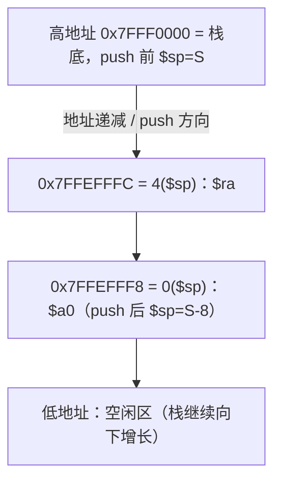
```text
     高地址（栈底）
     0x7FFF0000   S     ← push 前 $sp
     0x7FFEFFFC   S-4   4($sp) = $ra
     0x7FFEFFF8   S-8   0($sp) = $a0   ← push 后 $sp
     0x7FFEFFF4   S-12  空闲
     低地址（栈增长方向 ↓，$sp 递减）

     push：$sp: S → S-8 ；pop：$sp: S-8 → S
```
**评分点**：①栈向下增长、低地址在下方（2）；②`$sp` 初值、push 后 `S-8`、pop 后回 `S` 三处标清（3）；③`0($sp)`=`$a0`、`4($sp)`=`$ra` 位置正确（2）；④push/pop 箭头方向相反（1）。
**常见错误**：把栈画成向上增长；写 `$a0` 在 `4($sp)`（入栈顺序与偏移弄反）；pop 时先 `add $sp` 再 `lw`（会取到已释放的内容）；忘记 `sub` 与 `add` 对称，`$sp` 不能复位。

2. （10 分）
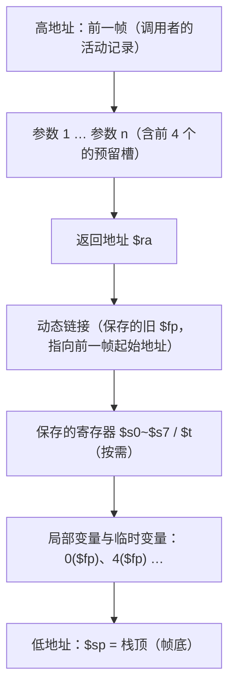
```text
     高地址
     ┌───────────────┐
     │ 前一帧         │ ←──┐ 动态链接回指
     ├───────────────┤    │
     │ 参数1 … 参数n  │    │ 调用者预留（>4 个时 16($sp)、20($sp)…）
     ├───────────────┤    │
     │ 返回地址 $ra    │    │ 本帧最高位置的保存项
     ├───────────────┤    │
     │ 动态链接(旧$fp) │ ───┘
     ├───────────────┤
 $fp→│ 局部变量/临时量 │ 0($fp)
     │   …            │ 4($fp)、8($fp)
 $sp→└───────────────┘
     低地址（栈增长方向 ↓）
```
**评分点**：①标出局部变量/临时变量、参数 1…n、返回地址、动态链接五部分（5）；②`$fp` 指向本帧起始（`0($fp)` 为局部变量），`$sp` 指向栈顶（2）；③高/低地址方向与“`$fp`→前一帧”的链接箭头（2）；④说明栈帧=活动记录（1）。
**常见错误**：`$fp` 与 `$sp` 位置画反；漏画动态链接或箭头指错；把参数画在低地址侧；未标地址增长方向；认为每个函数必须同时保存全部 `$s`。

3. （10 分）初始 `$sp=0x7FFF0000`。
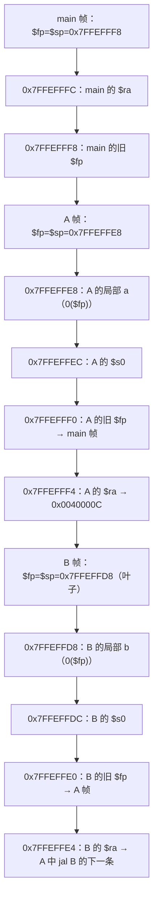
```text
     高地址 0x7FFF0000
     0x7FFEFFFC  main $ra
     0x7FFEFFF8  main 旧$fp        ← main $fp=$sp
     0x7FFEFFF4  A $ra（返回 main）
     0x7FFEFFF0  A 旧$fp → main 帧
     0x7FFEFFEC  A $s0
     0x7FFEFFE8  A 局部 a（0($fp)） ← A $fp=$sp
     0x7FFEFFE4  B $ra（返回 A）
     0x7FFEFFE0  B 旧$fp → A 帧
     0x7FFEFFDC  B $s0
     0x7FFEFFD8  B 局部 b（0($fp)） ← B $fp=$sp
     低地址 0x7FFEFFD4（空闲）
```
**评分点**：①三帧边界清楚、互不重叠且地址递减（3）；②每帧的 `$ra` 与旧 `$fp` 都有，且旧 `$fp` 指向上一层帧（3）；③各帧 `$fp`（帧底）与 `$sp`（当前栈顶）标注正确（2）；④返回顺序说明：B 撤销 → `$sp=$fp+局部区` 后 `lw $fp` 使 `$fp` 回到 A 帧，逐层弹出，最终 `$sp` 恢复到 `0x7FFF0000`（2）。
**常见错误**：三帧地址画成递增；旧 `$fp` 指向自己帧；漏写 B 的 `$ra`（叶子函数虽不 `jal`，但为了 `jr $ra` 与统一帧格式仍可保存）；返回时先恢复 `$ra` 再恢复 `$sp`，偏移错乱。

4. （10 分）JACK 中 `addiu $sp,$sp,-32`，设 `$sp=0x7FFEFFE0`。
```mermaid
flowchart TD
    A["0($sp)=0x7FFEFFE0：参数 A=0x11"]
    B["4($sp)=0x7FFEFFE4：参数 B=0x22"]
    C["8($sp)=0x7FFEFFE8：参数 C=0x33"]
    D["12($sp)=0x7FFEFFEC：返回值 D（jal 前未写 → 调用后 = JILL 的 $v0）"]
    E["16($sp)=0x7FFEFFF0：返回值 E（jal 前未写 → 调用后 = JILL 的 $v1）"]
    R["20($sp)=0x7FFEFFF4：$ra = jal JILL 的下一条地址"]
    T6["24($sp)=0x7FFEFFF8：$t6=0x66（调用者保存）"]
    T7["28($sp)=0x7FFEFFFC：$t7=0x77（调用者保存）"]
    A --> B --> C --> D --> E --> R --> T6 --> T7
```
```text
【jal 之前】                    【jr 之后（JILL 写好返回值）】
 28($sp) $t7 = 0x77              28($sp) $t7 = 0x77
 24($sp) $t6 = 0x66              24($sp) $t6 = 0x66
 20($sp) $ra = 返回地址          20($sp) $ra = 返回地址（未变）
 16($sp) 未写（返回值 E 槽）      16($sp) E = $v1
 12($sp) 未写（返回值 D 槽）      12($sp) D = $v0
  8($sp) C = 0x33                 8($sp) C = 0x33
  4($sp) B = 0x22                 4($sp) B = 0x22
  0($sp) A = 0x11 ← $sp           0($sp) A = 0x11 ← $sp
（低地址在上侧为栈顶；$sp 始终 = 0x7FFEFFE0，JILL 为叶子不移 $sp）
```
**评分点**：①八个偏移 `0~28` 全部标出且顺序正确（4）；②A/B/C、D/E、`$ra`、`$t6/$t7` 位置与课件 P266 一致（3）；③区分两种状态：`jal` 前 12/16 为未知槽，`jr` 后为 D/E（2）；④`$sp` 在 JACK 帧内不变、JILL 按 `0/4/8` 取参（1）。
**常见错误**：把返回值槽放到 `0/4`；漏 `$t6/$t7` 或把它们放 20 号槽；忘记 `$ra` 在 20；以为 `jal` 前后 `$sp` 变化；把 JILL 的取参偏移写成 `($fp)`。

<div style="page-break-after: always"></div>

# 第十讲（前半）可重入函数与递归函数 复习题（对应课件 P280–P299）

> 作答约定：除题目明确说明存在延迟槽外，程序题按课程模拟器默认的“无分支延迟、无加载延迟”模型执行；此时 jal/jalr 保存调用指令地址加 4。经典带分支延迟槽的 MIPS 保存调用指令地址加 8。所有地址均按字节计；宏展开和周期数按题目指定的模型计算。


> 本讲为**程序设计与栈帧的联合考点**：可重入（reentrant）函数三条特征 → 递归（recursive）函数如何用栈"自我保存" → Fac 逐条指令的偏移含义 → Fac(3) 栈的逐层堆叠与回退。
> 一切递归题都可归结为一句话：**参数、返回地址、本层私有数据一律入栈，返回值经"调用者帧的 4($sp) 槽"逐层回送**。

## 本讲覆盖要点与题号索引

| 课件页 | 知识点 | 对应题号 |
|---|---|---|
| P280 | 课件 10 标题页：可重入函数、递归函数及异常处理 | 全章 |
| P281 | 主要内容三项：可重入函数概念／递归函数／异常处理 | 单1、填1 |
| P282 | 可重入函数动机（多用户多任务共有代码只一份副本）＋三条特征：纯代码、无全局可变数据（可有常量）、局部变量栈上动态分配 | 单2、单3、多1、填2、填3、判1、判2、简1、简2、图2 |
| P283 | 可重入 I/O：`addiu $sp,-32`、`move $a0,$sp`、`li $a1,32`、`li $v0,8`、`syscall` | 单4、单5、多1、填4、读3、编程3 |
| P284 | 递归与可重入的关系（**谁负责保存寄存器**）、N! 定义、0!=1 | 单6、单7、填5、判3、简3、简4、简5 |
| P285 | Fac 主程序 `.data` 段三个字符串（prompt/msg/bye） | 填6、读1 |
| P286 | main：`addiu $sp,$sp,-8`、`sw $v0,0($sp)` 传参、`jal Fac` | 单8、填8、读1 |
| P287 | main：`lw $a0,4($sp)` 取结果、`bltz` 退出、`addiu $sp,$sp,8` 释放 | 判4、读1、读2 |
| P288 | Fac 入口：`lw $a0,0($sp)`、`addiu $sp,$sp,-16`、`sw $ra,12`、`sw $a0,8`、`slti`＋`beqz` 判出口 | 单9、填7、判5、简6、计1、读1 |
| P289 | Go 段：`addi $a0,-1`、`sw $a0,0($sp)` 传参、`jal Fac`、`lw $v0,4($sp)`、`mult`+`mflo`、`sw $v0,4($sp)`、`addiu $sp,16` | 单10、计1、判5、读1、读2 |
| P290–P299 | Fac(3) 递归栈逐层变化 3→2→1→返回 1→2→6；返回值/返回地址/参数的栈上位置 | 读1、读2、作图1、编程1、编程2 |

---

## 一、单项选择题（共 10 题）

1. 【课件P281】课件第 10 讲的主要内容**不包括**（ ）
   - A. 可重入（reentrant）函数的概念
   - B. 递归函数
   - C. 异常处理
   - D. 指令流水线与延迟槽调度

2. 【课件P282】多用户、多任务系统中，可重入函数的代码副本数量应当是（ ）
   - A. 每个用户各一份
   - B. 每个任务各一份
   - C. 所有任务共用同一份代码副本
   - D. 每个进程、每个线程各一份

3. 【课件P282】下列各项**不属于**可重入函数特征的是（ ）
   - A. 纯代码（执行过程中不修改自身代码）
   - B. 没有全局数据段分配的内存变量，但可以有常量
   - C. 局部变量必须在堆栈上动态分配空间
   - D. 所有变量都在 `.data` 段静态分配，长度固定

4. 【课件P283】要在堆栈中分配 32 个字符的输入缓冲区，应使用的指令是（ ）
   - A. `addiu $sp,$sp,32`
   - B. `addiu $sp,$sp,-32`
   - C. `addiu $a0,$a0,-32`
   - D. `sw $sp,-32($sp)`

5. 【课件P283】在可重入 I/O 程序段中，`move $a0,$sp` 的作用是（ ）
   - A. 把缓冲区长度送入 `$a0`
   - B. 让 `$a0` 指向刚在栈上分配的缓冲区首字节，作为 syscall 8 的目标地址
   - C. 保存旧的 `$sp`，以便函数返回时恢复
   - D. 把 `$sp` 的值存入 `$ra`

6. 【课件P284】关于"由谁负责保存寄存器"，可重入函数与递归函数的正确说法是（ ）
   - A. 两者都由硬件自动保存，程序不必关心
   - B. 可重入函数由**调用者**在调用前负责保存；递归函数由**被调用者（函数自身）**在递归调用前保存
   - C. 可重入函数由被调用者保存；递归函数由调用者保存
   - D. 两者都只保存 `$v0`，其余寄存器不需要保存

7. 【课件P284】教材对 N 的阶乘的递归定义是（ ）
   - A. N! = N×(N−1)!，且 0! = 1
   - B. N! = (N−1)×(N−2)!，且 0! = 0
   - C. N! = N+(N−1)!，且 1! = 2
   - D. N! = N×(N+1)!，且 0! = 1

8. 【课件P286】`main` 中读入 N 之后紧接着执行 `sw $v0,0($sp)`，其目的是（ ）
   - A. 保存 `syscall 5` 的返回值，防止被下一个 syscall 破坏
   - B. 把 N 作为**实参**放入栈的 0($sp) 槽，供 `Fac` 用 `lw $a0,0($sp)` 取出
   - C. 把返回值槽清零
   - D. 建立 `$fp` 指针

9. 【课件P288】`Fac` 内部用 `slti $t0,$a0,2` 接 `beqz $t0,Go` 完成的功能是（ ）
   - A. 判断参数是否为负，是则报错
   - B. 判断 N<2（即 N 为 0 或 1）是否成立：成立则返回 1（递归出口），否则转 Go 继续递归
   - C. 判断 N 是否大于 2
   - D. 判断 N 是否为偶数

10. 【课件P289】`Fac` 的返回段是 `ret: addiu $sp,$sp,16` 之后才执行 `sw $v0,4($sp)`。先加 `$sp` 再存返回值的理由是（ ）
    - A. 减少指令条数
    - B. `mult` 的结果必须写在 `$sp+16` 处才能被读到
    - C. 撤销本层帧后，`4($sp)` 正好落在**调用者**帧的返回值槽上，返回值就"交回"给了上一层
    - D. `$ra` 已被覆盖，只能这样返回

## 二、多项选择题（共 2 题）

1. 【综合 P282/P283】关于可重入函数的下列叙述，正确的是（ ）
   - A. 可重入函数是"纯代码"，运行中不修改自身的指令
   - B. 可重入函数可以使用 `.data` 段中的常量
   - C. 可重入函数不含有在全局数据段分配的可变内存变量
   - D. 可重入函数的局部变量（含输入缓冲区）应在堆栈上动态分配
   - E. 可重入函数应把输入缓冲区放在 `.data` 段，以便多次调用复用
   - F. 多任务系统应为每个任务复制一份可重入函数的代码

2. 【综合 P283–P289】关于课件中 Fac 程序的实现，正确的有（ ）
   - A. 参数经栈传递：`main` 用 `sw $v0,0($sp)` 传 N，`Fac` 用 `lw $a0,0($sp)` 取 N
   - B. 返回值也经栈传递：结果放在 `4($sp)` 槽，调用者用 `lw $v0,4($sp)` 取回
   - C. 返回地址 `$ra` 保存在本层帧的 `12($sp)`
   - D. N×(N−1)! 通过 `mult $v0,$a0` 后 `mflo $v0` 得到乘积
   - E. Fac 只被调用一次，所以 `$ra` 不必入栈

## 三、填空题（共 8 题）

1. 【课件P281】课件第 10 讲的三项主要内容是：______函数的概念、______函数、______处理。

2. 【课件P282】可重入函数的三个特征是：①______；②______；③______。

3. 【课件P282】多用户、多任务系统中共有代码只应该有______份副本；可重入函数没有全局数据段分配的变量，但可以有______。

4. 【课件P283】补全可重入 I/O 程序段：
   ```asm
   addiu $sp,$sp,____     # 分配栈上的空间
   move  ____,$sp         # 初始化指针指向缓冲区第一个字符
   li    $a1,____         # 指定缓冲器的长度
   li    $v0,____         # 系统调用读字符串
   syscall
   ```

5. 【课件P284】N! = 1×2×3×…×N，且约定 0! = ______；用递归思想定义：N! = ______。

6. 【课件P285】Fac 主程序的三个字符串 `prompt`/`msg`/`bye` 用______伪指令定义，它们存放在以______开始的段中；字符串以 ______ 字节结尾。

7. 【课件P288】Fac 每层栈帧为 16 字节，其内部布局是：输入参数在 ____($sp)，返回值在 ____($sp)，保存的 N 在 ____($sp)，返回地址 `$ra` 在 ____($sp)。

8. 【课件P289】Fac 的返回段先把 `$sp` 加上 ______，再把 `$v0` 写入 ______($sp)，这样返回值就落在______的帧中，最后用 `jr $ra` 返回。

## 四、判断题（共 5 题，正确写"对"，错误写"错"并改正）

1. 【课件P282】可重入函数中不允许出现任何常量。（　）

2. 【课件P282】可重入函数的局部变量必须在堆栈上动态分配空间，否则多个任务并发调用时会互相破坏数据。（　）

3. 【课件P284】递归函数在执行递归调用之前，要把与本次调用有关的所有寄存器内容保存到堆栈；而可重入函数要求由调用者负责保存。（　）

4. 【课件P287】`main` 只执行了 `addiu $sp,$sp,-8`，却能在 `4($sp)` 处取到 Fac 的结果，是因为 Fac 在撤销自己帧之后把返回值写进了调用者帧的 `4($sp)` 槽。（　）

5. 【课件P288/P289】Fac 中的 `$a0` 只需用 `sw $a0,8($sp)` 保存一次即可，`sw $a0,0($sp)` 是多余的。（　）

## 五、简答题（共 6 题）

1. 【课件P282】（6 分）可重入函数必须满足哪三个条件？逐条说明理由。

2. 【课件P282】（5 分）为什么库函数（如 `printf`、`getchar`、字符串输入函数）必须设计成可重入的？

3. 【课件P284】（6 分）递归函数与可重入函数有什么联系与区别？请从"由谁负责保存寄存器"的角度说明。

4. 【课件P284、P288】（6 分）用课件中的 Fac 为例，说明递归函数必须保存哪些寄存器/数据；为什么 `$a0` 要保存两次（`8($sp)` 与 `0($sp)`）？

5. 【课件P284、P289】（6 分）说明本课Fac如何通过栈槽返回结果。这是否意味着所有递归函数都必须通过栈返回？若改用$v0返回，需要保存哪些跨调用状态？

6. 【课件P288/P289】（5 分）若 Fac 中省略 `sw $ra,12($sp)` 与 `lw $ra,12($sp)`，程序会怎样？请结合 Fac(3) 的调用过程说明。

## 六、计算与编码题（共 1 题）

1. 【综合 P286–P289】（10 分）
   (1) 课件 Fac 程序在主程序中执行 `addiu $sp,$sp,-8`，Fac 每层执行 `addiu $sp,$sp,-16`。若输入 N=6，求 Fac 的返回值、递归调用 Fac 的最大层数、以及此刻栈段共被占用的字节数（含 main 的 8 字节）。
   (2) 写出下列三条指令的 32 位机器码（给出字段分解与十六进制）：
   ```asm
   addiu $sp,$sp,-16
   sw    $ra,12($sp)
   slti  $t0,$a0,2
   ```

## 七、代码转换题（共 2 题）

### 7.1 C 语言 → MIPS 汇编

1. 【综合 P284–P289】（10 分）把下面的递归 C 函数改写为 MIPS 汇编，并写出完整可运行程序（含 `main` 测试）。
   **要求**：完全仿照课件 Fac 的协议——参数与返回值都经栈传递（参数在 `0($sp)`，返回值在 `4($sp)`），`$ra` 在 `12($sp)`，帧大小 16 字节。
   ```c
   int Rsum(int n) {          /* 求 0+1+2+…+n */
       if (n <= 0) return 0;  /* 递归出口 */
       return n + Rsum(n-1);  /* 递归调用 */
   }
   ```

### 7.2 机器码 → MIPS 汇编（反汇编）

1. 【综合 P288–P289】（8 分）Fac 程序中的四条机器码如下（均为十六进制），请反汇编为 MIPS 指令，并说明每条指令在 Fac 中的作用。
   ```
   (a) 0x27BDFFF0
   (b) 0xAFBF000C
   (c) 0x00001012
   (d) 0x03E00008
   ```

## 八、读程序写结果（共 3 题）

1. 【课件P285–P299】（10 分）下面是课件中的 Fac 程序。设用户输入 **4**。要求：
   (a) 写出 `Fac` 递归到**最深**时栈上各帧的内容（标出每格的相对 `$sp` 偏移与数值）；
   (b) 写出程序从键盘读入到输出结果的**屏幕输出**；
   (c) 写出最终 `$v0` 的值。

   ```asm
        .data
   prompt: .asciiz "\n\n Give me a value for 'N' : "
   msg:    .asciiz " N factorial is : "
   bye:    .asciiz "\n### Good-Bye ### "
        .text
   main:
        addiu $sp,$sp,-8          # 分配存储空间
   mloop:
        li    $v0,4
        la    $a0,prompt
        syscall
        li    $v0,5               # 输入值 N
        syscall
        bltz  $v0,quit
        sw    $v0,0($sp)          # 实参入栈
        jal   Fac                 # 调用递归函数
        li    $v0,4
        la    $a0,msg
        li    $v0,1
        lw    $a0,4($sp)          # 取出结果
        syscall
        b     mloop
   quit:
        addiu $sp,$sp,8
        li    $v0,10
        syscall

   Fac:
        lw    $a0,0($sp)          # 获取输入参数
        bltz  $a0,out_e
        addiu $sp,$sp,-16         # 分配本层帧
        sw    $ra,12($sp)         # 保存返回地址
        sw    $a0,8($sp)          # 保存输入参数 N
        slti  $t0,$a0,2
        beqz  $t0,Go
        li    $v0,1
        b     facret
   Go:
        addi  $a0,$a0,-1
        sw    $a0,0($sp)          # 传给下一层
        jal   Fac
        lw    $v0,4($sp)          # 取 (N-1)!
        lw    $ra,12($sp)
        lw    $a0,8($sp)          # 取回 N
        mult  $v0,$a0
        mflo  $v0
   facret:
        addiu $sp,$sp,16
        sw    $v0,4($sp)          # 返回值交给调用者
        jr    $ra
   out_e:
        sw    $zero,4($sp)
        jr    $ra
   ```

2. 【课件P287–P289、P290–P299】（8 分）仍使用上题 Fac 程序。若用户输入 **6**（而不是 4），请回答：
   (a) 从 `main` 首次 `jal Fac` 到最深一层，栈上一共同时存在几个帧？分别是哪些 N 的帧？
   (b) 栈段最多被占用多少字节（含 main 的 8 字节）？
   (c) 最深一层执行 `li $v0,1` 之后，它把 1 写到了哪个 `$sp` 偏移处？最终 `$v0` 的值是多少？

3. 【课件P283】（8 分）阅读下面的可重入输入程序（`main` 开始执行前 `$sp` = 0x7fff_fffc）：

   ```asm
        .data
   pr:  .asciiz "Please input: "
        .text
   main:
        addiu $sp,$sp,-32
        li    $v0,4
        la    $a0,pr
        syscall
        move  $a0,$sp        # 缓冲区首地址
        li    $a1,32         # 缓冲区长度
        li    $v0,8          # 读字符串
        syscall
        move  $t0,$sp
        lb    $t1,0($t0)     # 取输入的第一个字符
        lb    $t2,1($t0)     # 取输入的第二个字符
        move  $a0,$t1
        li    $v0,1
        syscall
        li    $v0,10
        syscall
   ```

   设用户输入 `MIPS` 后回车。请回答：
   (a) 执行 `addiu $sp,$sp,-32` 之后 `$sp` 的值是多少？缓冲区占哪一段字节地址？
   (b) 输入后，缓冲区前 6 个字节各是什么（用十六进制表示）？
   (c) `$t1`、`$t2` 的值，以及屏幕在问候语之后又输出了什么？
   (d) 如果把这个 32 字节缓冲区改成 `.data` 段中定义的 `buf: .space 32`，该程序还是可重入的吗？为什么？

## 九、程序设计与综合题（共 3 题）

1. 【综合 P284–P289】（12 分）编写递归函数 `Rsum`，计算 1+2+…+N（N≥0，N=0 时返回 0）。要求：
   ① 参数与返回值都经栈传递（参数在 `0($sp)`，返回值在 `4($sp)`）；② `$ra` 与 N 存入本层帧；
   ③ 主程序读入 N、调用 `Rsum`、输出结果；④ 给出完整可运行代码，并给出 N=4 时的栈变化表。

2. 【综合 P284–P289】（12 分）编写递归函数 `Fib`，计算第 N 个斐波那契数（Fib(0)=0，Fib(1)=1，Fib(n)=Fib(n-1)+Fib(n-2)）。要求：
   ① 每层帧 24 字节，其中 `0($sp)` 参数、`4($sp)` 返回值、`8($sp)` 保存 N、`12($sp)` 保存 `$ra`、`16($sp)` 保存第一次递归的结果；
   ② 说明为什么第二次递归调用返回后必须**重新从栈上**取回 `16($sp)` 的值，而不能直接使用 `$t` 寄存器；
   ③ 给出完整可运行代码并指出 Fib(5) 的结果。

3. 【课件P283】（12 分）编写**可重入**的 `Decout` 过程：把 `$a0` 中的非负整数按十进制输出到屏幕，要求数字转换用的字符缓冲区在**栈上动态分配**（不得使用 `.data` 段的全局缓冲区）。要求：
   ① 画出帧布局；② 给出完整可运行代码（主程序用 0、7、12345 三个数测试）；③ 说明该过程为何满足可重入三条件。

## 十、作图题（共 2 题）

1. 【课件P290–P299】（10 分）画出 Fac(3) 的递归栈帧变化图，要求：
   ① 画出 main 帧与 Fac 的 3 层帧（N=3、N=2、N=1）在栈上**自底向上**的堆叠顺序；
   ② 每层帧内标出 `0($sp)` 参数、`4($sp)` 返回值、`8($sp)` 保存的 N、`12($sp)` 返回地址（返回地址写清是"主程序调用返回地址"还是"标号 A"）；
   ③ 用箭头表示返回值回传：1 → 2 → 6；
   ④ 标注递归"深入"与"回退"两个阶段。

2. 【课件P282】（8 分）画出"可重入函数 + 多用户独立栈"的关系图，要求标出：
   ① 唯一的代码副本（纯代码段，多个任务共享）；
   ② 任务 1、任务 2 各自的独立栈与各自的局部变量/缓冲区；
   ③ 若无全局可变数据，则任务切换为何不会破坏数据；
   ④ 在图上注明"常量可共享、全局可变变量不可共享"。

---

# 参考答案与解析

## 一、单项选择题

1. **D**。【解析】P281 列出三项：可重入函数的概念、递归函数、异常处理；指令流水线与延迟槽属于数据通路/流水线内容。
2. **C**。【解析】P282 原文"多用户、多任务系统，共有代码只应该有一个副本"，各任务只私有自己的栈与数据。
3. **D**。【解析】可重入函数恰恰**不得**有全局数据段分配的可变变量；局部变量必须在堆栈上动态分配（D 正好相反）。
4. **B**。【解析】栈向下增长，分配 32 字节必须 `$sp←$sp−32`，即 `addiu $sp,$sp,-32`（机器码 0x27BDFFE0）。
5. **B**。【解析】`move $a0,$sp` 相当于 `add $a0,$zero,$sp`，把缓冲区首字节地址作为 syscall 8 的 `$a0` 参数。
6. **B**。【解析】P284：可重入代码要求**调用者**保存；递归函数在执行递归调用前由**函数自己**把相关寄存器内容压栈，返回时恢复。
7. **A**。【解析】N!=1×2×…×N，约定 0!=1，递归定义 N!=N×(N−1)!。
8. **B**。【解析】课件协议：实参放在调用者帧的 `0($sp)`，被调用者一进门 `lw $a0,0($sp)` 取参。
9. **B**。【解析】`slti $t0,$a0,2`：若 `$a0<2` 则 `$t0=1`；`beqz` 在 `$t0==0`（即 N≥2）时转 Go 继续递归，否则返回 1。
10. **C**。【解析】`addiu $sp,$sp,16` 撤销本层帧后，`$sp` 已回到调用者的帧基址，此时 `4($sp)` 就是调用者的返回值槽，`sw $v0,4($sp)` 即"交回返回值"。

## 二、多项选择题

1. **ABCD**。
   - A 对：纯代码（只执行、不自我修改）。
   - B 对：P282"没有全局数据段分配的内存变量，但**可以有常量**"。
   - C 对：不得有全局可变变量，否则多任务互相破坏。
   - D 对：局部变量（含输入缓冲区）必须在堆栈上动态分配。
   - E 错：`.data` 中的缓冲区是所有调用共享的，一旦可重入/并发就会互相覆盖。
   - F 错：代码只保留**一份**副本，各任务各有独立栈。
2. **ABCD**。
   - A、B、C、D 均与课件代码一致（`0/4/8/12($sp)` 四槽 + `mult/mflo`）。
   - E 错：Fac 是**非叶子**函数，`jal Fac` 会覆盖 `$ra`，且递归多层需要各自不同的返回地址，必须每层入栈保存；`$s` 寄存器也只有一份，同样存不下多层。

## 三、填空题

1. **可重入**；**递归**；**异常**。
2. **纯代码**；**没有全局数据段分配的内存变量（但可以有常量）**；**局部变量必须在堆栈上动态分配空间**。
3. **一（1）**；**常量**。
4. **-32**；**$a0**；**32**；**8**。
5. **1**；**N×(N−1)!**。
6. **.asciiz**；**.data**；**0（NULL 结束符）**。
7. **0**；**4**；**8**；**12**。
8. **16**；**4**；**调用者**。

## 四、判断题

1. **错**。可重入函数**可以**有常量（写在代码中或用只读数据段），禁止的是**全局数据段分配的可变变量**。
2. **对**。局部变量若静态分配在 `.data`，多个任务并发调用会互相覆盖，失去可重入性。
3. **对（限课件 P284 示例约定）**。递归函数在调用下一层时也充当调用者；保存责任仍由约定及值的生存期决定，不能把这句话当作一般定义。
4. **对**。Fac 的 `facret` 段先 `addiu $sp,$sp,16` 撤销本层帧，再 `sw $v0,4($sp)`，正好写进调用者（main）帧的返回槽。
5. **错**。两处作用不同：`8($sp)` 保存**本层**的 N（递归返回后用 `lw $a0,8($sp)` 恢复，因为 `$a0` 已被下一层改写）；`0($sp)` 是**传给下一层**的实参槽（`sw $a0,0($sp)` 后 `jal Fac`）。缺任一处都会算错。

## 五、简答题

1. **三条件（每点 2 分）**
   - ①**纯代码（pure code）**：函数只包含可执行指令，运行中不修改自身代码，故任意多个任务可同时执行同一份代码而不冲突。
   - ②**没有全局数据段分配的内存变量（可有常量）**：可变数据若放在 `.data`，多任务共享时会互相覆盖；常量不可变，可安全共享。
   - ③**局部变量在堆栈上动态分配**：每次调用在栈上新建一份私有数据（含 I/O 缓冲区），各任务/各层调用互不干扰，返回时随帧释放。

2. **库函数必须可重入的理由（5 分）**
   - ①库函数被众多程序、众多任务共同使用，系统只保留**一份代码副本**（节省空间、便于维护）。
   - ②同一时刻可能有多个任务在库函数内部（如 `printf`/`getchar`），甚至在信号/中断处理中被再次调用。
   - ③若库函数使用全局缓冲区或静态变量，一个任务的数据会被另一个任务覆盖，产生随机错误；把缓冲区放在栈上才互不影响。
   - ④可重入还意味着支持**嵌套调用**（函数调用自身或调用链上再次进入），这是递归与并发的前提。

3. **递归与可重入的联系与区别（6 分）**
   - 联系：二者都要求"可被多次/多层同时进入而不破坏数据"，实现手段相同——**在栈上动态分配私有数据**；递归代码通常也是可重入代码。
   - 课件示例比较了寄存器的保存位置；这不是递归与可重入的一般定义差异。
     - 按课件 P284 的示例，可重入函数的调用者负责保存跨调用仍需使用的临时值；一般调用约定仍须遵守，被调用者使用 `$s`/`$fp` 时也应恢复。
     - 递归函数：由**被调用者自己**（同一段代码）在递归调用前把本层要用的 `$ra`、参数、局部值压入本层帧，返回前恢复。
   - 另一点：递归强调**控制流上的自我调用**与递归出口；可重入强调**多任务/并发下的数据独立**。

4. **递归必须保存什么；`$a0` 为何保存两次（6 分）**
   - 必须保存：①`$ra`（`jal` 会覆盖它，递归返回后要回到本层 `jal` 的下一条指令）；②输入参数 N（下一层会改写 `$a0`）；③本层要用到的其他寄存器/局部变量（如 `$s`、临时结果）；④返回值经固定的 `4($sp)` 槽回送。
   - `$a0` 存两次的原因：
     - `sw $a0,0($sp)` 写入的是本层帧的**参数槽**，用于 `jal Fac` 时把 N−1 传给下一层（被调用者用 `lw $a0,0($sp)` 读）；
     - `sw $a0,8($sp)` 保存的是**本层自己的 N**，因为递归返回后 `$a0` 已被最深层改得面目全非，必须 `lw $a0,8($sp)` 取回才能做 `mult $v0,$a0`。
   - 一句话：一个槽"向外传参"，一个槽"自己留底"。

5. **返回值为何也要经栈传递（6 分）**
   - ①本题按课件统一使用调用者帧的返回值槽；递归本身并不强制结果经栈返回，用 `$v0` 直接返回同样可以正确实现阶乘，只须把跨递归调用仍需使用的 N 等状态保存在本层帧。
   - ②因此每层返回前，先把结果写入**调用者帧的 `4($sp)`**（`addiu $sp,$sp,16` 后 `sw $v0,4($sp)`），调用者再用 `lw $v0,4($sp)` 取回，与自己的 N 相乘后继续向上送。
   - ③这样返回值与参数、返回地址一样"随帧走"，天然支持任意深度递归；每层只在自己的那一格里读写，互不干扰。
   - ④副产品：`out_e` 里 `sw $zero,4($sp)` 能统一用 0 表示非法输入。

6. **不保存 `$ra` 的后果（5 分）**
   - Fac 是非叶子函数，`jal Fac` 执行时硬件把 `PC+4` 写入 `$ra`，**同一份 `$ra` 被每层覆盖**。
   - Fac(3) 时序：main `jal` → `$ra`=main 返回地址；Fac(3) 在 Go 中 `jal` → `$ra`=标号 A；Fac(2) `jal` → `$ra`=A；Fac(1) 直接返回。
   - 若不入栈，Fac(1) 返回后 `$ra`=A，Fac(2) 再 `jr $ra` 又跳回 A（自己 frame 内 `jal` 的下一条），形成**死循环/重复计算**，且 main 的返回地址永久丢失，`jr $ra` 会跳到错误位置（常见现象：结果错、死循环、`mars` 报 "attempt to execute non-instruction"）。
   - 结论：任何含 `jal` 的函数都必须保存 `$ra`（课件存于 `12($sp)`）。

## 六、计算与编码题

1. **(1)（5 分）**
   - 返回值：Fac(6)=6!=**720**。
   - 递归层数：N=6,5,4,3,2,1 各分配一层帧（Fac(1) 也先 `addiu $sp,$sp,-16`，再被 `slti` 判为出口返回 1），共 **6 层**。
   - 栈占用：main 8 字节 + 6×16 = **104 字节**（若设 main 起始 `$sp`=S，则最深时 `$sp`=S−104）。
   - 说明：N=0/1 时只有 1 层帧，16+8=24 字节。

   **(2)（5 分）**

   (a) `addiu $sp,$sp,-16`：I 型，op=**001001**(9)，rs=`$sp`=**11101**(29)，rt=`$sp`=**11101**(29)，imm=−16=**1111 1111 1111 0000**
   ```
   0010 01 11101 11101 1111 1111 1111 0000  →  0x27BDFFF0
   ```
   (b) `sw $ra,12($sp)`：I 型，op=**101011**(43)，rs=`$sp`=**11101**(29)，rt=`$ra`=**11111**(31)，imm=12=**0000 0000 0000 1100**
   ```
   1010 11 11101 11111 0000 0000 0000 1100  →  0xAFBF000C
   ```
   (c) `slti $t0,$a0,2`：I 型，op=**001010**(10)，rs=`$a0`=**00100**(4)，rt=`$t0`=**01000**(8)，imm=2
   ```
   0010 10 00100 01000 0000 0000 0000 0010  →  0x28880002
   ```
   （验算：0x27BDFFF0 高 6 位 001001=9=addiu ✔；0xAFBF000C 高 6 位 101011=43=sw ✔；0x28880002 高 6 位 001010=10=slti ✔）

## 七、代码转换题

### 7.1 C 语言 → MIPS 汇编

**参考代码（完整可运行，MARS 直接 Run）**
```asm
        .data
prompt: .asciiz "\nN = ? "
msg:    .asciiz "sum(0..N) = "
        .text
        .globl main
main:
        addiu $sp,$sp,-8          # main 帧：0($sp)=实参，4($sp)=返回值
        li    $v0,4
        la    $a0,prompt
        syscall
        li    $v0,5               # 读入 N
        syscall
        bltz  $v0,quit            # 负数退出
        sw    $v0,0($sp)          # 实参入栈
        jal   Rsum                # 调用递归函数
        li    $v0,4
        la    $a0,msg
        syscall
        lw    $a0,4($sp)          # 取返回值
        li    $v0,1
        syscall
quit:
        addiu $sp,$sp,8
        li    $v0,10
        syscall

#---- Rsum(n) = n + Rsum(n-1)，Rsum(0)=0 ----
# 帧 16 字节：0($sp) 参数  4($sp) 返回值  8($sp) 本层 n  12($sp) 返回地址
Rsum:
        lw    $a0,0($sp)          # 取输入参数
        bltz  $a0,out_e           # 负参数返回 0
        addiu $sp,$sp,-16         # 分配本层帧
        sw    $ra,12($sp)         # 保存返回地址
        sw    $a0,8($sp)          # 保存本层 n
        blez  $a0,base            # n<=0 → 出口
        addi  $a0,$a0,-1          # 向下一层传 n-1
        sw    $a0,0($sp)
        jal   Rsum                # 递归调用
        lw    $v0,4($sp)          # 取 Rsum(n-1)
        lw    $ra,12($sp)         # 恢复本层返回地址
        lw    $a0,8($sp)          # 取回本层 n
        add   $v0,$v0,$a0         # n + Rsum(n-1)
        b     ret
base:
        li    $v0,0               # Rsum(0)=0
ret:
        addiu $sp,$sp,16          # 撤销本层帧
        sw    $v0,4($sp)          # 返回值送入调用者帧
        jr    $ra
out_e:
        sw    $zero,4($sp)
        jr    $ra
```
**评分点**：`main` 用 `-8` 且 `sw $v0,0($sp)` 传参（2 分）；`jal`/帧分配/`sw $ra,12`（2 分）；`blez` 出口返回 0（2 分）；`sw $a0,0($sp)` 传参 + `jal`（1 分）；`lw $v0,4` 取回 + `lw $ra,12` 恢复 + `lw $a0,8` 取 n + `add`（2 分）；`addiu $sp,16` 后再 `sw $v0,4` + `jr $ra`（1 分）。
**常见错误**：未按本题规定的栈协议回传结果；**忘记 `lw $ra,12($sp)` 恢复返回地址**（`jal` 覆盖了 `$ra`，不恢复会跳回上一层 `jal` 之后形成死循环）；忘记 `lw $a0,8($sp)`；`sw $v0,4($sp)` 写在 `addiu $sp,16` 之前（会写进本层帧，调用者读不到）。

### 7.2 机器码 → MIPS 汇编（反汇编）

| 机器码 | 字段分解 | 指令 | 在 Fac 中的作用 |
|---|---|---|---|
| (a) 0x27BDFFF0 | op=001001(9) rs=11101(29) rt=11101(29) imm=0xFFF0(−16) | `addiu $sp,$sp,-16` | 进入 Fac 后分配 16 字节本层栈帧 |
| (b) 0xAFBF000C | op=101011(43) rs=11101(29) rt=11111(31) imm=12 | `sw $ra,12($sp)` | 保存返回地址（非叶子递归函数必须） |
| (c) 0x00001012 | op=000000 rs=00000 rt=00000 rd=00010(2) shamt=00000 funct=010010(18) | `mflo $v0` | 把 `mult` 结果低 32 位（N×(N−1)!）送 `$v0` |
| (d) 0x03E00008 | op=000000 rs=11111(31) rd/shamt=0 funct=001000(8) | `jr $ra` | 返回到上一层（或主程序） |

**易错点**：(b) 的 `rt` 字段是 31（`$ra`）而非 29；(c) 的 `rd` 在 11–15 位，值为 2（`$v0`），funct=0x12 是 `mflo`（不是 `mfhi`=0x10）。

## 八、读程序写结果

1. **（10 分）**
   **(a) 最深时（Fac(1) 刚分配完帧）的栈内容**。设 main 进入时 `$sp`=S：

   | 帧 | `$sp` 值 | 0($sp) 参数 | 4($sp) 返回值 | 8($sp) 保存的 N | 12($sp) 返回地址 |
   |---|---|---|---|---|---|
   | main | S−8 | **4**（`sw $v0,0($sp)`） | 24（最后写入） | —（只有 8 字节） | — |
   | Fac(N=4) | S−24 | 3（传给下一层） | 6（回退后写入） | 4 | main 中 `jal Fac` 的下一条（`li $v0,4`） |
   | Fac(N=3) | S−40 | 2 | 2 | 3 | 标号 A（Go 中 `jal Fac` 的下一条） |
   | Fac(N=2) | S−56 | 1 | 1 | 2 | 标号 A |
   | Fac(N=1) | S−72 | 未初始化（传入的 1 在调用者帧） | 未写（空） | 1 | 标号 A |

   最深时 `$sp` = **S−72**，即"4 层 Fac 帧 + main 帧"，各帧返回值槽此时均未由本次调用写入；表中 24、6、2、1 是回退后才出现的值。
   **回退过程**：Fac(1) `li $v0,1` → `addiu $sp,16` → `sw $v0,4($sp)` 写到 S−56+4=S−52（N=2 帧的返回槽）→ 回到 A；
   N=2：`lw $v0,4` 得 1，`lw $a0,8` 得 2，`mult`→2，写到 S−40+4=S−36；
   N=3：3×2=6，写到 S−24+4=S−20；
   N=4：4×6=24，写到 S−8+4=S−4（main 的返回槽）。
   **(b) 屏幕输出**
   ```
   <空行><空行> Give me a value for 'N' : 4
   24
   ```
   **注意课件笔误**：`li $v0,4 / la $a0,msg / li $v0,1` 中 `$v0` 被最后一句改成 1，故 `msg`（" N factorial is : "）**不会**被打印，只打印数字 **24**；随后又回到 `mloop` 再提示输入。
   **(c)** Fac 刚返回时 `$v0=24`；打印结果时已由 `li $v0,1` 改为服务号 1；打印后回到输入循环又会改为 4/5。因此“最终 `$v0=24`”不成立，结果 24 保存在 main 的 `4($sp)`，打印时也在 `$a0`。

2. **（8 分）N=6**
   - (a) 同时存在 **6 个 Fac 帧**：N=6、5、4、3、2、1（Fac(1) 也先建帧再判出口），加上 main 帧共 **7 个活动记录**。
   - (b) 8 + 6×16 = **104 字节**（`$sp` 从 S−8 降到 S−104）。
   - (c) 最深一层（N=1，`$sp`=S−104）执行 `li $v0,1` 后，先 `addiu $sp,$sp,16` 使 `$sp`=S−88（N=2 帧基址），再 `sw $v0,4($sp)` 把 1 写到 **S−84**，即**调用者（N=2）帧的 4($sp) 返回值槽**。
   - 最终 `$v0`=6!=**720**。

3. **（8 分）**
   - (a) `$sp` = 0x7fff_fffc − 32 = **0x7fff_ffdc**；缓冲区占 **0x7fff_ffdc ~ 0x7fff_fffb**（32 字节，低地址在栈顶）。
   - (b) 前 6 字节：

     | 偏移 | 0 | 1 | 2 | 3 | 4 | 5 |
     |---|---|---|---|---|---|---|
     | 内容 | 0x4D 'M' | 0x49 'I' | 0x50 'P' | 0x53 'S' | 0x0A '\n' | 0x00 |

     （syscall 8 把回车也读入，末尾补 0 结束符；再往后 26 字节未被改写。）
   - (c) `$t1`=0x4D=**77**，`$t2`=0x49=**73**；屏幕在 "Please input: " 之后输出 **77**（syscall 1 打印 `$a0`=77）。
   - (d) **不再是可重入**。`buf` 在 `.data` 中只有一份，多个任务/嵌套调用共用同一块内存，会互相覆盖；而且需要额外同步（加锁）。栈上分配则每次调用自动获得私有缓冲区，返回时随帧释放。

## 九、程序设计与综合题

1. **递归求 1..N 和（12 分）**

   **栈变化表（N=4）**：`Rsum(4)=4+Rsum(3)=…=10`。

   | 阶段 | `$sp` | 帧内容（0/4/8/12） | 说明 |
   |---|---|---|---|
   | main | S−8 | 4 / — | 传实参 4 |
   | Rsum(4) | S−24 | 3,?,4,ra(main) | 深入，传 3 |
   | Rsum(3) | S−40 | 2,?,3,ra(A) | 深入 |
   | Rsum(2) | S−56 | 1,?,2,ra(A) | 深入 |
   | Rsum(1) | S−72 | 0,?,1,ra(A) | 深入 |
   | Rsum(0) | S−88 | —,0 | 出口：`blez` → `$v0`=0 |
   | 回退 | S−88→S−72 | 4($sp)=0 | Rsum(1)=1+0=1 |
   | 回退 | →S−56 | 4($sp)=1 | Rsum(2)=2+1=3 |
   | 回退 | →S−40 | 4($sp)=3 | Rsum(3)=3+3=6 |
   | 回退 | →S−24 | 4($sp)=6 | Rsum(4)=4+6=10 |
   | 回退 | →S−8 | 4($sp)=10 | main `lw $a0,4($sp)` 得 10 |

   代码见 **7.1**（同一份代码，`main` 中把 `msg` 改为 `"sum(0..N) = "` 亦可）。输入 4 → 输出 **10**；输入 0 → 输出 0；负数直接退出。

   **评分点**：帧 16 字节且四槽含义正确（3 分）；出口 `blez` 返回 0（2 分）；`sw $a0,0($sp)`+`jal`（2 分）；`lw $v0,4`/`lw $ra,12`/`lw $a0,8`/`add`（3 分）；`addiu $sp,16` 后 `sw $v0,4`+`jr $ra`（2 分）。

2. **递归 Fibonacci（12 分）**

   **(a) 完整代码**
   ```asm
        .data
prompt: .asciiz "\nN = ? "
msg:    .asciiz "Fib(N) = "
        .text
        .globl main
main:
        addiu $sp,$sp,-8          # 0($sp) 参数，4($sp) 返回值
        li    $v0,4
        la    $a0,prompt
        syscall
        li    $v0,5
        syscall
        bltz  $v0,quit
        sw    $v0,0($sp)
        jal   Fib
        li    $v0,4
        la    $a0,msg
        syscall
        lw    $a0,4($sp)
        li    $v0,1
        syscall
quit:
        addiu $sp,$sp,8
        li    $v0,10
        syscall

#---- Fib(n)：Fib(0)=0, Fib(1)=1, Fib(n)=Fib(n-1)+Fib(n-2) ----
# 帧 24 字节：0 参数 | 4 返回值 | 8 本层 n | 12 返回地址 | 16 暂存 Fib(n-1)
Fib:
        lw    $a0,0($sp)
        bltz  $a0,out_e
        addiu $sp,$sp,-24         # 分配本层帧
        sw    $ra,12($sp)         # 保存返回地址
        sw    $a0,8($sp)          # 保存本层 n
        li    $t0,2
        slt   $t0,$a0,$t0         # n<2 ?
        beqz  $t0,Rec
        move  $v0,$a0             # 出口：n=0→0，n=1→1
        b     fret
Rec:
        addi  $a0,$a0,-1          # 第一次递归：Fib(n-1)
        sw    $a0,0($sp)
        jal   Fib
        lw    $t1,4($sp)          # 取 Fib(n-1)
        sw    $t1,16($sp)         # **入栈**暂存
        lw    $a0,8($sp)          # 取回本层 n
        addi  $a0,$a0,-2          # 第二次递归：Fib(n-2)
        sw    $a0,0($sp)
        jal   Fib
        lw    $v0,4($sp)          # Fib(n-2)
        lw    $t1,16($sp)         # **从栈上**取回 Fib(n-1)
        add   $v0,$v0,$t1
fret:
        lw    $ra,12($sp)         # 恢复本层返回地址
        addiu $sp,$sp,24          # 撤销本层帧
        sw    $v0,4($sp)
        jr    $ra
out_e:
        sw    $zero,4($sp)
        jr    $ra
   ```
   **(b) 为什么必须从栈上取 `16($sp)`**（4 分）：`$t` 寄存器是**调用者保存**且**只有一份**；第二次 `jal Fib` 执行 Fib 内部代码时，会被其块内使用的 `$t0`、`$t1` 覆盖（本例 Fib 自己就用了 `$t0/$t1`）。若把 Fib(n-1) 留在 `$t1` 里，第二次递归返回后 `$t1` 已是垃圾值，结果必错。所以必须 `sw` 到本层帧的 `16($sp)`（每层独立一格），返回后再 `lw` 回来。
   **(c)** Fib(5)=**5**（0,1,1,2,3,5）；Fib(0)=0，Fib(1)=1。
   **评分点**：24 字节帧与五个槽位（3 分）；`slt/beqz` 出口返回 n（2 分）；两次 `jal` 前都 `sw $a0,0($sp)` 且第二次前重新 `lw $a0,8($sp)`（3 分）；`sw/lw 16($sp)` 暂存（2 分）；`lw $ra,12($sp)` 恢复 + `addiu $sp,24` 后 `sw $v0,4`+`jr`（2 分）。
   **注意**：Fib 递归调用次数呈指数增长，输入不要超过 25 左右。

3. **可重入 Decout（12 分）**

   **(a) 帧布局（16 字节，缓冲区完全在栈上）**

   | 偏移 | 用途 |
   |---|---|
   | 0 ~ 10($sp) | 11 字节字符缓冲区（最多 10 位数字，从 10($sp) 起向前填写） |
   | 11($sp) | 字符串结束符 0 |
   | 12($sp) | 保存 `$ra` |

   **(b) 完整可运行代码**
   ```asm
        .data
nl:     .asciiz "\n"
        .text
        .globl main
main:
        li    $a0,0               # 测试 0
        jal   Decout
        li    $a0,7               # 测试 7
        jal   Decout
        li    $a0,12345           # 测试 12345
        jal   Decout
        li    $v0,10
        syscall

#---- 可重入 Decout：输出 $a0 中的非负十进制整数 ----
# 帧 16 字节：0~10 字符缓冲区 | 11 结束符 | 12 返回地址
Decout:
        addiu $sp,$sp,-16         # 缓冲区在栈上动态分配
        sw    $ra,12($sp)
        move  $t0,$a0             # 待转换数
        addiu $t1,$sp,10          # 从缓冲区末尾 10($sp) 向前填
        li    $t2,10
        sb    $zero,11($sp)       # 字符串结束符
dloop:
        divu  $t0,$t2
        mfhi  $t3                 # 余数 = 最低位数字
        mflo  $t0                 # 商
        addi  $t3,$t3,0x30        # 数字 → ASCII
        sb    $t3,0($t1)
        addi  $t1,$t1,-1
        bnez  $t0,dloop
        addiu $t1,$t1,1           # 指向最高位
        move  $a0,$t1
        li    $v0,4               # 打印数字串
        syscall
        la    $a0,nl
        li    $v0,4               # 换行
        syscall
        lw    $ra,12($sp)
        addiu $sp,$sp,16          # 释放缓冲区
        jr    $ra
   ```
   输出：`0`、`7`、`12345` 各占一行。
   **(c) 可重入三条件对照**（3 分）：
   - ①纯代码：只有指令，不修改自身代码；
   - ②无全局可变数据：`.data` 里只有常量字符串 `nl`，可变数据一律不放在数据段；
   - ③局部变量栈上动态分配：11 字节缓冲区 + `$ra` 全在本层 16 字节帧内，每次调用各得一份，返回即释放，因此可递归/可并发调用而互不干扰。

## 十、作图题

1. **Fac(3) 递归栈帧变化图（10分）**

设main建帧前sp=S。最深调用时的帧布局与回退后才写入的返回值分开画；未初始化槽不能假定为0。

| 帧 | 帧基址 | 参数槽0(sp)：传给下一层 | 返回槽4(sp)：下一层返回后才写入 | 保存N的8(sp) | 返回地址12(sp) |
|---|---|---|---|---|---|
| main | S−8 | S−8处为3 | S−4处最终为6 | 无 | 无 |
| Fac(3) | S−24 | S−24处为2 | S−20处最终为2 | S−16处为3 | S−12处为main调用返回地址 |
| Fac(2) | S−40 | S−40处为1 | S−36处最终为1 | S−32处为2 | S−28处为标号A |
| Fac(1) | S−56 | S−56处未初始化 | S−52处未被本次调用写入 | S−48处为1 | S−44处为标号A |

```text
高地址
main     S−8  .. S−1 ：输入3，最终结果6在S−4
Fac(3)   S−24 .. S−9 ：下一层参数2，本层N=3
Fac(2)   S−40 .. S−25：下一层参数1，本层N=2
Fac(1)   S−56 .. S−41：递归出口，本层N=1；当前sp=S−56
低地址（递归深入时sp减小）

回退：
Fac(1) v0=1 → sp恢复S−40 → 写4(sp)=S−36（Fac(2)的槽）
Fac(2) v0=2 → sp恢复S−24 → 写4(sp)=S−20（Fac(3)的槽）
Fac(3) v0=6 → sp恢复S−8  → 写4(sp)=S−4 （main的槽）
main从S−4读出6；释放main帧后sp=S
```

评分点：四帧边界及增长方向（3分）；参数槽与保存N分开（3分）；返回值1→2→6写入调用者槽且绝对地址正确（4分）。常见错误：把返回值写入退出前的本层4(sp)；把最深层的参数槽当作传入参数（它实际来自调用者0(sp)）；在深入图中提前填入尚未计算的返回值。

2. **可重入函数 + 多用户独立栈（8 分）**

   ```mermaid
   flowchart TB
     subgraph CODE["代码段：唯一一份 Fac/GetStr 代码副本（纯代码，只读）"]
       C1["Fac / Decout 指令"]
     end
     subgraph T1["任务 1"]
       S1["独立栈<br/>局部变量+输入缓冲区(栈上)<br/>返回地址/参数/返回值"]
     end
     subgraph T2["任务 2"]
       S2["独立栈<br/>局部变量+输入缓冲区(栈上)<br/>返回地址/参数/返回值"]
     end
     subgraph D["数据段：只放常量（可共享）"]
       K["prompt/msg 等 .asciiz 常量<br/>（不含全局可变变量）"]
     end
     C1 -->|"任务1 调用"| S1
     C1 -->|"任务2 调用"| S2
     S1 -->|"只读"| K
     S2 -->|"只读"| K
   ```

   **ASCII 备用图**
   ```
   ┌──────────────── 唯一代码副本（纯代码，共享）──────────────┐
   │  Fac / Decout / GetStr 指令（运行中不被修改）              │
   └───────────┬──────────────────────────────┬───────────────┘
               │ 任务1 调用                    │ 任务2 调用
       ┌───────▼────────┐             ┌────────▼───────┐
       │ 任务1 的栈      │             │ 任务2 的栈      │
       │ 参数/返回地址   │             │ 参数/返回地址   │
       │ 局部变量        │             │ 局部变量        │
       │ 输入缓冲区(32B) │             │ 输入缓冲区(32B) │
       └───────┬────────┘             └────────┬───────┘
               │ 只读                          │ 只读
       ┌───────▼───────────────────────────────▼───────┐
       │ 数据段：仅常量（.asciiz 提示串），无可变全局变量 │
       └────────────────────────────────────────────────┘
   任务切换时：$sp/$ra/$v0 由 OS 随任务现场保存；栈各自独立
   ⇒ 任何任务都不会破坏另一个任务的局部数据。
   ```
   **评分点**：① 代码只画/写一份并注明共享（2 分）；② 画出两条独立栈、各自含局部变量与缓冲区（3 分）；③ 常量可共享、全局可变变量不可共享的标注（2 分）；④ 指出切换时栈与寄存器现场由系统各自保存、数据互不干扰（1 分）。
   **常见错误**：给每个任务画一份代码副本；把输入缓冲区画进数据段/代码段；忘记标注"常量可共享"。

<div style="page-break-after: always"></div>

# 第十一讲 异常处理 复习题（对应课件 P300–P311，教材 P103–P109）

> 本讲为考试重点：**四类异常、CP0 四个寄存器（编号 12/13/14/8）、入口 0x80000080、mfc0/mtc0/rfe、Status 与 Cause 位段、异常码表、硬件四步动作、SPIM 陷阱处理程序结构**。位段题一律给“位号—字段名—含义”三要素。

 > 本讲沿用教材正文 P103–P108、课件 P301–P311 的旧版 PCSpim 教学模型：入口为 `0x80000080`，恢复指令为 `rfe`。这些例程不应直接当作 MARS 内核程序运行，MARS 不支持 `rfe`。Status 的 KUc 极性按教材题设（0 用户、1 内核）计算；真实 R2000/R3000 的 KUc 极性相反，答题时必须先写明所用约定。教材 P104 的“BD=0 时 EPC 上移一条”与课件 P305 不符，应为 **BD=1**。
>
> 对异常现场的通用提取式为 `ExcCode=(Cause>>2)&0x1F`。教材的简化处理程序假定没有 BD/IP 等高位干扰，因此直接 `Cause>>2` 并以 Cause 作表偏移；该简写不能推广到任意现场。`mtc0 $0,$13` 的“清 Cause”也仅按教材模型理解，真实处理器的 Cause 并非所有位都可由软件改写。

## 本讲覆盖要点与题号索引

| 课件页 | 知识点 | 对应题号 |
|---|---|---|
| P300 | 引入异常的原因（提高吞吐能力、交互响应、打断正常执行）；四类异常及实例 | 单1、单2、多1、填1、判1、简1、简2 |
| P301 | CP0（协处理器0）；EPC=14、Cause=13、Status(SR)=12、BadVaddr=8；入口 0x80000080（KSEG0 内核段） | 单3、单4、多3、填2、填3、判2、简3、读2 |
| P302 | CPU、CP1/FPU、CP0的组成与连接 | 单13、图3 |
| P303 | `mfc0`/`mtc0`/`rfe` 三条指令语义；`mtc0` 目的寄存器在右字段 | 单5、填4、判3、简6、计1 |
| P304 | Status 位：位0 IEc、位1 KUc、位2–3 IEp/KUp、位4–5 IEo/KUo、位8–15 IM；异常时硬件压栈过程 | 单6、单7、多2、填5、填6、判4、图2 |
| P305 | Cause 位：位31 BD、位8–15 IP、位2–6 ExcCode（5 位，0–31） | 单8、单9、填7、读1、读2、图2、计1 |
| P306 | 异常码表：0 Int、4 AdEL、5 AdES、6 IBE、7 DBE、8 Syscall、9 Bp、10 RI、11 CpU、12 Ov、13 Tr、15 FPE | 单10、单11、填8、简4、读1 |
| P307 | 异常发生时硬件四个动作（EPC→切换内核态禁中断→Cause/BadVaddr→从入口取指） | 单12、多3、填9、判5、简5、图1 |
| P308–P311 | SPIM 陷阱处理程序：`$at`→`$k1`、a0/v0 存数据段、`_m1_/_m2_/_e0_.._e17_` 输出格式、ExcCode 右移 2 位、`mtc0 $0,$13`、`rfe`、`jr $k0`、`addiu $k0,$k0,4`、不可重入 | 判6、填10、读3、编程1、编程2、转1、转2、图1 |

---

## 一、单项选择题（共 13 题）

1. 【课件P300】关于“引入异常的原因”，下列说法**最完整**的是（ ）
   - A. 只是为了处理除零错误
   - B. 提高计算机系统吞吐能力、提供交互响应、允许打断程序的正常执行
   - C. 为了把用户程序翻译成机器码
   - D. 为了扩大内存容量

2. 【课件P300】【易】“对于给定的访存地址不存在可用的映射项，或试图写入写保护的页”属于（ ）
   - A. 外部事件
   - B. 访存异常
   - C. 程序或硬件检测到的错误
   - D. 系统调用和陷阱

3. 【课件P301】CP0 中记录“产生异常指令的地址”的寄存器是（ ）
   - A. 12 号 Status 寄存器
   - B. 13 号 Cause 寄存器
   - C. 14 号 EPC 寄存器
   - D. 8 号 BadVaddr 寄存器

4. 【课件P301】MIPS 异常处理程序的入口地址是（ ）
   - A. `0x00400000`，用户文本段
   - B. `0x10010000`，用户数据段
   - C. `0x80000080`，内核段 0（KSEG0）
   - D. `0x7fffffff`，栈段顶端

5. 【课件P303】指令 `mfc0 $k0,$13` 完成的操作是（ ）
   - A. 把 CPU 寄存器 `$k0` 的内容送入 CP0 的 13 号寄存器
   - B. 把 CP0 的 13 号寄存器（Cause）的内容复制到 CPU 寄存器 `$k0`
   - C. 把 `$k0` 与 13 号寄存器相加
   - D. 从内存地址 0x0000000D 取字到 `$k0`

6. 【课件P304】Status 寄存器位 0 的名称与含义是（ ）
   - A. KUc，内核模式，为 1 时以用户模式运行
   - B. IEc，中断使能，为 0 时阻止 CPU 响应中断，为 1 时允许
   - C. IM，中断掩码
   - D. BD，分支延迟

7. 【课件P304】异常发生时，硬件对 Status 位 0、位 1 的处理是（ ）
   - A. 位0 置 1，位1 置 0
   - B. 位0 置 0（禁止响应中断），位1 置 1（进入内核模式）
   - C. 两位都保持不变
   - D. 两位都清 0

8. 【课件P305】Cause 寄存器位 31（BD）为 1 表示（ ）
   - A. 有 8 个以上中断被挂起
   - B. 异常发生在分支指令的延迟槽中
   - C. 发生了地址对齐错误
   - D. 用户程序处于内核模式

9. 【课件P305】Cause 寄存器中异常码 ExcCode 占用的位是（ ）
   - A. 位 0–5，共 6 位
   - B. 位 2–6，共 5 位，可表示 0–31
   - C. 位 8–15，共 8 位
   - D. 位 27–31，共 5 位

10. 【课件P306】若 Cause 的 ExcCode＝8，则异常类型与引起它的指令是（ ）
    - A. Bp，由 `break` 指令引起
    - B. Syscall，由 `syscall` 指令引起
    - C. Ov，由 `add` 指令引起
    - D. RI，由未定义指令引起

11. 【课件P306】ExcCode＝12 对应的助记符、含义及典型触发指令是（ ）
    - A. AdEL，取指令地址错，由 `lw` 引起
    - B. Tr，条件陷阱，由 `teq` 引起
    - C. Ov，算术溢出，由 `add`/`sub` 等有符号运算指令引起
    - D. CpU，未实现的协处理器，由 `mfc0` 引起

12. 【课件P307】异常发生时硬件动作的**正确顺序**是（ ）
    - A. 取入口指令 → 设 EPC → 设 Cause → 切内核态
    - B. 设 EPC → 切换到内核态并禁止响应中断（压栈 KU/IE）→ 设 Cause（地址异常时设 BadVaddr）→ 从异常入口地址取指令
    - C. 设 Cause → 设 EPC → 返回用户态 → 执行 `rfe`
    - D. 保存所有通用寄存器 → 设 EPC → 执行 `syscall`

13. 【课件P302】关于图示MIPS 2000的CPU、CP0、CP1，正确的是（　）。
    - A. CP0负责浮点算术，CP1记录EPC
    - B. CPU有整数通用寄存器及HI/LO，CP1为浮点单元，CP0管理异常和存储系统相关状态
    - C. CPU、CP0、CP1共用完全相同的一组32个通用寄存器
    - D. 执行mfc0就是从CP1读取浮点数

## 二、多项选择题（共 3 题）

1. 【课件P300】课件列出的 MIPS 常见异常类别有（ ）
   - A. 外部事件：包括中断和读总线出错
   - B. 访存异常：地址无可用映射项，或写入写保护的页
   - C. 程序或硬件检测到的错误：不存在的指令、用户态非法指令、整数溢出、地址对齐错误、用户态访问非用户空间等
   - D. 系统调用和陷阱：如 `syscall` 产生的异常，用于提供系统调用
   - E. 编译器语法错误

2. 【课件P304】关于 Status 寄存器（SR）的位段，正确的有（ ）
   - A. 位 0 是 IEc（当前中断使能），位 1 是 KUc（当前内核模式）
   - B. 位 2–3 记录“旧的位 0–1”，即位 2 为 IEp、位 3 为 KUp
   - C. 位 4–5 记录“旧的位 2–3”，即位 4 为 IEo、位 5 为 KUo
   - D. 位 8–15 是中断掩码 IM，6 个硬件中断级 + 2 个软件中断级，“1”允许、“0”禁止
   - E. 位 31 是 BD，用于标记延迟槽

3. 【课件P307】异常发生时，MIPS 硬件所做的工作包括（ ）
   - A. 设置 EPC，使其指向返回时重新执行的指令
   - B. 把 SR 的 KUp/IEp 保存到 KUo/IEo，把 KUc/IEc 保存到 KUp/IEp，并设 KUc=1、IEc=0
   - C. 设置 Cause 寄存器，使软件能看到异常原因；地址异常时设置 BadVaddr
   - D. CPU 从异常处理入口 `0x80000080` 取指令，开始异常响应例程
   - E. 由硬件自动把 `$ra`、`$sp`、`$s0–$s7` 全部压入栈

## 三、填空题（共 10 题）

1. 【课件P300】引入异常是为了提高计算机系统的______能力、提供交互响应，并允许______程序的正常执行。MIPS 的异常事件分为四类：______、______、______、______。

2. 【课件P301】CP0（协处理器0）中处理异常有关的四个寄存器：EPC 是______号寄存器、Cause 是______号寄存器、Status(SR) 是______号寄存器、BadVaddr 是______号寄存器。

3. 【课件P301】异常处理程序的入口地址是______（十六进制），它位于______段，该段称为______（缩写 KSEG0）。

4. 【课件P303】`mfc0 rd,n` 的功能是______；`mtc0 rs,n` 的功能是______；`rfe` 的功能是______，其全称是______。

5. 【课件P304】Status 寄存器：位 0 是______（中断使能），位 1 是______（内核模式）；为 0 时以______模式运行，为 1 时以______模式运行。

6. 【课件P304】异常发生时，硬件把 Status 的位 0、位 1 分别保存到位______和位______（即 IEp/KUp 一组），把位 2–3 的值保存到位______和位______，并设位 1（KUc）＝______、位 0（IEc）＝______；异常处理结束用______指令恢复。

7. 【课件P305】Cause 寄存器：位______为 BD（分支延迟），为 1 表示异常发生时正在执行的指令处于______中；位______为挂起的中断 IP，“1”表示该级中断______；位______为 ExcCode，共______位，可表示 0–______之间的码值。

8. 【课件P306】填写异常码：0＝______、4＝______（加载或取指令地址错）、5＝______（存储地址错）、6＝______（取指令总线错）、7＝______（加载/存取数据总线错）、8＝______、9＝______、10＝______、11＝______、12＝______、13＝______、15＝______。

9. 【课件P307】异常发生时硬件的四个动作依次是：①设置______；②把 CPU 切换到______并禁止响应中断（KU/IE 压栈）；③设置______寄存器（地址异常时另设______）；④从______取指令。

10. 【课件P308–P311】SPIM 陷阱处理程序：先用 `move $k1,$at` 把______寄存器保存到______寄存器（因为它是不可重入代码、不敢占用 `$sp`）；把 `$a0`、`$v0` 保存到______；用 `mfc0 $k0,$13` 取______，用 `srl $a0,$k0,2` 提取______，用 `mtc0 $0,$13` ______，用 `rfe` ______，最后 `jr $k0` 之前要执行 `addiu $k0,$k0,______`。

## 四、判断题（共 6 题，正确写“对”，错误写“错”并改正）

1. 【课件P300】MIPS 的异常只可能由外部中断引起。（　）

2. 【课件P301】EPC 中保存的是异常处理程序第一条指令的地址。（　）

3. 【课件P303】执行 `mtc0 $0,$13` 后，Cause 寄存器被清 0。（　）

4. 【课件P304】异常发生时，硬件把 Status 的 IEc 置 1，以便尽快响应中断。（　）

5. 【课件P307】异常发生时 EPC 总是指向“产生异常指令的下一条指令”。（　）

6. 【课件P311】按课件 P311，先执行 `rfe`，再执行 `addiu $k0,$k0,4`，最后执行 `jr $k0`。（　）

## 五、简答题（共 6 题）

1. 【课件P300】为什么要引入异常机制？（6 分）

2. 【课件P300】MIPS 的异常分为哪四类？每类各举一个实例。（8 分）

3. 【课件P301】说明 EPC、Cause、Status、BadVaddr 四个 CP0 寄存器的作用及编号。（8 分）

4. 【课件P306】ExcCode＝12 代表什么异常？由哪类指令引起？请举两例并说明与 AdEL 的区别。（6 分）

5. 【课件P307】异常发生时 CPU 硬件做了哪四件事？请按顺序说明每一步的内容。（10 分）

6. 【课件P303、P311】`rfe` 指令的作用是什么？陷阱处理程序在 `jr $k0` 之前为什么要执行 `addiu $k0,$k0,4`？（8 分）

---

## 六、计算与编码题（共 1 题，含 4 小问）

1. 【综合：P301/P305/P307】按下列各问计算并写出二进制过程。

   **(1) Cause 解码**：已知 Cause 寄存器值如表，求 BD（位31）、IP（位8–15）、ExcCode（位2–6）、异常类型及 EPC 指向。

   | 序号 | Cause 值 | BD | IP(hex) | ExcCode(dec) | 助记符 | EPC 指向 |
   |---|---|---|---|---|---|---|
   | ① | `0x00000020` | | | | | |
   | ② | `0x80000030` | | | | | |
   | ③ | `0x00007D28` | | | | | |

   **(2) Status 位压栈计算**：异常发生前 SR＝`0x0000000B`（位0 IEc=1、位1 KUc=1、位2 IEp=0、位3 KUp=1）。写出异常发生时硬件对位 0–5 的重新赋值过程与异常发生后的 SR 值；再写出 `rfe` 执行后 SR 的值，说明是否回到原值。

   **(3) 指令编码**：按 COP0 指令格式 `010000 | rs | rt | rd | 00000 | 000000`（`mfc0` 时 rs=00000，`mtc0` 时 rs=00100，`$k0`=26，`$0`=0），写出 `mfc0 $k0,$13` 与 `mtc0 $0,$13` 的字段分解和十六进制机器码。

   **(4) 地址计算**：写出 `0x80000080` 的 32 位二进制（按 4 位一组），说明它属于哪个段、为何不放在 `0x00400000`；若 EPC＝`0x0040002C` 且 BD＝0，则处理程序中 `addiu $k0,$k0,4` 之后 `jr $k0` 跳到哪里？

## 七、代码转换题（共 3 题）

### 7.1 伪代码 → MIPS 汇编

1. 【课件P308–P311】将下面的陷阱处理程序主线伪代码翻译成 MIPS 汇编（要求：`.ktext 0x80000080`，先保护 `$at`、`$a0`、`$v0`，按“Exception 异常码 异常信息 occurred and ignored”格式输出，清 Cause，恢复现场，`rfe` 后返回下一条指令）。

```
保存 $at -> $k1；保存 $v0、$a0 -> 数据段
k0 = Cause
if (k0 > 0x44) goto ret          # 大于 0x44 视为中断，直接忽略
打印 " Exception "；打印 ExcCode = k0 >> 2
打印 _excp[k0] 处的异常信息字串
打印 " occurred and ignored\n"
ret: Cause = 0
     恢复 $v0、$a0；k0 = EPC；恢复 $at
     rfe；k0 = k0 + 4；jr k0
```

### 7.2 MIPS 汇编 → 机器码

1. 【课件P303/P311】写出下列三条指令的字段分解与十六进制机器码（已知 `$k0`=26、`$a0`=4）：
   ```asm
   mfc0  $k0, $13
   srl   $a0, $k0, 2
   addiu $k0, $k0, 4
   ```

### 7.3 机器码 → MIPS 汇编（反汇编）

1. 【课件P303】反汇编下列机器码并说明其功能（提示：opcode=`010000` 为 CP0 类指令，rt=目的/源 CPU 寄存器，rd=CP0 寄存器号）：
   - ① `0x401A6800`
   - ② `0x40806800`
   - ③ `0x275A0004`

## 八、读程序写结果（共 3 题）

1. 【课件P305/P306】某程序执行到 `0x00400040` 处的 `break` 时产生异常，此时读得：
   Cause＝`0x00000024`，Status＝`0x00000002`，EPC＝`0x00400040`，BadVaddr＝`0x00000000`。
   回答：(1) ExcCode 及异常类型；(2) BD 位与 EPC 的关系，若处理程序不做 `+4` 修正会怎样；(3) Status 中 KUc/IEc 的值说明当前处于什么状态；(4) BadVaddr＝0 说明了什么；(5) `syscall` 产生的异常码与本题是否相同，若不同应是多少。

2. 【课件P301/P311】陷阱处理程序片段如下：
   ```asm
   .ktext 0x80000080
           mfc0  $k0, $14        # 取 EPC
           nop
           addiu $k0, $k0, 4
           rfe
           jr    $k0
           nop
   ```
   已知三种情况（相互独立）：
   - ① EPC＝`0x0040002C`，Cause 的位31＝0；
   - ② EPC＝`0x0040002C`，但 Cause 的位31＝1（该地址是一条 `beq`）；
   - ③ EPC＝`0x0040002C`，处理程序**没有**执行 `addiu $k0,$k0,4`（该 EPC 指向 `syscall`）。
   分别写出 `jr $k0` 之后 PC 的值，说明各情况下程序的行为（正常继续／死循环），并说明位31＝1 时只做 `+4` 修正有什么隐患、正确做法是什么。

3. 【课件P308–P311】阅读 SPIM 陷阱处理程序片段，回答问题：
   ```asm
   .kdata
   _m1_: .asciiz " Exception "
   _m2_: .asciiz " occurred and ignored\n"
   .ktext 0x80000080
           .set noat
           move  $k1, $at          # (a)
           .set at
           sw    $v0, s1           # (b)
           sw    $a0, s2
           mfc0  $k0, $13          # (c)
           sgt   $v0, $k0, 0x44
           bgtz  $v0, ret
           li    $v0, 4
           la    $a0, _m1_
           syscall
           li    $v0, 1
           srl   $a0, $k0, 2       # (d)
           syscall
           li    $v0, 4
           lw    $a0, _excp($k0)   # (e)
           syscall
           li    $v0, 4
           la    $a0, _m2_
           syscall
   ret:    mtc0  $0, $13          # (f)
           lw    $v0, s1
           lw    $a0, s2
           mfc0  $k0, $14          # (g)
           .set noat
           move  $at, $k1
           .set at
           rfe                     # (h)
           addiu $k0, $k0, 4       # (i)
           jr    $k0
           nop
   ```
   回答：(a)(b)(d)(e)(f)(g)(h)(i) 各语句的作用；程序最终输出的**完整格式**（以 ExcCode＝8 为例）；若把 (i) 移到 `jr $k0` 之后的延迟槽中，还能否跳到 EPC+4，为什么；若 `$k0>0x44` 走 `ret` 分支，程序将做什么？

## 九、程序设计与综合题（共 2 题）

1. 【10 分】【课件P303/P305/P306】编写程序：用 `mfc0` 读取 Cause 寄存器，提取 ExcCode（位 2–6），按 `ExcCode = 数值 助记符` 格式输出。要求：
   - 用 `srl` 取位段、用 `andi` 保留低 5 位；
   - 用 `$t0`–`$t3` 暂存；
   - 对 0/4/5/6/7/8/9/10/11/12/13/15 输出助记符，其它输出 `Unknown`；
   - 完整可运行代码（`.data`/`.text`/`.globl main`/结尾 `li $v0,10`+`syscall`）；
   - 说明为何 `andi $t1,$t1,0x1F` 是必需的（只右移 2 位会带入高位）。

2. 【10 分】【课件P300/P306/P311】用 `syscall 8` 读入一行字符串（含换行不超过31个字符），把它当有符号32位十进制整数检查，越界也判为Invalid：
   - 全部字符为 `'0'`–`'9'`（允许开头一个 `'-'`）则输出 `OK` 与该数的值；
   - 出现非法字符（如 `12a4`、`1.5`、空串）则输出 `Invalid`，并用 `break` 指令**主动触发一次断点异常**，在 `.ktext 0x80000080` 的陷阱处理程序中打印 `Exception <ExcCode> occurred and ignored` 后返回。
   要求：写出主程序完整代码 + 陷阱处理程序伪代码，并说明 `break` 产生的 ExcCode 是多少、`syscall 8` 本身会不会因为“输入不是十进制数”而产生异常。

## 十、作图题（共 3 题）

1. 【8 分】【课件P301/P307/P311】画出“异常产生 → 硬件保存现场 → 进入 0x80000080 → 陷阱处理 → `rfe` → 返回”的完整流程图。要求标出：
   ① 触发源（外部中断／访存异常／程序错误／`syscall`、`break`）；
   ② 硬件四步（设置 EPC、KU/IE 压栈并进入内核态、设置 Cause 与 BadVaddr、从 0x80000080 取指）；
   ③ 处理程序中的保存现场与输出、`mtc0 $0,$13`、`rfe`；
   ④ 保存原始 Cause 后选择返回策略：BD=0 且决定跳过指令时使用 EPC+4；BD=1 时标出 EPC 指向分支指令，并注明只有修复故障且可重试时才返回 EPC。

2. 【8 分】【课件P304/P305】画出 CP0 **Status(SR)** 与 **Cause** 两个寄存器的位段图（32 位，标出位号）。要求：
   ① Status：位0 IEc、位1 KUc、位2–3 IEp/KUp、位4–5 IEo/KUo、位8–15 IM；
   ② Cause：位31 BD、位8–15 IP、位2–6 ExcCode，其余位标“保留/其它”；
   ③ 用箭头标出异常发生时“位0→位2、位1→位3、位2→位4、位3→位5”的压栈方向。

---

3. 【课件P302】画出CPU、CP1（FPU）、CP0与存储器的关系，标注整数通用寄存器、HI/LO、浮点寄存器组、Status/Cause/EPC/BadVaddr，说明mfc0/mtc0跨越的是哪两个部件。（8分）

# 参考答案与解析

## 一、单项选择题

1. **B**。【解析】P300：提高吞吐能力、提供交互响应、打断程序正常执行。
2. **B**。【解析】P300 原文。A 是中断/总线错，C 是非法指令/溢出/对齐，D 是 `syscall`。
3. **C**。【解析】EPC（Exception Program Counter，异常程序计数器）为 CP0 的 14 号寄存器，记录产生异常指令的地址；Cause 是 13 号、Status 是 12 号、BadVaddr 是 8 号。
4. **C**。【解析】P301：异常处理程序入口 `0x80000080`，位于内核段 0（KSEG0）；`0x00400000` 是用户文本段，`0x10010000` 是用户数据段。
5. **B**。【解析】`mfc0 rd,n`＝Move From CP0：CP0 的 n 号寄存器 → CPU 寄存器 rd。A 是 `mtc0` 的方向。
6. **B**。【解析】Status 位 0＝IEc：0 阻止响应中断，1 允许；位 1＝KUc（0 用户态、1 内核态）。
7. **B**。【解析】P304/P307：异常时 IEc=0、KUc=1，并把旧 KUc/IEc 压到 KUp/IEp、旧 KUp/IEp 压到 KUo/IEo。
8. **B**。【解析】Cause 位 31＝BD（Branch Delay）：为 1 表示异常发生在分支延迟槽，此时 EPC 指向该分支指令而不是延迟槽指令。
9. **B**。【解析】位 2–6 共 5 位，构成 0–31 的 ExcCode；位 8–15 是 IP（挂起中断），位 31 是 BD。
10. **B**。【解析】8＝Syscall，由 `syscall` 引起；9＝Bp；12＝Ov；10＝RI。
11. **C**。【解析】12＝Ov，由 `add`/`sub`/`addi` 等**有符号**运算在结果超出 32 位补码范围时产生；`addu`/`subu` 不产生。A=4 AdEL，B=13 Tr，D=11 CpU。
12. **B**。【解析】四步：设 EPC → KU/IE 压栈进内核态禁中断 → 设 Cause（地址异常设 BadVaddr）→ 从入口取指。硬件**不**保存通用寄存器。

13. **B**。CPU、CP1、CP0是不同部件；mfc0/mtc0在CPU通用寄存器与CP0寄存器之间传递数据，不能把同号寄存器当作同一个物理寄存器。

## 二、多项选择题

1. **ABCD**。【解析】P300 四类：外部事件（中断、读总线出错）、访存异常（无映射项/写保护页）、程序或硬件检测到的错误（不存在的指令、用户态非法指令、整数溢出、地址对齐错误、用户态访问非用户空间）、系统调用和陷阱（`syscall`）。E 属编译期错误，不是异常。
2. **ABCD**。【解析】E 错：BD 在 **Cause** 位 31，不在 Status。其余与 P304 一致：位0 IEc、位1 KUc、位2 IEp、位3 KUp、位4 IEo、位5 KUo、位8–15 IM（6 硬件 + 2 软件中断级，“1”允许）。
3. **ABCD**。【解析】E 错：通用寄存器由**软件**（处理程序自己）保存，硬件只压栈 KU/IE 六个状态位并给出 EPC/Cause/BadVaddr。

## 三、填空题

1. **吞吐；打断；外部事件；访存异常；程序或硬件检测到的错误；系统调用和陷阱**。
2. **14；13；12；8**。
3. **0x80000080；内核段 0；KSEG0**（Kernel Segment 0）。
4. **把 CP0 的 n 号寄存器内容复制到 CPU 寄存器 rd；把 CPU 寄存器 rs 的内容写入 CP0 的 n 号寄存器；恢复 Status(SR) 中的当前和先前模式；restore from exception**。
5. **IEc；KUc；用户（用户态）；内核（系统态）**。
6. **4；5；2；3；1；0；rfe**。（位2←旧位0，位3←旧位1，位4←旧位2，位5←旧位3）
7. **31；分支/转移延迟槽；8–15；尚未处理；2–6；5；31**。
8. **Int；AdEL；AdES；IBE；DBE；Syscall；Bp；RI；CpU；Ov；Tr；FPE**。
9. **EPC；内核态（系统态）；Cause；BadVaddr；异常处理入口地址 0x80000080**。
10. **`$at`；`$k1`；数据段（`s1`/`s2` 变量）；Cause 寄存器；ExcCode（右移 2 位后的异常码）；把 Cause 清 0；从异常恢复 Status；4**。

## 四、判断题

1. **错**。异常有四类：外部事件、访存异常、程序或硬件检测到的错误、系统调用与陷阱；外部中断只是其中一类。
2. **错**。EPC 保存**产生异常指令的地址**（BD=1 时是分支指令地址），异常处理入口是固定地址 `0x80000080`。
3. **对**。【解析】`mtc0 $0,$13` 把 `$0`（恒 0）写入 CP0 13 号 Cause，即清 0。
4. **错**。异常时 IEc **置 0**（禁止响应中断）、KUc 置 1（进入内核态）。
5. **错**。EPC 指向**产生/遭遇异常的指令**（返回时重新执行它，所以处理程序要 +4 跳过），BD=1 时指向分支指令。
6. **对**。【解析】课件 P311 的顺序为 `rfe` → `addiu $k0,$k0,4` → `jr $k0`。教材扫描页上顺序不同，应指出其错误：`jr` 读取的是它执行时的寄存器值，延迟槽再修改 `$k0` 不会改变已确定的跳转目标。

## 五、简答题

1. **为什么要引入异常（6 分）**　得分点：
   ① 提高计算机系统吞吐能力（CPU 不必反复查询外设，中断方式传送数据）；
   ② 提供交互响应（键盘、鼠标等外部事件随时打断正在运行的程序）；
   ③ 需要一种机制打断程序的正常执行，并在处理后**恢复**现场继续执行；
   ④ 处理错误（非法指令、溢出、地址错误），或经 `syscall`/`break` 主动请求系统服务。

2. **四类异常与实例（8 分）**：
   | 类别 | 含义 | 实例 |
   |---|---|---|
   | 外部事件 | 中断和读总线出错 | 键盘按下产生硬件中断（ExcCode 0 Int）、读总线错（IBE/DBE） |
   | 访存异常 | 给定访存地址无可用映射项，或写入写保护的页 | 写只读的文本段、访问不存在的页 |
   | 程序或硬件检测到的错误 | 不存在的指令、用户态非法指令、整数溢出、地址对齐错误、用户态访问非用户空间 | `add` 溢出（12 Ov）、`lw` 未对齐地址（4 AdEL）、未定义指令（10 RI） |
   | 系统调用和陷阱 | 专用指令产生的特殊异常 | `syscall`（8）、`break`（9）、条件陷阱 `teq` 等（13 Tr） |

3. **四个寄存器（8 分）**：
   ① **EPC（14 号）**：异常程序计数器，保存异常返回点地址，一般是产生（遭遇）异常指令的地址；BD=1 时指向分支指令。
   ② **Cause（13 号）**：记录异常原因，位 2–6 为 ExcCode，位 8–15 为挂起中断 IP，位 31 为 BD。
   ③ **Status/SR（12 号）**：记录系统状态，位 0 IEc 中断使能、位 1 KUc 内核模式、位 2–3 IEp/KUp、位 4–5 IEo/KUo、位 8–15 中断掩码 IM。
   ④ **BadVaddr（8 号）**：发生地址访问异常（越界或未对齐）时，保存引发异常的坏虚拟地址。

4. **ExcCode=12（6 分）**：
   ① 12 的助记符是 **Ov**，含义是**算术溢出**异常；
   ② 由**有符号**算术运算指令引起：`add`、`sub`、`addi` 等在结果超出 32 位补码表示范围时产生（如 `0x7FFFFFFF + 1`）；
   ③ 两例：`add $t0,$t1,$t2` 结果溢出；`addi $t0,$t1,0x7FFF` 结果溢出；
   ④ 与 AdEL（4）的区别：AdEL 是**地址错误**（取指令/加载数据地址未对齐或非法，且 BadVaddr 被设置），Ov 是**数值溢出**（与地址无关，BadVaddr 不设置）；另注意 `addu`/`subu`/`addiu` **不产生**溢出异常。

5. **异常时 CPU 做了什么（10 分，按顺序）**：
   ① **设置 EPC**，使其指向返回时重新执行的指令（一般为产生异常的指令；BD=1 时指向分支指令）；
   ② **切换到权限更高的系统态并禁止响应中断**：硬件把 SR 的 KUp/IEp 存入 KUo/IEo，把 KUc/IEc 存入 KUp/IEp，再设 KUc=1（内核模式）、IEc=0（禁止响应中断）；
   ③ **设置 Cause**，让软件看到异常原因；若为地址异常，同时设置 **BadVaddr**；
   ④ **从异常处理入口 `0x80000080`（KSEG0）取指令**，开始执行异常响应例程。
   （此后由软件保存现场 → 处理 → `mtc0 $0,$13` 清 Cause → `rfe` 恢复 SR → `jr $k0` 返回。）

6. **`rfe` 与 `addiu $k0,$k0,4`（8 分）**：
   ① `rfe`（restore from exception）恢复 Status 寄存器中的“当前/先前”模式：IEc←IEp、KUc←KUp、IEp←IEo、KUp←KUo，从而退出内核态、恢复中断使能；
   ② EPC 指向**产生异常的指令本身**（如 `syscall`/`break`），若直接 `jr $k0` 返回，会再次执行同一条指令 → 再次异常 → 无限循环（死循环）；
   ③ `addiu $k0,$k0,4` 把返回地址加 4，跳过这条产生异常的指令，返回到它的**下一条**指令继续执行；
   ④ `addiu` 必须在 `jr $k0` 之前。`jr` 先读取目标地址，延迟槽中的修改不能追溯改变目标。BD=1 时不能机械地加 4，须结合异常类型、分支结果与是否修复故障选择重试或恢复地址；只有故障已修复且允许安全重试时，才可返回 EPC 重执行分支和延迟槽。

## 六、计算与编码题

1. **(1) Cause 解码**

| 序号 | Cause 值 | BD | IP(hex) | ExcCode | 助记符 | EPC 指向 |
|---|---|---|---|---|---|---|
| ① | `0x00000020` | 0 | `0x00` | (0x20>>2)&0x1F=8 | Syscall | `syscall` 指令本身 |
| ② | `0x80000030` | 1 | `0x00` | (0x30>>2)&0x1F=12 | Ov | 该**分支指令**（延迟槽的前一条） |
| ③ | `0x00007D28` | 0 | `0x7D` | (0x28>>2)&0x1F=10 | RI | 该未定义（保留）指令 |

   过程：`0x20=0000…0010 0000`，位 2–6＝`01000`＝8；`0x30=0000…0011 0000`，位 31＝1、位 2–6＝`01100`＝12；`0x7D28=0000 0000 0000 0000 0111 1101 0010 1000`，位 8–15＝`0111 1101`＝`0x7D`（IP0、IP2–IP6 挂起），位 2–6＝`01010`＝10。
   （注意：BD=1 时 EPC 不指向延迟槽指令，而是**回退一条**指向分支指令。）

   **(2) Status 位压栈**：旧值 `0x0B = 0000 1011`，即位0 IEc=1、位1 KUc=1、位2 IEp=0、位3 KUp=1。
   - 位 2（IEp）← 旧位 0（IEc）= 1；位 3（KUp）← 旧位 1（KUc）= 1；
   - 位 4（IEo）← 旧位 2（IEp）= 0；位 5（KUo）← 旧位 3（KUp）= 1；
   - 位 1（KUc）← 1；位 0（IEc）← 0。
   得 SR = **`0x0000002E`**（内核模式、禁止中断）。
   `rfe` 后 IEc←IEp=1、KUc←KUp=1、IEp←IEo=0、KUp←KUo=1，低 4 位恢复 `1011`；位 4–5 由 `rfe` 保留（0/1），故 SR=**`0x0000002B`** —— 低 4 位回到原值，位 4–5 只是历史记录。

   **(3) 指令编码**（COP0 格式：opcode=`010000`，rs，rt，rd=CP0 寄存器号，shamt=0，funct=0）
   - `mfc0 $k0,$13`：rs=`00000`，rt=`11010`(26)，rd=`01101`(13)
     → `010000 00000 11010 01101 00000 000000` = `0100 0000 0001 1010 0110 1000 0000 0000`
     = **`0x401A6800`**
   - `mtc0 $0,$13`：rs=`00100`(4)，rt=`00000`(0)，rd=`01101`(13)
     → `010000 00100 00000 01101 00000 000000` = `0100 0000 1000 0000 0110 1000 0000 0000`
     = **`0x40806800`**

   **(4) 入口地址**：`0x80000080` = `1000 0000 0000 0000 0000 0000 1000 0000`。最高 4 位 `1000`（≥`0x80000000`）→ **内核段 kseg0**（KSEG0），仅内核态可访问；若放 `0x00400000`（用户文本段），用户程序可读甚至改写异常处理代码，不安全。
   EPC=`0x0040002C`、BD=0 时，`addiu $k0,$k0,4` 得 `0x00400030`，`jr $k0` 跳到 **`0x00400030`**（异常指令的下一条）。

## 七、代码转换题

### 7.1 伪代码 → MIPS 汇编

```asm
        .kdata
_m1_:   .asciiz " Exception "
_m2_:   .asciiz " occurred and ignored\n"
_e0_:   .asciiz "[Interrupt]"
_e1_:   .asciiz " "
_e2_:   .asciiz " "
_e3_:   .asciiz " "
_e4_:   .asciiz "[Unaligned address in inst/data fetch]"
_e5_:   .asciiz "[Unaligned address in store]"
_e6_:   .asciiz "[Bad address in text read]"
_e7_:   .asciiz "[Bad address in data/stack read]"
_e8_:   .asciiz "[Error in syscall]"
_e9_:   .asciiz "[Breakpoint]"
_e10_:  .asciiz "[Reserved instruction]"
_e11_:  .asciiz "[Coprocessor unusable]"
_e12_:  .asciiz "[Arithmetic overflow]"
_e13_:  .asciiz "[Inexact floating point result]"
_e14_:  .asciiz "[Invalid floating point result]"
_e15_:  .asciiz "[Divide by 0]"
_e16_:  .asciiz "[Floating point overflow]"
_e17_:  .asciiz "[Floating point underflow]"
_excp:  .word _e0_,_e1_,_e2_,_e3_,_e4_,_e5_,_e6_,_e7_,_e8_   # 0~8
        .word _e9_,_e10_,_e11_,_e12_,_e13_,_e14_,_e15_,_e16_,_e17_  # 9~17
        .align 2
s1:     .word 0                 # 保存 $v0
s2:     .word 0                 # 保存 $a0

        .ktext 0x80000080
        .set noat
        move  $k1, $at          # 先保护 $at（伪指令展开要用 $at）
        .set at
        sw    $v0, s1           # 保存 $v0、$a0 到数据段（不可重入、不敢用 $sp）
        sw    $a0, s2
        mfc0  $k0, $13          # $k0 = Cause
        sgt   $v0, $k0, 0x44    # Cause 值 > 0x44：中断类，忽略
        bgtz  $v0, ret
        li    $v0, 4
        la    $a0, _m1_         # 打印 " Exception "
        syscall
        li    $v0, 1
        srl   $a0, $k0, 2       # ExcCode = Cause >> 2
        syscall
        li    $v0, 4
        lw    $a0, _excp($k0)   # 按 Cause 值查表取异常信息字串
        syscall
        li    $v0, 4
        la    $a0, _m2_         # 打印 " occurred and ignored\n"
        syscall
ret:    mtc0  $0, $13           # Cause 清 0
        lw    $v0, s1           # 恢复现场
        lw    $a0, s2
        mfc0  $k0, $14          # $k0 = EPC
        .set noat
        move  $at, $k1
        .set at
        rfe                     # 恢复 SR 的 KU/IE
        addiu $k0, $k0, 4       # 必须在 jr 读取目标之前修正
        jr    $k0
        nop
```
评分点：① `.ktext 0x80000080` 入口 ② `$at`→`$k1` 保护 ③ a0/v0 存数据段并在返回前恢复 ④ `mfc0 $k0,$13` + `srl 2` 取异常码 ⑤ 查表输出格式 ⑥ `mtc0 $0,$13` 清 Cause ⑦ `rfe` ⑧ `jr $k0` 前完成 `+4`，延迟槽填 `nop`。

### 7.2 MIPS 汇编 → 机器码

| 指令 | 格式与字段 | 二进制（分组） | 十六进制 |
|---|---|---|---|
| `mfc0 $k0,$13` | COP0：op=`010000`，rs=`00000`，rt=`11010`(26)，rd=`01101`(13)，shamt=0，funct=0 | `010000 00000 11010 01101 00000 000000` → `0100 0000 0001 1010 0110 1000 0000 0000` | **`0x401A6800`** |
| `srl $a0,$k0,2` | R 型：op=`000000`，rs=`00000`(0)，rt=`11010`(26)，rd=`00100`(4)，shamt=`00010`(2)，funct=`000010`(2) | `000000 00000 11010 00100 00010 000010` → `0000 0000 0001 1010 0010 0000 1000 0010` | **`0x001A2082`** |
| `addiu $k0,$k0,4` | I 型：op=`001001`(9)，rs=`11010`(26)，rt=`11010`(26)，imm=`0000 0000 0000 0100` | `001001 11010 11010 0000000000000100` → `0010 0111 0101 1010 0000 0000 0000 0100` | **`0x275A0004`** |

验算：`0x40000000|0x001A0000|0x00006800=0x401A6800` ✔；`0x001A0000|0x00002000|0x80|2=0x001A2082` ✔；`0x24000000|0x03400000|0x001A0000|4=0x275A0004` ✔

### 7.3 机器码 → MIPS 汇编（反汇编）

- ① `0x401A6800` = `010000 00000 11010 01101 00000 000000`：opcode=`010000` 为 CP0 类，rs=`00000`→`mfc0`，rt=`11010`(=`$k0`)，rd=`01101`(13=Cause) → **`mfc0 $k0,$13`**，功能：把 Cause 寄存器读入 `$k0`。
- ② `0x40806800` = `010000 00100 00000 01101 00000 000000`：rs=`00100`→`mtc0`，rt=`00000`(=`$0`)，rd=13 → **`mtc0 $0,$13`**，功能：把 0 写入 Cause，即清空 Cause（清挂起位与异常码）。
- ③ `0x275A0004` = `001001 11010 11010 0000000000000100`：opcode=`001001`(9)=`addiu`，rs=`$k0`，rt=`$k0`，imm=4 → **`addiu $k0,$k0,4`**，功能：返回地址 +4，跳过产生异常的指令。

## 八、读程序写结果

1. **(1) ExcCode**＝(`0x24`>>2)&`0x1F` = `0x09` = **9 → Bp（断点异常）**，由 `break` 指令引起。
   **(2)** 位 31（BD）= 0 → 异常**不在**延迟槽，EPC=`0x00400040` 正是这条 `break` 指令的地址；处理程序若不执行 `+4` 而直接 `jr`，会重新执行 `break` → 反复异常，形成**死循环**。
   **(3)** Status=`0x00000002`：位0 IEc=0（已禁止响应中断）、位1 KUc=1（内核模式）→ 说明此时已进入异常处理状态。
   **(4)** 本题由 Cause 的 Bp 确定是断点异常；**单凭 BadVaddr=0 不能判定异常类别**。它可能是旧值，也可能恰好记录坏地址 0；非地址异常通常不更新它。
   **(5)** 不同：`syscall` 的异常码是 **8（Syscall）**，`break` 是 9（Bp）。

2. 三情况结果：

   | 情况 | EPC | BD | `jr $k0` 后 PC | 行为 |
   |---|---|---|---|---|
   | ① | `0x0040002C` | 0 | **`0x00400030`** | 正常跳回异常指令的下一条，程序继续 |
   | ② | `0x0040002C`（`beq`） | 1 | **`0x00400030`** | 跳到的是**延迟槽指令**地址，但分支本身不再执行 → 延迟槽指令被单独执行一次，若它是有效运算则副作用正确，但分支的跳转判定丢失，控制流可能出错 |
   | ③ | `0x0040002C`（`syscall`） | 0 | **`0x0040002C`** | 又执行 `syscall` → 再次异常 → **死循环** |

   **隐患与正确做法**：位31=1 时 EPC 指向分支指令，统一 `+4` 会越过分支指令而只执行延迟槽指令，可能重复/遗漏分支效果。严谨做法：先 `mfc0 $k0,$13`、`srl $t0,$k0,31`（`andi` 的立即数只有 16 位，不能直接写 `0x80000000`）判断 BD，BD=0 且决定跳过该指令时返回 `EPC+4`；BD=1 且故障已修复、允许重试时可返回 `EPC`，否则须解码分支并按处理策略恢复，不能保证简单重试会成功。

3. (a) 把 `$at` 保存到 `$k1`：处理程序开头必须“搬走” `$at`，因为后面所有伪指令（`la`、`lw` 带标号、`sgt` 等）展开都会用 `$at`；`$k1` 是内核保留寄存器，不会影响用户程序。
   (b) 把 `$v0`、`$a0` 保存到数据段变量 `s1`、`s2`：这是不可重入代码，且不能信任 `$sp`（异常随时可能发生在任何栈操作中间），所以存在固定内存单元，返回前恢复。
   (c) `$k0`=Cause。(d) `srl 2` 取出 **ExcCode**，`syscall 1` 打印其十进制值。
   (e) 以 **Cause 值**（0、4…0x44，字对齐）作字节偏移查 18 项指针表，取异常信息字串地址，`syscall 4` 打印。
   (f) Cause 清 0（清异常码与挂起位）。(g) `$k0`=EPC 作返回地址。
   (h) `rfe` 恢复 SR（KUc/IEc←KUp/IEp），退出内核态、恢复中断使能。
   (i) 在 `jr` 之前把返回地址改为 EPC+4。若移到 `jr` 的延迟槽，`jr` 已读取旧 EPC，仍会跳到旧地址；若关闭延迟槽，跳转后的这条加法也不会执行。
   **输出格式**（ExcCode=8）：`_m1_`（" Exception "）+ `8` + `_excp[0x20]`（"[Error in syscall]"）+ `_m2_`（" occurred and ignored\n"），即
   ` Exception 8[Error in syscall] occurred and ignored`（如需数字与方括号间留空格，可在 `_e8_` 前加一个空格）。
   **`$k0>0x44` 时**：按给出的教学片段直接跳到 `ret`，不打印，恢复后返回 EPC+4。该判断使用有符号比较，不能可靠识别所有中断或 BD 情况；完整课件的 `ret` 标号还位于“清 Cause”之后。实际系统应分别提取 ExcCode、IP、BD，不能把这个判断当作通用分类算法。

## 九、程序设计与综合题

1. **读 Cause 并打印 ExcCode 与助记符（10 分）**

```asm
        .data
hdr:    .asciiz "ExcCode = "
sep:    .asciiz " "
nl:     .asciiz "\n"
unk:    .asciiz "Unknown"
s0:     .asciiz "Int"
s4:     .asciiz "AdEL"
s5:     .asciiz "AdES"
s6:     .asciiz "IBE"
s7:     .asciiz "DBE"
s8:     .asciiz "Syscall"
s9:     .asciiz "Bp"
s10:    .asciiz "RI"
s11:    .asciiz "CpU"
s12:    .asciiz "Ov"
s13:    .asciiz "Tr"
s15:    .asciiz "FPE"
tbl:    .word s0,  unk,  unk,  unk        # 0 ~ 3
        .word s4,  s5,   s6,   s7         # 4 ~ 7
        .word s8,  s9,   s10,  s11        # 8 ~ 11
        .word s12, s13,  unk,  s15        # 12 ~ 15
        .word unk, unk, unk, unk          # 16 ~ 19
        .word unk, unk, unk, unk          # 20 ~ 23
        .word unk, unk, unk, unk          # 24 ~ 27
        .word unk, unk, unk, unk          # 28 ~ 31

        .text
        .globl main
main:
        mfc0  $t0, $13          # $t0 = Cause（用户态 SPIM 中通常为 0；
                                #   放在 .ktext 处理程序中执行时得真实异常码）
        srl   $t1, $t0, 2       # 位 2~6 右移到最低位
        andi  $t1, $t1, 0x1F    # 保留低 5 位 → ExcCode（0~31）
        la    $t2, tbl          # 表首地址
        sll   $t3, $t1, 2       # 字偏移 = ExcCode * 4
        add   $t2, $t2, $t3
        lw    $t3, 0($t2)       # $t3 = 助记符字串地址
        li    $v0, 4
        la    $a0, hdr          # 输出 "ExcCode = "
        syscall
        li    $v0, 1
        move  $a0, $t1          # 输出数值
        syscall
        li    $v0, 4
        la    $a0, sep
        syscall
        li    $v0, 4
        move  $a0, $t3          # 输出助记符
        syscall
        li    $v0, 4
        la    $a0, nl
        syscall
        li    $v0, 10
        syscall
```
运行结果：`ExcCode = 0 Int`（正常运行 Cause=0）；若在相容的旧版PCSpim异常入口使用此提取逻辑，普通syscall异常的ExcCode为8；移植时还须保存现场并接入正确返回流程，不能只把main整段搬入.ktext。
**为何必须 `andi`**：`srl` 只是右移，结果仍可能含 Cause 原来位 7–31 的内容（BD=1 时结果 ≥`0x20000000`），直接做表索引会越界；`andi 0x1F` 截出 5 位正好 0–31。
评分点：① `mfc0 $t0,$13` ② `srl` 取位段 ③ `andi 0x1F` ④ `sll 2`+`add` 求字偏移 ⑤ 表内容/助记符正确 ⑥ syscall 1/4 输出 ⑦ 结尾 `li $v0,10`。

2. **`syscall 8` + 非法十进制检查 + 主动触发异常（10 分）**

```asm
        .data
buf:    .space 32
ok:     .asciiz "OK "
inv:    .asciiz "Invalid\n"

        .text
        .globl main
main:
        li    $v0, 8            # syscall 8：读一行字符串
        la    $a0, buf
        li    $a1, 32
        syscall

        la    $t0, buf          # $t0 = 当前字符指针
        li    $t1, 0            # $t1 = 数值
        li    $t4, 0            # $t4 = 1 表示有负号
        lb    $t2, 0($t0)
        li    $t3, '-'
        bne   $t2, $t3, chk     # 不是 '-' 就跳到 chk
        li    $t4, 1
        addiu $t0, $t0, 1
chk:
        lb    $t2, 0($t0)       # 负号后必须是数字
        beq   $t2, $zero, bad   # 空串 / 只有负号 → 非法
        li    $t3, 10
        beq   $t2, $t3, bad     # 只有换行（空行）→ 非法
loop:
        lb    $t2, 0($t0)       # 逐字符检查
        beq   $t2, $zero, done
        li    $t3, 10
        beq   $t2, $t3, done    # 换行结束
        li    $t3, '0'
        blt   $t2, $t3, bad     # < '0' → 非法
        li    $t3, '9'
        bgt   $t2, $t3, bad     # > '9' → 非法
        addiu $t2, $t2, -48     # 字符 → 数值
        li    $t9,214748364
        bgtu  $t1,$t9,bad
        bne   $t1,$t9,acc_digit
        li    $t8,7
        addu  $t8,$t8,$t4       # 正数末位最多7，负数最多8
        bgtu  $t2,$t8,bad
acc_digit:
        sll   $t5, $t1, 3       # $t1*8
        sll   $t6, $t1, 1       # $t1*2
        addu  $t1, $t5, $t6     # $t1*10
        addu  $t1, $t1, $t2     # + 本位数字
        addiu $t0, $t0, 1
        j     loop
done:
        beqz  $t4,print_ok
        subu  $t1,$zero,$t1      # 处理负号并支持INT_MIN
print_ok:
        li    $v0, 4
        la    $a0, ok
        syscall                 # 输出 "OK "
        li    $v0, 1
        move  $a0, $t1
        syscall                 # 输出已按负号处理的有符号值
        j     exit
bad:
        li    $v0, 4
        la    $a0, inv
        syscall                 # 输出 "Invalid"
        break 0                 # 主动产生断点异常，ExcCode = 9 (Bp)
exit:
        li    $v0, 10
        syscall
```

**陷阱处理程序伪代码**（放 `.ktext 0x80000080`，可直接用第七题的处理程序）：
```
ExcCode = (Cause >> 2) & 0x1F
打印 " Exception " + ExcCode + " occurred and ignored\n"
Cause = 0
rfe
返回 EPC+4
```
运行示例：输入 `12a4` → 打印 `Invalid`，随后 `break 0` 触发异常，处理程序输出 ` Exception 9 occurred and ignored`，`rfe` 后返回到 `break` 的下一条（`exit`），程序正常结束。

**结论**：`break` 的异常码是 **9（Bp）**，`syscall` 是 **8（Syscall）**；`syscall 8` 只把一行字符读入缓冲区、**不做数值转换**，所以“输入不是十进制数”**不会**产生异常，合法性检查必须由程序自己做；在教材的旧版PCSpim模型中，break可用来演示异常机制；MARS将已支持的syscall服务交由模拟器处理，异常向量及返回指令也与本讲旧模型不同，不应混用。

评分点：① `syscall 8` 传参（`$a0` 缓冲区、`$a1` 长度） ② 支持负号、拒绝空串 ③ 逐字符检查 `'0'`–`'9'` ④ `×10+digit`（用移位加法） ⑤ 非法输出 `Invalid` 并 `break` ⑥ 说明 ExcCode=9、`syscall 8` 不产生异常 ⑦ 处理程序 `rfe`+`+4` 返回。

## 十、作图题

1. **异常处理流程图**

```mermaid
flowchart TD
    A[异常或中断发生] --> B[硬件保存 EPC 和 Cause<br/>BD=1 时 EPC 指向分支指令]
    B --> C[保存 KU/IE 历史位<br/>按教材约定 KUc=1 IEc=0]
    C --> D[地址异常时更新 BadVaddr<br/>从 0x80000080 取指]
    D --> E[软件保存将要改写的寄存器<br/>保存原始 Cause 和 EPC]
    E --> F[提取 ExcCode IP BD<br/>按类型处理或修复故障]
    F --> G{能否安全继续}
    G -->|不能| H[终止或上报]
    G -->|可以| I{恢复策略}
    I -->|BD=0 且跳过故障指令| J[目标=EPC+4]
    I -->|故障已修复且允许重试| K[目标=EPC]
    I -->|需跳过延迟槽中的故障| L[解码分支并计算后继地址]
    J --> M[恢复寄存器与 Status<br/>在 jr 之前确定目标]
    K --> M
    L --> M
    M --> N[jr 目标寄存器<br/>延迟槽填 nop]
```

```text
异常 → 保存 EPC/Cause，更新模式和必要的 BadVaddr → 异常入口
 → 软件保存现场及原始 BD/IP/ExcCode → 分类处理
 → 不能继续：终止
 → 可以继续：选择重试 EPC / 跳过 EPC+4 / 解码分支求后继
 → 恢复现场和 Status → 先算目标，再 jr，延迟槽 nop
```

评分点：硬件与软件分工（2 分）；BD 与 EPC 的关系（2 分）；清 Cause 前保留原始原因（2 分）；返回策略及 `jr` 前修正地址（2 分）。常见错误：所有异常都无条件 EPC+4；清 Cause 后才读 BD；在 `jr` 的延迟槽改目标寄存器。

2. **Status 与 Cause 位段图**

```
Status (SR, CP0 12 号)
 31      16 15      8 7 6  5   4   3   2   1   0
┌──────────┬─────────┬─┬────┬───┬───┬───┬───┬───┐
│ 其它/保留 │ IM(8位) │保│KUo │IEo│KUp│IEp│KUc│IEc│
└──────────┴─────────┴─┴────┴───┴───┴───┴───┴───┘
  位8~15: IM(6硬件+2软件中断级, 1允许/0禁止)
  位5 KUo ←旧位3   位4 IEo ←旧位2   (旧低4位左移2位，移向高位压栈)
  位3 KUp ←旧位1   位2 IEp ←旧位0
  位1 KUc: 0用户/1内核   位0 IEc: 中断使能0禁止/1允许

Cause (CP0 13 号)
 31 30      16 15      8 7        6      2 1     0
┌───┬─────────┬─────────┬─────────┬────────┬───────┐
│BD │ 保留    │ IP(8位) │ 保留    │ExcCode │保留   │
└───┴─────────┴─────────┴─────────┴────────┴───────┘
  位31 BD: 1=异常发生在分支延迟槽
  位8~15 IP: 1=该级中断尚未处理
  位2~6 ExcCode: 5位异常码(0~31)
```
评分点：① 两个寄存器位号标注正确（Status: 0/1/2-3/4-5/8-15；Cause: 31/8-15/2-6） ② 位宽与顺序（32 位，位 31 在左） ③ 标出压栈箭头“位0→位2、位1→位3、位2→位4、位3→位5” ④ IM 注明 6 硬件 + 2 软件中断级。
常见错误：把 ExcCode 画到位 0–5 或位 27–31；把 BD 画进 Status；把压栈方向画反（位2→位0）。

3. **CPU、CP0、CP1关系图（8分）**

```text
                         存储器
                           │
                    系统连接/总线
                  ┌────────┴────────┐
                  │                 │
CPU：32个整数通用寄存器        CP1/FPU：浮点寄存器组
     整数ALU、乘除部件                 浮点运算单元
     HI、LO
                  │
       mfc0 / mtc0（CPU寄存器↔CP0寄存器）
                  │
CP0：Status(12)、Cause(13)、EPC(14)、BadVaddr(8)
     异常与存储系统管理
```

评分点：三个部件区分2分；各寄存器放置正确3分；存储器连接1分；mfc0/mtc0方向2分。常见错误：将CP0的13号Cause当作CPU的13号t5；把HI/LO画入CP0；把FPU画成异常处理部件。

<div style="page-break-after: always"></div>

# 第十二讲 教材补充与易错专项

> 本讲共 40 题，补充教材课后练习及原题库中较薄弱的边界情况。教材页码采用**页脚印刷页码**，本扫描文件的 PDF 页序通常为印刷页码加 1；课件采用 PDF 页序。代码按无分支延迟、无加载延迟模型执行。代码转换题给核心片段，程序设计题给独立运行程序。不得把片段中的省略号当成可汇编指令。

## 本讲覆盖要点与题号索引

| 来源 | 补充内容 | 对应题号 |
|---|---|---|
| 教材 P17、P36；课件 P60–P73 | 性能模型、真实指令与宏展开 | 计1、转1 |
| 教材 P50，习题3.3/3.4/3.5 | 保留输入寄存器、负数整除、数据布局 | 单3、填1、判2、转2、转3、图2 |
| 教材 P57–P58；课件 P182–P183 | 进位、溢出、64位加法 | 单5、多1、判1、计2、读1、编1、图1 |
| 教材 P82–P83，习题5.2/5.9/5.11 | 数组搬移、主对角线、边界及对齐 | 单6、填2、填5、判4、转4、编3、编4 |
| 教材 P100–P101，习题6.2/6.6/6.12 | 栈传参、下标及失败返回、Fibonacci范围 | 多3、填3、填6、简2、计4、读3 |
| 教材 P103–P108；课件 P301–P311 | 教材勘误、异常返回、延迟槽 | 判5、简1、读4 |
| 教材 P109–P110，习题7.2/7.4/7.5 | 32位乘积检错、多字长运算 | 单4、多2、判3、计3、读2、编2 |
| 教材附录C/D/E；课件 P94/P111/P198 | 立即数扩展、补码极值、移位取整 | 单1、单2、填4 |

## 一、单项选择题（共 6 题）

1. 【教材附录C；课件P94】`$t0=0`，执行 `addiu $t1,$t0,-1` 后 `$t1` 为（　）。
   - A. `0x0000FFFF`
   - B. `0xFFFFFFFF`
   - C. `0x00000001`
   - D. 产生有符号溢出异常

2. 【教材附录C；课件P111】`$t0=0x80000000`，执行 `sltiu $t1,$t0,-1` 后 `$t1` 为（　）。
   - A. 0，因为立即数被零扩展为 65535
   - B. 1，因为立即数先符号扩展为 0xFFFFFFFF，再做无符号比较
   - C. 1，因为比较按有符号数进行
   - D. 指令没有立即数形式

3. 【教材P50习题3.4；课件P198】有符号整数 −9 除以 2，C 整除的结果与 `sra` 一位的结果分别为（　）。
   - A. −5、−4
   - B. −4、−5
   - C. −4、−4
   - D. −5、−5

4. 【教材P109习题7.2】有符号 `mult` 的 64 位结果能用 32 位补码表示，当且仅当（　）。
   - A. HI 为零
   - B. LO 非负
   - C. HI 等于 LO 的符号位扩展
   - D. HI 等于 LO

5. 【教材P57；课件P182/P183】32 位 `0x7FFFFFFF + 1` 的精确数学结果是 2147483648，下列正确的是（　）。
   - A. 无符号进位=1，有符号溢出=1
   - B. 无符号进位=1，有符号溢出=0
   - C. 无符号进位=0，有符号溢出=1
   - D. 两者均为0

6. 【教材P82习题5.2】复制 n 个字的通用函数允许 n=0，入口后应优先（　）。
   - A. 先读取首元素，再检查 n
   - B. 检查 n=0 时直接返回，避免任何数组访问
   - C. 无条件执行一次循环体
   - D. 把 n 改成1

## 二、多项选择题（共 3 题）

1. 【教材P82–P83习题5.11】`zap` 有 50 个字，`$a0` 是相对首址的**字节偏移**，首址字对齐。允许执行 `sw` 的条件有（　）。
   - A. `$a0` 按无符号解释不超过196
   - B. `$a0 & 3` 必须为0
   - C. `$a0=198` 满足条件
   - D. `$a0=-4` 不能通过无符号范围检查

2. 【教材P109习题7.2/7.5】以下有符号乘法的32位溢出判断正确的有（　）。
   - A. `-1 × 1` 时 HI=0xFFFFFFFF、LO=0xFFFFFFFF，不溢出
   - B. `INT_MIN × -1` 的精确结果不能用32位补码表示
   - C. HI非零就一定溢出
   - D. `sra $t0,LO寄存器,31` 所得值应与 HI 比较

3. 【教材P85–P99；课件P262/P284】以下说法正确的有（　）。
   - A. 递归函数可以按约定用 `$v0` 返回结果
   - B. 若题目明确规定所有参数与结果都经栈传递，就应按指定栈协议实现
   - C. `$t` 寄存器里的值只要下一次调用后还需要，就应由调用者保护
   - D. 可重入函数可以忽略 `$s` 寄存器保存约定

## 三、填空题（共 6 题）

1. 【教材P50习题3.5】数据段首址0x10010000，依次定义 `string: .ascii "ABCD"`、`crlfs: .byte 13,10,0`、`array1: .space 4`、`.align 2`、`array2: .word 100,200,300,400`。array1地址为______，array2地址为______，显式对齐填充______字节，array2占______字节。

2. 【教材P82习题5.9】按行连续存放的 N×N 字矩阵，主对角线相邻元素地址差为______字节；N=4时偏移依次为______。

3. 【教材P100习题6.6】约定 Fib(0)=0、Fib(1)=1，Fib(46)=______，Fib(47)=2971215073，因此有符号32位结果最后一个合法下标为______。

4. 【教材P109习题7.5；课件P198】INT_MIN补码为______，`subu $t0,$zero,INT_MIN所在寄存器` 后位模式为______；它不能表示正的有符号绝对值，但可按______数解释为2147483648。

5. 【教材P82习题5.2】连续100个字共占______字节；最后一个字相对首址的偏移为______；下一单元地址偏移为______。

6. 【教材P100习题6.2】调用者帧偏移0/4/8为X、N、V，偏移12为结果L。被调用者先把sp减8，则上述参数偏移变为______，写回L应使用新sp的______偏移；若先恢复sp再写回，L的偏移为______。

## 四、判断题（共 5 题）

1. 【教材P58】64位加法可先加低32位，再把低位进位加到高32位。（　）

2. 【教材P50习题3.4；课件P198】对任意32位负数，都可以用可能产生溢出异常的 `sub` 取绝对值，再移位、取负，实现C除法。（　）

3. 【教材P109习题7.2】`mult` 之后只取 `mflo`，就能保证精确乘积始终没有溢出。（　）

4. 【教材P82习题5.2】SRC、DEST可能重叠时，无论DEST与SRC的相对位置如何，从低地址到高地址复制都安全。（　）

5. 【教材P108；课件P311】在 `jr $k0` 的延迟槽中给 `$k0` 加4，必然能把已经确定的跳转目标也改成原值加4。（　）

## 五、简答题（共 2 题）

1. 【教材P104/P108；课件P305/P311】教材、课件出现表述差异时，怎样记录以下两个容易背错的点：BD与EPC的关系，以及异常返回地址加4的位置？（6分）

2. 【教材P100习题6.2】实现 `Search(&X,N,V,L)` 时，说明字节/字、从1开始的位置/从0开始的下标、未找到时-1、n=0四个条件分别影响哪些代码。（6分）

## 六、计算与编码题（共 4 题）

1. 【教材P17习题6–8】主频500MHz，不流水，每条指令取指1周期、执行1周期，无其他开销。求指令执行率、1分钟执行条数、1000条指令所需时间。

2. 【教材P58】计算无符号64位 `0x00000001FFFFFFFF + 0x0000000200000001`，写出低半和、低半进位、高半和及最终结果；再计算 `0xFFFFFFFFFFFFFFFF+1` 的低64位结果和最高进位。

3. 【教材P109习题7.2】对 `-3×7` 与 `0x40000000×2` 分别写出64位补码乘积HI/LO；用“HI=LO符号扩展”判断能否用32位补码表示。

4. 【教材P100习题6.2】Search调用前sp为0x7FFFFFF0，调用者分配16字节，Search再分配8字节。求Search内sp、X/N/V及结果L槽的绝对地址，并说明恢复栈前后的偏移如何对应。

## 七、代码转换题（共 4 题）

1. 【教材P36习题7–9】固定采用 `lui $a0,0x1000; ori $a0,$a0,0` 展开 `la $a0,0x10000000`。随后为 `lw $t0,0($a0); mult $t0,$t0; mflo $t1; sw $t1,4($a0)`。写出每条机器码及字段，说明程序功能。起始内存字为100，不考虑延迟槽。

2. 【教材P50习题3.3】把 `$t0=($s1-$s0/$s2)*$s4` 转成指令片段，不改写任一 `$s` 寄存器。假设除数非零、没有INT_MIN/-1及中间结果溢出。

3. 【教材P50习题3.4；课件P198】不用 `div`，实现与C整除相同的 `$t0=$s0/8-2*$s1+$s2`。`$s0` 可为任意32位有符号数，表达式最终结果及后续加减均不溢出。提示：负数除8前可加7，再算术右移3位。

4. 【教材P82–P83习题5.11】数组首址在 `$a1`，字节偏移在 `$a0`，待存值在 `$t0`。给出检查“偏移≤196且字对齐”后才存数的片段，非法时跳到 `bad`。不要改写输入寄存器。

## 八、读程序写结果（共 4 题）

1. 【教材P58】初值 `$t0=0xFFFFFFFF`、`$t1=0`、`$t2=1`、`$t3=2`，执行后 `$t4/$t5/$t6` 分别是多少？
   ```asm
   addu $t4,$t0,$t2
   sltu $t5,$t4,$t0
   addu $t6,$t1,$t3
   addu $t6,$t6,$t5
   ```

2. 【教材P109习题7.2】`$a0=INT_MIN`、`$a1=-1`，执行 `mult $a0,$a1; mfhi $t0; mflo $t1; sra $t2,$t1,31; xor $t3,$t0,$t2`。写出 `$t0/$t1/$t2/$t3`，并说明该xor检测的含义。

3. 【教材P100习题6.2】字节数组 `X={4,7,4,9}`，按“从前向后找到第一个就返回、位置从1开始、未找到返回-1”搜索。分别给V=4、9、8及N=0的返回值。

4. 【课件P311；教材P108】开启分支延迟，初值 `$k0=0x00400020`：执行 `jr $k0`，延迟槽为 `addiu $k0,$k0,4`。延迟槽结束后的寄存器值和跳转目标各是多少？若关闭分支延迟，结果又如何？

## 九、程序设计与综合题（共 4 题）

1. 【教材P58；P109习题7.4】实现无符号64位加法：两个输入分别为 `$a1:$a0`、`$a3:$a2`，结果为 `$v1:$v0`，最高进位放 `$t9`。要求两个高半相加及再加低半进位都不能漏检。主程序测试“全1加1”，打印最高进位及结果两个半字（按有符号十进制打印即可）。（12分）

2. 【教材P109习题7.2】实现栈接口Mul32：调用者帧偏移0/4为有符号输入m、n，8为低32位乘积p，12为错误标志f。函数只用临时寄存器，若精确乘积可用32位补码表示则f=0，否则f=1。主程序以INT_MIN和-1测试，打印p和f。（12分）

3. 【教材P82习题5.2】把SRC起的连续100个字复制到DEST，假定两块区域不重叠；支持通用函数的n=0情况。主程序初始化SRC为0..99，复制后打印DEST首尾两项，输出应为0和99。（10分）

4. 【教材P82习题5.9】实现行优先N×N字矩阵主对角线求和。地址在 `$a0`、N在 `$a1`，不改写这两个输入，返回 `$v0`；N=0返回0。主程序以按行存放1..16的4×4矩阵测试，写出访问的元素及结果。（10分）

## 十、作图题（共 2 题）

1. 【教材P58】画64位加法的两层加法及进位传递图，标出低32位进位c0、高32位的两次进位c1/c2、结果与最高进位，并代入“全1加1”。（8分）

2. 【教材P50习题3.5】画填空1的数据段布局图，注明每个标号、地址区间、显式对齐填充、零终止符，以及小尾端下array2首个字100的四个字节。（8分）

# 参考答案与解析

## 一、单项选择题

1. **B**。addiu仍将16位立即数符号扩展；u表示不引发有符号加法溢出异常。
2. **B**。扩展规则和比较规则是两回事：立即数符号扩展后，比较按无符号解释。
3. **B**。C向零取整；sra向负无穷取整。
4. **C**。HI必须全等于LO的符号位，才是LO的合法符号扩展。
5. **C**。按无符号解释未超过0xFFFFFFFF；按有符号解释超过INT_MAX。
6. **B**。空数组不应访存；先访问再判断会使n=0仍有一次越界风险。

## 二、多项选择题

1. **ABD**。198没有字对齐；负偏移转为无符号数后很大，会被196的上界排除。
2. **ABD**。C错：负数乘积可合法地有HI=0xFFFFFFFF。
3. **ABC**。D错：可重入性不取消调用约定。题目要求栈接口时必须遵守该接口，但这不是递归算法本身的必要限制。

## 三、填空题

1. **0x10010007；0x1001000C；1；16**。前4字节字符串不自动补零，随后3字节13/10/0，再留4字节空间，到偏移11；对齐到偏移12。
2. **4(N+1)；0、20、40、60**。第i行第i列偏移为4i(N+1)。
3. **1836311903；46**。注意某些教材习题以1、1作为序列前两项，必须先写清下标定义。
4. **0x80000000；0x80000000；无符号**。subu不产生有符号溢出异常；位模式不变并不代表有符号绝对值已成功表示。
5. **400；396；400**。
6. **8/12/16；20；12**。栈指针向低地址移动8，相同槽相对新sp的偏移就加8。

## 四、判断题

1. **对**。高半还要分别检查本身相加及加c0产生的最高进位。
2. **错**。INT_MIN的正绝对值超出有符号32位范围。除2^k可用“负数先加2^k-1，再sra k”的方法向零取整。
3. **错**。mult得到64位积，mflo只取低32位，不会替使用者验证精确结果。
4. **错**。若DEST落在SRC区域内部且地址更高，前向复制会覆盖尚未读取的数据，应从末尾向前复制；本章编程3已明确排除重叠。
5. **错**。jr在延迟槽之前已经读取目标值，后改寄存器不能追溯改变该目标。

## 五、简答题

1. BD=1表示故障发生在延迟槽，EPC指向前面的分支指令；BD=0通常指向故障指令本身。教材P104将该条件写反，应按课件P305纠正（3分）。若决定跳过非延迟槽故障指令，先在jr之前计算EPC+4；课件P311如此排列，教材P108把加法放在jr之后会使解释不成立（3分）。不能无条件把所有异常都跳过；需重试的故障和中断还要按策略返回。
2. 字节数组每项地址加1，若用有符号/无符号加载还要与V的表示约定一致；从1开始的位置为下标加1；搜索结束仍未命中返回-1；n=0直接返回-1且不访存。每点1.5分。

## 六、计算与编码题

1. 每条2周期，执行率500×10^6/2=**250×10^6条/秒**；1分钟**15×10^9条**；1000条耗时1000×2/(500×10^6)=**4微秒**。本题明确不流水，不能套五级流水CPI≈1。
2. 低半0xFFFFFFFF+1得到0，c0=1；高半1+2+1=4，结果 **0x0000000400000000**。全1加1得到低64位0、最高进位1，精确结果需要65位。
3. -21的64位补码为 **HI=0xFFFFFFFF、LO=0xFFFFFFEB**，LO符号扩展也是0xFFFFFFFF，可表示。0x40000000×2为 **HI=0、LO=0x80000000**，LO符号扩展为0xFFFFFFFF，与HI不同，溢出。
4. 调用者sp=0x7FFFFFE0，Search内sp=**0x7FFFFFD8**。X/N/V位于**0x7FFFFFE0/E4/E8**，L位于**0x7FFFFFEC**；相对新sp偏移8/12/16/20。Search恢复sp为0x7FFFFFE0后，偏移又成为0/4/8/12。调用者最后加16恢复0x7FFFFFF0。

## 七、代码转换题

1. 各指令编码如下。mult的两个源都是t0，mflo的目标字段是rd。

   | 指令 | 字段 | 机器码 |
   |---|---|---|
   | lui $a0,0x1000 | op=15,rs=0,rt=4,imm=0x1000 | 0x3C041000 |
   | ori $a0,$a0,0 | op=13,rs=4,rt=4,imm=0 | 0x34840000 |
   | lw $t0,0($a0) | op=35,rs=4,rt=8,imm=0 | 0x8C880000 |
   | mult $t0,$t0 | op=0,rs=8,rt=8,rd=0,shamt=0,funct=24 | 0x01080018 |
   | mflo $t1 | op=0,rs=0,rt=0,rd=9,shamt=0,funct=18 | 0x00004812 |
   | sw $t1,4($a0) | op=43,rs=4,rt=9,imm=4 | 0xAC890004 |

   功能：读取地址0x10000000的字100，求平方，向0x10000004存入10000。若la采用其他合法展开，机器码条数可能不同；本题已经固定展开。

2. 核心片段（只改t0/t1与HI/LO）：
   ```asm
   div $s0,$s2
   mflo $t1
   sub $t0,$s1,$t1
   mult $t0,$s4
   mflo $t0
   ```
   不把中间结果写回s0/s1/s2/s4，故保留全部输入。

3. 核心片段：
   ```asm
   move $t0,$s0
   bgez $t0,div8
   addiu $t0,$t0,7
   div8:
   sra $t0,$t0,3
   sll $t1,$s1,1
   sub $t0,$t0,$t1
   add $t0,$t0,$s2
   ```
   负数加7不会向上超出INT_MAX；INT_MIN也可处理。例如-9→-2→sra3得-1，等于C的-9/8；INT_MIN/8=-268435456。所有原s寄存器不变。

4. 核心片段：
   ```asm
   sltiu $t1,$a0,197
   beqz $t1,bad
   andi $t1,$a0,3
   bnez $t1,bad
   addu $t1,$a1,$a0
   sw $t0,0($t1)
   b done
   bad:
   # 本题由调用者提供错误处理
   done:
   ```
   偏移0..196且为4的倍数才允许访问，-4在无符号比较中失败。该检查还假定a1确为合法数组首址且已经字对齐。

## 八、读程序写结果

1. **t4=0、t5=1、t6=3**。结果64位为0x0000000300000000。
2. **t0=0、t1=0x80000000、t2=0xFFFFFFFF、t3=0xFFFFFFFF**。xor非零意味着HI与LO符号扩展不同，发生有符号32位乘法溢出。
3. 分别为 **1、4、-1、-1**。n=0与V无关，搜索不应读取X[0]。
4. 开启延迟：**k0=0x00400024、目标仍为0x00400020**。关闭延迟：jr后加法被跳过，**k0和目标均为0x00400020**。要到0x00400024，须先加4再jr。

## 九、程序设计与综合题

1. 交叉引用：a1:a0与a3:a2为输入，v1:v0为结果，t0为c0，t1/t2为两次高半进位，t9为最高进位。伪代码：先加低半并记c0；加高半得临时结果并记c1；再加c0并记c2；最高进位=c1或c2。

   ```asm
   .data
   sep: .asciiz " "
   .text
   .globl main
   main:
       li $a0,-1
       li $a1,-1
       li $a2,1
       li $a3,0
       jal Add64
       move $t7,$v0
       move $t8,$v1
       move $a0,$t9
       li $v0,1
       syscall
       la $a0,sep
       li $v0,4
       syscall
       move $a0,$t8
       li $v0,1
       syscall
       la $a0,sep
       li $v0,4
       syscall
       move $a0,$t7
       li $v0,1
       syscall
       li $v0,10
       syscall
   Add64:
       addu $v0,$a0,$a2
       sltu $t0,$v0,$a0
       addu $v1,$a1,$a3
       sltu $t1,$v1,$a1
       move $t2,$v1
       addu $v1,$v1,$t0
       sltu $t2,$v1,$t2
       or $t9,$t1,$t2
       jr $ra
   ```

   输出 **1 0 0**。评分点：低半与进位3分，高半两次加法/进位5分，返回及测试4分。最高进位是无符号进位；教材习题7.4如另要求有符号64位溢出，应根据两个高半输入与高半结果的符号另行判断，不能混用。

2. 栈布局：调用者16字节，0=m、4=n、8=p、12=f；叶子Mul32不移动sp。伪代码：64位有符号乘法；p=LO；f=(HI不等于LO符号扩展)。

   ```asm
   .data
   sep: .asciiz " "
   .text
   .globl main
   main:
       addiu $sp,$sp,-16
       li $t0,0x80000000
       sw $t0,0($sp)
       li $t0,-1
       sw $t0,4($sp)
       jal Mul32
       lw $a0,8($sp)
       li $v0,1
       syscall
       la $a0,sep
       li $v0,4
       syscall
       lw $a0,12($sp)
       li $v0,1
       syscall
       addiu $sp,$sp,16
       li $v0,10
       syscall
   Mul32:
       lw $t0,0($sp)
       lw $t1,4($sp)
       mult $t0,$t1
       mflo $t2
       mfhi $t3
       sw $t2,8($sp)
       sra $t4,$t2,31
       xor $t4,$t3,$t4
       sltu $t4,$zero,$t4
       sw $t4,12($sp)
       jr $ra
   ```

   输出 **-2147483648 1**，p是被截断的低32位，f=1说明不能当作精确有符号结果。评分点：栈接口4分，HI/LO与符号扩展比较5分，输出和解释3分。

3. 核心函数复制字，不改a0/a1/a2；t0/t1为游标、t2为剩余个数、t3为数据。伪代码：若n=0返回；重复加载、存储、指针加4、计数减1。

   ```asm
   .data
   SRC: .space 400
   DEST: .space 400
   sep: .asciiz " "
   .text
   .globl main
   main:
       la $t0,SRC
       li $t1,0
   init:
       sw $t1,0($t0)
       addiu $t0,$t0,4
       addiu $t1,$t1,1
       blt $t1,100,init
       la $a0,SRC
       la $a1,DEST
       li $a2,100
       jal CopyWords
       lw $a0,DEST
       li $v0,1
       syscall
       la $a0,sep
       li $v0,4
       syscall
       la $t0,DEST
       lw $a0,396($t0)
       li $v0,1
       syscall
       li $v0,10
       syscall
   CopyWords:
       move $t0,$a0
       move $t1,$a1
       move $t2,$a2
       blez $t2,ret_copy
   copy_loop:
       lw $t3,0($t0)
       sw $t3,0($t1)
       addiu $t0,$t0,4
       addiu $t1,$t1,4
       addiu $t2,$t2,-1
       bgtz $t2,copy_loop
   ret_copy:
       jr $ra
   ```

   输出 **0 99**。评分点：数据空间及初始化2分，先判断空数组2分，加载/存储及指针4分，调用输出2分。

4. 交叉引用：t0为当前对角元地址，t1为剩余元素数，t2为步长4(N+1)，t3为元素，v0为和。假定矩阵及求和在合法空间和32位补码范围内。

   ```asm
   .data
   matrix: .word 1,2,3,4,5,6,7,8,9,10,11,12,13,14,15,16
   .text
   .globl main
   main:
       la $a0,matrix
       li $a1,4
       jal SumMain
       move $a0,$v0
       li $v0,1
       syscall
       li $v0,10
       syscall
   SumMain:
       li $v0,0
       blez $a1,ret_diag
       move $t0,$a0
       move $t1,$a1
       addiu $t2,$a1,1
       sll $t2,$t2,2
   diag_loop:
       lw $t3,0($t0)
       add $v0,$v0,$t3
       addu $t0,$t0,$t2
       addiu $t1,$t1,-1
       bgtz $t1,diag_loop
   ret_diag:
       jr $ra
   ```

   访问 **1、6、11、16**，结果 **34**。a0/a1在函数返回前保持原值；main随后为打印改写a0不属于函数破坏输入。评分点：步长3分，循环与累加3分，保留输入及空数组2分，测试2分。

## 十、作图题

1. 参考图：
   ```text
   a0 + a2 ─────────────→ v0（低半）
        └─ c0=(v0<a0，无符号)
   a1 + a3 ─→ h ── +c0 ─→ v1（高半）
        └─ c1=(h<a1)  └─ c2=(v1<h)
   最高进位 t9 = c1 OR c2
   全1加1：低半=0，c0=1，h=FFFFFFFF，c1=0，高半=0，c2=1
   ```
   评分点：两个结果半字2分，低进位传递2分，高半两次进位2分，用例2分。常见错误：只检查a1+a3的进位，漏掉高半再加c0时的进位。

2. 参考图：
   ```text
   低地址 → 高地址
   10010000..03 string：41 42 43 44（ABCD，无自动结尾零）
   10010004..06 crlfs ：0D 0A 00
   10010007..0A array1：预留4字节（初值不作为题设保证）
   1001000B     对齐填充：1字节
   1001000C..0F array2[0]=100：64 00 00 00（小尾端）
   10010010..13 array2[1]=200
   10010014..17 array2[2]=300
   10010018..1B array2[3]=400
   ```
   评分点：标号地址3分，区间长度2分，对齐1分，零终止符与字节序2分。常见错误：给.ascii自动补零；把.space4当4个字；将.align2误当补2字节。

<div style="page-break-after: always"></div>

# 第十三讲 教材独有内容与习题补充

> 本讲依据教材正文及习题中课件文字未明确展开、或课件涉及一般方法但未给出同一具体任务的内容编写。教材页码为页脚印刷页码；“课件未发现”仅表示对课件可提取文字及相关页面的核查结果，图片和扫描识别误差可能造成遗漏。第12讲已有的64位加法、数组复制、对角线及Mul32基础题继续保留。本讲统一使用无延迟槽模型；代码片段中的参数、寄存器和边界以题干为准。算法设计题给出可转换为汇编的详细伪代码，不声称片段是独立可运行程序。

## 一、单项选择题（共 5 题）

1. 【教材P61，习题4.17】将64位值高、低两个32位字分别按16进制输出，正确的格式要求是（　）。
   - A. 两个字各自去掉前导零后直接拼接
   - B. 高、低字各打印固定8个十六进制数字，高字在前
   - C. 低字在前，高字在后
   - D. 每个字打印4个十六进制数字
2. 【教材P82，习题5.4】32位补码数为负且为偶数的充分必要条件是（　）。
   - A. 最高位为0且最低位为0
   - B. 最高位为1且最低位为0
   - C. 最高位为1且最低位为1
   - D. 最低位为0即可
3. 【教材P82，习题5.6】按教材给定序列 `1,1,2,3,…` 存放前N项，N=1时需要存储（　）。
   - A. 空数组 B. `0` C. `1` D. `1,1`
4. 【教材P100，习题6.3】统计ASCII大写字母时应使用的闭区间是（　）。
   - A. `0x30..0x39` B. `0x41..0x5A` C. `0x61..0x7A` D. `0x00..0x7F`
5. 【教材P101，习题6.9】整数一元二次方程 `ax²+bx+c=0` 且 `a≠0`，有重实根的条件是（　）。
   - A. `b²−4ac=0` B. `b²−4ac>0` C. `b²−4ac<0` D. `b=0`

## 二、多项选择题（共 3 题）

1. 【教材P101，习题6.10–6.11】下列做法有利于字符串处理函数可重入（　）。
   - A. 每次调用使用自己的栈缓冲区 B. 保存跨调用需要的值和返回地址
   - C. 使用未经保护的全局可写共享缓冲区 D. 被调用函数按约定保存需保护的寄存器
2. 【教材P109–P110，习题7.5】有符号32位乘法快速路径中可能溢出的有（　）。
   - A. `INT_MIN×(-1)` B. `INT_MAX×2` C. `INT_MIN×1` D. `INT_MIN×(-2)`
3. 【教材P100，习题6.5】对数组执行 `X[i]=abs(Y[i])+abs(Z[i])` 且结果必须为非负有符号32位整数，下列判断正确的有（　）。
   - A. `Y[i]=INT_MIN` 的数学绝对值不能以非负有符号32位表示
   - B. 两个绝对值都能表示仍可能加法溢出
   - C. 出错时状态应置1并终止后续元素处理
   - D. 任何输入都能使用有符号 `abs` 后无条件相加

## 三、填空题（共 6 题）

1. 【教材P61，习题4.17】高字 `0x00000001`、低字 `0x0000000A` 合并为16位十六进制输出：`0x________________`。
2. 【教材P82，习题5.5】`1+…+N=N(N+1)/2`。N=654321时精确和为____________，超过有符号32位最大值。（可使用64位中间值。）
3. 【教材P82，习题5.8】`Y=56,K=20`，计算 `Z[K]=Y−16*(K/4+210)`，字数组元素偏移为______字节，结果为______。
4. 【教材P100，习题6.3】字符串 `Az9!b0` 中大写、小写、数字的个数依次为______、______、______。
5. 【教材P101–P102，习题6.14】对字符串 `The quick brown fox.` 按教材示例从1开始计数，小写元音位置依次为____________，数量为______。
6. 【教材P82，习题5.10】矩阵 `[[1,2],[2,4]]` 的行列式为______，其矩阵秩为______。

## 四、判断题（共 4 题）

1. 【教材P82，习题5.5】先用32位 `mult` 的低32位计算 `N*(N+1)` 再除2，总能得到正确的有符号32位和。（　）
2. 【教材P100，习题6.1】若N=0，直接将首元素初始化为最大值、最小值是安全的。（　）
3. 【教材P101，习题6.11】若回文检查区分大小写，则 `Aa` 是回文。（　）
4. 【教材P109–P110，习题7.3/7.5】`addu` 不产生有符号溢出异常，但可以用额外指令检测无符号进位。（　）

## 五、简答题（共 7 题）

1. 【教材P50，习题3.2】某代码展开为6条普通指令、1条乘法和1条除法，各指令取指各1周期；普通指令执行1周期、乘法执行32周期、除法执行38周期。不流水、无其他开销。计算总周期，并说明为何必须先确定宏展开。
2. 【教材P82，习题5.10】教材写“2×2矩阵秩”，但函数名为 `Det`。解释矩阵秩与行列式的区别，并说明应如何处理此处歧义。
3. 【教材P101，习题6.8】解释双向冒泡（鸡尾酒/纹波排序）的两个方向扫描，以及扫描边界如何缩小。说明此处算法解释是一种明确约定。
4. 【教材P101，习题6.9】教材印刷的重根公式为 `−a/b`。给出正确的重根公式，并指出求根前应处理哪些边界及表示问题。
5. 【教材P109–P110，习题7.5】解释乘数为0、1、−1、2、−2时如何做快速路径，以及为何优化后仍须判溢出。

6. 【教材附录B，P125–127】自定义宏与函数分别在什么时候展开或执行？说明宏形参、重复展开产生的局部标号，以及MARS对嵌套定义的限制。
7. 【教材附录C/D，P129–151】说明真实指令和宏指令/伪指令的区别。对于非对齐读写相关伪指令，为什么不能假设它只有一条机器指令，也不能忽略目标系统与字节序？

## 六、计算与编码题（共 3 题）

1. 【教材P60，习题4.13】无延迟模型：`addi`、`sub`、`bne`依次位于 `0x00012344`、`0x00012348`、`0x0001234C`，标签loop位于首条指令。求分支立即数字段及执行后PC的两个可能值。
2. 【教材P60，习题4.14】8位补码X=`0x94`、Y=`0x2C`。分别求有符号十进制X、Y，以及X+Y、X−Y、Y−X的8位结果和有符号溢出情况。
3. 【教材P82，习题5.5】求N=9、10、32666、32777、654321时的精确 `N(N+1)/2`，指出哪些不适合用单个有符号32位结果返回。

## 七、代码转换题（共 6 题）

1. 【教材P82，习题5.8】在 `$t0=20,$t1=56,$a0=&Z` 条件下，写MIPS片段，将 `56−16*(20/4+210)` 写入 `Z[20]`。除法前提为K非负。
2. 【教材P82，习题5.12】`$a0=&X,$a1=N`，数组为有符号32位整数且N≥0。写一段循环，在 `$v0` 返回能被4整除的元素数量；N=0不得访存。
3. 【教材P109，习题7.3】`$t0=x,$t1=y` 均按无符号32位解释。写指令计算低32位和 `$t2`、进位标志 `$t3`。当进位时执行 `break` 以表示题设要求的陷阱；异常处理机制按环境约定。
4. 【教材P82，习题5.7】三个有符号数在 `$a0,$a1,$a2`。写排序片段，使三寄存器依次为从小到大的结果；允许使用临时寄存器。

5. 【教材P109，习题7.1】调用者栈偏移0/4/8分别为字变量X的地址、Y、Z。写叶函数 `chico` 的代码：`*X=Y/4−Z*10+*X*8`。Y允许负数，除法按C向零取整；假定所有结果及中间结果不溢出。
6. 【教材P82，习题5.10】`$a0`指向按行存放的2×2有符号整数字矩阵，在不修改`$a0`的情况下写出求行列式到`$v0`的片段。假设乘积与差都可用有符号32位表示；另解释如何得到矩阵秩。

## 八、读程序写结果（共 3 题）

1. 【教材P82，习题5.4】数组 `[-4,-3,0,1,2,3,5]`：正奇数之和、负偶数之和各是多少？
2. 【教材P100，习题6.5】输入Y=`[1,-2,INT_MIN,4]`、Z=`[2,3,1,5]`。从左到右计算绝对值向量和，首次溢出在何处？此前写入哪些X元素，status为多少？
3. 【教材P101，习题6.7–6.8】对 `[3,1,2]` 做双向冒泡：先从左向右比较相邻项，再从右向左比较相邻项，写每次发生交换后的序列。

## 九、程序设计与综合题（共 12 题）

1. 【教材P82，习题5.1/5.4】设计 `PENO(&X,N,SP,SN)`，输入`$a0`、`$a1`，输出`$v0`、`$v1`，分别求正奇数和、负偶数和；允许N=0，假设各累加结果不溢出。写可直接翻译为MIPS的算法，并给出 `[−4,−3,0,1,3]` 的结果。
2. 【教材P82，习题5.6】设计 `FIB(N,&array)`，写入前N项 `1,1,2,3,...`。给出N=0、1及≥2的处理，并说明可表示范围和数组容量前提。
3. 【教材P100，习题6.1/6.3】设计通过栈传参及返回结果的 `MinMax` 和字符分类 `Scan`：给出各槽偏移、循环及空输入处理。Scan分别统计ASCII大写、小写、数字。
4. 【教材P100，习题6.4】设计 `Hypotenuse(A,B,H)`，通过栈调用 `sqr(V,R)`。说明两层栈槽、返回地址保存及计算/数值边界；以整数A=3、B=4为例。
5. 【教材P100，习题6.5】设计栈接口 `AVA(&X,&Y,&Z,N,status)`，实现有符号32位绝对值向量和并在溢出时终止。写出检查顺序、写入顺序和status。
6. 【教材P101，习题6.10–6.11】设计可重入字符串反转与回文判断：输入分别最多60、16个字符（不计终止符），回文题要求调用 `Search` 求长度，并将1或0写入栈返回槽。说明换行、空串、栈空间及嵌套调用的约定。
7. 【教材P101，习题6.13】设计递归 `Determinant(&M,N,R)`。矩阵按行存储，所有参数和结果经栈传递；给出递归式、基例、临时子矩阵与栈空间安排。对 `[[1,2],[3,4]]` 求R。
8. 【教材P101–P102，习题6.14】设计栈接口 `Scan(&X,Num)`，逐个输出小写元音的1起始位置，并返回个数；打印必须嵌套调用 `PrintDecimal`。说明调用前需保护的值和可重入条件。
9. 【教材P109–P110，习题7.4–7.5】设计64位栈接口加法的最终进位检测，以及调用 `Mul32` 的向量乘法 `vectorprod(&X,&Y,&Z,N,status)`。明确两种错误接口的区别和中途失败后的结果状态。

10. 【教材P61，习题4.17】设计输出64位数的十六进制函数，高低32位分别为`$a0`、`$a1`。输出恰好16个大写十六进制数字，写出循环、字符转换和跨调用寄存器保护方案。
11. 【教材P51，习题3.6】数组`[10,23,33,5,20,77,13,28]`按原顺序逐项输出，再输出最大值。设计循环并写出输出次序、最大值，说明初始化及数组访问条件。
12. 【教材P101，习题6.9】设计栈接口`Roots(a,b,c,status,R1,R2)`，写出判别式分支、根的表达式、退化方程及中间溢出处理。设根以浮点数或实数形式返回，平方根例程可调用。

## 十、作图题（共 2 题）

1. 【教材P100，习题6.4】画 `main → Hypotenuse → sqr` 的栈帧示意，标明各层栈增长方向、输入槽、结果槽及保存的返回地址。
2. 【教材P101，习题6.13】画2×2行列式按首行展开的递归树，标出符号、1×1基例和最终结果。

# 参考答案与解析

## 一、单项选择题

1. **B**。每半字固定8位，可确保低半字的前导零不会丢失；若题目另允许省略整个64位数的前导零，应先拼接再处理。
2. **B**。补码最高位1表示负数；最低位0表示偶数，`INT_MIN`也满足。
3. **C**。第一个元素即1；N=0时不写入。
4. **B**。A为数字，C为小写。
5. **A**。判别式为0时有一个重实根；需先确认a非零。

## 二、多项选择题

1. **ABD**。未保护共享可写缓冲区可能被并发或递归调用覆盖。
2. **ABD**。`INT_MIN×1=INT_MIN` 可表示；其余三项的数学结果超出范围。
3. **ABC**。INT_MIN的绝对值与两个正数相加都可能溢出。

## 三、填空题

1. **000000010000000A**。
2. **214068312681**。使用64位乘积及移位；结果不能用一个有符号32位字返回。
3. **80；−3384**。`20/4=5`，`56−16×215=−3384`。
4. **1、2、2**；标点不计。
5. **3、6、7、13、18；5**。位置按教材示例从1计。
6. **0；1**。行列式为0但矩阵非零，因此秩为1。

## 四、判断题

1. **错**。中间乘积可先溢出，即便最终的数学商仍可能可表示；应使用64位中间值。
2. **错**。N=0需先返回约定的空数组状态，不能读取X[0]。
3. **错**。大小写敏感时'A'与'a'不同。
4. **对**。可用 `addu sum,x,y; sltu carry,sum,x`；出现进位再按题目指定陷阱策略处理。

## 五、简答题

1. **84周期**：8条指令取指8周期，执行6+32+38=76周期，合计84。宏或伪指令可能展开多条指令，展开方案不同会改变取指数和执行数。
2. 秩是线性无关行或列的数量；行列式是方阵对应的标量。2×2时行列式非零则秩为2；行列式为零且矩阵非零则秩为1；全零矩阵秩为0。题目名与题意不一致，答题时先声明采用哪一定义；本题将二者都列出供核对。
3. 一种约定：先左到右将最大值推至右端，右边界减1；再右到左将最小值推至左端，左边界加1，直到边界相遇或无交换。教材只命名ripple sort，具体扫描顺序须在答案中写清。
4. **`−b/(2a)`**。先处理a=0退化情况、判别式及中间值溢出；整数或浮点根、平方根及复数返回格式须事先约定。教材所列`−a/b`不适用于一般二次方程。
5. 0直接返回0；1返回对方；−1先检查对方是否INT_MIN再取负；2和−2检查数学积是否在INT_MIN..INT_MAX，再用移位与取负或宽结果实现。简单移位会丢失高位，不能代替范围检查。

6. 用户宏在汇编阶段展开，形参按汇编器规则替换；函数在运行时通过调用与返回协议执行。MARS对宏内标号在各次展开时生成不同后缀，避免重复定义；宏必须先定义后使用，MARS不允许在宏定义内部再定义宏，但可调用先前定义的宏。宏语法依汇编器而异。
7. 真实指令对应目标架构定义的机器指令；伪指令由汇编器按具体操作数、地址和设置展开为一条或多条真实指令，可能使用`$at`。非对齐访问涉及字节组合与边界，具体展开、字节序和处理器/模拟器支持不同，必须依据目标环境查验；不要把一种汇编器的展开当成普遍编码。

## 六、计算与编码题

1. **imm=−3=0xFFFD**；不跳转PC=`0x00012350`，跳转PC=`0x00012344`。分支基址是 `0x00012350`。
2. X=**−108**，Y=**44**；X+Y=−64，位模式**0xC0**，不溢出；X−Y=−152，位模式**0x68**，溢出；Y−X=152，位模式**0x98**，溢出。
3. **45、55、533550111、537182253、214068312681**。仅最后一项超出有符号32位上限；取值按数学精确整数计算。

## 七、代码转换题

1. 非负K可逻辑右移；偏移为字下标乘4：
   ```asm
   srl $t2,$t0,2
   addiu $t2,$t2,210
   sll $t2,$t2,4
   subu $t2,$t1,$t2
   sll $t3,$t0,2
   addu $t3,$a0,$t3
   sw $t2,0($t3)
   ```
2. `x & 3 == 0` 对负数补码同样适用：
   ```asm
   move $t0,$a0
   move $t1,$a1
   move $v0,$zero
   count_loop:
   beq $t1,$zero,count_done
   lw $t2,0($t0)
   andi $t3,$t2,3
   bne $t3,$zero,count_next
   addiu $v0,$v0,1
   count_next:
   addiu $t0,$t0,4
   addiu $t1,$t1,-1
   b count_loop
   count_done:
   ```
3. 无符号进位在低32位和小于任一加数时为1：
   ```asm
   addu $t2,$t0,$t1
   sltu $t3,$t2,$t0
   beq $t3,$zero,no_carry
   break
   no_carry:
   ```
4. 三次有符号比较交换（使用局部唯一标号）：
   ```asm
   slt $t0,$a1,$a0
   beq $t0,$zero,sort_b
   move $t1,$a0
   move $a0,$a1
   move $a1,$t1
   sort_b:
   slt $t0,$a2,$a1
   beq $t0,$zero,sort_c
   move $t1,$a1
   move $a1,$a2
   move $a2,$t1
   sort_c:
   slt $t0,$a1,$a0
   beq $t0,$zero,sort_end
   move $t1,$a0
   move $a0,$a1
   move $a1,$t1
   sort_end:
   ```

5. `Y`为负时先加3再算术右移，得到向零取整的商。`Z*10`用8Z+2Z：
   ```asm
   chico:
   lw $t0,0($sp)
   lw $t1,4($sp)
   lw $t2,8($sp)
   lw $t3,0($t0)
   bgez $t1,chico_div
   addiu $t1,$t1,3
   chico_div:
   sra $t1,$t1,2
   sll $t4,$t2,3
   sll $t5,$t2,1
   addu $t4,$t4,$t5
   sll $t3,$t3,3
   subu $t1,$t1,$t4
   addu $t1,$t1,$t3
   sw $t1,0($t0)
   jr $ra
   ```
   此叶函数不调整sp且不调用其他函数，调用者负责分配和回收参数槽。延迟模型另需调整分支槽。
6. 计算 `a*d−b*c`：
   ```asm
   lw $t0,0($a0)
   lw $t1,4($a0)
   lw $t2,8($a0)
   lw $t3,12($a0)
   mult $t0,$t3
   mflo $t4
   mult $t1,$t2
   mflo $t5
   subu $v0,$t4,$t5
   ```
   若行列式不为0，秩2；否则检查四元素是否全0，全0秩0、其他秩1。题中教材原文“秩”与Det名称的歧义见简答2。

## 八、读程序写结果

1. **9、−4**。正奇数为1、3、5；负偶数仅−4；0不是正数也不是负数。
2. 下标**2**（从0起）处首次溢出；此前写 `X[0]=3,X[1]=5`，status=**1**，后续元素不处理。失败前已写入的值保留，除非另约定事务回滚。
3. 从左到右先交换 `[3,1]` 得 **[1,3,2]**，再交换 `[3,2]` 得 **[1,2,3]**；反向扫描无交换。

## 九、程序设计与综合题

1. `SP=0,SN=0; for i=0..N−1: x=X[i]; if x>0 and (x&1)=1: SP+=x; if x<0 and (x&1)=0: SN+=x; return SP,SN`。N=0返回0、0；样例返回**4、−4**。MIPS中用有符号比较、`andi`、`lw`、地址递增4和`addu`完成循环。
2. `if N==0 return; array[0]=1; if N==1 return; array[1]=1; for i=2..N−1: array[i]=array[i−1]+array[i−2]`。数组至少N个字；若要求有符号32位且不检测溢出，N最多46（最后一项1836311903）；无符号或更宽表示应另行确定。
3. 一种调用者槽协议：MinMax偏移0/4/8/12依次为X、N、Min、Max，另设16为status；N=0时status=1且不访问数组，N>0以X[0]初始化，扫描余项更新两值并返回status=0。Scan偏移0/4/8/12/16依次为X、N、U、L、D，计数清零，遍历N字节，用`lbu`与ASCII闭区间比较，写回各计数；N=0返回三个0。槽协议是本答案额外约定，按具体试题调整。
4. main分配三个字存A、B、H；Hypotenuse先保存自己的`$ra`，计算V=A²+B²，再分配两个字给sqr的V、R槽并`jal sqr`；读取R，撤销内层槽，把结果写回main的H槽，恢复`$ra`与`$sp`。A=3、B=4得**5**。整数版本须约定平方、加法不溢出和平方根的取整规则；一般实数需浮点接口。
5. 调用者槽依次放X、Y、Z、N、status。`status=0; for i=0..N−1: y=Y[i]; z=Z[i]; if y==INT_MIN or z==INT_MIN: status=1; return; ay=abs(y); az=abs(z); if ay>INT_MAX−az: status=1; return; X[i]=ay+az`。先检查后写当前元素，较早元素不回滚；N=0不访问数组，status=0。
6. 反转：在本次调用的栈帧中分配至少61字节保存最多60个字符及终止符，读取后如约定去除末尾换行，再从最后字符向前输出。回文：缓冲至少17字节，`Search`返回有效长度n；双指针i=0、j=n−1，循环比较直到i≥j或不相等，空串返回1。调用Search前保存返回地址和以后还需使用的指针/槽；所有缓冲和临时状态归各自调用所有，不使用未经保护的全局缓冲。若输入包含多字节UTF-8，按字节反转与按汉字反转不同，题目按单字节字符约定。
7. `det(M,1)=M[0,0]`；可定义 `det(M,0)=1` 方便递推。`det(M,N)=Σ(j=0..N−1) (-1)^j M[0,j] det(minor(M,0,j),N−1)`；每层独立保存`$ra`、循环下标、累加值、指针与子矩阵存储，并为被调用层准备参数及返回槽；确保栈空间与数值范围足够。样例 **1×4−2×3=−2**。
8. 栈槽0为X地址、4为Num返回槽；扫描索引从0开始，遇小写a/e/i/o/u时调用PrintDecimal打印 `i+1` 并计数；末尾写Num。嵌套调用前保存`$ra`、指针、索引及计数中之后还需使用的值；每次调用状态保存在本次栈帧，且PrintDecimal也满足可重入和调用约定时整体可重入。示例输出位置3、6、7、13、18，返回5。
9. 低半`lo=ylo+zlo`，`c0=(lo<ylo)`；高半第一次`h=yhi+zhi`，`c1=(h<yhi)`；最终`hi=h+c0`，`c2=(hi<h)`；最终64位进位`c1|c2`。题设要求溢出异常时先检测再触发约定的陷阱；参数、结果放入调用者指定栈槽。向量乘法逐项调用Mul32并保护循环指针、下标、`$ra`；成功写X[i]，首次失败status=1并停止，否则status=0。**异常型Mul32**需要异常处理程序明确返回/恢复策略才能让调用者设置status；若要求普通返回status，可另设计返回错误码的Mul32，两种接口不能混为一谈。

10. 将高字和低字分别保存到本次调用的栈帧；对每个字依次取移位量28、24、20、16、12、8、4、0：`digit=(word>>shift)&15`，小于10加`0x30`，否则加`0x37`，输出字符或写缓冲。先高后低，保留16个位置的前导零；若调用字符输出子程序，保存`$ra`和之后仍需使用的高低字、移位量及缓冲位置。例`1:10`输出`000000010000000A`。
11. 当N>0先输出各项，再以`max=X[0]`初始化，扫描剩余N−1项，遇更大值更新；N=0应按约定返回空数组状态而不读X[0]。输出数值依次为**10、23、33、5、20、77、13、28；最大值77**。每项地址为`base+4*i`。
12. 例如调用者槽依次存a、b、c、status、R1、R2；约定0为两个不同实根、1为重根、2为一对共轭复根、3为无解或计算错误。若a=0，b非0时线性根为`−c/b`；a=b=0时c=0是恒等式，应通过另加状态区分无穷多解，c非0无解。a非0时先在足够宽精度下算`D=b²−4ac`：D>0为`(−b±sqrt(D))/(2a)`；D=0为`−b/(2a)`；D<0共轭根的实部为`−b/(2a)`、虚部为`±sqrt(−D)/(2a)`（输出正负号按约定规范化）。调用sqrt时保存`$ra`和后续所需值，处理D、中间乘积与返回格式溢出。教材重根公式见简答4的更正。

## 十、作图题

1. 一种示意（栈向下增长；偏移依各自协议）：
   ```text
   高地址
   main 调用者槽：A | B | H（返回）
   Hypotenuse 帧：保存的 ra | 局部值及调用前需保留的寄存器
   sqr 调用者槽：V | R（返回）
   sqr 自身帧：其局部值／需保存寄存器
   低地址 ← sp，栈向下增长
   ```
   返回时先撤销sqr调用槽，再写H并恢复Hypotenuse的ra和sp；布局不是唯一方案。
2. 递归树：
   ```text
             det([[1,2],[3,4]])
              /                 \
          +1×det([4])       −2×det([3])
                4                 3
              \_________________/
                     −2
   ```
